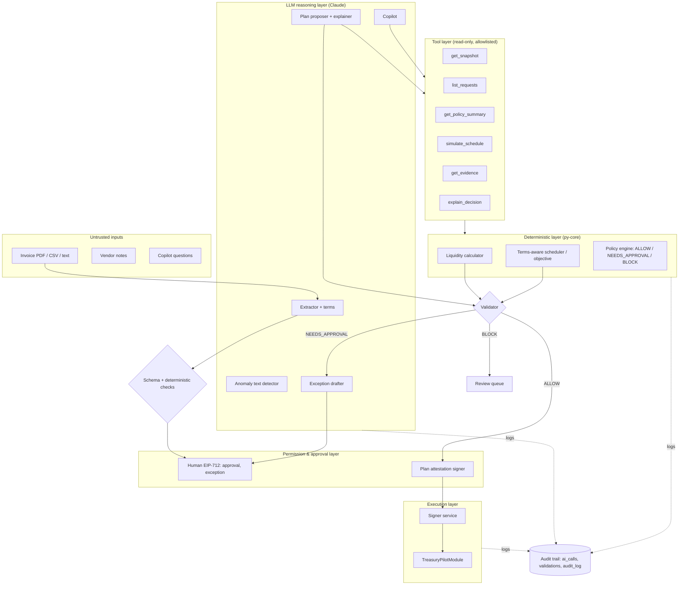

# TreasuryPilot: AI Agent Architecture

**Status:** Draft for gate G2 · **ADR:** ADR-005 · **Rules:** BR-002, BR-034, BR-055–058, BR-070, BR-092

> **The rule:** the LLM never decides anything that moves money by itself. It **observes** through read-only tools, **reasons** and **recommends** in a strict schema, and may **choose among options deterministic code has already validated**. Authority comes only from three sources:
> - the policy engine (deterministic);
> - human EIP-712 signatures (approvals, exceptions);
> - the smart contract (final check).

## 1. Layers

| Layer | Owns | Never does |
|---|---|---|
| **LLM reasoning** | Extraction, term parsing, anomaly text detection, plan ordering proposals, rationales, exception drafts, Copilot answers | Compute amounts, assert balances or permissions, write calldata, call write APIs, see secrets |
| **Deterministic business logic** (`py-core`) | Shortage/refill math, scheduler objective, feasibility, minOut, fingerprints | Depend on LLM output for numbers |
| **Policy engine** | ALLOW / NEEDS_APPROVAL / BLOCK + reason codes; attestation building | Grant exceptions, raise limits |
| **Tool layer** | 6 read-only tools with typed I/O, org-scoped, budgeted | Any side effect |
| **Permission layer** | RBAC, maker-checker, approver set, mandate | Rely on AI confidence (BR-058) |
| **Validation layer** | Pydantic schemas for every LLM output; reference integrity (request ids exist, evidence ids exist); objective scoring | Auto-repair bad AI output by loosening policy (BR-056) |
| **Human approval** | Whether to pay (approval); over-cap (exception); policy, payees, pause | — |
| **Audit trail** | `ai_calls`, `validations`, `audit_log`, evidence bundles | — |

## 2. AI actions and their control loop

Each AI-involved action follows **Observe → Reason → Policy Check → Decide → Act → Verify → Recover**.

### A1. Invoice intelligence (F-031, F-035, F-036)

| Stage | What happens | Who |
|---|---|---|
| Observe | The document is stored. Content is sent as a labelled `untrusted_document` block. Vendor history is pulled deterministically. | System |
| Reason | Extract fields, payment terms and suspicious instructions into `InvoiceExtraction` (schema), with page/span provenance. | LLM (small model) |
| Policy check | Schema valid. Amount precision ok. Asset = payment stablecoin. Address compared to the registry by **checksum equality** (deterministic). Fingerprint computed. Statistical outlier check. | Deterministic |
| Decide | Draft fields + flags. **No decision on payment.** | — |
| Act | Create the Draft (no money). | System |
| Verify | The Operator confirms every field and the terms. The Approver acknowledges high flags. | Human |
| Recover | Timeout/error → manual entry with the document shown; flags fall back to deterministic only, with a coverage note. | System |

Financial consequence: **none directly.** Money moves only after a human approval signature.

### A2. Plan proposal (F-052, F-053, F-054)

| Stage | What happens | Who |
|---|---|---|
| Observe | Fresh snapshot (F-050); approved requests with confirmed terms; budgets; mandate. | Deterministic + tools |
| Reason | Propose ordering, deferrals and exception needs, plus a rationale citing evidence ids (`PlanProposal` schema). | LLM (strong model) |
| Policy check | Scheduler scores the AI proposal and the deterministic plan under BR-052. The validator checks each candidate (BR-010 …). | Deterministic |
| Decide | Pick the best **feasible, valid** plan. Record `planner_source` and `chosen_reason`. | Deterministic (AI choice only wins if valid and better) |
| Act | Attest the plan → signer → module calls. | Policy engine, signer, contract |
| Verify | Receipts, post-conditions, re-read state after each step. | Deterministic |
| Recover | AI timeout → rule-based template (BR-055). Invalid AI plan → NeedsReview (BR-056). Tx unknown → recovery (F-080). | System |

Financial consequence: **yes.** Controls:

| Control | Implementation |
|---|---|
| Mandate | On-chain mandate version in force (F-021) |
| Limit | Per-request and daily UTC counters, buffer (F-023, F-024) |
| Approval policy | Each PAY needs an Approver signature. Over-cap needs the Owner's exception. |
| Audit evidence | `ai_calls` + `validations` + `attestations` + `operations` + `transactions` → evidence bundle |

### A3. Exception drafting (F-057)

| Stage | What happens |
|---|---|
| Observe | The validator says NEEDS_APPROVAL because of `OVER_PER_REQUEST_LIMIT`; daily budget remaining; terms/deadline. |
| Reason | The LLM writes a justification and lists alternatives. The numbers are injected from the engine, never generated. |
| Policy check | A post-check asserts that every number in the text equals the engine values (regex extraction + compare). |
| Decide | — (the AI does not decide) |
| Act | Create a review item for the Owner. |
| Verify | The Owner signs or rejects; the contract enforces BR-040/041/042. |
| Recover | LLM down → template text. |

### A4. Copilot (F-090)

| Stage | What happens |
|---|---|
| Observe | Question + role-scoped context. |
| Reason | Tool loop (max 6 calls) using `simulate_schedule` for what-ifs. |
| Policy check | Output schema `{answer, citations[]}`; every number must appear in a cited tool output (post-check). |
| Decide / Act | None. No write tools. Requests to "pay" are refused with a link to the approval flow. |
| Verify | The audit log shows zero side effects. |
| Recover | Timeout → "AI unavailable" + the deterministic dashboard. |

### A5. Anomaly explanation and discrepancy summaries (F-071, F-072)
Recommend-only text attached to review items, labelled as "AI explanation".

## 3. Tool contracts

| Tool | Input | Output | Notes |
|---|---|---|---|
| `get_snapshot` | treasuryId | balances, counters, buffers, mandate summary, coverage, blockNumber | The latest COMPLETE snapshot only |
| `list_requests` | treasuryId, statuses[] | requests with confirmed terms, deadlines, amounts | No raw documents |
| `get_policy_summary` | treasuryId | Human-readable limits, paths, payees (labels + short address) | |
| `simulate_schedule` | treasuryId, overrides{defer[], include[], date} | Engine output: feasible schedule, savings, binding constraints | Pure simulation |
| `get_evidence` | evidenceId | Stored evidence record | Id must belong to the org |
| `explain_decision` | planId or validationId | Validator reason codes + checks | |

Tool budgets: max 8 calls per planning cycle, 6 per Copilot turn; payload size caps; per-org daily token budget (`AI_BUDGET_EXCEEDED`).

## 4. Prompt-injection defenses (F-091)

1. **Separation:** system prompt (static, versioned) ≠ untrusted content. Untrusted text is wrapped in tags with a source label and length cap. Active content (links, scripts) is stripped.
2. **Least privilege:** only read tools. No URL fetching. No free-form calldata.
3. **Schema-locked outputs:** Pydantic models with `extra="forbid"`; enums for actions; ids validated against the DB.
4. **Deterministic verification:** addresses, amounts and payees are compared by code, never by the LLM. Validator + contract re-check.
5. **Detection as signal:** instruction-like text becomes a flag, never an action.
6. **Red-team suite:** 20+ crafted invoices (address swap, "pre-approved", limit raise, homoglyph address, hidden text) → expect 0 field or policy changes (NFR-SEC-06).

## 5. Model routing & operations

| Task | Model class | Timeout | Fallback |
|---|---|---|---|
| Extraction / terms / anomaly text | small, fast Claude model | 20 s | manual entry |
| Plan proposal / rationale | strongest available Claude model | 20 s | rule-based template (BR-055) |
| Exception draft | strong | 15 s | template text |
| Copilot | strong | 30 s (streamed) | "AI unavailable" |

Model ids, prompt versions and budgets live in `services/worker/agent/config.yaml`. Every call writes `ai_calls` (F-093). If the log write fails, the action fails closed.

## 6. Evaluation (F-092)

| Suite | Size | Metric | Gate (M1) |
|---|---|---|---|
| Extraction accuracy | 30 labelled invoices | field-level exact match; terms F1 | report (target ≥ 90% on core fields) |
| Planner benchmark B1 vs B2 | ≥ 30 scenarios (dev/held-out split) | stablecoin saved, on-time %, exceptions, tx count, fees, **violations = 0**, latency, cost | violations must be 0; savings reported honestly |
| Red-team | 20 invoices | successful manipulations | 0 |
| Copilot numeric fidelity | 20 questions | numbers match the engine | 100% |

Datasets and ground truth are authored by the advisors (epic "Domain & Evidence") and versioned in `evals/`.
