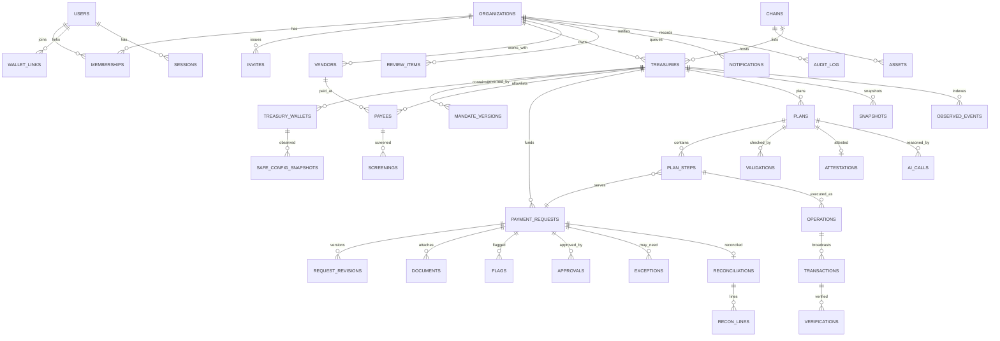

# TreasuryPilot: Data Model

**Status:** Draft for gate G2 · **Store:** PostgreSQL 16 (ADR-004) · **Money:** `NUMERIC(78,0)` base units (ADR-014)

## Conventions

- **Primary keys:** `id UUID` (v7, time-ordered).
- **Tenancy:** every tenant-owned table has `org_id UUID NOT NULL` (FK `organizations.id`) and a composite index starting with `org_id`. Repositories always filter by `org_id` (BR-093).
- **Audit fields** on mutable tables: `created_at`, `created_by`, `updated_at`, `updated_by`, `version INT` (optimistic lock).
- **Immutable tables:** `audit_log`, `ai_calls`, `mandate_versions`, `approvals`, `observed_events` and `verifications` are append-only. No `updated_*` fields, and a DB trigger blocks UPDATE/DELETE.
- **Chain identifiers:**
  - `chain_id INT`
  - addresses `BYTEA(20)`, stored lowercase and checksummed in the API
  - `tx_hash BYTEA(32)`
- **State columns** are Postgres enums mirroring `FEATURES.md` (F-039) and `SYSTEM_ARCHITECTURE` §6.

## 1. Entity overview (ER)

## 2. Tables

### 2.1 Identity (M01)

| Table | Key columns | FKs | Indexes / constraints |
|---|---|---|---|
| `users` | id, email (citext), display_name, status | — | unique(email) |
| `sessions` | id, user_id, token_hash, created_at, expires_at, last_seen_at, ip_hash, ua_hash, revoked_at | users | idx(user_id), unique(token_hash) |
| `magic_links` | id, email, token_hash, expires_at, used_at | — | unique(token_hash) |
| `wallet_links` | id, user_id, address, chain_family='evm', is_contract, linked_at, unlinked_at | users | **unique(address) where unlinked_at is null** |
| `siwe_nonces` | nonce, user_id, expires_at, used_at | users | pk(nonce) |
| `organizations` | id, name, legal_name, country, display_tz, solo_mode, created_* | — | |
| `memberships` | id, org_id, user_id, roles text[], status | orgs, users | unique(org_id,user_id) |
| `invites` | id, org_id, email, roles[], token_hash, expires_at, accepted_at | orgs | unique(token_hash) |

### 2.2 Treasury & chain (M02)

| Table | Key columns | FKs | Indexes |
|---|---|---|---|
| `chains` | chain_id (pk), name, is_testnet, confirmations, explorer_url, rpc_urls jsonb, enabled | — | |
| `assets` | id, chain_id, address, symbol, decimals, issuer_label, is_test, is_native | chains | unique(chain_id,address); one native asset per chain |
| `deployments` | id, chain_id, name, address, code_hash, version | chains | unique(chain_id,name,version) |
| `treasuries` | id, org_id, chain_id, asset_id (payment stablecoin), module_address, status, coverage enum, coverage_ack_by/at | orgs, chains, assets | idx(org_id) |
| `treasury_wallets` | id, treasury_id, chain_id, role enum(SOURCE,OPERATIONAL), label, safe_address, owners jsonb, threshold | treasuries | unique(chain_id,safe_address) |
| `safe_config_snapshots` | id, wallet_id, block_number, block_hash, owners, threshold, modules[], guard, observed_at | wallets | idx(wallet_id, block_number desc) |

### 2.3 Mandate, payees, exceptions (M03)

| Table | Key columns | Notes |
|---|---|---|
| `mandate_versions` | id, treasury_id, version, onchain_version, status enum(Draft,PendingActivation,Active,Superseded,Expired,Revoked,Discrepancy), config jsonb (full mandate), config_hash, governance_tx_id, valid_from, expires_at, created_by, activated_at | **Immutable rows** except status/onchain_version/activated_at (and governance_tx_id while Draft); only a Draft can be deleted; a trigger enforces this. Status transitions recorded in `mandate_status_events`. unique(treasury_id,version). Paused is a treasury status (docs/modules/mandate §5.1) |
| `mandate_status_events` | id, mandate_version_id, from, to, tx_hash, at, by | append-only |
| `vendors` | id, org_id, name, normalized_ref, tax_id (encrypted) null, contact (encrypted), notes, created_by | unique(org_id, normalized_ref); PII is Confidential (F-113); M05-D2 |
| `payees` | id, treasury_id, vendor_id, label, address, status enum(Proposed,Screening,ScreeningFailed,AwaitingOwner,Cooling,Active,Deactivated), active_from, oob_verified_by/at, oob_method, oob_note, registration_tx_id, deactivated_at | unique(treasury_id,address) where status≠Deactivated; see docs/modules/mandate §4 |
| `screenings` | id, payee_id or address, provider, result enum(CLEAR,HIT,ERROR), source_ref, checked_at, ttl_until | idx(address, checked_at desc) |
| `exceptions` | id, request_id, mandate_onchain_version, amount, payee, expiry, status enum(Requested,Proposed,Granted,Consumed,Expired,Invalidated,Rejected,Revoked), governance_tx_id, draft_ai_call_id, reason | unique(request_id) where status in (Proposed, Granted) |
| `governance_txs` / `governance_signatures` | Safe transactions built by the app and owner signatures (M03-D1) | see docs/modules/mandate §4 |
| `guardian_setups`, `treasury_fee_policies`, `fee_acceptances`, `backend_pause` | Guardian Safe + sentinel, fee policy (M03) | see docs/modules/mandate §4 |

### 2.4 Invoices & requests (M05)

| Table | Key columns | Notes |
|---|---|---|
| `payment_requests` | id, org_id, treasury_id, vendor_id, payee_id, invoice_no, issue_date, due_at, amount, asset_id, paying_wallet_id, terms jsonb (confirmed), terms_hash, terms_confirmed_by/at, fingerprint, invoice_hash, onchain_request_id, source enum(MANUAL,UPLOAD,CSV,RECURRING), extraction_confirmed_by/at, status enum (F-039), current_revision, created_by, last_edited_by, note, tags[], cost_center, cancel_onchain enum(NotNeeded,Pending,Confirmed), cancel_tx_hash, version | unique(treasury_id, fingerprint) where status ∉ (Rejected, Cancelled, Expired); recurring rows are Draft and follow the normal approval path; details in docs/modules/invoices §4 |
| `recurring_payment_schedules` | id, org_id, treasury_id, vendor_id, payee_id, asset_id, paying_wallet_id, invoice_no_template, amount numeric(78,0), terms, note, tags, cost_center, cadence, interval, period_index, start_date, next_period, end_date, due_days_after_issue, status, created_by, last_edited_by, version | Operator-managed template; amounts stay integer base units; period index preserves the start-date day when clamping short months |
| `recurring_payment_periods` | id, schedule_id, period_date, request_id, status(Generated,Skipped), skipped_by/at, created_at | unique(schedule_id, period_date) and unique(request_id); durable idempotency and skip history |
| `request_revisions` | id, request_id, revision, snapshot jsonb, edited_by, at | Edits invalidate approvals (BR-003) |
| `documents` | id, request_id, storage_key, sha256, mime, size, pages, uploaded_by | file in S3 (private) |
| `extractions` | id, document_id, ai_call_id, fields jsonb (with provenance), terms jsonb, confirmed_by, confirmed_at | |
| `flags` | id, request_id, revision, code, severity enum(LOW,HIGH), evidence jsonb, source enum(DETERMINISTIC,AI), status enum(Open,Acknowledged,Superseded), acknowledged_by/at, ack_note | recomputed per revision |
| `approvals` | id, request_id, revision, approver_user_id, approver_address, typed_data jsonb, signature, acknowledged_flag_ids uuid[], solo_mode, expires_at, status enum(Valid,Invalidated,Expired,Cancelled) | immutable except status |
| `csv_imports` | id, org_id, treasury_id, file_sha256, rows_total, rows_created, errors jsonb, created_by, at | F-032 |
| `request_status_events` | id, request_id, from, to, by, reason, at | append-only |

### 2.5 Planning & AI (M07–M09)

| Table | Key columns | Notes |
|---|---|---|
| `snapshots` | id, treasury_id, block_number, block_hash, observed_at, data jsonb (balances, counters, payees, mandate), coverage, missing jsonb | referenced by plans |
| `plans` | id, treasury_id, snapshot_id, planner_source enum(AI,RULE_BASED,DETERMINISTIC), chosen_reason, objective_score jsonb, status enum(Proposed,Validated,Rejected,Attested,Executing,Completed,PartiallyCompleted,Aborted), plan_hash | idx(treasury_id, created_at desc) |
| `plan_steps` | id, plan_id, seq, step_id (bytes32, deterministic), request_id, action enum(REFILL,PAY,SWAP), from_wallet, to_address, amount, params jsonb, status | unique(step_id) |
| `validations` | id, plan_id, step_id null, decision enum(ALLOW,NEEDS_APPROVAL,BLOCK), reason_codes text[], checks jsonb, policy_version | append-only |
| `attestations` | id, plan_id, typed_data jsonb, signature, nonce, valid_until | unique(nonce) |
| `ai_calls` | id, org_id, purpose enum(EXTRACT,TERMS,ANOMALY,PLAN,EXPLAIN,EXCEPTION_DRAFT,COPILOT,EVAL), model, prompt_version, input_refs jsonb (untrusted-input sources, no text), tool_calls jsonb (result previews), output jsonb, validation_result enum(OK,SCHEMA_ERROR,POSTCHECK_FAILED,REJECTED)?, latency_ms, input_tokens, output_tokens, cost_usd_micros, error? (preview), created_at | **AI decision history**, append-only; validation_result or error is set |
| `copilot_threads` / `copilot_messages` | id, org_id, user_id / thread_id, role, content, ai_call_id | |

### 2.6 Execution & chain (M06, M10)

| Table | Key columns | Notes |
|---|---|---|
| `operations` (**outbox**) | id, treasury_id, plan_step_id, request_id, step_id, kind, payload jsonb, idempotency_key, status enum(NotSubmitted,Submitted,Pending,Confirmed,Reverted,Unknown,Abandoned), attempts, last_error, created_at | unique(step_id); idx(treasury_id,status) |
| `transactions` | id, operation_id, chain_id, tx_hash, nonce, from_address, replaced_by_tx_id, status, block_number, block_hash, gas_used, effective_gas_price, fee_wei, submitted_at, confirmed_at | unique(chain_id,tx_hash) |
| `observed_events` | id, treasury_id, chain_id, block_number, block_hash, tx_hash, log_index, event_name, payload jsonb, observed_at, removed (reorg) | unique(chain_id,tx_hash,log_index) |
| `index_cursors`, `token_movements`, `rpc_health` | Indexer cursors, classified asset transfers (BR-069), provider health (M06) | see docs/modules/chain-reader §4 |
| `verifications` | id, operation_id, expected jsonb, observed jsonb, result enum(PASSED,DISCREPANCY,UNKNOWN), at | |
| `gas_ledger` | id, treasury_id, transaction_id, fee_wei, payer_address, reverted | for F-066 |

### 2.7 Reconciliation, recovery, notifications, audit (M11–M15)

| Table | Key columns | Notes |
|---|---|---|
| `reconciliations` | id, request_id, status enum(NotReady,Pending,Matched,Discrepancy), matched_by, matched_at, note | unique(request_id) |
| `recon_lines` | id, reconciliation_id, transaction_id, classification enum(INTERNAL_TRANSFER,CONVERSION,EXTERNAL_EXPENSE,FEE), amount, asset_id | |
| `chain_attestations` | id, request_id, schema_uid, attestation_uid, tx_hash | F-074 |
| `review_items` | id, org_id, treasury_id, request_id, plan_id, type enum(POLICY_BLOCK,NEEDS_AUTHORITY,UNCERTAIN_TX,DISCREPANCY,AI_REJECTED,INFRA), reason_codes[], completed_steps jsonb, assigned_role, status enum(Open,Resolved,Dismissed), sla_due_at, resolved_by/at, resolution | one open item per (request, type) |
| `circuit_events` | id, treasury_id, rule, details, action enum(ALERT,PAUSE), at | |
| `notifications` | id, org_id, user_id, event_type, event_id, payload, read_at | unique(user_id,event_id) |
| `notification_channels` | id, user_id, kind enum(TELEGRAM,EMAIL,WEBHOOK), target (encrypted), verified_at, show_amounts | |
| `audit_log` | id (bigserial), org_id, at, actor_type enum(USER,SYSTEM,AI,CONTRACT), actor_id, action, entity_type, entity_id, data jsonb, prev_hash, hash | **hash chain** per org; append-only |
| `evidence_bundles` | id, org_id, request_id/scenario_id, storage_key, sha256, created_at | |

### 2.8 Platform (M18)
`platform_settings`, `billing_*` (Later), `api_keys` (Later: id, org_id, scopes[], key_hash).

## 3. Event history & AI decision history

- **Domain events** are derived from the `*_status_events`, `validations`, `ai_calls`, `operations`/`transactions` and `audit_log` tables. Together they reconstruct any request's full timeline. Evidence bundles (F-121) are built from these joins.
- **AI decision history:** every plan references the `ai_calls` that produced or explained it, and the validation that accepted or rejected it. `plans.planner_source` and `chosen_reason` record why the AI or the deterministic plan won (FR-407).

## 4. Key indexes and integrity constraints

| Constraint | Purpose (BR) |
|---|---|
| `payment_requests (treasury_id, fingerprint)` partial unique | Duplicate invoice (BR-071) |
| `plan_steps.step_id` unique, `operations.step_id` unique | No duplicate execution step (BR-061) |
| `attestations.nonce` unique | Replay (BR-059) |
| `wallet_links.address` partial unique | One user per address (FR-006) |
| `exceptions` one Granted per request | BR-041 |
| `audit_log` hash chain + no-update trigger | BR-097 |
| `CHECK (amount >= 0)` on all amount columns | ADR-014 |

## 5. Retention & classification

| Class | Examples | Handling |
|---|---|---|
| Secret | session tokens, keystore password | never stored in plain text; not logged |
| Confidential | invoice files, vendor contacts, Telegram chat ids | encrypted at rest; signed URLs; redacted in logs |
| Internal | requests, plans, ai_calls | tenant-scoped |
| Public | on-chain hashes, events | already public |
