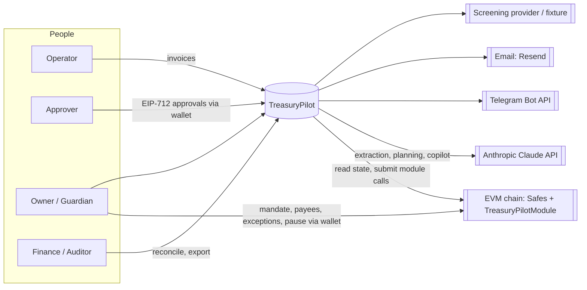
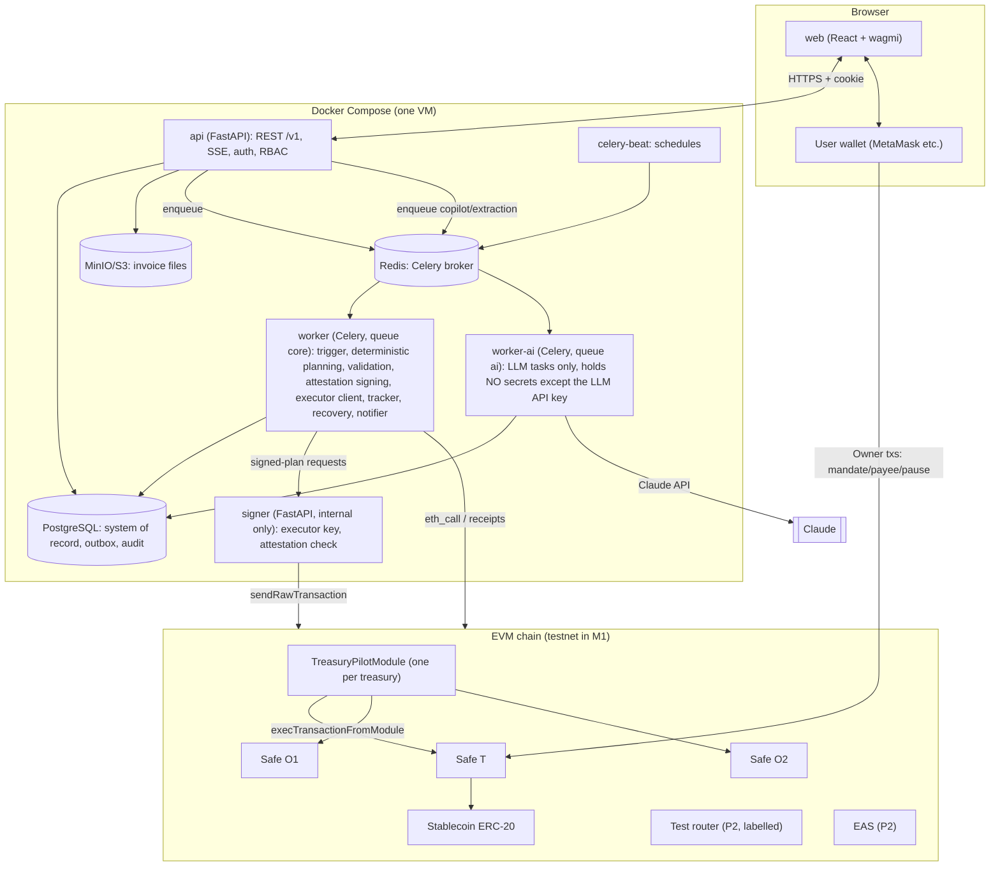

# TreasuryPilot: System Architecture

**Status:** Draft for gate G2 · **Date:** 2026-10-11
**Read with:** `TECH_STACK.md`, `AI_AGENT_ARCHITECTURE.md`, `DATA_MODEL.md`, `API_SPEC.md`, `docs/adr/`, `docs/modules/`.

## 1. Architectural principles

| # | Principle | Consequence |
|---|---|---|
| AP-1 | **The contract is the final authority over money.** | Every C-rule in `BUSINESS_RULES.md` is checked in `TreasuryPilotModule`; the backend mirrors the checks but is never trusted alone. |
| AP-2 | **AI proposes; deterministic code decides; humans authorize.** | The LLM has read-only tools only. Amounts come from `py-core`. Approvals and exceptions are human EIP-712 signatures. |
| AP-3 | **Keys live in exactly one place.** | Owner keys stay in users' wallets. The executor key lives only in `signer`. The policy attestation key lives only in `worker` (core). **All LLM calls run in `worker-ai`, which holds no signing secrets** (it has only the LLM API key and read-only DB credentials for the tables it needs). |
| AP-4 | **Write before you act; never guess outcomes.** | Transactional outbox in Postgres. Unknown ≠ failed. Recovery happens before new work. |
| AP-5 | **Modular monolith off-chain.** | One API, one worker codebase and one shared core package. Boundaries are enforced by module structure, not by network calls (except `signer`). |
| AP-6 | **Evidence by construction.** | Every decision, AI call, transaction and verification is recorded with ids that join into an evidence bundle. |

## 2. Context



## 3. Containers



**Trust boundaries**

| Boundary | Crossed by | Control |
|---|---|---|
| Browser ↔ API | User actions | Session cookie, CSRF token, RBAC, rate limit |
| API/worker ↔ LLM | Prompts with labelled untrusted data | Read-only tools, schemas, validator after (AI_AGENT_ARCHITECTURE) |
| worker ↔ signer | Attested step payloads | mTLS/shared secret on the internal network; signer re-verifies the attestation and policy hash; no other endpoint |
| signer ↔ chain | Raw transactions | Only `TreasuryPilotModule` typed entry points |
| Module ↔ Safe | `execTransactionFromModule` | Module-level checks (BR C-rules); no generic execute |
| Owner wallet ↔ Safe | Governance transactions | Owner's own signature, outside TreasuryPilot |

## 4. Off-chain components (modules)

Full specs are in `docs/modules/`. Mapping:

| Module | Runs in | Responsibility |
|---|---|---|
| M01 identity | api | Accounts, sessions, SIWE, orgs, members, RBAC, maker-checker |
| M02 treasury | api, worker | Treasuries, Safes, coverage, asset registry, chain config |
| M03 mandate | api, worker | Mandate drafts and versions, payees, exceptions, pause/resume (off-chain side) |
| M04 contracts | chain | TreasuryPilotModule, tUSDC, test router, deploy scripts |
| M05 invoices | api | Intake, requests, fingerprints, approvals, state machine |
| M06 chain-reader | worker (+api reads) | Snapshots, tx tracking, reorg handling, event indexing |
| M07 financial-engine | py-core | Liquidity calculator, terms-aware scheduler, forecast |
| M08 policy-engine | py-core + worker | Validation decisions, attestation building |
| M09 agent | worker, api | LLM adapter, extraction, terms, anomalies, planner, exception drafts, Copilot, eval |
| M10 execution | worker + signer | Trigger, sequential executor, signer, gas, swap |
| M11 reconciliation | worker, api | Post-conditions, reconciliation, export, attestations |
| M12 recovery | worker | Unknown recovery, partial completion, review queue, retries, circuit breaker |
| M13 notifications | worker, api | In-app, Telegram (email/webhooks Later) |
| M14 compliance | worker, api | Screening adapter, data classification (KYB/Travel Rule Later) |
| M15 audit | all | Hash-chained audit log, evidence bundles, coverage labels |
| M16 web | browser | All UI |
| M17 observability & analytics | all | Logs, metrics, traces, ops metrics, savings |
| M18 admin & billing | api | Platform config (M1); tenant admin, billing (Later) |
| M19 devex & quality | repo/CI | Compose, CI, scenario runner, security suites, reliability |
| M20 domain & evidence | people | Datasets, scenarios, threat review, interviews, deck (non-code) |

## 5. On-chain design (summary; details in `docs/modules/contracts/`)

**One `TreasuryPilotModule` per treasury**, enabled on Safes T, O1 and O2. It stores:
- mandate (version, status, expiry, limits, buffers, paths, executor);
- payee allowlist with `activeFrom`;
- approver set;
- counters `(action, asset, day)`;
- used request ids, step ids and fingerprints;
- exception nonces.

| Entry point | Caller | Checks (BR) |
|---|---|---|
| `configureMandate(...)`, `setApprovers`, `addPayee`, `deactivatePayee`, `resume`, `revoke` | The Safe T itself (Owner governance via Safe tx) | owner path only; version++ (BR-015/016) |
| `pause()` | Safe T or Guardian address | idempotent (BR-064) |
| `refill(PaymentApproval approval, bytes approverSig, stepId, toWallet, amount)` | executor | active, not paused, path allowed, refill limits, `F_T` buffer, step unused, **valid approval signature for the request being funded** and `toWallet` = the approval's paying wallet (BR-010/012/023/030) |
| `pay(PaymentApproval approval, bytes approverSig, stepId)` — exceptions are granted beforehand by Safe T governance (M04-D3); the plan attestation is checked by the signer, not on-chain (M08) | executor | EIP-712 approval valid & approver in the current set; payee active (cooling over); fingerprint and request unused; per-request limit or valid exception; daily limit; buffer after; not paused, not expired (BR-001/003/004/013/022/024/030/040–042/071) |
| `swapForGas(...)` (P2) | executor | router/pair allowlist; swap budget; minOut; exact allowance → 0 (BR-081/082) |

No generic `execute`. No `delegatecall`. No owner or module changes from the module.

## 6. Key runtime flows

### 6.1 Autonomous payment (J4)

```mermaid
sequenceDiagram
  autonumber
  participant B as celery-beat
  participant W as worker
  participant DB as Postgres
  participant R as chain-reader
  participant E as financial-engine
  participant A as agent (Claude)
  participant P as policy-engine
  participant S as signer
  participant M as TreasuryPilotModule
  B->>W: tick (treasury T1)
  W->>DB: pg_advisory_xact_lock(T1); check paused/coverage/unknown ops
  W->>R: snapshot @block N
  W->>E: shortages, refill amounts, terms-aware schedule
  W->>A: propose plan (read-only tools, schema)
  A-->>W: plan proposal + rationale + evidenceIds
  W->>E: score proposal vs deterministic plan
  W->>P: validate plan → ALLOW / NEEDS_APPROVAL / BLOCK
  alt ALLOW
    W->>P: build attestation (planHash, nonce, expiry)
    W->>DB: INSERT operation (outbox, status NotSubmitted)
    W->>S: sign step (payload + attestation)
    S->>S: verify attestation & policy hash
    S->>M: refill(...) / pay(...)
    S-->>W: txHash
    W->>DB: operation Submitted(txHash)
    W->>R: track receipt → Confirmed after N blocks
    W->>R: re-read state, verify post-conditions
    W->>DB: request Paid, reconciliation Pending, audit + evidence
  else NEEDS_APPROVAL
    W->>A: draft exception request
    W->>DB: review item → Owner notified
  else BLOCK
    W->>DB: review item with reason codes
  end
```

### 6.2 Recovery on restart (J6)
1. Worker start → load operations with status in {NotSubmitted, Submitted, Pending, Unknown}.
2. For each one: look up the txHash receipt, then the nonce, then the module's `requestUsed`/`stepUsed`.
3. Resolve to Confirmed, Reverted or still Pending. If never broadcast → re-submit with the **same** ids.
4. Until every operation for a treasury is resolved, its trigger is skipped (BR-060).

### 6.3 Approval (J3)
Web builds the EIP-712 `PaymentApproval` from the API → the wallet signs → the API verifies the signature, maker-checker and the current approver set → stores it → state `Approved`. The contract re-verifies at PAY.

## 7. Cross-cutting concerns

| Concern | Approach |
|---|---|
| Idempotency | API `Idempotency-Key` header; operation ids; on-chain used-flags (three layers, GA p.29) |
| Concurrency | Per-treasury advisory lock; optimistic locking (`version` column) on requests |
| Time | All timestamps UTC. Daily limits use block time. Display uses the org timezone. |
| Money | Integers in base units (`NUMERIC(78,0)` in DB, `int` in Python, `bigint` in TS) |
| Config | Pydantic settings; chain manifest `deployments/<chain>.json` checked in |
| Secrets | `.env` (local); Docker secrets on the VM; signer keystore password separate |
| Realtime | SSE stream `/v1/events` per org (plan/operation/notification events) |
| Errors | RFC 9457 problem+json with stable `code` values matching validator reason codes |
| i18n | UI strings externalized (EN in M1) |

## 8. Deployment (M1)

Compose services: `web` (nginx serving the static build), `api`, `worker` (core queue, holds the policy attestation key), `worker-ai` (ai queue, no signing secrets), `beat`, `signer`, `postgres`, `redis`, `minio`, optional `anvil` (local profile), `flower` (ops). Only `web` and `api` are exposed through a reverse proxy with TLS. `signer`, `postgres`, `redis` and `minio` stay on the internal network only.

Profiles: `local` (Anvil + seeded scenario) · `testnet` (chain RPCs from env) · `ci`.

## 9. Production evolution (Later)

- Signer → KMS-backed.
- Managed Postgres (point-in-time recovery).
- Horizontal workers partitioned by treasury.
- Multi-chain treasuries.
- An external contract audit before mainnet.
- KYB/KYT/Travel Rule providers.
- ERP integrations.
- Email and webhooks.
