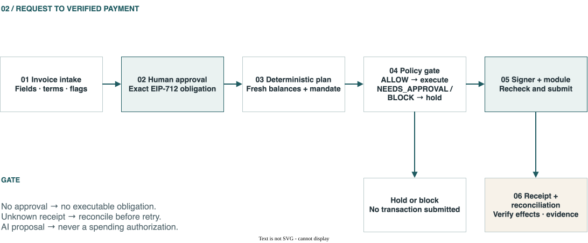
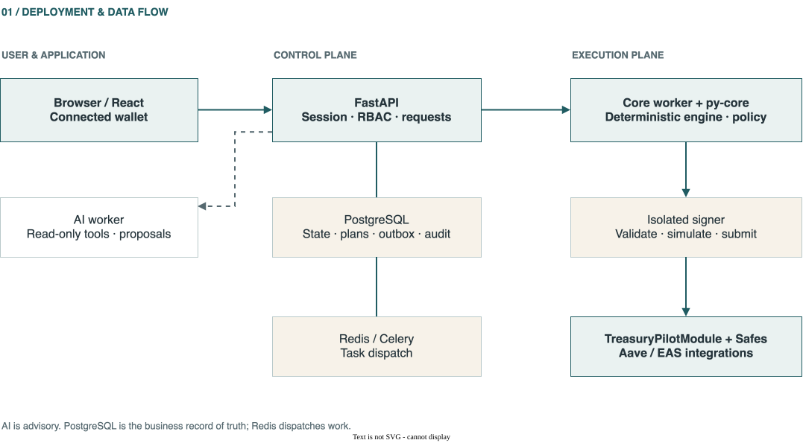
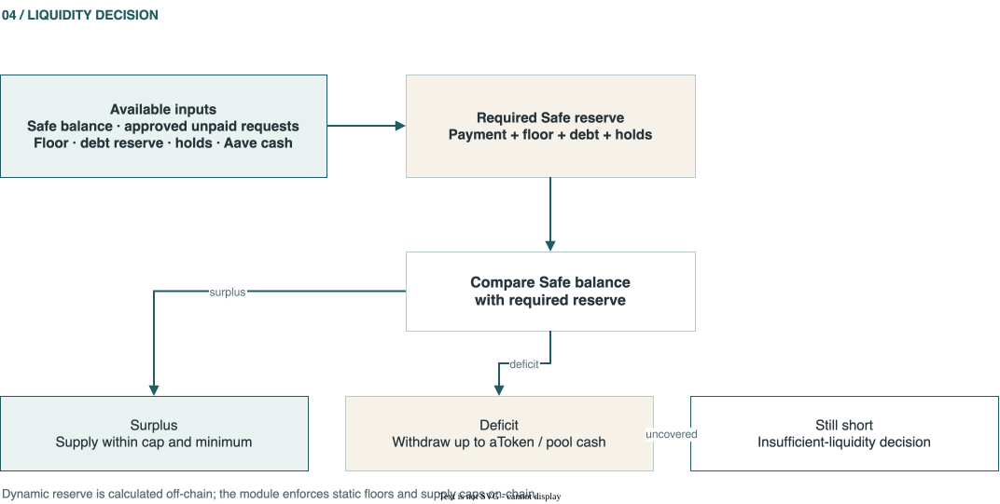
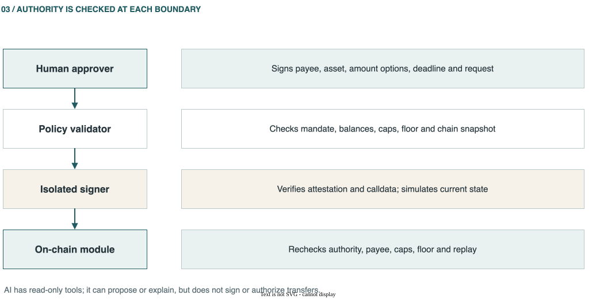
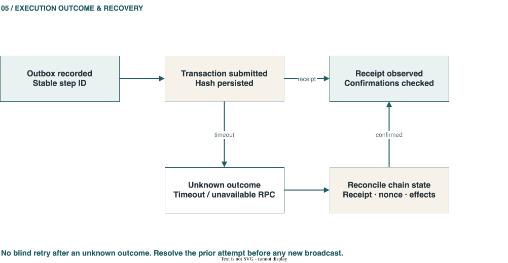

# TreasuryPilot — Technical Report & Documentation Hub

> **Reviewed:** 16 October 2026 · **Code baseline:** commit `50b1117` · **Sources:** the current repository and the [TreasuryPilot Google Doc](https://docs.google.com/document/d/1nkSIU5c-zouBkKooWjEFshxw61pH0CRwugYDy5AFJBo/edit), particularly tabs 8, 11, 13, 36 and 37. Historical measurements are identified by their date and environment.

**TL;DR — What does TreasuryPilot do?** TreasuryPilot receives invoices, requires an authorized person to confirm and approve the exact payment obligation, schedules payment, moves liquidity between an organization's own Safe wallets, executes through a constrained on-chain module, tracks the receipt, and reconciles the result. AI reads documents, proposes actions and explains decisions. Human signatures, deterministic policy checks, a separate signer and the smart contract control the movement of funds.

**How to read implementation status:** **Present in code** means a concrete implementation path exists. **Local evidence** means a test or report covers local/fork execution. **Sepolia configuration** means a deployment manifest contains addresses and verification metadata, without proving every end-to-end scenario. **Design or pending verification** means the intended behavior is documented or partly implemented but lacks evidence for a complete operational claim. Some repository READMEs and submission drafts describe older revisions; this report favors current code and dated evidence.

## 01 · Getting started

### 1.1 Problem and product boundary

The primary users are finance and treasury operators, payment approvers and company owners paying vendors in stablecoins. An approved invoice can still be late because the operational wallet lacks the right token or gas while the treasury wallet has funds. Moving funds manually, monitoring limits and assembling proof of payment are error-prone. Delegating an unrestricted wallet to an agent is unacceptable. The product's division of authority is: **humans decide whether to pay; the agent proposes how and when; the contract constrains what can be executed**. [Product overview](PROJECT_OVERVIEW.md) · [Google Doc overview](https://docs.google.com/document/d/1nkSIU5c-zouBkKooWjEFshxw61pH0CRwugYDy5AFJBo/edit?tab=t.0).

M1 is a synthetic-asset Sepolia evaluation, not an audited mainnet payment service. Version 0.3 adds Aave V3 supply/withdraw for genuinely idle funds, an approved early-payment amount alongside the standard amount, and borrowing proposals. Contract code also implements owner-granted borrow/repay paths as a P2 capability; their existence does not mean the M1 product autonomously borrows. [Version 0.3 decisions](vi/37-cap-nhat-v03.md) · [existing technical draft](submission/technical-documentation.md).

This boundary matters when interpreting the rest of the report: a feature can be implemented and still be unsuitable for a production claim because its provider, deployment configuration, operating procedure, or independent review is missing. The synthetic-asset evaluation does not establish custody, payment-rail, legal, or mainnet readiness.

**Follow-up questions:** Which Sepolia scenarios use synthetic assets, and which controls would change before a real-token deployment? Has the owner-granted debt path been explicitly excluded from M1 operations?

### 1.2 End-to-end value flow

[](report_site/diagrams/payment-flow.svg)

*Figure 01.1 — End-to-end payment flow · [Edit in draw.io](report_site/diagrams/payment-flow.drawio).*

1. **Set up:** create an organization and treasury, connect Safe T (treasury) and Safe O1 (operational), select chain/asset, deploy the module, and set the mandate, payees, limits and balance floors.
2. **Intake:** enter or upload an invoice, store the document privately, extract fields and payment terms, and flag duplicates or anomalies.
3. **Confirm and approve:** a person confirms significant fields; backend maker-checker and HIGH-flag rules apply; an approver signs EIP-712 typed data for the exact obligation.
4. **Plan:** load a fresh chain snapshot and unpaid obligations; the deterministic engine calculates shortages, reserves and a schedule. AI may propose a choice, while policy returns `ALLOW`, `NEEDS_APPROVAL` or `BLOCK`.
5. **Execute:** persist the outbox record, create a policy attestation, let the isolated signer verify calldata and simulate fresh state, then submit steps in order. The module checks authority, caps, floors and replay protection again on-chain.
6. **Verify:** the tracker observes receipt and chain state, the verifier checks postconditions, reconciliation connects transfers to the request, and audit/evidence records the trail. An `Unknown` outcome must be resolved before a retry.

This is the **target system-wide sequence**. Individual components have code, while completion of the entire sequence depends on environment-specific smoke and end-to-end evidence. [System flow](SYSTEM_ARCHITECTURE.md) · [worker tasks](../services/worker/src/treasurypilot_worker/tasks.py) · [execution API](../services/api/src/treasurypilot_api/execution/routes.py).

The sequence crosses durable database state, asynchronous queues, an external model, a signer, and an independently changing chain. A successful intake or plan API response says nothing by itself about payment completion. The strongest completion record joins the approved request and plan to the mined receipt and verified balance/event postconditions; retries must preserve that identity.

**Follow-up questions:** Is there a release-pinned smoke run that exercises every step in this sequence? Who handles escalation when a receipt remains unknown beyond the normal confirmation window?

### 1.3 Wallets and authority

| Actor or component | Purpose | Relevant authority |
|---|---|---|
| Safe T | Treasury wallet and mandate owner | Owner threshold governs configuration, exceptions, pause/revoke and Aave aTokens. |
| Safe O1/O2 | Operational company wallets | Receive request-bound refills and pay vendors through the module. The M1 demo uses O1; local fixtures may use O2. |
| Approver | Authorizes one payment obligation | Signs exact EIP-712 fields; this signature does not change the mandate. |
| Executor/signer | Broadcasts a checked transaction | Holds the executor key in a separate service; cannot change the payee or policy. |
| AI worker | Reads, proposes and explains | Read-only tools, no spending authority or signing key. |
| Contract module | Last gate for module-originated transfers | Checks authorization, payee, limit, floor, expiration and replay state at execution time. |

Safe owners or other enabled Safe modules can still make transactions outside TreasuryPilot. The mandate constrains the **TreasuryPilotModule path**, not every possible Safe action. [Known risk KR-02](security/known-risks.md) · [governance contract](../contracts/src/TreasuryPilotGovernance.sol).

The authority model separates business approval of an invoice, Safe-owner governance of the standing mandate, and transaction submission by the executor. A signed payment does not authorize a policy change; an owner-approved mandate does not approve a particular invoice. This separation narrows the signer’s role but still depends on protecting the owner threshold and operational access.

**Follow-up questions:** Has the deployed Safe configuration been checked for every enabled module and owner threshold? Who reviews and rotates the executor key and signer credentials?

## 02 · System architecture

### 2.1 Deployment layers

[](report_site/diagrams/system-architecture.svg)

*Figure 02.1 — Deployment layers · [Edit in draw.io](report_site/diagrams/system-architecture.drawio).*

The implementation is divided into [web](../apps/web/src/app.tsx), [API](../services/api/src/treasurypilot_api/main.py), [worker](../services/worker/src/treasurypilot_worker/tasks.py), [signer](../services/signer/src/treasurypilot_signer/main.py), pure [py-core](../packages/py-core/src/treasurypilot_core/) and [contracts](../contracts/src/). PostgreSQL is the business source of truth. Redis dispatches work; it is not a payment ledger. [Compose](../infra/compose.yaml) separates core, AI and webhook workers, beat, signer, API, web, PostgreSQL, Redis and MinIO. Anvil is a local profile.

The deterministic core is reusable by API and worker paths, while signer and contracts form distinct execution gates. Queue messages should be treated as prompts to inspect durable operation state, not as payment records. Compose describes a runnable topology; it does not establish high availability, production secret management, or that optional integrations are enabled in a deployment.

**Follow-up questions:** Which Compose services and secret sources are active in the target demo environment? Has recovery been exercised after a worker restart with an operation in flight?

### 2.2 Trust boundaries

| Boundary | Untrusted or sensitive input | Control | Remaining limitation |
|---|---|---|---|
| Invoice → AI | PDF, email, free text | Untrusted-content wrapper, instruction/secret scans, schema and human confirmation | Independent adversarial evaluation is still needed. |
| Browser → API | Session, organization ID, signature | RBAC, maker-checker, scoped queries and session checks | Every new endpoint still needs review. |
| Worker → signer | Attestation, calldata and plan | Internal secret, typed checks, fresh simulation | Shared host or database credentials remain operational risks. |
| Signer → module | Signed transaction | Contract rechecks each action | `eth_call` does not reserve future block state. |
| Chain → backend | Balances, events and receipts | Chain ID, RPC health, confirmation and reorg handling | A stale/unavailable RPC can delay or distort interim conclusions. |

See [AI architecture](AI_AGENT_ARCHITECTURE.md), [signing service](../services/signer/src/treasurypilot_signer/service.py) and [known risks](security/known-risks.md).

Controls are layered because no single boundary guarantees the full outcome: API checks protect business operations, signer checks reduce malformed or stale submissions, and contract checks protect module-originated transfers at execution. Simulation is point-in-time; chain state, RPC responses, database privileges and host isolation remain part of the trusted computing base. This table describes controls in code, not an independent penetration test result.

**Follow-up questions:** Which trust boundary has an owner and incident procedure? Are database and host compromise scenarios included in the threat model?

### 2.3 Consistency rules

- **Money uses integer base units.** API and database serialize decimal integers; Python uses strict integer types; Solidity uses `uint256`. Floating point is excluded from payment decisions. [BaseUnits](../packages/py-core/src/treasurypilot_core/money/base_units.py).
- **Time is UTC.** Daily limits use chain block time; user-facing dates may use the organization's timezone. Due-date calculations normalize to UTC days. [UTC day helpers](../packages/py-core/src/treasurypilot_core/domain/utc_days.py).
- **Write before action.** Persist the operation and stable step identity before broadcast. A timeout is unknown, not failure. [Outbox](../services/worker/src/treasurypilot_worker/executor/outbox.py).
- **Evidence is built into the flow.** A decision must be traceable to policy version, hashes, transaction, receipt and verified postcondition. [Audit evidence](../services/api/src/treasurypilot_api/audit/evidence.py).

These conventions prevent display formatting from becoming a financial input, but require validation at serialization boundaries: decimals, UTC dates and identifiers must survive API, database, queue and contract encoding without reinterpretation. Historical snapshots should retain chain/block context so later reconciliation can distinguish changed balances from the inputs to an earlier decision.

**Follow-up questions:** Are integer and time-zone invariants checked across external import/export paths? Can an operator reproduce a decision from its stored snapshot and policy version?

## 03 · Invoice and approval workflow

### 3.1 Request lifecycle

The draft/extraction state is separate from an executable obligation. Intake checks fields, payee, asset, fingerprint, terms and anomaly flags. The code exposes create/bulk, edit, terms confirmation, submit, withdraw/request changes, HIGH-flag acknowledgment, typed-data retrieval, approve, reject, cancel and renew operations. [Request routes](../services/api/src/treasurypilot_api/invoices/requests.py) · [state machine](../services/api/src/treasurypilot_api/invoices/state_machine.py) · [documents](../services/api/src/treasurypilot_api/invoices/documents.py).

Upload, API-key and inbound-email paths have implementation. The existence of an endpoint does not establish that a provider or mail integration is configured in a particular deployment. Fingerprints and near-duplicate checks address renamed/re-entered invoices, while the on-chain approval signature prevents a database `approved` flag alone from authorizing payment. [API keys](../services/api/src/treasurypilot_api/invoices/api_keys.py) · [email intake](../services/api/src/treasurypilot_api/invoices/inbound_email.py) · [fingerprint](../packages/py-core/src/treasurypilot_core/fingerprint/invoice.py).

Extraction should produce a reviewable draft, not an executable obligation. Fingerprinting helps identify likely repeats but cannot establish that semantically similar invoices are duplicates or that a unique fingerprint is legitimate. The recorded 30-invoice extraction set has labels pending independent review; it is not a production accuracy estimate.

**Follow-up questions:** Which upload and email providers are configured for the demo? How are fingerprint collisions and near-duplicate false positives surfaced to reviewers?

### 3.2 Payment signature

`PaymentApproval` binds request ID, invoice hash, fingerprint, treasury, paying wallet, asset, payee, standard amount, early amount and early deadline, terms hash, expiry, and a fiat flag. Its EIP-712 domain binds chain and module. The module checks that the current approver signed (EOA or ERC-1271), selects the correct early or standard amount for the time window and consumes the request once. Fiat-quoted requests have separate cap semantics; therefore “every payment equals one fixed integer” would be too broad. [Approval hash](../contracts/src/libraries/PaymentApprovalHash.sol) · [module pay](../contracts/src/TreasuryPilotModule.sol) · [approval API](../services/api/src/treasurypilot_api/invoices/approval.py).

Typed data gives the signer a structured obligation to inspect; its domain prevents free replay across another chain or module. It does not prove that the human saw an accurate invoice, which depends on the review interface and source document. Expiry, one-time consumption and field binding protect execution semantics, with local contract tests covering specified cases.

**Follow-up questions:** Does the approval UI render every signed field, including early-payment terms and fiat mode, in human-readable units? Are deployed approver addresses and ERC-1271 behavior covered by testnet evidence?

### 3.3 Maker-checker and fraud flags

Backend RBAC determines who creates, edits and approves a request. Maker-checker may prevent self-approval, with a distinct controlled solo mode. HIGH flags require acknowledgment or review before progression. A changed payee or signed field invalidates a stale approval. These backend controls are separate from the contract's signature verification. [Maker-checker](../services/api/src/treasurypilot_api/identity/maker_checker.py) · [RBAC](../services/api/src/treasurypilot_api/identity/rbac.py) · [risk KR-24](security/known-risks.md).

These controls reduce single-user error and make suspicious intake visible, but rely on correct role assignment, session security and flagging quality. Acknowledgment records that a reviewer handled a warning; it does not prove the underlying data is correct. Solo mode is a deliberate exception and should remain visible in audit records.

**Follow-up questions:** Is solo mode disabled or explicitly governed in the target organization? Do audit records identify the maker, checker and HIGH-flag disposition for each approved request?

## 04 · Financial engine and optimization

### 4.1 Request-bound refill

For operational-wallet balance `B`, hard floor `F`, soft target `H`, current demand `D` and other protected funds `R`:

```text
Shortage  = max(0, R + D + F - B)
Preferred = max(0, R + D + H - B)
Bound     = max(0, D + H - B)
Capacity  = max(0, SourceBalance - SourceProtected - SourceFloor)
Cap       = min(Capacity, RemainingRefillDaily, PerRefillLimit)
```

If `Shortage` is zero, the engine does not refill solely to reach the soft target. If the required amount exceeds the bound or cap, it blocks rather than funding an incomplete payment. PAY and REFILL have separate daily counters. The module additionally checks the approved request/destination, per-request refill count and exact balance deltas. [Liquidity engine](../packages/py-core/src/treasurypilot_core/engine/liquidity.py) · [module refill](../contracts/src/TreasuryPilotModule.sol) · [algorithm report](submission/technical-documentation.md).

The hard floor protects essential liquidity while the soft target avoids topping every wallet up unnecessarily. `SourceProtected` and `SourceFloor` limit what can leave the treasury; destination bounds prevent refill from becoming general-purpose funding. The recommendation is off-chain, while contract checks are the execution backstop. Divergence between calculations should fail closed and be covered by shared vectors.

**Follow-up questions:** Are floors, protected funds and daily counters consistent across UI, API, planner and deployed module? Which tests cover fee-on-transfer or rebasing tokens against the exact-delta assumption?

### 4.2 Scheduling and payment value

`schedule_edf` orders requests by UTC due day, approval sequence and request ID. It simulates up to 30 days, resets daily caps at UTC boundaries, carries balances forward and rechecks cooling, limits and refill. It returns a feasible heuristic result, **not a global optimum certificate**. `schedule_cpsat` exists with a default five-second limit and EDF fallback. Reports should state the actual algorithm, solver status and fallback mode. [EDF scheduler](../packages/py-core/src/treasurypilot_core/engine/scheduler.py) · [CP-SAT](../packages/py-core/src/treasurypilot_core/engine/cpsat.py).

The value model can account for the signed early-payment discount, transaction fee, foregone simple supply interest and late fees from confirmed terms. Valuation cannot increase PAY beyond the signed options. ADR-019 defines B0 as manual/EDF with idle cash, B1 as a deterministic optimizer and B2 as AI plus optimizer. Any comparison needs explicit fee/rate assumptions, inputs and actual algorithms. [Scoring](../packages/py-core/src/treasurypilot_core/engine/scoring.py) · [ADR-019](adr/ADR-019-aave-liquidity-and-payment-options.md).

EDF provides a deterministic, understandable baseline; optional CP-SAT can explore a constrained objective but may time out and fall back. A fair comparison holds invoice set, balances, policy limits and market assumptions fixed, and reports solver status rather than labeling every output “optimized.” The value score is a planning aid, not a guarantee of realized savings.

**Follow-up questions:** Are B0/B1/B2 results generated from the same held-out scenarios and assumptions? Does each benchmark record CP-SAT success, timeout or EDF fallback?

### 4.3 Reserves, Aave and borrowing proposals

[](report_site/diagrams/liquidity-decision.svg)

*Figure 04.1 — Liquidity decision · [Edit in draw.io](report_site/diagrams/liquidity-decision.drawio).*

```text
RequiredSafeReserve = PaymentReserve + SafeFloor + DebtServiceReserve + ExecutionHolds
AvailableForSupply  = max(0, SafeUSDC - RequiredSafeReserve)
AccessibleLiquidity = SafeUSDC + min(aUSDC, PoolAvailableUSDC)
Deficit             = max(0, RequiredSafeReserve - SafeUSDC)
WithdrawTarget      = ceil(Deficit × 105 / 100)
```

`PaymentReserve` includes approved unpaid obligations within the reserve horizon and chooses the known early amount when applicable. Supply requires a minimum amount and stays within caps. Withdraw is bounded by aToken balance and available pool cash. A remaining deficit becomes an insufficient-liquidity decision, not an automatic borrow. The module enforces a static floor and supply caps; the **dynamic reserve is computed and checked off-chain**. [Liquidity engine](../packages/py-core/src/treasurypilot_core/engine/liquidity.py) · [forecast](../packages/py-core/src/treasurypilot_core/engine/forecast.py) · [Aave contract paths](../contracts/src/TreasuryPilotModule.sol).

The 105% withdrawal target is a planning buffer, not a promise that the pool can provide that amount or that the reserve remains sufficient through execution. Aave use depends on configured pool and token addresses, aToken balances, pool cash and current protocol behavior. Local fixtures and fork tests cover specified paths; they do not establish current Sepolia liquidity. Borrow proposals remain a separate owner decision.

**Follow-up questions:** What evidence confirms pool, asset and aToken configuration at the recorded block? How are recalculation and withdrawal failure handled if liquidity changes between planning and submission?

## 05 · Policy, mandate and smart contracts

### 5.1 Three-way policy decision

[](report_site/diagrams/authority-boundaries.svg)

*Figure 05.1 — Authority boundaries · [Edit in draw.io](report_site/diagrams/authority-boundaries.drawio).*

The validator evaluates a chain snapshot, request, policy version, balances, limits, payee and plan/step, then returns `ALLOW`, `NEEDS_APPROVAL` or `BLOCK` with stable reason codes. `NEEDS_APPROVAL` is not executable until an owner grants a precisely scoped exception. Shared Python/Foundry differential vectors compare validator outcomes with contract success or revert selectors for unknown payee, cooling, pause, expiry, caps, duplicate, floor and replay cases. [Validator](../packages/py-core/src/treasurypilot_core/policy/validator.py) · [reason codes](../packages/py-core/src/treasurypilot_core/policy/reason_codes.py) · [differential report](testing/policy-contract-differential-report.md).

The validator is the explanatory off-chain decision point; the contract remains authoritative for its encoded checks when a transaction executes. Differential vectors show agreement for named cases, not exhaustive equivalence. `ALLOW` means execution may proceed to later checks, not that mining or postcondition verification is guaranteed.

**Follow-up questions:** Which policy checks are intentionally off-chain only, and what reviews them? Are differential vectors rerun and archived for the exact release candidate?

### 5.2 Mandate and governance

Safe T owner/threshold governs payees, assets, operational wallets, PAY/REFILL limits, floors, validity, pause/revoke, exceptions, Aave settings and one-time borrow/repay grants. The factory creates one module instance per treasury. Owner or guardian pause affects subsequent module actions only after the pause transaction is mined. It does not undo settled transfers or restrict direct Safe owner actions. [Governance](../contracts/src/TreasuryPilotGovernance.sol) · [factory](../contracts/src/TreasuryPilotModuleFactory.sol) · [mandate API](../services/api/src/treasurypilot_api/mandate/routes.py).

Governance changes are on-chain operations and should reconcile to the database’s mandate view. The module enforces only configuration it has received, so a UI’s intended policy is not evidence of deployed state. One-time debt grants are a separate capability and require review of asset, amount, rate and expiry.

**Follow-up questions:** Is the current UI mandate compared with on-chain storage for the target treasury? Who verifies the owner threshold and grant revocation procedure?

### 5.3 On-chain entry points

| Group | Entry points | Core condition |
|---|---|---|
| Vendor payment | `pay` | Valid approval and amount option, allowed payee, per-request/daily limits, floor, no replay. |
| Internal liquidity | `refill` | Safe T to a registered operational wallet, bounded by request need and refill limits. |
| Idle funds | `supply`, `withdraw` | Fixed pool/asset, floor/caps and exact asset-delta checks; no generic arbitrary execution. |
| P2 debt | `authorizeBorrow`, `authorizeRepay`, `borrow`, `repay` | One-time owner grant with expiry; borrow also checks current rate and health factor. |
| Specialized paths | `swapForGas` and executor wrappers | Environment-specific configuration and evidence are required; code presence does not put all paths in the M1 demo. |

See [TreasuryPilotModule](../contracts/src/TreasuryPilotModule.sol), [PlanAttestedExecutor](../contracts/src/PlanAttestedExecutor.sol), [ReserveHoldExecutor](../contracts/src/ReserveHoldExecutor.sol) and [ThresholdApprovalExecutor](../contracts/src/ThresholdApprovalExecutor.sol).

This is a capability inventory, not a statement that every path is enabled or demonstrated in one environment. Restrictions are strongest when calls are limited to known selectors, configured assets and explicit Safe/module relationships. Specialized wrappers have distinct assumptions and test fixtures, so each needs separate evidence before inclusion in a demo or security claim.

**Follow-up questions:** Which entry points are enabled in the deployed M1 module, and which are only covered locally? Are wrapper authorization and target-address assumptions included in contract review?

## 06 · AI agent

### 6.1 AI's role

AI assists with invoice and terms extraction, plan proposals, exception drafts, Copilot answers and anomaly explanations. `worker-ai` calls the model with read-only tools and budget/failover controls. `worker-core` uses the deterministic engine and holds the policy-attestation boundary. The repository includes provider adapters, versioned prompts, an instruction detector, secret scan, read-only tools and evaluation harnesses. [Agent code](../services/worker/src/treasurypilot_worker/agent/) · [AI architecture](AI_AGENT_ARCHITECTURE.md) · [Google Doc AI tab](https://docs.google.com/document/d/1nkSIU5c-zouBkKooWjEFshxw61pH0CRwugYDy5AFJBo/edit?tab=t.yed8bvlknow6).

Model output is advisory content that must be grounded in application data and checked by deterministic code. Provider failover and budget controls help availability and cost management, but do not make different models equivalent. Explanations should retain citations or source records so operators can distinguish observed facts from a model summary.

**Follow-up questions:** Which model and prompt versions are active in the target deployment? Are provider outage, malformed output and unsupported-answer behavior visible to operators?

### 6.2 Output contract and injection defenses

PDF/email content is untrusted data. Text in a document must not become a mandate or payee change, and a proposed address cannot become executable without confirmation and deterministic validation. The AI receives neither signing keys nor write tools. Its output passes schemas, reference checks and calculations outside the model. Untrusted-content wrappers, secret scans, instruction detection and prompt policy reduce risk; they are not proof of immunity to prompt injection. [Untrusted wrapper](../services/worker/src/treasurypilot_worker/agent/untrusted.py) · [detector](../services/worker/src/treasurypilot_worker/agent/instruction_detector.py) · [secret scan](../services/worker/src/treasurypilot_worker/agent/secret_scan.py).

The red-team artifact is bounded local evidence: 0/20 cases changed a field or policy, but the keyword fallback alone flagged only 2/20. Those cases do not establish general resistance. Safety depends on preventing extracted text from bypassing human confirmation and signed-field checks even when the model misses an instruction.

**Follow-up questions:** Can evaluation add OCR artifacts, multiple languages, unusual encodings and newly authored attacks? Is there an alert path when the model detects an instruction but fallback scanning does not?

### 6.3 Bounded evaluation results

| Artifact dated 15 October 2026 | Reported result | Interpretation limit |
|---|---|---|
| [Extraction accuracy](evidence/extraction-accuracy.md) | 30 recorded invoices; amount 27/30; terms F1 70.6%; exact terms 60%. | Labels await second-person review; public/recorded set, not production accuracy. |
| [Copilot fidelity](evidence/copilot-fidelity.md) | 20/20 cases meet numeric-fidelity checks. | AI-authored cases await independent review; not a measure of all real questions. |
| [Red-team](evidence/redteam-results.md) | 0/20 cases changed a field/policy; model flagged 20/20. | Keyword fallback alone flagged 2/20; 20 cases do not establish general injection resistance. |

All three artifacts are dated recorded evaluations. Extraction labels await second-person review, Copilot questions are AI-authored, and the red-team set is finite. They establish results only for those inputs, prompts and configurations, not live-provider behavior or quality on unrepresented documents and attacks.

**Follow-up questions:** Who will independently adjudicate labels and cases, and record disagreements? What held-out set and acceptance criteria will gate a prompt or model change?

## 07 · Execution, signer and recovery

### 7.1 Safe execution sequence

Each step needs a stable plan/step ID, fresh state, a policy decision, an attestation bound to plan hash/nonce/expiry, and a PostgreSQL outbox row before broadcast. The signer checks the typed step, attestation, target chain/module and calldata against the plan, simulates with `eth_call`, reserves nonce/step state against duplicates and signs using the executor key. An internal `/sign-and-send` endpoint exists. Older submission text saying the signer has only a health endpoint is stale for this commit. [Signer API](../services/signer/src/treasurypilot_signer/main.py) · [signing service](../services/signer/src/treasurypilot_signer/service.py) · [store](../services/signer/src/treasurypilot_signer/store.py).

The outbox makes intent durable before an external network action and gives retries a stable identity. Simulation can catch stale-state and calldata errors but cannot reserve a nonce or guarantee the same result after a new block. Practical signer isolation depends on deployment credentials, network policy, database access and host administration.

**Follow-up questions:** Is signer access restricted to the intended worker and chain/module in deployment? Has a crash between signing, broadcast and outbox update been exercised?

### 7.2 Unknown outcomes and partial plans

[](report_site/diagrams/execution-recovery.svg)

*Figure 07.1 — Outcome recovery · [Edit in draw.io](report_site/diagrams/execution-recovery.drawio).*

After a timeout, the worker must not invent a fresh request/step identity and retry blindly. It checks receipt, nonce, module `requestPaid`/`stepUsed` and actual chain state, blocking or routing the treasury to review until the outcome is known. Confirmed steps in a multi-step plan must not be replayed after a later step fails. Outbox, sequencer, tracker and partial-recovery code exist; full durability must still be demonstrated by environment-specific end-to-end evidence. [Executor](../services/worker/src/treasurypilot_worker/executor/) · [recovery](../services/worker/src/treasurypilot_worker/recovery/) · [risk KR-09](security/known-risks.md).

“Unknown” is an intentional safety state: a timeout may mean a transaction was accepted even when the caller did not receive its hash or receipt. Recovery correlates the persisted step, signer nonce and chain evidence before resuming, completing or requiring review. The 30/30 result covers a local Anvil scenario, not process termination, reorgs or Sepolia RPC behavior.

**Follow-up questions:** Are restart, dropped/replaced transaction and reorg cases represented in evidence? What operator action clears an unresolved unknown without risking duplicate payment?

### 7.3 Circuit breaker and pause

The API and worker include review/circuit-breaker paths, and the internal sentinel service can request pause. “Pause requested” is different from “pause mined”; only mined contract state blocks future module calls, and Safe owners retain their separate authority. [Circuit API](../services/api/src/treasurypilot_api/recovery/circuit.py) · [sentinel](../services/signer/src/treasurypilot_signer/sentinel.py).

The breaker should report request, submission and mined confirmation as distinct states so operators do not assume protection before chain state reflects it. RPC outages can prevent confirmation. A pause limits the module path; it cannot reverse a finalized transfer or prevent an owner using a separate Safe route.

**Follow-up questions:** Which roles may request and confirm a pause, and how is it surfaced during RPC outage? Has resume governance been reviewed alongside emergency pause?

## 08 · Data, API and web interface

### 8.1 Data model

PostgreSQL groups identity/org/session, treasury/wallet/chain, mandate/payee/exception, invoice/request/approval, plan/step/AI call, operation/event/snapshot, reconciliation/evidence/audit, notification and administration data. Business tables carry an organization scope; amounts are integer base units. Migrations are the source for the current schema; [DATA_MODEL](DATA_MODEL.md) is the design overview. [Migrations](../services/api/migrations/versions/) · [Google Doc data-model tab](https://docs.google.com/document/d/1nkSIU5c-zouBkKooWjEFshxw61pH0CRwugYDy5AFJBo/edit?tab=t.py8ti27c4ma4).

The minimum evidence chain is request → invoice hash/fingerprint → typed approval/signature → plan/policy version → operation/step ID → transaction hash/receipt/events → verification → reconciliation → audit/evidence bundle. A transaction hash alone is not a complete payment explanation. [Audit models](../services/api/src/treasurypilot_api/audit/models.py) · [reconciliation models](../services/api/src/treasurypilot_api/reconciliation/models.py).

Organization scope and integer amounts support tenant separation and exact accounting, but do not by themselves guarantee correct authorization or immutable audit history. Retention, document access, encryption and export redaction remain lifecycle responsibilities. Evidence should preserve source revision and block context, distinguishing what the system knew when planning from later chain state.

**Follow-up questions:** Do migrations and repository scopes cover every business table and background task? Can an evidence export be tied to the original invoice object and chain block?

### 8.2 API surface

| Domain | Example capability | Implementation |
|---|---|---|
| Identity | Auth, organization, membership, MFA, OIDC/SAML/SCIM | [Router wiring](../services/api/src/treasurypilot_api/main.py), [identity](../services/api/src/treasurypilot_api/identity/) |
| Treasury | Chain, treasury, Safe, forecast, snapshot | [Treasury API](../services/api/src/treasurypilot_api/treasury/api.py), [forecast](../services/api/src/treasurypilot_api/treasury/forecast.py) |
| Mandate | Payee, governance transaction, pause, exception, fee policy | [Mandate](../services/api/src/treasurypilot_api/mandate/) |
| Requests | Intake/upload, terms, EIP-712 approval, cancel | [Requests](../services/api/src/treasurypilot_api/invoices/requests.py) |
| Execution | Plan/operation sequencing and status | [Execution](../services/api/src/treasurypilot_api/execution/routes.py) |
| Evidence | Reconciliation, export, audit log, verification | [Reconciliation](../services/api/src/treasurypilot_api/reconciliation/), [audit](../services/api/src/treasurypilot_api/audit/) |
| Support | Notification, webhook, Copilot, ERP adapter | [Notifications](../services/api/src/treasurypilot_api/notifications/), [Copilot](../services/api/src/treasurypilot_api/copilot/api.py), [ERP](../services/api/src/treasurypilot_api/integrations/erp/) |

Major routes use `/v1` and organization-scoped routes include the organization ID. [API_SPEC](API_SPEC.md) can lag or lead code, so integrations should compare generated OpenAPI with the [web client schema](../apps/web/openapi.json). The React/Vite UI includes setup, dashboard, requests, approval, plans, review, mandate, payees, reconciliation, metrics and Copilot. [Web app](../apps/web/src/app.tsx) · [package](../apps/web/package.json).

The route inventory describes breadth, not equal maturity or full integration coverage. External clients also need stable error, idempotency and pagination semantics. UI screens require environment-backed walkthroughs to establish that state transitions, access checks and transaction status remain understandable under chain latency.

**Follow-up questions:** Is OpenAPI generated and checked against the committed web schema in CI? Which operator journeys have been walked end to end against demo configuration?

## 09 · Chain evidence and reconciliation

The chain reader/indexer creates snapshots and follows events and receipts. Verification checks postconditions before declaring a payment result. Reconciliation distinguishes internal refill/swap from vendor expense and supports match, discrepancy and resolve flows. Audit logs, evidence bundles and EAS helpers add traceability, but invoice/approval/plan hashes inside EAS are backend assertions. An auditor must check the trusted attester, schema and actual PAY transaction. [Chain worker](../services/worker/src/treasurypilot_worker/chain/) · [verifier](../services/worker/src/treasurypilot_worker/reconcile/verify.py) · [reconciliation routes](../services/api/src/treasurypilot_api/reconciliation/routes.py) · [receipt helper](../infra/scripts/attest_receipt.py).

The current [Sepolia manifest](../deployments/11155111.json) says `deploymentStatus: deployed` and contains the module, Safe T/O1, code hashes and verification block. This is a deployment artifact with addresses and checks; it does **not alone prove** that all public demo/reconciliation scenarios succeeded. The [15 October reliability report](evidence/reliability-2026-10-15.md) records 30/30 completed local Anvil runs and zero Sepolia runs. Some older submission drafts still say `configured_only`; each claim needs its own revision/date.

Local Anvil evidence demonstrates repeatability within that scenario and revision. Sepolia evidence here establishes a manifest and deployment metadata, not successful public transactions for payment, Aave, attestation or reconciliation. EAS records are pointers: an auditor should inspect the trusted attester, schema and underlying PAY transaction before treating an assertion as proof.

**Follow-up questions:** Which public transaction hashes support each scene currently described as demonstrated? Has postcondition verification been exercised against a mined Sepolia receipt and documented block?

## 10 · Security and compliance

### 10.1 Primary controls

- The module rejects unapproved recipients, excess limits, floor breaches, expiry, pause/revoke, replay and a payment amount outside the signed option. [Contract](../contracts/src/TreasuryPilotModule.sol).
- The signer isolates the executor key and checks attestation, payload and simulation. Compose does not pass policy/executor signing secrets to the AI worker. [Signer](../services/signer/src/treasurypilot_signer/) · [Compose](../infra/compose.yaml).
- Identity/RBAC and scoped repositories enforce multi-tenant access; maker-checker adds a separate business rule. [RBAC](../services/api/src/treasurypilot_api/identity/rbac.py) · [scoped repository](../services/api/src/treasurypilot_api/common/repository.py).
- Screening, KYB, travel-rule and data-region code exist, but fixture screening is not evidence of live provider coverage or legal approval. [Compliance](../services/api/src/treasurypilot_api/compliance/) · [risk KR-19](security/known-risks.md).
- Privacy classification, redaction and encryption primitives must be applied by each integration, log path and export. [Privacy package](../packages/py-core/src/treasurypilot_core/privacy/).

These are layered controls and open engineering risks, not a certification claim. Contract checks protect only their own execution path; compromised owner access, signer host or external service can undermine the broader model. Privacy primitives also require consistent use in logs, support tools and evidence exports.

**Follow-up questions:** Which risks have named owners, target dates and release-blocking criteria? Has an independent reviewer assessed deployed bytecode and the off-chain signer/API model together?

### 10.2 Open risks for public claims

The contracts lack an independent audit. Other Safe owners/modules can move funds outside the mandate. RPC failures and reorgs affect finality. Dynamic reserves are not fully enforced on-chain. Aave pool caps and liquidity change. Signer database privilege needs hardening. Invoice data can be exposed or misread. Fixture sanctions checks are not live coverage. A single Compose VM is a concentrated failure point. The full register and severity context are in [known risks](security/known-risks.md) and the [security self-assessment](submission/security-self-assessment.md).

These risks affect distinct claims: contract review concerns code safety; a public transaction demonstrates a particular path; operational resilience concerns recovery and availability; compliance coverage depends on providers and jurisdiction. Closing one category does not imply the others are resolved.

**Follow-up questions:** Which are blockers for the next testnet milestone versus mainnet? What evidence will demonstrate signer privilege and backup/restore work is complete?

## 11 · Testing, metrics and reproducibility

| Layer | Code or evidence | What it establishes |
|---|---|---|
| Unit/property | [py-core tests](../packages/py-core/tests/), [API tests](../services/api/tests/) | Defined cases and invariants, not end-to-end operation. |
| Contract | [Foundry tests](../contracts/test/), [test evidence](security/test-evidence.md) | Module behavior in specified test/fork revisions. |
| Policy ↔ contract | [Differential matrix](testing/policy-contract-differential-report.md) | Agreement over shared vectors, with documented uncovered cases. |
| Web | [Vitest/Playwright](../apps/web/e2e/) | UI behavior under its fixture/mock setup. |
| AI | [Extraction](evidence/extraction-accuracy.md), [Copilot](evidence/copilot-fidelity.md), [red-team](evidence/redteam-results.md) | Bounded recorded/synthetic results, not general production quality. |
| Reliability | [30-run Anvil report](evidence/reliability-2026-10-15.md) | 30/30 local scenario runs; no Sepolia run in that report. |

A reproducible benchmark must record SHA, chain ID/block, asset/decimals, dataset split and exposure, model/prompt, actual EDF/CP-SAT/fallback path, fee/rate assumptions, denominators and failures. Anvil, historical fork and public Sepolia results must be reported separately. [Submission evaluation protocol](submission/technical-documentation.md) · [planner benchmark](../services/worker/src/treasurypilot_worker/planner_bench/).

The dated reliability artifact reports 30/30 completed `demo-main` runs on local Anvil and no Sepolia runs requested. This supports a bounded local completion claim; latency and fee figures must retain the artifact’s environment and units. Unit, contract, differential, browser and AI evaluations answer narrower questions and should not be collapsed into one readiness score.

**Follow-up questions:** Can CI publish immutable, revision-bound outputs for local and testnet scenarios? Which failure classes must be covered before recovery is called reliable?

## 12 · Deployment and operations

### 12.1 Environments

Local Compose starts PostgreSQL 16, Redis 7, MinIO, optional Anvil, migrations, API, core/AI/webhook workers, beat, signer and web. Sepolia has a separate override and deployment manifest/scripts. Before a demo, check chain ID, RPC, Safe owners/threshold/module enablement, token decimals, mandate expiry, payees, pool/aToken, gas and EAS attester. Aave supply headroom can differ from a historical fork. [Infra README](../infra/README.md) · [Compose](../infra/compose.yaml) · [Sepolia override](../infra/compose.sepolia.yaml) · [deployment guide](../contracts/docs/DEPLOYMENT.md).

The local stack provides repeatable dependencies and an Anvil profile; the Sepolia override and manifest describe public-testnet setup. Configuration artifacts should be compared with live state before a run because addresses, balances, owner configuration and pool liquidity can change. “Deployed” should be verified against code and configuration at the stated block.

**Follow-up questions:** Is there a preflight record for the current demo deployment, including code hashes and module enablement? Which secrets and service credentials differ between local Compose and Sepolia?

### 12.2 Observability and incidents

The stack includes correlation IDs, metrics/tracing, Sentry/OpenTelemetry and notification outboxes. An incident record should identify request/plan/operation IDs, policy reason code, chain/block, tx/nonce/receipt and the retry or review decision. Logs and exports should omit raw keys, session tokens, signatures and sensitive invoice content. [Core observability](../packages/py-core/src/treasurypilot_core/observability.py) · [metrics](../services/api/src/treasurypilot_api/observability/metrics.py) · [notifications](../services/worker/src/treasurypilot_worker/notify/).

Monitoring should distinguish attempted, submitted, mined, verified and reconciled operations; otherwise a healthy API can conceal a stalled payment. Telemetry should connect business and chain identifiers without copying sensitive invoice content. Incident handling needs an owner for unknown outcomes and a clear criterion for when retry is safe.

**Follow-up questions:** Are alerts tied to stuck outbox steps and delayed reconciliation, with runbooks? Has redaction been reviewed across traces, notification payloads and evidence exports?

## 13 · Implementation status and gaps

| Area | Observed at commit `50b1117` | Needed for a stronger completion claim |
|---|---|---|
| Web/API | Many screens, endpoints and migrations are present. | Run demo-configuration end-to-end tests and check OpenAPI/client alignment. |
| Engine/policy | EDF, CP-SAT, forecast, liquidity and validator have code/tests. | Publish correctly labeled B0/B1/B2 measurements on reviewed held-out data. |
| Contract/chain | Module entry points and a Sepolia manifest marked `deployed`. | Public transaction evidence for each claimed demo scene, independent authorization review and audit before mainnet. |
| Signer/worker | `/sign-and-send`, outbox, sequencing and recovery code exist. | Restart/reorg/partial-step tests on testnet and signer DB privilege review. |
| AI | Extraction/Copilot/guard code and recorded evaluations exist. | Independent ground truth, protected held-out cases and broader OCR/injection/locale evaluation. |
| Reliability | The 15 October report records 30/30 Anvil runs. | Separate Sepolia evidence and backup/restore exercises. |

These are **verification requests**, not claims that the implementation is absent. Source code supports statements about individual components and boundaries; production readiness needs a release-specific system and security review. [Submission README](submission/README.md) · [known risks](security/known-risks.md).

The table distinguishes code inspection from evidence needed for stronger completion claims. Current materials include implementation paths, local test artifacts and a Sepolia deployment manifest, while the reliability report records zero Sepolia runs. Claims should name evidence class and date rather than treat configuration, local execution and public operation as interchangeable.

**Follow-up questions:** Which gaps are release gates for the next evaluation milestone? Who will assemble a revision-bound evidence bundle linking code, tests, chain state and review sign-offs?

## 14 · Module map and implementation dependencies

The Google Doc organizes the project into M01–M20. Its assignment tab reflects the team plan **as of 11–12 October 2026**, not the current issue state. This map points readers to the technical ownership area for each module. [Module catalog](modules/README.md) · [assignment tab](https://docs.google.com/document/d/1nkSIU5c-zouBkKooWjEFshxw61pH0CRwugYDy5AFJBo/edit?tab=t.3xlngx2j9mze).

This map is a navigation aid, not a claim that modules are independent or complete. Contract ABI, database schema and API schemas are shared seams where changes affect several streams. Pairing module progress with upstream dependencies, downstream consumers and evidence artifacts helps reviewers validate integration.

**Follow-up questions:** Which shared interfaces lack explicit versioning or compatibility rules? Are module owners and integration reviewers current relative to the historical assignment tab?

| Module | Responsibility | Entry point |
|---|---|---|
| M01 Identity | Session, SIWE, organizations, RBAC, MFA/federation | [identity](../services/api/src/treasurypilot_api/identity/) |
| M02 Treasury | Safes, wallets, chain, snapshots, forecast | [treasury API](../services/api/src/treasurypilot_api/treasury/) |
| M03 Mandate | Payees, caps, governance, exceptions and pause | [mandate API](../services/api/src/treasurypilot_api/mandate/) |
| M04 Contracts | Module/factory, EIP-712, Aave, replay and floors | [contracts](../contracts/src/) |
| M05 Invoices | Intake, extraction, requests and approval | [invoices](../services/api/src/treasurypilot_api/invoices/) |
| M06 Chain reader | RPC, indexer, tracker and snapshot | [chain worker](../services/worker/src/treasurypilot_worker/chain/) |
| M07 Financial engine | Refill, EDF/CP-SAT, reserve and forecast | [engine](../packages/py-core/src/treasurypilot_core/engine/) |
| M08 Policy | Validator, reason codes and attestation | [policy](../packages/py-core/src/treasurypilot_core/policy/) |
| M09 Agent | Extraction, proposals, Copilot and evaluation | [agent](../services/worker/src/treasurypilot_worker/agent/) |
| M10 Execution | Outbox, sequencing, signing and simulation | [executor](../services/worker/src/treasurypilot_worker/executor/), [signer](../services/signer/src/treasurypilot_signer/) |
| M11 Reconciliation | Receipts, verification, match and export | [worker](../services/worker/src/treasurypilot_worker/reconcile/), [API](../services/api/src/treasurypilot_api/reconciliation/) |
| M12 Recovery | Unknown/partial state, retry and review | [worker](../services/worker/src/treasurypilot_worker/recovery/), [API](../services/api/src/treasurypilot_api/recovery/) |
| M13 Notifications | In-app, webhook, email and Telegram | [notify worker](../services/worker/src/treasurypilot_worker/notify/) |
| M14 Compliance | Screening, KYB, travel rule and retention | [compliance](../services/api/src/treasurypilot_api/compliance/) |
| M15 Audit | Log, hash chain and evidence bundle | [audit](../services/api/src/treasurypilot_api/audit/) |
| M16 Web | Operator, approver and owner interface | [features](../apps/web/src/features/) |
| M17 Observability | Metrics, savings, logs and traces | [observability](../services/api/src/treasurypilot_api/observability/) |
| M18 Platform admin | Multi-organization operations support | [admin](../services/api/src/treasurypilot_api/admin/) |
| M19 DevEx | Build, Compose, CI, tests and OpenAPI | [infra](../infra/), [workflows](../.github/workflows/) |
| M20 Domain/evidence | Demo scenarios, measurement and business review | [evidence](evidence/), [submission](submission/) |

**Dependency chain:** contract ABI/EIP-712 and chain snapshots shape the validator; validator and engine shape the attested plan; signer/executor accept only checked steps; tracker/verifier enable Paid and reconciliation; web and AI consume these data contracts. The assignment tab's streams A (chain/engine/policy/execution/recovery), B (product/API/web/AI) and C (business/evidence) reflect this order. Use current code, PRs and project state instead of the tab's historical ticket counts for a new sprint.

## 15 · Sources and maintenance

| Topic | Primary source |
|---|---|
| Product and scope | [Google Doc](https://docs.google.com/document/d/1nkSIU5c-zouBkKooWjEFshxw61pH0CRwugYDy5AFJBo/edit), [PROJECT_OVERVIEW](PROJECT_OVERVIEW.md) |
| Architecture and trust | [SYSTEM_ARCHITECTURE](SYSTEM_ARCHITECTURE.md), [entry overview](../ARCHITECTURE.md) |
| Financial and authorization rules | [BUSINESS_RULES](BUSINESS_RULES.md), [contracts](../contracts/src/), [policy](../packages/py-core/src/treasurypilot_core/policy/) |
| Data and API | [DATA_MODEL](DATA_MODEL.md), [API_SPEC](API_SPEC.md), [migrations](../services/api/migrations/versions/) |
| AI | [AI_AGENT_ARCHITECTURE](AI_AGENT_ARCHITECTURE.md), [agent code](../services/worker/src/treasurypilot_worker/agent/) |
| Version 0.3 decisions | [ADR-019](adr/ADR-019-aave-liquidity-and-payment-options.md), [Google Doc tab 37](https://docs.google.com/document/d/1nkSIU5c-zouBkKooWjEFshxw61pH0CRwugYDy5AFJBo/edit?tab=t.85x0bmmbqru0) |
| Operations, tests and risks | [infra](../infra/), [evidence](evidence/), [security](security/), [submission](submission/) |

**Update rule:** record a new commit and date; compare routes, schema and contracts with source; rerun evaluations with revision-bound artifacts; verify the manifest against chain state at the recorded block; separately label “code present,” “local test,” “public transaction” and “independent audit.” This Markdown is the editable source for the English documentation pages.

English, Vietnamese and Chinese reports share a structural contract: section and subsection headings must remain aligned for the site builder. Retain source links and distinguish code inspection, local Anvil/fork evidence, Sepolia configuration/transaction evidence, and independent review. Historical results should carry their date, revision, environment and denominator.

**Follow-up questions:** Is there an automated check for translated heading order before publishing? Who refreshes evidence when code, prompts, deployments or evaluation data change?
