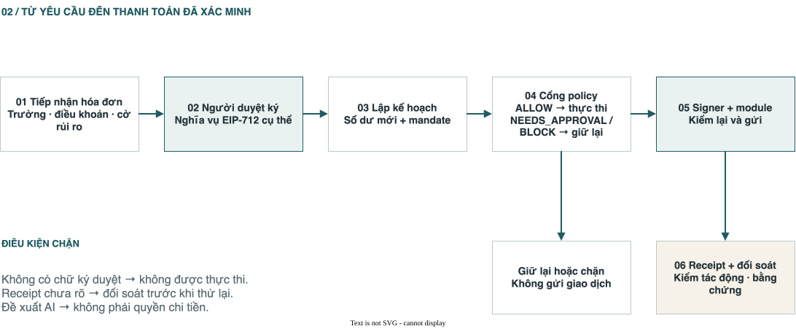
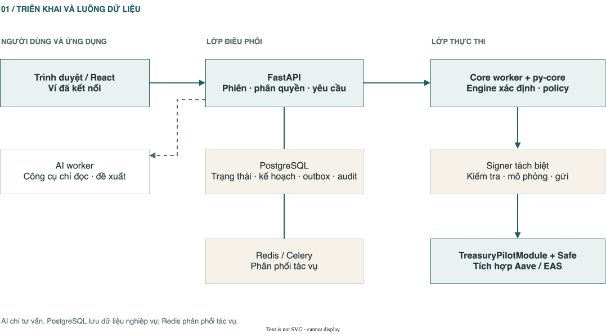
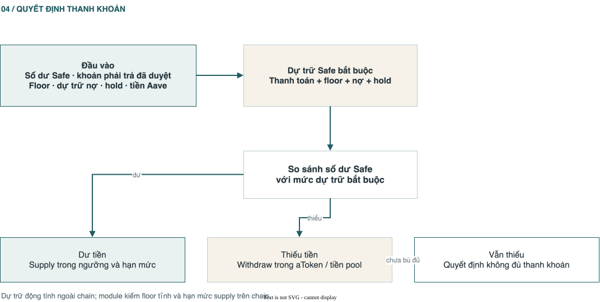
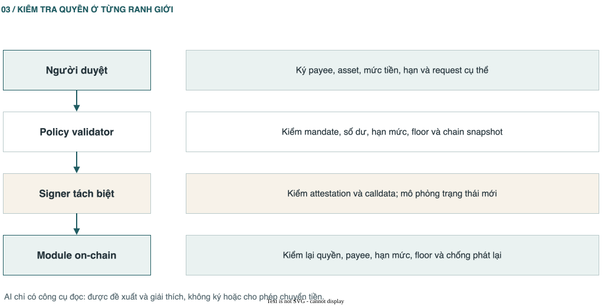
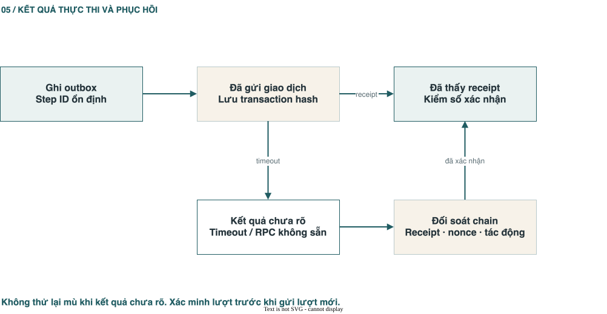

# TreasuryPilot — Technical Report & Documentation Hub

> **Bản rà soát:** 16/10/2026 · **Code:** commit `50b1117` · **Phạm vi:** repo hiện tại, tài liệu [TreasuryPilot trên Google Docs](https://docs.google.com/document/d/1nkSIU5c-zouBkKooWjEFshxw61pH0CRwugYDy5AFJBo/edit) (đặc biệt các tab 8, 11, 13, 36, 37) và tài liệu chuẩn trong repo. Đây là báo cáo kỹ thuật theo trạng thái quan sát được; các kết quả đo cũ được ghi rõ mốc thời gian và môi trường.

**TL;DR — TreasuryPilot làm gì?** Hệ thống nhận hóa đơn, yêu cầu người có thẩm quyền xác nhận nghĩa vụ thanh toán và ký duyệt đúng các trường tiền, sau đó dùng bộ lập kế hoạch để quyết định thời điểm trả, chuẩn bị thanh khoản giữa các Safe của cùng tổ chức, thực hiện qua module có giới hạn trên chain, theo dõi biên nhận và đối soát. AI giúp đọc chứng từ, đề xuất và giải thích; quyền chuyển tiền được kiểm bằng chữ ký người dùng, bộ policy xác định, signer riêng và hợp đồng thông minh.

**Cách đọc trạng thái:** **Có trong code** = đã thấy đường triển khai cụ thể; **có bằng chứng cục bộ** = có test hoặc báo cáo chạy local/fork; **cấu hình trên Sepolia** = có manifest đã khai báo/deploy nhưng không suy ra mọi luồng đã chạy end-to-end; **thiết kế/đang kiểm chứng** = tài liệu mô tả đích hoặc có thành phần rời, chưa đủ bằng chứng cho tuyên bố vận hành hoàn chỉnh. [README](../README.md) và một số báo cáo submission được viết ở revision cũ; khi chúng khác code hiện tại, báo cáo này ưu tiên code và artifact có ngày/revision rõ ràng.

## 01 · Bắt đầu

### 1.1 Bài toán và ranh giới sản phẩm

Đối tượng chính là finance/treasury operator, người duyệt và owner của doanh nghiệp chi trả bằng stablecoin. Vấn đề cốt lõi gồm: hóa đơn đã duyệt nhưng ví vận hành thiếu token/gas; việc chia tiền giữa các ví làm thủ công; người dùng muốn tự động hóa mà vẫn khóa người nhận, hạn mức và khoản dự phòng; bằng chứng thanh toán rời rạc, khó đối soát. Tài liệu nguồn phân vai: **con người quyết định có trả hay không; agent đề xuất cách và thời điểm; contract giới hạn hành động được phép**. [Tổng quan sản phẩm](vi/01-tong-quan.md) · [Google Docs, tab tổng quan](https://docs.google.com/document/d/1nkSIU5c-zouBkKooWjEFshxw61pH0CRwugYDy5AFJBo/edit?tab=t.0).

Mốc M1 dùng tài sản thử nghiệm trên Sepolia; không nên hiểu thành sản phẩm thanh toán mainnet đã được kiểm toán. Bản v0.3 bổ sung supply/withdraw Aave V3 cho tiền dư, hai mức tiền đã duyệt khi trả sớm, và đề xuất vay. Code contract còn có đường borrow/repay với ủy quyền owner một lần; đó là năng lực kỹ thuật/P2, không đồng nghĩa luồng sản phẩm M1 tự vay. [Cập nhật v0.3](vi/37-cap-nhat-v03.md) · [technical documentation hiện có](submission/technical-documentation.md).

### 1.2 Luồng giá trị từ đầu đến cuối

[](report_site/diagrams/payment-flow-vi.svg)

*Hình 01.1 — Luồng thanh toán đầu cuối · [Chỉnh sửa bằng draw.io](report_site/diagrams/payment-flow-vi.drawio).*

1. **Thiết lập:** tạo tổ chức và treasury, liên kết Safe T (quỹ) và Safe O1 (ví vận hành), cấu hình chain/asset, triển khai module, owner đặt mandate, payee, trần và floor.
2. **Nhận hóa đơn:** nhập tay, CSV/API hoặc tài liệu; lưu chứng từ riêng tư; trích trường/điều khoản; kiểm trùng và tín hiệu bất thường.
3. **Xác nhận và duyệt:** người dùng xác nhận trường quan trọng, maker-checker và cờ HIGH được xử lý ở backend, approver ký EIP-712 cho đúng request/payee/asset/số tiền/điều khoản.
4. **Lập kế hoạch:** snapshot chain + nghĩa vụ chưa trả; engine tính số thiếu, dự trữ và lịch; AI chỉ đề xuất trong tập lựa chọn hợp lệ; policy trả `ALLOW`, `NEEDS_APPROVAL` hoặc `BLOCK`.
5. **Thực thi:** ghi outbox, ký policy attestation, signer kiểm calldata và mô phỏng trạng thái mới, gửi các bước theo thứ tự; module trên chain kiểm lại quyền, hạn mức, floor, request/step đã dùng.
6. **Hậu kiểm:** tracker đọc receipt/state, verifier kiểm postcondition, reconciliation gắn giao dịch với request, audit/evidence xuất chứng cứ. Trường hợp `Unknown` phải được giải quyết trước retry.

Luồng trên là **chuỗi mục tiêu của toàn hệ thống**. Các cấu phần có code riêng; mức tích hợp thực tế phải được xác nhận bằng smoke/E2E và bằng chứng giao dịch của đúng môi trường. [Kiến trúc luồng](SYSTEM_ARCHITECTURE.md) · [worker tasks](../services/worker/src/treasurypilot_worker/tasks.py) · [execution API](../services/api/src/treasurypilot_api/execution/routes.py).

### 1.3 Phân biệt các loại ví và quyền

| Thành phần | Vai trò | Quyền quan trọng |
|---|---|---|
| Safe T | Ví quỹ, chủ mandate và tài sản dự trữ | Owner/threshold đổi cấu hình, pause/revoke, cấp ngoại lệ; giữ aToken Aave. |
| Safe O1/O2 | Ví chi của tổ chức | Nhận refill và trả payee qua module; M1 demo dùng O1, local có thể thử O2. |
| Approver | Duyệt nghĩa vụ cụ thể | Ký EIP-712 đúng các trường; không tự sửa mandate bằng chữ ký hóa đơn. |
| Executor/signer | Phát giao dịch đã được kiểm | Giữ khóa executor trong dịch vụ riêng; không có quyền đổi payee hay policy. |
| AI worker | Đọc, đề xuất, giải thích | Chỉ dùng tool đọc; không giữ khóa, không tự tạo quyền chi. |
| Contract module | Chốt chặn cuối cho đường đi qua module | Kiểm quyền, người nhận, hạn mức, floor, replay và thời hạn tại thời điểm giao dịch. |

Một Safe owner hoặc module khác vẫn có thể thực hiện giao dịch ngoài TreasuryPilot. Vì thế “mandate khóa toàn bộ Safe” là diễn giải sai; nó khóa **đường thực thi của TreasuryPilotModule**. [Known risks KR-02](security/known-risks.md) · [governance contract](../contracts/src/TreasuryPilotGovernance.sol).

## 02 · Kiến trúc hệ thống

### 2.1 Các lớp triển khai

[](report_site/diagrams/system-architecture-vi.svg)

*Hình 02.1 — Các lớp triển khai · [Chỉnh sửa bằng draw.io](report_site/diagrams/system-architecture-vi.drawio).*

Code chia thành [web](../apps/web/src/app.tsx), [API](../services/api/src/treasurypilot_api/main.py), [worker](../services/worker/src/treasurypilot_worker/tasks.py), [signer](../services/signer/src/treasurypilot_signer/main.py), [py-core](../packages/py-core/src/treasurypilot_core/) và [contracts](../contracts/src/). Postgres là nguồn sự thật cho nghiệp vụ; Redis là cơ chế phân phối việc, không phải sổ cái giao dịch. [Compose](../infra/compose.yaml) tách `worker`, `worker-ai`, `worker-webhooks`, `beat`, `signer`, `api`, `web`, Postgres, Redis, MinIO; Anvil là profile local.

### 2.2 Ranh giới tin cậy

| Ranh giới | Dữ liệu đi qua | Kiểm soát cần có | Giới hạn |
|---|---|---|---|
| Tài liệu hóa đơn → AI | PDF, text, metadata không đáng tin | Bọc nguồn untrusted, quét instruction/secret, schema, người xác nhận | Prompt injection vẫn cần đánh giá bằng bộ tấn công độc lập. |
| Browser → API | session, org ID, chữ ký | RBAC, maker-checker, CSRF/session, kiểm org scope | Mỗi endpoint mới vẫn phải được review. |
| Worker → signer | attestation + calldata + plan | Secret nội bộ, attestation đúng phiên bản, kiểm payload và `eth_call` mới | Cùng host/DB role có rủi ro vận hành cần cô lập thêm. |
| Signer → module | giao dịch được ký | Contract kiểm lại từng hành động | Mô phỏng không giữ trước state của block tương lai. |
| Chain → backend | balances, events, receipt | chain ID, RPC health, confirmations, reorg handling | RPC lỗi/stale có thể làm trễ hoặc sai nhận định tạm thời. |

Nguồn: [AI architecture](AI_AGENT_ARCHITECTURE.md), [signing service](../services/signer/src/treasurypilot_signer/service.py), [known risks](security/known-risks.md).

### 2.3 Nguyên tắc nhất quán

- **Tiền là số nguyên base units:** API/DB tuần tự hóa decimal string/`NUMERIC(78,0)`; Python `int`/kiểu chặt; Solidity `uint256`. Không dùng float để quyết định thanh toán. [money](../packages/py-core/src/treasurypilot_core/money/base_units.py).
- **Thời gian UTC:** hạn mức ngày theo block time, hiển thị theo timezone tổ chức; lịch và ngày đến hạn quy về UTC day. [utc_days](../packages/py-core/src/treasurypilot_core/domain/utc_days.py).
- **Write before act:** lưu operation/step và danh tính bất biến trước khi phát giao dịch; timeout là trạng thái chưa biết, không phải thất bại. [outbox](../services/worker/src/treasurypilot_worker/executor/outbox.py).
- **Evidence by construction:** mỗi quyết định, phiên bản policy, hash, transaction, receipt và postcondition phải có thể truy ngược. [audit evidence](../services/api/src/treasurypilot_api/audit/evidence.py).

## 03 · Nghiệp vụ hóa đơn và duyệt

### 3.1 Trạng thái request

Mô hình nghiệp vụ tách bản nháp/trích xuất khỏi nghĩa vụ có thể thi hành. Người tạo có thể nhập hoặc upload; hệ thống kiểm trường, payee, asset, fingerprint, điều khoản, cờ bất thường; người duyệt nhận payload EIP-712 và ký. Các endpoint trong code gồm tạo/bulk, sửa, xác nhận terms, submit, withdraw/request changes, ack cờ, lấy typed data, approve/reject/cancel/renew. [routes](../services/api/src/treasurypilot_api/invoices/requests.py) · [state machine](../services/api/src/treasurypilot_api/invoices/state_machine.py) · [documents](../services/api/src/treasurypilot_api/invoices/documents.py).

Đường intake có code cho upload, API key và email inbound; cần phân biệt endpoint tồn tại với cấu hình provider/SMTP thực tế. [API keys](../services/api/src/treasurypilot_api/invoices/api_keys.py) · [email inbound](../services/api/src/treasurypilot_api/invoices/inbound_email.py). Fingerprint/near-duplicate giúp phát hiện cùng hóa đơn khác số ID, còn chữ ký duyệt chặn việc dùng một bản ghi “approved” trong DB để chuyển tiền khi thiếu quyền on-chain. [fingerprint](../packages/py-core/src/treasurypilot_core/fingerprint/invoice.py) · [near duplicates](../services/api/src/treasurypilot_api/invoices/near_duplicates.py).

### 3.2 Chữ ký thanh toán

`PaymentApproval` ràng buộc request ID, invoice hash, fingerprint, treasury, paying wallet, asset, payee, standard amount, early amount/deadline, terms hash, expiry và cờ fiat. Domain EIP-712 ràng buộc chain/module. Module kiểm người ký hiện là approver (EOA hoặc ERC-1271) và đúng mức tiền theo cửa sổ trả sớm; request chỉ tiêu thụ một lần. Một số trường hợp fiat-quoted dùng cap và logic riêng, vì vậy không nên diễn giải mọi payment thành “luôn đúng một số nguyên cố định”. [PaymentApprovalHash](../contracts/src/libraries/PaymentApprovalHash.sol) · [module pay](../contracts/src/TreasuryPilotModule.sol) · [approval API](../services/api/src/treasurypilot_api/invoices/approval.py).

### 3.3 Maker-checker và fraud flags

RBAC xác định ai tạo, sửa, duyệt; maker-checker cấm tự duyệt theo cấu hình, solo mode có kiểm soát riêng. HIGH flags cần được xử lý/ack trước khi đi tiếp; thay đổi payee hoặc trường ký khiến approval cũ không còn hợp lệ. Đây là **kiểm soát backend**, khác kiểm chữ ký của contract. [maker checker](../services/api/src/treasurypilot_api/identity/maker_checker.py) · [RBAC](../services/api/src/treasurypilot_api/identity/rbac.py) · [risk KR-24](security/known-risks.md).

## 04 · Financial engine và tối ưu

### 4.1 Refill gắn với request

Với `B` = số dư ví chi, `F` = hard floor, `H` = soft target, `D` = nghĩa vụ cần trả, `R` = tiền dành cho nghĩa vụ khác:

```text
Shortage  = max(0, R + D + F - B)
Preferred = max(0, R + D + H - B)
Bound     = max(0, D + H - B)
Capacity  = max(0, SourceBalance - SourceProtected - SourceFloor)
Cap       = min(Capacity, RemainingRefillDaily, PerRefillLimit)
```

Nếu `Shortage = 0`, không refill chỉ để đạt soft target. Nếu thiếu vượt bound/cap, dừng thay vì gửi một phần rồi vẫn không thể trả. Counter `PAY` và `REFILL` độc lập; module còn ràng buộc đích refill, số lần refill cho request và chênh lệch số dư thực. [engine liquidity](../packages/py-core/src/treasurypilot_core/engine/liquidity.py) · [module refill](../contracts/src/TreasuryPilotModule.sol) · [report thuật toán](submission/technical-documentation.md).

### 4.2 Lập lịch và giá trị thanh toán

`schedule_edf` sắp theo hạn UTC, thứ tự duyệt, request ID; mô phỏng tối đa 30 ngày, làm mới hạn mức theo ngày, chuyển số dư qua ngày, kiểm cooling/cap/refill. Đây là heuristic có nghiệm khả thi, không phải chứng nhận tối ưu toàn cục. `schedule_cpsat` tồn tại với giới hạn thời gian mặc định 5 giây và EDF fallback; khi báo kết quả phải ghi thuật toán thực chạy, solver status và fallback. [scheduler](../packages/py-core/src/treasurypilot_core/engine/scheduler.py) · [CP-SAT](../packages/py-core/src/treasurypilot_core/engine/cpsat.py).

Giá trị một lựa chọn trả tiền xét chênh lệch standard/early amount, phí giao dịch, lãi supply bị bỏ lỡ và phạt trễ theo điều khoản đã xác nhận. Phần phân tích không được tăng số tiền PAY vượt chữ ký. B0/B1/B2 trong ADR-019 lần lượt là baseline manual/EDF để tiền nhàn rỗi, optimizer xác định, AI + optimizer; phải công bố cả giả định fee/rate và mẫu dữ liệu khi so sánh. [scoring](../packages/py-core/src/treasurypilot_core/engine/scoring.py) · [ADR-019](adr/ADR-019-aave-liquidity-and-payment-options.md).

### 4.3 Dự trữ, Aave và đề xuất vay

[](report_site/diagrams/liquidity-decision-vi.svg)

*Hình 04.1 — Quyết định thanh khoản · [Chỉnh sửa bằng draw.io](report_site/diagrams/liquidity-decision-vi.drawio).*

```text
RequiredSafeReserve = PaymentReserve + SafeFloor + DebtServiceReserve + ExecutionHolds
AvailableForSupply  = max(0, SafeUSDC - RequiredSafeReserve)
AccessibleLiquidity = SafeUSDC + min(aUSDC, PoolAvailableUSDC)
Deficit             = max(0, RequiredSafeReserve - SafeUSDC)
WithdrawTarget      = ceil(Deficit × 105 / 100)
```

`PaymentReserve` tính các nghĩa vụ đã duyệt/chưa trả trong horizon, dùng mức trả sớm khi biết và đúng cửa sổ. Supply chỉ khi đạt ngưỡng tối thiểu, không vượt cap; withdraw bị chặn bởi aToken và thanh khoản pool. Thiếu hụt sau rút cho ra trạng thái không đủ thanh khoản, không tự biến thành giao dịch vay. Hợp đồng chặn floor tĩnh và supply cap; **dự trữ động là trách nhiệm của engine/policy ngoài chain**. [liquidity engine](../packages/py-core/src/treasurypilot_core/engine/liquidity.py) · [forecast](../packages/py-core/src/treasurypilot_core/engine/forecast.py) · [contract Aave paths](../contracts/src/TreasuryPilotModule.sol).

## 05 · Policy, mandate và smart contract

### 5.1 Quyết định ba mức

[](report_site/diagrams/authority-boundaries-vi.svg)

*Hình 05.1 — Ranh giới quyền · [Chỉnh sửa bằng draw.io](report_site/diagrams/authority-boundaries-vi.drawio).*

Validator đánh giá snapshot chain, request, policy version, số dư, hạn mức, payee và plan/step rồi trả `ALLOW`, `NEEDS_APPROVAL` hoặc `BLOCK` kèm reason code. `NEEDS_APPROVAL` là chưa thi hành được; owner phải cấp ngoại lệ đúng request/số tiền, không nới vô hạn. Bộ differential dùng cùng manifest cho Python và Foundry để so quyết định và revert selector; báo cáo hiện liệt kê các trường hợp payee lạ, cooling, pause, expired, over cap, duplicate, floor, replay. [validator](../packages/py-core/src/treasurypilot_core/policy/validator.py) · [reason codes](../packages/py-core/src/treasurypilot_core/policy/reason_codes.py) · [differential report](testing/policy-contract-differential-report.md).

### 5.2 Mandate và quản trị

Safe T owner/threshold quản trị allowlist payee, asset, wallet, hạn mức PAY/REFILL, floor, thời gian hiệu lực, pause/revoke, ngoại lệ, Aave pool và các quyền vay/trả. Module instance được tạo qua factory. Owner/guardian pause chỉ ngăn hành động **sau khi giao dịch pause được mined**; không thu hồi giao dịch đã hoàn tất và không cản quyền trực tiếp của Safe owner. [governance](../contracts/src/TreasuryPilotGovernance.sol) · [factory](../contracts/src/TreasuryPilotModuleFactory.sol) · [mandate API](../services/api/src/treasurypilot_api/mandate/routes.py).

### 5.3 Các entry point on-chain

| Nhóm | Entry point / control | Ý nghĩa |
|---|---|---|
| Chi trả | `pay` | Approval hợp lệ, option đúng, payee được phép, per-request/daily limit, floor, anti-replay. |
| Chuyển nội bộ | `refill` | Safe T → ví vận hành đã đăng ký, gắn request, mức cần thiết và daily/refill cap. |
| Tiền dư | `supply`, `withdraw` | Pool/asset cố định, floor/cap, kiểm chênh lệch tài sản; không có generic arbitrary call. |
| Nợ P2 | `authorizeBorrow`, `authorizeRepay`, `borrow`, `repay` | Owner cấp grant một lần, có expiry; borrow còn kiểm rate/health factor tại thời điểm gọi. |
| Gas / nâng cao | `swapForGas`, `PlanAttestedExecutor`, `ReserveHoldExecutor`, `ThresholdApprovalExecutor` | Đường chuyên biệt cần cấu hình và bằng chứng theo đúng môi trường; không suy ra tất cả đều nằm trong demo M1. |

Nguồn: [TreasuryPilotModule](../contracts/src/TreasuryPilotModule.sol), [PlanAttestedExecutor](../contracts/src/PlanAttestedExecutor.sol), [ReserveHoldExecutor](../contracts/src/ReserveHoldExecutor.sol), [ThresholdApprovalExecutor](../contracts/src/ThresholdApprovalExecutor.sol).

## 06 · AI agent

### 6.1 Vị trí của AI trong hệ thống

AI được dùng cho trích xuất hóa đơn/điều khoản, gợi ý kế hoạch, soạn ngoại lệ, Copilot và giải thích bất thường. `worker-ai` gọi model, có budget/failover và tool đọc; `worker-core` giữ policy attestation và quyết định tiền qua engine. Code có provider adapter, prompt phiên bản, instruction detector, secret scan, read-only tools và các eval harness. [agent code](../services/worker/src/treasurypilot_worker/agent/) · [AI architecture](AI_AGENT_ARCHITECTURE.md) · [Google Docs, tab AI](https://docs.google.com/document/d/1nkSIU5c-zouBkKooWjEFshxw61pH0CRwugYDy5AFJBo/edit?tab=t.yed8bvlknow6).

### 6.2 Hợp đồng đầu ra và chống injection

Nội dung PDF/email là dữ liệu không tin cậy. AI không được lấy câu trong chứng từ làm lệnh đổi policy/payee, không được đưa địa chỉ vào bước chi nếu chưa qua dữ liệu đã xác nhận, không được gọi API ghi hoặc giữ key. Đầu ra đi qua schema, kiểm tham chiếu và so với tính toán xác định. Các lớp chống injection trong code gồm untrusted wrapper, quét bí mật, instruction detector và prompt policy; đây là giảm rủi ro, không phải bằng chứng “miễn nhiễm”. [untrusted](../services/worker/src/treasurypilot_worker/agent/untrusted.py) · [detector](../services/worker/src/treasurypilot_worker/agent/instruction_detector.py) · [secret scan](../services/worker/src/treasurypilot_worker/agent/secret_scan.py).

### 6.3 Kết quả eval có điều kiện

| Artifact 15/10/2026 | Kết quả ghi nhận | Giới hạn đọc kết quả |
|---|---|---|
| [Extraction accuracy](evidence/extraction-accuracy.md) | 30 invoice recorded; amount đúng 27/30; terms F1 70,6%, exact terms 60%. | Nhãn đang chờ người thứ hai review; tập public/recorded, không phải đo production. |
| [Copilot fidelity](evidence/copilot-fidelity.md) | 20/20 case giữ đúng số theo quy tắc kiểm. | Case do AI tạo, chờ review độc lập; không đo toàn bộ câu hỏi thật. |
| [Red-team](evidence/redteam-results.md) | 0/20 case đổi field/policy; model flag 20/20. | Keyword fallback tự flag 2/20; bộ 20 case không chứng minh chống mọi prompt injection. |

## 07 · Execution, signer và phục hồi

### 7.1 Chuỗi thực thi an toàn

Một bước thực thi phải có plan/step ID ổn định, snapshot mới, policy decision, attestation gắn plan hash/nonce/expiry, outbox trong Postgres rồi mới phát giao dịch. Signer nhận typed step, kiểm attestation, target chain/module, calldata với plan, mô phỏng `eth_call`, giữ nonce/step chống gửi lặp và ký bằng khóa executor. Endpoint nội bộ `/sign-and-send` đã có code; mô tả cũ “signer chỉ có health” trong submission draft không còn đúng với commit hiện tại. [signer main](../services/signer/src/treasurypilot_signer/main.py) · [signer service](../services/signer/src/treasurypilot_signer/service.py) · [signer store](../services/signer/src/treasurypilot_signer/store.py).

### 7.2 Xử lý trạng thái không chắc chắn

[](report_site/diagrams/execution-recovery-vi.svg)

*Hình 07.1 — Phục hồi kết quả · [Chỉnh sửa bằng draw.io](report_site/diagrams/execution-recovery-vi.drawio).*

Sau timeout, worker không được tạo request/step mới và thử lại mù. Nó đọc receipt, nonce, module `requestPaid`/`stepUsed`, state thực của chain; cho tới khi rõ, treasury bị chặn hoặc chuyển review. Với plan nhiều bước, bước đã confirmed không được phát lại khi bước sau thất bại. Code có outbox, sequencer, tracker, scan/retry/resolve và partial recovery; cần đối chiếu kết quả E2E theo môi trường để khẳng định độ bền đầy đủ. [executor](../services/worker/src/treasurypilot_worker/executor/) · [recovery](../services/worker/src/treasurypilot_worker/recovery/) · [risk KR-09](security/known-risks.md).

### 7.3 Circuit breaker và pause

Đường phát hiện bất thường có review queue/circuit breaker trong API/worker và đường sentinel pause nội bộ. Cần phân biệt: “pause requested” là yêu cầu; “pause mined” mới là trạng thái contract; Safe owner vẫn có quyền riêng. [circuit API](../services/api/src/treasurypilot_api/recovery/circuit.py) · [sentinel](../services/signer/src/treasurypilot_signer/sentinel.py).

## 08 · Dữ liệu, API và giao diện

### 8.1 Mô hình dữ liệu

PostgreSQL lưu các nhóm: identity/org/member/session; treasury/wallet/chain; mandate/payee/exception; invoice/request/approval; plan/step/AI call; operation/event/snapshot; reconciliation/evidence/audit; notification/admin. Các bảng nghiệp vụ có `organization_id`/`org_id` cho isolation; amount dùng số nguyên; migration là nguồn thực tế cho schema hiện hành, còn [DATA_MODEL](DATA_MODEL.md) là thiết kế đọc nhanh. [migrations](../services/api/migrations/versions/) · [Google Docs, tab data model](https://docs.google.com/document/d/1nkSIU5c-zouBkKooWjEFshxw61pH0CRwugYDy5AFJBo/edit?tab=t.py8ti27c4ma4).

Chuỗi chứng cứ tối thiểu: request → invoice hash/fingerprint → approval typed data/signature → plan/policy version → operation/step ID → tx hash/receipt/events → verification → reconciliation → audit/evidence bundle. Việc nối bằng khóa định danh và hash quan trọng hơn chỉ hiển thị một tx hash. [audit models](../services/api/src/treasurypilot_api/audit/models.py) · [reconciliation models](../services/api/src/treasurypilot_api/reconciliation/models.py).

### 8.2 Bề mặt API hiện có

| Miền | Ví dụ route / hành vi | Code |
|---|---|---|
| Identity | auth, tổ chức, membership, MFA, OIDC/SAML/SCIM | [main/router wiring](../services/api/src/treasurypilot_api/main.py), [identity](../services/api/src/treasurypilot_api/identity/) |
| Treasury | chain, treasury, Safe, forecast, snapshot | [treasury](../services/api/src/treasurypilot_api/treasury/api.py), [forecast](../services/api/src/treasurypilot_api/treasury/forecast.py) |
| Mandate | payee, governance tx, pause, exception, fee policy | [mandate](../services/api/src/treasurypilot_api/mandate/) |
| Requests | intake/upload, terms, approval EIP-712, cancel | [requests](../services/api/src/treasurypilot_api/invoices/requests.py) |
| Execution | plan/operation, sequencing and status | [execution](../services/api/src/treasurypilot_api/execution/routes.py) |
| Evidence | reconciliation, export, audit log, verification | [reconciliation](../services/api/src/treasurypilot_api/reconciliation/), [audit](../services/api/src/treasurypilot_api/audit/) |
| Support | notification, webhook, Copilot, ERP adapter | [notifications](../services/api/src/treasurypilot_api/notifications/), [copilot](../services/api/src/treasurypilot_api/copilot/api.py), [ERP](../services/api/src/treasurypilot_api/integrations/erp/) |

Các API chính ở `/v1`; org-scoped routes gắn organization ID. Spec [API_SPEC](API_SPEC.md) có thể đi trước/đi sau code, vì vậy khi tích hợp client nên kiểm OpenAPI xuất từ app và file [web openapi.json](../apps/web/openapi.json). UI dùng React/Vite, TanStack Query, wagmi/viem và có dashboard, setup, request, approval, plan, review, mandate, payee, reconciliation, metrics, Copilot. [web app](../apps/web/src/app.tsx) · [package](../apps/web/package.json).

## 09 · Chain, bằng chứng và đối soát

Chain reader/indexer tạo snapshot và theo dõi event/receipt; verifier kiểm hậu điều kiện trước khi đánh dấu kết quả thanh toán. Reconciliation phân biệt refill/swap nội bộ với chi phí vendor và cho phép match/discrepancy/resolve. Audit log, evidence bundle và helper EAS thêm khả năng chứng minh, nhưng hash hóa đơn/approval/plan trong EAS vẫn là assertion từ backend; người kiểm toán phải kiểm trusted attester, schema và tx PAY thật. [chain worker](../services/worker/src/treasurypilot_worker/chain/) · [verify](../services/worker/src/treasurypilot_worker/reconcile/verify.py) · [reconciliation routes](../services/api/src/treasurypilot_api/reconciliation/routes.py) · [attestation helper](../infra/scripts/attest_receipt.py).

Manifest [Sepolia](../deployments/11155111.json) ở commit này ghi `deploymentStatus: deployed`, module/Safe T/Safe O1 và các code hash/verified block. Điều này chứng minh **artifact cấu hình triển khai có địa chỉ và mốc kiểm**, nhưng riêng manifest không chứng minh tất cả bước demo hoặc đối soát public đã chạy thành công. [Báo cáo reliability 15/10](evidence/reliability-2026-10-15.md) ghi 30/30 run local Anvil hoàn tất; Sepolia: 0 run. Một số báo cáo submission cũ còn ghi `configured_only`; khi trình bày cần nêu ngày/revision của từng artifact.

## 10 · Bảo mật và tuân thủ

### 10.1 Các kiểm soát chính

- Contract chặn người nhận không được phép, hạn mức, floor, expiry, pause/revoke, replay và sai option ký. [contract](../contracts/src/TreasuryPilotModule.sol).
- Signer cô lập khóa executor, kiểm attestation/payload/simulation; AI worker không nhận khóa policy/executor theo cấu hình Compose. [signer](../services/signer/src/treasurypilot_signer/) · [compose](../infra/compose.yaml).
- Identity/RBAC và org-scoped repository bảo vệ dữ liệu đa tenant; maker-checker là một lớp riêng. [RBAC](../services/api/src/treasurypilot_api/identity/rbac.py) · [scoped repository](../services/api/src/treasurypilot_api/common/repository.py).
- Screening/KYB/travel-rule và data region có code/adapter, nhưng fixture screening không đồng nghĩa kết nối provider sống hoặc phê chuẩn pháp lý. [compliance](../services/api/src/treasurypilot_api/compliance/) · [risk KR-19](security/known-risks.md).
- Privacy primitives cho classification/redaction/encryption cần được áp dụng ở từng tích hợp, log và export. [privacy](../packages/py-core/src/treasurypilot_core/privacy/).

### 10.2 Rủi ro còn mở phải ghi trong báo cáo công khai

Hợp đồng chưa có audit độc lập; owner/module Safe khác có thể giao dịch ngoài mandate; RPC/reorg ảnh hưởng tính cuối cùng; dự trữ động không nằm hoàn toàn on-chain; Aave pool/cap thay đổi; signer với quyền DB cần hardening; dữ liệu hóa đơn và prompt có thể lộ/sai; nhận diện sanctions qua fixture không tương đương kiểm thực tế; một VM/Compose là điểm lỗi tập trung. Danh mục và mức ảnh hưởng chi tiết: [known risks](security/known-risks.md) · [self-assessment](submission/security-self-assessment.md).

## 11 · Kiểm thử, đo lường và khả năng tái lập

| Tầng | Bằng chứng/code | Điều có thể kết luận |
|---|---|---|
| Unit/property | [py-core tests](../packages/py-core/tests/), [API tests](../services/api/tests/) | Logic theo case và invariant đã định nghĩa; không thay thế E2E. |
| Contract | [Foundry tests](../contracts/test/), [test evidence](security/test-evidence.md) | Revert/invariant của module trong môi trường test/fork theo revision báo cáo. |
| Policy ↔ contract | [differential matrix](testing/policy-contract-differential-report.md) | Python/contract đồng ý trên case manifest; báo cáo nêu cả case chưa phủ. |
| Web | [Vitest/Playwright](../apps/web/e2e/) | Luồng UI với fixture/mock theo cấu hình test. |
| AI | [extraction](evidence/extraction-accuracy.md), [Copilot](evidence/copilot-fidelity.md), [red-team](evidence/redteam-results.md) | Kết quả recorded/synthetic, chưa chứng minh chất lượng ngoài tập. |
| Reliability | [30-run Anvil report](evidence/reliability-2026-10-15.md) | 30/30 local scenario; chưa có 10-run Sepolia trong artifact này. |

Để tái lập đánh giá, cần ghi SHA, chain ID/block, asset/decimals, dataset split và lịch sử exposure, model/prompt, algorithm thực dùng (EDF hay CP-SAT/fallback), giả định phí/rate, denominator và số lần fail. Không trộn kết quả fork, Anvil và public Sepolia thành một “success rate”. [technical documentation, §7](submission/technical-documentation.md) · [planner benchmark](../services/worker/src/treasurypilot_worker/planner_bench/).

## 12 · Triển khai và vận hành

### 12.1 Môi trường

Local Compose khởi Postgres 16, Redis 7, MinIO, Anvil tùy profile, migrate, API, worker core/AI/webhooks, beat, signer và web. Sepolia có compose override và deployment scripts/manifest riêng. Trước mỗi demo cần kiểm chain ID, RPC, Safe owners/threshold/module enabled, token decimals, hạn mandate, payee, pool/aToken, gas và EAS attester; điều kiện Aave supply có thể thay đổi ngay cả khi fork lịch sử chạy tốt. [infra README](../infra/README.md) · [compose](../infra/compose.yaml) · [Sepolia override](../infra/compose.sepolia.yaml) · [deployment guide](../contracts/docs/DEPLOYMENT.md).

### 12.2 Observability và sự cố

Log có correlation ID, metrics/trace, Sentry/OpenTelemetry và notification outbox. Sự cố quan trọng phải cho thấy request/plan/operation ID, policy reason code, chain/block, tx/nonce/receipt và quyết định retry hoặc review; không log khóa, session token, chữ ký nguyên văn hay hóa đơn nhạy cảm. [observability core](../packages/py-core/src/treasurypilot_core/observability.py) · [metrics](../services/api/src/treasurypilot_api/observability/metrics.py) · [notifications](../services/worker/src/treasurypilot_worker/notify/).

## 13 · Trạng thái triển khai và khoảng trống

| Hạng mục | Quan sát ở commit `50b1117` | Điều cần thêm trước khi khẳng định hoàn tất |
|---|---|---|
| Sản phẩm web/API | Nhiều màn hình, endpoint và migration hiện diện. | E2E trên cấu hình demo thật, xác nhận client/OpenAPI không lệch. |
| Engine/policy | EDF, CP-SAT, forecast, liquidity và validator có code/test. | Benchmark B0/B1/B2 đúng nhãn với tập held-out đã review. |
| Contract/on-chain | Module và các entry point, manifest Sepolia `deployed`. | Bằng chứng public tx cho từng cảnh D1–D10, review quyền độc lập, audit trước mainnet. |
| Signer/worker | `/sign-and-send`, outbox/sequencer/recovery có code. | Chaos/restart/reorg và multi-step E2E trên testnet; kiểm quyền DB signer. |
| AI | Extraction/Copilot/eval recorded và guard có code. | Ground truth độc lập, held-out, thêm tấn công/OCR/locale. |
| Reliability | 30/30 Anvil trong báo cáo 15/10. | Chạy và lưu evidence Sepolia riêng; backup/restore và multi-host khi nâng cấp. |

Các mục trên là **đề nghị xác minh**, không phải khẳng định code thiếu. Điểm có thể kết luận chắc từ repo là ranh giới thiết kế và code triển khai từng module; mức sẵn sàng production cần một review kỹ thuật/bảo mật và chứng cứ hệ thống theo release cụ thể. [Submission README](submission/README.md) · [known risks](security/known-risks.md).

## 14 · Bản đồ module và phụ thuộc triển khai

Tài liệu Google Docs tổ chức công việc thành 20 module M01–M20. Tab 36 ghi cách chia luồng và phân công **tại 11–12/10/2026**; đó là snapshot quản lý công việc, không phải trạng thái issue hiện tại. Bảng dưới ánh xạ module với code/tài liệu để người mới có thể tìm ngay nơi chịu trách nhiệm. [Danh mục module](modules/README.md) · [Google Docs, hướng dẫn phân công](https://docs.google.com/document/d/1nkSIU5c-zouBkKooWjEFshxw61pH0CRwugYDy5AFJBo/edit?tab=t.3xlngx2j9mze).

| Module | Trách nhiệm kỹ thuật | Điểm vào |
|---|---|---|
| M01 Identity | Session, SIWE, tổ chức, RBAC, MFA/federation | [identity](../services/api/src/treasurypilot_api/identity/) |
| M02 Treasury | Safe, wallet, chain, snapshot, forecast | [treasury API](../services/api/src/treasurypilot_api/treasury/) |
| M03 Mandate | Payee, hạn mức, governance, ngoại lệ, pause | [mandate API](../services/api/src/treasurypilot_api/mandate/) |
| M04 Contracts | Module/factory, EIP-712, Aave, replay/floor/cap | [contracts](../contracts/src/) |
| M05 Invoices | Intake, trích xuất, request, approval | [invoices](../services/api/src/treasurypilot_api/invoices/) |
| M06 Chain reader | RPC, event indexer, tracker, snapshot | [chain worker](../services/worker/src/treasurypilot_worker/chain/) |
| M07 Financial engine | Refill, EDF/CP-SAT, reserve, forecast | [engine](../packages/py-core/src/treasurypilot_core/engine/) |
| M08 Policy | Validator, reason codes, attestation | [policy](../packages/py-core/src/treasurypilot_core/policy/) |
| M09 Agent | Extraction, plan proposal, Copilot, AI eval | [agent](../services/worker/src/treasurypilot_worker/agent/) |
| M10 Execution | Outbox, sequencing, signer, simulation | [executor](../services/worker/src/treasurypilot_worker/executor/), [signer](../services/signer/src/treasurypilot_signer/) |
| M11 Reconciliation | Receipt, verification, match/export | [reconcile worker](../services/worker/src/treasurypilot_worker/reconcile/), [API](../services/api/src/treasurypilot_api/reconciliation/) |
| M12 Recovery | Unknown/partial, retry và review | [recovery worker](../services/worker/src/treasurypilot_worker/recovery/), [API](../services/api/src/treasurypilot_api/recovery/) |
| M13 Notifications | In-app, webhook, email, Telegram | [notify worker](../services/worker/src/treasurypilot_worker/notify/) |
| M14 Compliance | Screening, KYB, travel rule, retention | [compliance](../services/api/src/treasurypilot_api/compliance/) |
| M15 Audit | Audit log, hash chain, evidence bundle | [audit](../services/api/src/treasurypilot_api/audit/) |
| M16 Web | Giao diện operator/approver/owner | [features](../apps/web/src/features/) |
| M17 Observability | Metrics, savings, logging, tracing | [observability](../services/api/src/treasurypilot_api/observability/) |
| M18 Platform admin | Hỗ trợ vận hành đa tổ chức | [admin](../services/api/src/treasurypilot_api/admin/) |
| M19 DevEx | Build, Compose, CI, test, OpenAPI | [infra](../infra/), [workflows](../.github/workflows/) |
| M20 Domain/evidence | Kịch bản demo, đo lường, review nghiệp vụ | [evidence](evidence/), [submission](submission/) |

**Thứ tự phụ thuộc thực tế:** contract ABI/EIP-712 và chain snapshot định hình validator; validator cùng engine định hình plan/attestation; signer và executor chỉ nhận step đã hợp lệ; tracker/verifier mới cho phép Paid/reconciliation; web/AI dựa vào các hợp đồng dữ liệu và trạng thái đó. Chia luồng A (chain/engine/policy/execution/recovery), B (sản phẩm/API/web/AI), C (nghiệp vụ/bằng chứng) trong tab 36 phản ánh phụ thuộc này. Khi điều phối sprint hiện tại, đọc code/PR/Project mới nhất thay vì dùng số ticket còn mở của snapshot 11/10.

## 15 · Bản đồ nguồn và cách cập nhật báo cáo

| Cần hiểu | Nguồn chính |
|---|---|
| Ý tưởng, người dùng, phạm vi | [Google Docs](https://docs.google.com/document/d/1nkSIU5c-zouBkKooWjEFshxw61pH0CRwugYDy5AFJBo/edit), [PROJECT_OVERVIEW](PROJECT_OVERVIEW.md) |
| Kiến trúc/trust boundary | [SYSTEM_ARCHITECTURE](SYSTEM_ARCHITECTURE.md), [ARCHITECTURE entry](../ARCHITECTURE.md) |
| Quy tắc tiền và quyền | [BUSINESS_RULES](BUSINESS_RULES.md), [contracts](../contracts/src/), [policy](../packages/py-core/src/treasurypilot_core/policy/) |
| Data/API | [DATA_MODEL](DATA_MODEL.md), [API_SPEC](API_SPEC.md), [migrations](../services/api/migrations/versions/) |
| AI | [AI_AGENT_ARCHITECTURE](AI_AGENT_ARCHITECTURE.md), [agent code](../services/worker/src/treasurypilot_worker/agent/) |
| Quyết định v0.3 | [ADR-019](adr/ADR-019-aave-liquidity-and-payment-options.md), [tab 37](https://docs.google.com/document/d/1nkSIU5c-zouBkKooWjEFshxw61pH0CRwugYDy5AFJBo/edit?tab=t.85x0bmmbqru0) |
| Vận hành/test/rủi ro | [infra](../infra/), [evidence](evidence/), [security](security/), [submission](submission/) |

**Quy tắc cập nhật:** ghi commit và ngày mới; đối chiếu route/schema/contract với source; chạy lại test/eval và gắn report theo đúng revision; xác minh manifest với chain tại block ghi nhận; tách “code có”, “test local có”, “public tx có” và “đã được audit”. Bản Markdown này là nguồn biên tập cho site đa trang trong `docs/report_site/`.
