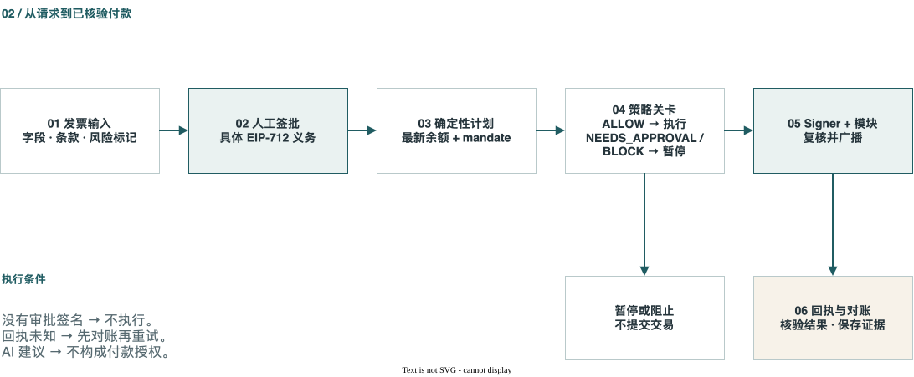
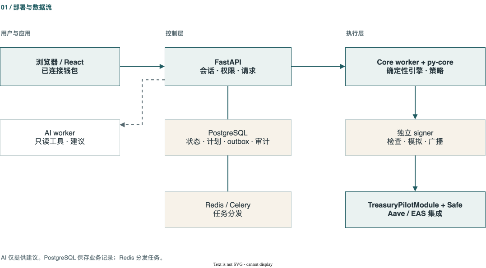
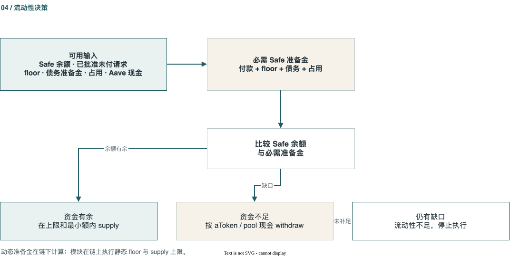
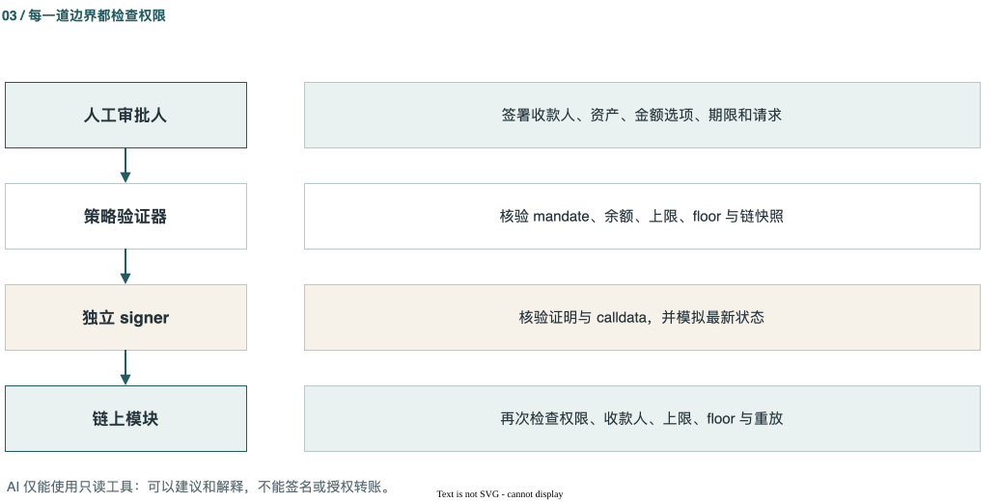
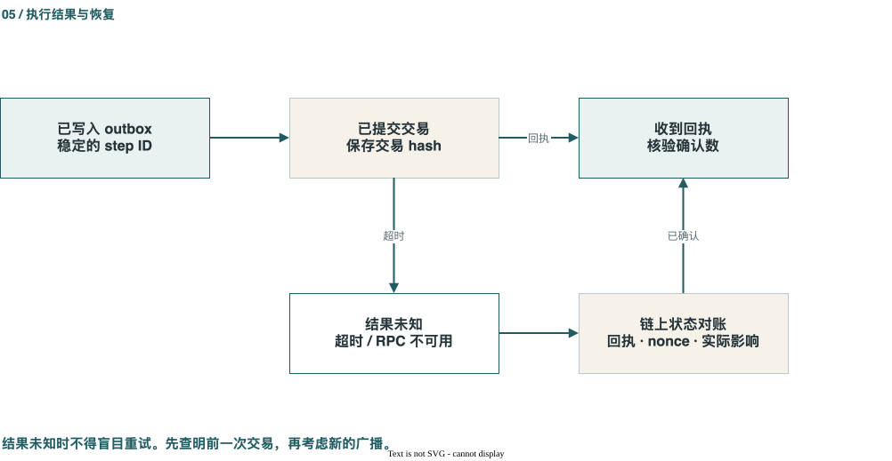

# TreasuryPilot — 技术报告与文档中心

> **审阅日期：** 2026 年 10 月 16 日 · **代码基线：** `50b1117` · **依据：** 当前代码仓库、[TreasuryPilot Google 文档](https://docs.google.com/document/d/1nkSIU5c-zouBkKooWjEFshxw61pH0CRwugYDy5AFJBo/edit)以及仓库中的测试和部署记录。历史测量结果按日期与运行环境分别说明。

**摘要。** TreasuryPilot 接收发票，由有权限的人确认付款义务并对具体金额签名；确定性引擎计算付款时间和 Safe 钱包之间的流动性安排；受限的链上模块执行转账；跟踪器再检查交易回执、实际状态并完成对账。AI 负责读取、建议和解释，不掌握支出授权或执行私钥。

**证据级别。**“代码中存在”表示能找到具体实现路径；“本地证据”表示本地或历史分叉测试；“Sepolia 配置”表示部署清单记录了地址与核验信息；“设计或待验证”表示仍缺少针对完整生产场景的端到端证据。不能把这些级别合并为“已在生产运行”。

## 01 · 入门与产品边界

### 1.1 问题与目标用户

目标用户是以稳定币支付供应商的财务/资金运营人员、付款审批人和企业资金所有者。发票即使已经获批，运营钱包也可能缺少支付代币或 gas，而资金仍在企业的资金库 Safe 中。人工调拨、逐笔核对限额、保留付款凭证都容易出错。系统的责任划分是：**人决定是否付款；AI 提出建议；确定性规则和合约限制实际可执行的动作。**

M1 是使用合成测试资产的 Sepolia 评估，不等于经过独立审计的主网付款产品。v0.3 引入 Aave V3 闲置资金存取、已签署的提前付款选项及借款建议。合约中存在需 owner 单次授权的 borrow/repay 路径，但这不代表 M1 可以自动借款。

**参考来源：** [Product overview](PROJECT_OVERVIEW.md) · [Google Doc overview](https://docs.google.com/document/d/1nkSIU5c-zouBkKooWjEFshxw61pH0CRwugYDy5AFJBo/edit?tab=t.0) · [Version 0.3 decisions](vi/37-cap-nhat-v03.md) · [existing technical draft](submission/technical-documentation.md)

从实现审查角度，产品价值可拆成三项分别核验：审批签名是否绑定真实付款义务、引擎是否只提出可行安排、链上入口是否把资金动作限制在 mandate 内。端到端价值还依赖这些环节间的身份、状态与证据关联。

**后续核查问题：**评估环境是否明确区分 M1 与生产服务？每项产品能力是否能对应到代码入口及独立运行证据？

### 1.2 从发票到付款的完整流程

*图 01.1 — 付款流程 · [在 draw.io 中编辑](report_site/diagrams/payment-flow-zh.drawio)。*

1. **配置：**建立组织和 treasury，连接资金库 Safe T 与运营 Safe O1，选择链和资产，部署模块，并设定收款人、限额、有效期与最低余额。
2. **发票输入：**手动、CSV/API 或文档上传；私有保存原件，抽取字段与付款条款，并检查重复及异常信号。
3. **确认和签批：**人核实关键字段，后台执行 maker-checker 和高风险标记规则；审批人对精确的 EIP-712 付款义务签名。
4. **计划：**读取最新链状态和未付义务；确定性引擎计算缺口、准备金和时间表；策略返回 `ALLOW`、`NEEDS_APPROVAL` 或 `BLOCK`。AI 可以建议，但不能改变签名金额。
5. **执行：**先写入 outbox，再提交策略证明；独立 signer 检查 calldata 并模拟最新状态；链上模块再次验证权限、限额、最低余额和防重放状态。
6. **核验：**跟踪回执和链状态，验证后置条件，关联发票与转账，保存审计证据。结果为 `Unknown` 时必须先查明再重试。

这是系统级目标顺序。虽然各模块均有代码，完整链路的成功率仍需按运行环境提供专门的 smoke/E2E 和交易证据。

**参考来源：** [System flow](SYSTEM_ARCHITECTURE.md) · [worker tasks](../services/worker/src/treasurypilot_worker/tasks.py) · [execution API](../services/api/src/treasurypilot_api/execution/routes.py)

各阶段间的状态转换和失败恢复同样重要：已签批准不等于已广播，广播超时也不能直接标为失败。评审完整链路时，应使用同一个 request、plan 和 step ID 追踪，而不是只看单个 API 响应。

**后续核查问题：**是否能用一个 request ID 串联签名、计划、执行和对账？每个状态转换失败时由哪个组件恢复？

### 1.3 钱包与权限

| 主体 | 职责 | 权限边界 |
|---|---|---|
| Safe T | 资金库、mandate owner、Aave aToken 持有者 | Owner threshold 管理配置、例外、暂停与撤销。 |
| Safe O1/O2 | 企业运营付款钱包 | 接收与请求绑定的 refill，并经模块向供应商付款；M1 演示使用 O1。 |
| Approver | 批准一笔具体付款义务 | 签署精确的 EIP-712 字段；不能据此修改 mandate。 |
| Executor/signer | 广播通过检查的交易 | 独立服务保管 executor 私钥，不能自行改写收款人或策略。 |
| AI worker | 读取、建议和解释 | 只读工具，不持有付款或签名权限。 |
| 合约模块 | 模块路径的最终关卡 | 在交易执行时检查授权、收款人、限额、最低余额、期限和重放。 |

Safe owner 或其他已启用的 Safe 模块仍能在 TreasuryPilot 以外进行交易。因此，mandate 只约束 **TreasuryPilotModule 的执行路径**，并不锁住整个 Safe。

**参考来源：** [Known risk KR-02](security/known-risks.md) · [governance contract](../contracts/src/TreasuryPilotGovernance.sol)

操作上应分别核对 Safe owner threshold、模块启用列表与 TreasuryPilot mandate；仅检查前端显示的权限配置，无法证明 Safe 的其他执行路径已受约束。

**后续核查问题：**部署时 Safe 的 owner、threshold 和 enabled modules 是否与清单一致？哪些动作可绕过 TreasuryPilotModule？

## 02 · 系统架构

### 2.1 部署层次

*图 02.1 — 部署层次 · [在 draw.io 中编辑](report_site/diagrams/system-architecture-zh.drawio)。*

系统由 React/Vite Web、FastAPI API、Celery 工作进程、纯 Python `py-core`、独立 signer、Solidity 合约及链读取/核验逻辑组成。PostgreSQL 保存组织、请求、计划、outbox 和审计等业务状态；Redis 负责排队与任务分发，不是付款账本。Compose 将 core、AI、webhook worker、beat、signer、API、Web、PostgreSQL、Redis 和 MinIO 分离；Anvil 用于本地测试。

浏览器通过 HTTPS 与 API 通信，并通过连接的钱包完成 EIP-712 签名。经批准的任务进入 worker；core worker 使用确定性引擎和策略，signer 检查执行步骤，随后经 RPC 到达模块、Safes 和 Aave/EAS 集成。AI worker 位于建议路径，不能直接调用支出权限。

**参考来源：** [web](../apps/web/src/app.tsx) · [API](../services/api/src/treasurypilot_api/main.py) · [worker](../services/worker/src/treasurypilot_worker/tasks.py) · [signer](../services/signer/src/treasurypilot_signer/main.py) · [py-core](../packages/py-core/src/treasurypilot_core/)

服务拆分表达了逻辑信任边界，不自动等于主机、网络或凭据层面的隔离；部署审查还需检查容器网络、挂载、数据库角色、secret 注入及 RPC 配置。

**后续核查问题：**Compose 与目标部署的网络/secret 配置是否一致？core、AI 与 signer 分别拥有哪些数据库和主机权限？

### 2.2 信任边界

| 边界 | 不可信或敏感输入 | 主要控制 | 仍需注意 |
|---|---|---|---|
| 发票 → AI | PDF、电子邮件与自由文本 | 不可信内容包装、指令/秘密扫描、结构化输出和人工确认 | 还需独立的对抗样本测试。 |
| 浏览器 → API | 会话、组织 ID、签名 | RBAC、maker-checker、组织隔离与会话检查 | 新 endpoint 仍需逐项审查。 |
| Worker → signer | 证明、calldata、计划 | 内部认证、类型校验、最新状态模拟 | 共用主机和数据库权限是运营风险。 |
| Signer → 合约模块 | 已签交易 | 合约在执行时再次检查每个动作 | `eth_call` 不能锁定未来区块的状态。 |
| 链 → 后端 | 余额、事件、回执 | Chain ID、RPC 健康度、确认数和重组处理 | RPC 延迟或失效会影响临时结论。 |

**参考来源：** [AI architecture](AI_AGENT_ARCHITECTURE.md) · [signing service](../services/signer/src/treasurypilot_signer/service.py) · [known risks](security/known-risks.md)

此表描述控制意图和剩余假设。实际审查应沿每条输入路径确认验证发生时点、失败时状态如何持久化，以及是否有跨组织访问或陈旧链状态的测试证据。

**后续核查问题：**新 endpoint 是否逐项完成组织隔离和角色审查？RPC 快照的区块高度及确认状态是否进入执行证据？

### 2.3 一致性规则

- **金额使用整数 base units。** API/数据库以十进制整数字符串或精确数值存储；Python 用整数，Solidity 用 `uint256`。付款决策不能使用浮点数。
- **时间使用 UTC。** 每日限额取链上区块时间；到期日归一化为 UTC 日，界面可使用组织时区展示。
- **先持久化，再执行。** 广播前保存 operation、稳定的 step ID 和 outbox；超时表示结果未知，不等于失败。
- **证据贯穿全流程。** 请求、策略版本、hash、交易、回执和核验结果需要能相互追溯。

**参考来源：** [BaseUnits](../packages/py-core/src/treasurypilot_core/money/base_units.py) · [UTC day helpers](../packages/py-core/src/treasurypilot_core/domain/utc_days.py) · [Outbox](../services/worker/src/treasurypilot_worker/executor/outbox.py) · [Audit evidence](../services/api/src/treasurypilot_api/audit/evidence.py)

序列化格式也是一致性边界：base-unit 转换必须使用资产 decimals，时间比较必须采用同一 UTC 日规则，链重组后则要能把暂定事件更新为最终状态。跨服务复核时应比较规范化值及其原始来源。

**后续核查问题：**金额转换是否覆盖不同 decimals 和溢出边界？每日限额跨 UTC 日及链重组时如何重新计算？

## 03 · 发票与审批

### 3.1 请求生命周期

发票草稿与可执行付款义务是不同状态。输入阶段检查供应商、金额、资产、付款地址、指纹、条款及异常标记。API 包含创建与批量导入、编辑、条款确认、提交、撤回/要求修改、高风险标记确认、获取 typed data、批准、拒绝、取消和续期。上传、API key 和 inbound email 路径有代码；某个 endpoint 存在并不证明外部邮件或供应商连接已在具体部署中配置。

发票指纹与近重复检测用于发现重新输入或改名的同一张发票；数据库中的 `approved` 标志本身不构成链上付款授权，仍需有效的审批签名。

**参考来源：** [Request routes](../services/api/src/treasurypilot_api/invoices/requests.py) · [state machine](../services/api/src/treasurypilot_api/invoices/state_machine.py) · [documents](../services/api/src/treasurypilot_api/invoices/documents.py) · [API keys](../services/api/src/treasurypilot_api/invoices/api_keys.py) · [email intake](../services/api/src/treasurypilot_api/invoices/inbound_email.py)

请求状态机同时解决流程编排与业务审计问题；导入成功、条款确认和审批应分别记录，避免把文档抽取结果误当授权事实。外部邮件或供应商集成是否可用还取决于 provider 与部署配置。

**后续核查问题：**关键字段变更后旧签名如何失效并留痕？部署环境的 inbound-email/API-key 路径是否实际配置？

### 3.2 付款签名

`PaymentApproval` 绑定 request ID、invoice hash、fingerprint、treasury、付款钱包、资产、收款人、常规金额、提前付款金额及期限、terms hash、有效期和法币报价标记。EIP-712 domain 再绑定链与模块。合约检查当前 approver 的签名（EOA 或 ERC-1271），根据时间窗口选择已签署的金额，并防止请求二次消费。法币报价请求有独立的上限语义，不能把所有场景简化成一个固定整数金额。

**参考来源：** [Approval hash](../contracts/src/libraries/PaymentApprovalHash.sol) · [module pay](../contracts/src/TreasuryPilotModule.sol) · [approval API](../services/api/src/treasurypilot_api/invoices/approval.py)

复核签名时可从 API 取得 typed data，独立重算 struct/domain hash，并与链上调用参数逐字段比较，以发现前端展示值、签名值和实际 calldata 的错配。

**后续核查问题：**EOA 与 ERC-1271 approver 是否分别验证？chain、module、期限和提前付款窗口的边界用例有哪些？

### 3.3 Maker-checker 与欺诈标记

后台 RBAC 决定谁能创建、编辑和批准。根据配置，maker-checker 阻止创建者自行批准；受控的 solo mode 另有规则。`HIGH` 风险标记需要确认或复核才能继续。修改 payee 或任何已签字段会使旧审批失效。这些后台规则与合约验证签名是两道不同的关卡。

**参考来源：** [Maker-checker](../services/api/src/treasurypilot_api/identity/maker_checker.py) · [RBAC](../services/api/src/treasurypilot_api/identity/rbac.py) · [risk KR-24](security/known-risks.md)

因此，maker-checker 的证据应包括 actor、组织角色、策略配置及请求变更历史；链上有效签名只能证明签名者授权了字段，不能证明内部职责分离流程确实发生。

**后续核查问题：**solo mode 的适用条件和审计记录是什么？HIGH 标记在何种状态转换前必须由谁确认？

## 04 · 财务引擎与优化

### 4.1 与付款请求绑定的 refill

对运营钱包余额 `B`、硬性最低余额 `F`、软目标 `H`、当前付款需求 `D` 和其他受保护资金 `R`，引擎先算最小缺口 `max(0, R + D + F - B)`，再在付款请求、资金库可用余额、单笔与每日 refill 限额内确定调拨量。如果没有真实缺口，不会仅为达到软目标而 refill；若可调拨上限不足以完成付款，则阻止不完整的计划。

`PAY` 与 `REFILL` 的每日计数彼此独立。合约再次检查目标 Safe、每个请求的 refill 次数及实际余额变化，降低错付或重复调拨的风险。

**参考来源：** [Liquidity engine](../packages/py-core/src/treasurypilot_core/engine/liquidity.py) · [module refill](../contracts/src/TreasuryPilotModule.sol) · [algorithm report](submission/technical-documentation.md)

计算结果依赖快照中的余额、受保护资金和剩余额度；执行前需要重新读取这些输入并重跑策略，避免排程时可行的 refill 在提交时已不再可行。

**后续核查问题：**链上实际余额差额与计划金额如何核对？源 Safe 余额或限额在计划后变化时，执行路径是否会阻断并重算？

### 4.2 排程与付款价值

`schedule_edf` 按 UTC 到期日、批准顺序和 request ID 排列请求，最多模拟 30 天，并跨日更新余额、每日限额、冷却期与 refill。它提供可行的启发式计划，**并非全局最优证明**。`schedule_cpsat` 也有实现，默认限时五秒并可退回 EDF；结果必须记录实际运行的算法、求解状态和回退情况。

价值模型可考虑已签的提前付款折扣、交易费、放弃的简单存款利息和已确认条款的逾期费，但不能增加超过签名选项的 PAY 金额。B0/B1/B2 对比只有在数据集、费率、利率和算法路径写清楚时才有解释力。

**参考来源：** [EDF scheduler](../packages/py-core/src/treasurypilot_core/engine/scheduler.py) · [CP-SAT](../packages/py-core/src/treasurypilot_core/engine/cpsat.py) · [Scoring](../packages/py-core/src/treasurypilot_core/engine/scoring.py) · [ADR-019](adr/ADR-019-aave-liquidity-and-payment-options.md)

启发式与 CP-SAT 的结果不应只比较总价值：还需记录可行性、未付义务、运行耗时和回退原因。模型偏好必须经过同一确定性约束检查，不能覆盖到期日或签名范围。

**后续核查问题：**B0/B1/B2 是否使用同一 held-out 数据和费率假设？报告能否区分求解器成功、超时与 EDF 回退？

### 4.3 准备金、Aave 与借款建议

*图 04.1 — 流动性决策 · [在 draw.io 中编辑](report_site/diagrams/liquidity-decision-zh.drawio)。*

必需的 Safe 准备金 = 已批准未付义务的付款准备金 + Safe 最低余额 + 债务服务准备金 + 执行占用。只有 `SafeUSDC - 必需准备金` 为正、满足最小金额和上限时才考虑向 Aave supply。若 Safe 余额不足，引擎估算提款目标，并受 aToken 余额和 Aave pool 可用现金约束。提款后仍短缺会成为“流动性不足”，不会自动触发借款。

合约在链上实施静态 floor 和 supply cap；**动态准备金由链下引擎与策略计算和检查**。Aave 的供应上限与池流动性会改变，历史分叉成功不能保证当前区块可用。

**参考来源：** [Liquidity engine](../packages/py-core/src/treasurypilot_core/engine/liquidity.py) · [forecast](../packages/py-core/src/treasurypilot_core/engine/forecast.py) · [Aave contract paths](../contracts/src/TreasuryPilotModule.sol)

提款估算中的安全余量是规划参数，最终可提数量仍受当前 aToken 持有量、pool 现金和交易状态影响。借款建议、owner 一次性授权与实际 borrow 是不同状态和证据，不能合并描述为自动融资。

**后续核查问题：**每次 supply/withdraw 是否记录计算准备金的输入区块？当前 pool 流动性不足时计划如何安全停止？

## 05 · 策略、授权范围与智能合约

### 5.1 三态策略决策

*图 05.1 — 授权边界 · [在 draw.io 中编辑](report_site/diagrams/authority-boundaries-zh.drawio)。*

验证器结合最新链状态、请求、策略版本、余额、限额、收款人和执行步骤，返回带稳定原因码的 `ALLOW`、`NEEDS_APPROVAL` 或 `BLOCK`。`NEEDS_APPROVAL` 不能立即执行；owner 必须授予范围精确的例外。Python 和 Foundry 使用共享向量比较未知收款人、冷却期、暂停、到期、上限、重复付款、最低余额与重放情况下的决策和合约结果。

**参考来源：** [Validator](../packages/py-core/src/treasurypilot_core/policy/validator.py) · [reason codes](../packages/py-core/src/treasurypilot_core/policy/reason_codes.py) · [differential report](testing/policy-contract-differential-report.md)

差分测试证明范围仅限列出的向量及固定输入；新增合约入口、状态变量或策略原因时，应同步扩充共享向量并注明未覆盖组合，避免将一致性报告误读为形式化等价证明。

**后续核查问题：**每个 `NEEDS_APPROVAL` 原因对应的例外范围如何限定？差分测试尚未覆盖哪些状态组合？

### 5.2 Mandate 与治理

Safe T 的 owner/threshold 管理允许的 payee、资产、运营钱包、PAY/REFILL 限额、最低余额、有效期、暂停/撤销、例外、Aave 设置和一次性借还款授权。Factory 为每个 treasury 创建模块。Owner 或 guardian 发起暂停后，只有暂停交易上链才会阻止随后的模块调用；它不能撤销已完成的转账，也不能限制 Safe owner 的独立操作。恢复权限属于 owner，不属于 guardian。

**参考来源：** [Governance](../contracts/src/TreasuryPilotGovernance.sol) · [factory](../contracts/src/TreasuryPilotModuleFactory.sol) · [mandate API](../services/api/src/treasurypilot_api/mandate/routes.py)

治理变更本身需要像付款一样核查 proposer、threshold、目标地址、calldata 与执行回执；API 中的待执行治理交易不能作为链上 mandate 已更新的证据。

**后续核查问题：**暂停、撤销和恢复操作是否有可复核的 Safe 交易回执？guardian 与 owner 的恢复权限是否在部署中匹配预期？

### 5.3 链上入口

| 操作 | 入口 | 核心条件 |
|---|---|---|
| 供应商付款 | `pay` | 有效批准及金额选项、允许的 payee、单笔/每日限额、floor、防重放。 |
| 内部资金调拨 | `refill` | Safe T 向注册的运营 Safe 付款，金额与请求缺口及 refill 限额绑定。 |
| 闲置资金 | `supply`、`withdraw` | 固定 pool/asset，检查 floor、cap 与实际资产差额；不提供任意调用。 |
| P2 债务 | `authorizeBorrow`、`authorizeRepay`、`borrow`、`repay` | Owner 的一次性授权与期限；借款还检查当前利率及健康因子。 |
| 特殊路径 | `swapForGas` 与 executor 包装器 | 需要环境特定配置和证据；代码存在不表示已纳入 M1 演示。 |

**参考来源：** [TreasuryPilotModule](../contracts/src/TreasuryPilotModule.sol) · [PlanAttestedExecutor](../contracts/src/PlanAttestedExecutor.sol) · [ReserveHoldExecutor](../contracts/src/ReserveHoldExecutor.sol) · [ThresholdApprovalExecutor](../contracts/src/ThresholdApprovalExecutor.sol)

入口列表应与实际部署 bytecode、模块 ABI 和 Safe 配置逐项对应。源码声明或测试覆盖只能说明代码路径；部署地址及实际可调用性需要单独核验。

**后续核查问题：**Sepolia 部署中哪些入口已由交易证据覆盖？特殊 gas swap 与包装器是否启用，具体配置为何？

## 06 · AI Agent

### 6.1 AI 在系统中的位置

AI 用于发票与条款抽取、计划建议、例外草稿、Copilot 回答及异常解释。`worker-ai` 使用模型适配器、只读工具、预算和故障切换；`worker-core` 运行确定性引擎，并持有策略证明的控制边界。仓库包含版本化提示词、指令检测器、秘密扫描、只读工具和评估脚手架。

**参考来源：** [Agent code](../services/worker/src/treasurypilot_worker/agent/) · [AI architecture](AI_AGENT_ARCHITECTURE.md) · [Google Doc AI tab](https://docs.google.com/document/d/1nkSIU5c-zouBkKooWjEFshxw61pH0CRwugYDy5AFJBo/edit?tab=t.yed8bvlknow6)

模型输出应视为带来源的候选数据，而非决策本身：调用日志、prompt 版本、模型/provider、预算和故障切换结果共同决定一次建议能否复现或审查。

**后续核查问题：**AI 输出如何关联输入文档与 prompt 版本？provider 故障切换时是否留下足以解释结果的日志？

### 6.2 输出约束与注入防御

PDF、邮件和供应商备注是**不可信数据**。文档中的文字不能直接变成 mandate 或收款人变更；AI 提出的地址若未经过人工确认、schema 检查和确定性验证，也不能进入可执行交易。AI 不持有私钥或写入工具。包装不可信内容、扫描秘密与指令可以降低提示词注入风险，但不是免疫证明。

**参考来源：** [Untrusted wrapper](../services/worker/src/treasurypilot_worker/agent/untrusted.py) · [detector](../services/worker/src/treasurypilot_worker/agent/instruction_detector.py) · [secret scan](../services/worker/src/treasurypilot_worker/agent/secret_scan.py)

对抗验证宜检查输出是否诱导地址或金额变更、引用不存在的链上事实，以及工具调用失败时是否安全退回人工流程；仅统计 detector 命中率不能代表端到端防护效果。

**后续核查问题：**评估是否包含多语言、OCR 噪声和间接注入样本？错误建议是否会被 schema/确定性校验拦截并记录？

### 6.3 有边界的评估结果

| 2026-10-15 记录 | 结果 | 解释边界 |
|---|---|---|
| 发票抽取 | 30 张 recorded 发票；金额 27/30；条款 F1 70.6%，完全正确 60%。 | 标签待第二人复核，不能代表生产准确率。 |
| Copilot 数字忠实度 | 20/20 用例符合数字与引用规则。 | 用例由 AI 编写，待独立审阅；不是全部真实问答的表现。 |
| 红队测试 | 20 个用例中 0 个改写字段或策略；模型报告时 20/20 被标记。 | 仅关键词回退时只标记 2/20；样本不足以证明一般性抗注入能力。 |

**参考来源：** [Extraction accuracy](evidence/extraction-accuracy.md) · [Copilot fidelity](evidence/copilot-fidelity.md) · [Red-team](evidence/redteam-results.md)

这些结果是特定数据集、模型配置和日期下的观测值；复现时需冻结 prompt/provider 与评估集，并公开错误样例和分母定义，避免将小样本结果推广为生产 SLA。

**后续核查问题：**抽取真值是否经过第二人复核并保留分歧？评估集是否与调参或提示词编写样本隔离？

## 07 · 执行、签名与恢复

### 7.1 安全执行顺序

每个步骤都有稳定的 plan/step ID、最新状态、策略决策、绑定计划 hash/nonce/有效期的证明，以及广播前写入 PostgreSQL 的 outbox。Signer 检查 typed step、证明、目标 chain/module 和 calldata，使用 `eth_call` 模拟，防止 nonce/step 重复，最后由 executor 私钥签名。内部 `/sign-and-send` endpoint 已存在；旧提交文档称 signer 只有 health endpoint 的说法不适用于本次代码基线。

**参考来源：** [Signer API](../services/signer/src/treasurypilot_signer/main.py) · [signing service](../services/signer/src/treasurypilot_signer/service.py) · [store](../services/signer/src/treasurypilot_signer/store.py)

模拟通过只是对当前 RPC 状态的预检；模拟到上链之间余额、限额或 nonce 仍可能变化，因此合约须在执行时复验。审计记录应关联模拟区块、attestation 和最终交易。

**后续核查问题：**signer 如何验证 calldata 与计划 step 一致？nonce/step 去重状态在进程重启后是否仍有效？

### 7.2 未知结果与部分计划

*图 07.1 — 结果恢复 · [在 draw.io 中编辑](report_site/diagrams/execution-recovery-zh.drawio)。*

超时后不得凭空建立新的 request/step ID 并盲目重试。Worker 应检查 receipt、nonce、模块的 `requestPaid`/`stepUsed` 和实际链状态，直到查明结果前暂停或送交复核。多步骤计划中已确认的步骤不能因后续步骤失败而重放。Outbox、sequencer、tracker 和部分恢复逻辑有代码；完整耐久性仍需环境特定的端到端证明。

**参考来源：** [Executor](../services/worker/src/treasurypilot_worker/executor/) · [recovery](../services/worker/src/treasurypilot_worker/recovery/) · [risk KR-09](security/known-risks.md)

恢复决策应以链上事实优先并保持幂等：收据、模块防重放状态、nonce 与数据库 operation 可能短暂不一致，需先归并再允许后续步骤或人工重试。

**后续核查问题：**进程重启、RPC 超时和链重组各自如何恢复？部分完成计划是否能证明已确认步骤不会重放？

### 7.3 Circuit breaker 与暂停

API 和 worker 中有异常复核与 circuit-breaker 路径；内部 sentinel 可以请求暂停。必须区分“已请求暂停”和“暂停交易已上链”：后者才会阻止后续模块调用。Safe owner 仍保留其独立权限。

**参考来源：** [Circuit API](../services/api/src/treasurypilot_api/recovery/circuit.py) · [sentinel](../services/signer/src/treasurypilot_signer/sentinel.py)

运行手册应明确触发阈值、值班角色、暂停交易的提交与确认步骤，以及恢复前需重新验证的积压操作；单有 circuit-breaker endpoint 不能证明事件响应可用。

**后续核查问题：**什么条件会触发自动或人工暂停？从告警到暂停上链的时长和恢复审批如何留证？

## 08 · 数据、API 与 Web 界面

### 8.1 数据模型

PostgreSQL 按业务域保存身份/组织/会话、treasury/钱包/链、mandate/payee/例外、发票/request/approval、计划/步骤/AI 调用、operation/事件/snapshot、对账/证据/审计，以及通知与管理数据。业务表带组织作用域；金额以整数 base units 表示。数据库 migration 是当前 schema 的依据，设计文档用于理解概念关系。

最小证据链是：request → invoice hash/fingerprint → typed approval 与签名 → plan/policy 版本 → operation/step ID → 交易 hash/receipt/event → 后置条件核验 → 对账 → audit/evidence bundle。单独一个交易 hash 无法解释付款为何被允许、具体支付了哪张发票。

**参考来源：** [DATA_MODEL](DATA_MODEL.md) · [Migrations](../services/api/migrations/versions/) · [Google Doc data-model tab](https://docs.google.com/document/d/1nkSIU5c-zouBkKooWjEFshxw61pH0CRwugYDy5AFJBo/edit?tab=t.py8ti27c4ma4) · [Audit models](../services/api/src/treasurypilot_api/audit/models.py) · [reconciliation models](../services/api/src/treasurypilot_api/reconciliation/models.py)

数据库 schema 只能显示字段和关系设计；实际完整性还取决于事务边界、外键/唯一约束、迁移顺序、组织级查询隔离和归档保留策略，需结合运行配置复核。

**后续核查问题：**从 request 到 evidence bundle 的关联键是否完整且可查询？迁移回滚、备份恢复和组织隔离是否在目标环境验证？

### 8.2 API 接口范围

| 领域 | 主要能力 | 代码入口 |
|---|---|---|
| Identity | 登录、组织、成员、MFA、OIDC/SAML/SCIM | [API 路由](../services/api/src/treasurypilot_api/main.py) |
| Treasury | Chain、Safe、余额快照与预测 | [treasury API](../services/api/src/treasurypilot_api/treasury/) |
| Mandate | 收款人、治理交易、暂停、例外与费用策略 | [mandate](../services/api/src/treasurypilot_api/mandate/) |
| Requests | 发票导入、条款、EIP-712 审批、取消 | [invoices](../services/api/src/treasurypilot_api/invoices/) |
| Execution | 计划、operation、步骤排序与状态 | [execution](../services/api/src/treasurypilot_api/execution/) |
| Evidence | 对账、导出、审计、核验 | [reconciliation](../services/api/src/treasurypilot_api/reconciliation/) |
| Support | 通知、webhook、Copilot、ERP 适配 | [notifications](../services/api/src/treasurypilot_api/notifications/)、[Copilot](../services/api/src/treasurypilot_api/copilot/) |

主要 API 使用 `/v1`，组织范围路由包含组织 ID。文档规格与实现可能短暂不同步，集成时应比较运行时 OpenAPI 与 Web 客户端 schema。前端基于 React/Vite，提供设置、dashboard、request、approval、plan、review、mandate、payee、reconciliation、metrics 与 Copilot 等界面，并通过 wagmi/viem 连接钱包。

**参考来源：** [Router wiring](../services/api/src/treasurypilot_api/main.py) · [identity](../services/api/src/treasurypilot_api/identity/) · [Treasury API](../services/api/src/treasurypilot_api/treasury/api.py) · [forecast](../services/api/src/treasurypilot_api/treasury/forecast.py) · [Mandate](../services/api/src/treasurypilot_api/mandate/)

接口集成应使用运行时生成的 OpenAPI 与客户端类型核对请求/响应 schema、权限要求和错误码；UI mock 响应不能代替真实 API 权限与组织隔离验证。

**后续核查问题：**生成 OpenAPI 与 web schema 是否来自同一基线？高风险写操作是否覆盖权限失败、重复提交和幂等响应？

## 09 · 链上证据与对账

链读取/indexer 形成状态快照并跟踪事件和回执；verifier 在标记付款结果前检查后置条件。Reconciliation 区分内部 refill/swap 与实际供应商支出，支持匹配、差异调查和解决。审计日志、证据包及 EAS helper 增强可追溯性，但 EAS 中的发票、批准和计划 hash 仍是后端的声明。审计者还须验证可信 attester、schema 及真正的 PAY 交易。

当前 [Sepolia 部署清单](../deployments/11155111.json) 标记 `deploymentStatus: deployed`，记录模块、Safe T/O1、代码 hash 与验证区块。这证明仓库保存了部署配置与核验信息，**不能单靠清单证明所有公开演示与对账场景成功**。[10 月 15 日可靠性报告](evidence/reliability-2026-10-15.md)记录本地 Anvil 30/30 次完成、Sepolia 0 次运行。旧版本提交文档仍可能写 `configured_only`，引用时必须注明日期和版本。

对账应把 receipt/event 的链上字段与 request、资产 decimals、收款地址及实际余额变化交叉比较，并保留差异原因和人工解决记录。证据区分为：indexer/verifier/reconciliation 有代码；30/30 是本地 Anvil 运行；Sepolia manifest 是部署与代码核验信息；可靠性报告记录 Sepolia 运行数为 0。

**后续核查问题：**哪些具体 Sepolia PAY 交易可关联到请求、回执和对账记录？确认数、重组处理及 EAS attester/schema 如何独立验证？

## 10 · 安全与合规

### 10.1 主要控制

- 合约拒绝未经批准的收款人、超额付款、低于 floor、过期、暂停/撤销、重放，以及签名选项以外的金额。
- 独立 signer 保管 executor 私钥，检查策略证明、payload 和最新模拟。Compose 不向 AI worker 提供 policy/executor 签名秘密。
- 身份、RBAC、组织范围 repository 和 maker-checker 控制多租户访问及创建/审批分离。
- Screening、KYB、travel-rule 与数据地域有代码或适配器；测试 fixture 不等于生产 provider 接入或法律批准。
- 分类、脱敏与加密原语必须覆盖各项集成、日志和导出流程，不能因为库存在就假设所有路径已受保护。

**参考来源：** [Contract](../contracts/src/TreasuryPilotModule.sol) · [Signer](../services/signer/src/treasurypilot_signer/) · [Compose](../infra/compose.yaml) · [RBAC](../services/api/src/treasurypilot_api/identity/rbac.py) · [scoped repository](../services/api/src/treasurypilot_api/common/repository.py)

控制有效性取决于配置和完整路径覆盖；例如 signer 隔离须同时检查 Compose secret、运行身份和数据库权限，组织隔离须检查每个 repository 查询，而不能只确认控制模块存在。

**后续核查问题：**目标部署是否验证 AI worker 无法取得签名秘密？筛查 provider、隐私分类和加密是否有真实环境配置证据？

### 10.2 对外声明需保留的开放风险

合约尚无独立审计；其他 Safe owner 或模块可绕过 TreasuryPilot 路径操作；RPC 故障和链重组影响最终性；动态准备金并非完全在链上实施；Aave pool 的上限与流动性变化；signer 的数据库权限仍需强化；发票数据可能泄露或被误读；基于 fixture 的制裁筛查不是实时覆盖；单 VM/Compose 也是集中故障点。这些风险应按发布版本单独审查，而不是被“安全设计”概述覆盖。

**参考来源：** [known risks](security/known-risks.md) · [security self-assessment](submission/security-self-assessment.md)

风险登记应跟随具体 release 更新，并记录负责人、缓解措施与剩余影响；风险条目存在并不代表风险已关闭，安全自评也不等同独立审计。

**后续核查问题：**当前发布有哪些风险已缓解、哪些仍接受？独立审计范围是否覆盖部署 bytecode 和治理配置？

## 11 · 测试、指标与可复现性

| 层次 | 已有证据 | 可以得出的结论 |
|---|---|---|
| 单元与属性 | [py-core](../packages/py-core/tests/) 和 [API tests](../services/api/tests/) | 已定义用例与不变量的行为，不能替代全链路运行。 |
| 合约 | [Foundry tests](../contracts/test/) 和 [安全测试记录](security/test-evidence.md) | 指定版本、环境或历史分叉下的模块行为。 |
| 策略 ↔ 合约 | [差分矩阵](testing/policy-contract-differential-report.md) | 共享测试向量内的一致性，未覆盖场景另记。 |
| Web | [Vitest/Playwright](../apps/web/e2e/) | 在测试 fixture/mock 配置下的 UI 行为。 |
| AI | [抽取](evidence/extraction-accuracy.md)、[Copilot](evidence/copilot-fidelity.md)、[红队](evidence/redteam-results.md) | 有边界的 recorded/synthetic 结果，不能推成生产质量。 |
| 可靠性 | [30 次 Anvil 报告](evidence/reliability-2026-10-15.md) | 30/30 本地场景完成；该报告没有 Sepolia 运行。 |

可复现的比较应记录代码 SHA、chain ID/区块、资产与小数位、数据集划分和是否已暴露、模型与 prompt、实际 EDF/CP-SAT/回退路径、费用及利率假设、分母和失败数。Anvil、本地历史分叉和公开 Sepolia 的结果必须分开报告。

报告不同层级证据时应保留测试命令/版本、代码 SHA、区块或 fork、输入集、失败数及运行次数。当前资料明确支持本地 Anvil 30/30 的历史结果；这不是 Sepolia 运行或主网可靠性证据。

**后续核查问题：**30 次运行的场景、重试和失败定义是什么？计划器与 AI 的比较是否使用未暴露数据并记录回退/错误案例？

## 12 · 部署与运营

### 12.1 环境

本地 Compose 启动 PostgreSQL 16、Redis 7、MinIO、可选 Anvil、migration、API、core/AI/webhook worker、beat、signer 与 Web。Sepolia 使用独立 override、部署脚本和 manifest。每次演示前需核对 chain ID、RPC、Safe owner/threshold、模块启用状态、代币小数位、mandate 期限、payee、pool/aToken、gas 和 EAS attester。历史分叉中有 Aave supply 空间，不代表当前区块仍有。

**参考来源：** [Infra README](../infra/README.md) · [Compose](../infra/compose.yaml) · [Sepolia override](../infra/compose.sepolia.yaml) · [deployment guide](../contracts/docs/DEPLOYMENT.md)

环境配置决定合约地址、RPC、Safe 权限和外部协议状态；manifest 与 override 应以同一 chain ID 和部署版本核对。Anvil 或历史 fork 的状态不能代表当前 Sepolia 或主网区块。

**后续核查问题：**演示前是否核实 Safe 模块启用、owner threshold 和代币 decimals？Aave cap、pool cash 与 gas 是否在同一区块重新检查？

### 12.2 可观测性与事故处理

系统包含 correlation ID、metrics/tracing、Sentry/OpenTelemetry 和通知 outbox。事故记录应能指出 request/plan/operation ID、策略原因码、chain/block、tx/nonce/receipt，以及重试或复核决定。日志及导出不应包含原始私钥、会话 token、完整签名或敏感发票内容。

**参考来源：** [Core observability](../packages/py-core/src/treasurypilot_core/observability.py) · [metrics](../services/api/src/treasurypilot_api/observability/metrics.py) · [notifications](../services/worker/src/treasurypilot_worker/notify/)

事故时间线应统一 correlation ID、链区块和交易 nonce，区分已提交、已确认与业务已核验状态；通知发送成功也不代表事故处置完成。

**后续核查问题：**指标和 trace 是否能从 request 追踪到链上交易？日志脱敏与备份恢复演练是否覆盖 signer、发票及审计数据？

## 13 · 实现状态与待验证事项

| 领域 | 在 `50b1117` 可观察到 | 更强完成结论所需证据 |
|---|---|---|
| Web/API | 多个界面、endpoint 与 migration 已存在。 | 演示配置上的 E2E 和 OpenAPI/客户端一致性。 |
| 引擎/策略 | EDF、CP-SAT、预测、流动性与 validator 有代码及测试。 | 经复核 held-out 数据上的 B0/B1/B2 对比。 |
| 合约/链 | 模块入口和标记 `deployed` 的 Sepolia manifest。 | 声称场景的公开交易证据、独立权限审查、主网上线前审计。 |
| Signer/worker | `/sign-and-send`、outbox、sequencer 与 recovery 有代码。 | 重启、reorg、部分步骤的 testnet E2E 和 signer DB 权限审查。 |
| AI | 抽取、Copilot、guard 与 recorded eval 已存在。 | 独立真值、未暴露样本、更多 OCR/注入/语言评估。 |
| 可靠性 | 10 月 15 日报告为 Anvil 30/30。 | 独立 Sepolia 证据和备份/恢复演练。 |

这些项目是**进一步验证所需事项**，不表示对应实现缺失。仓库可支持各组件及信任边界的说明；生产准备程度仍需按具体 release 进行系统与安全审查。

状态表中的“有代码”表示存在可审查入口，“有测试”表示特定用例执行过，“有部署清单”表示保存了地址及核验元数据；三者都不自动等于生产就绪。Anvil、Sepolia 和主网证据应分别标记，且不把待验证事项误报为缺失实现。

**后续核查问题：**当前 release 的每项能力处于代码、测试、测试网还是生产哪一阶段？哪些 E2E、安全审查或备份演练是发布阻断项？

## 14 · 模块地图与依赖

Google 文档将工作组织为 M01–M20；分工 tab 反映的是 **2026 年 10 月 11–12 日**的团队计划快照，不代表当前 issue 状态。下面将职责映射到代码入口，方便读者继续核查。

| 模块 | 技术职责 | 入口 |
|---|---|---|
| M01 Identity | 会话、SIWE、组织、RBAC、MFA/联合登录 | [identity](../services/api/src/treasurypilot_api/identity/) |
| M02 Treasury | Safe、钱包、链、快照、预测 | [treasury](../services/api/src/treasurypilot_api/treasury/) |
| M03 Mandate | 收款人、限额、治理、例外、暂停 | [mandate](../services/api/src/treasurypilot_api/mandate/) |
| M04 Contracts | 模块/factory、EIP-712、Aave、重放与 floor | [contracts](../contracts/src/) |
| M05 Invoices | 输入、抽取、请求与审批 | [invoices](../services/api/src/treasurypilot_api/invoices/) |
| M06 Chain reader | RPC、indexer、tracker 与快照 | [chain worker](../services/worker/src/treasurypilot_worker/chain/) |
| M07 Financial engine | Refill、EDF/CP-SAT、准备金与预测 | [engine](../packages/py-core/src/treasurypilot_core/engine/) |
| M08 Policy | 验证器、原因码和证明 | [policy](../packages/py-core/src/treasurypilot_core/policy/) |
| M09 Agent | 抽取、建议、Copilot 与评估 | [agent](../services/worker/src/treasurypilot_worker/agent/) |
| M10 Execution | Outbox、排序、签名和模拟 | [executor](../services/worker/src/treasurypilot_worker/executor/)、[signer](../services/signer/src/treasurypilot_signer/) |
| M11 Reconciliation | 回执、核验、匹配与导出 | [reconciliation](../services/api/src/treasurypilot_api/reconciliation/) |
| M12 Recovery | 未知/部分状态、重试与复核 | [recovery](../services/worker/src/treasurypilot_worker/recovery/) |
| M13 Notifications | 站内、webhook、邮件和 Telegram | [notify](../services/worker/src/treasurypilot_worker/notify/) |
| M14 Compliance | Screening、KYB、travel rule 和保留 | [compliance](../services/api/src/treasurypilot_api/compliance/) |
| M15 Audit | 日志、hash chain 和证据包 | [audit](../services/api/src/treasurypilot_api/audit/) |
| M16 Web | 运营、审批与 owner 界面 | [features](../apps/web/src/features/) |
| M17 Observability | 指标、节省金额、日志与 trace | [observability](../services/api/src/treasurypilot_api/observability/) |
| M18 Platform admin | 多组织平台运营支持 | [admin](../services/api/src/treasurypilot_api/admin/) |
| M19 DevEx | 构建、Compose、CI、测试与 OpenAPI | [infra](../infra/)、[workflows](../.github/workflows/) |
| M20 Domain/evidence | 演示场景、度量与业务复核 | [evidence](evidence/)、[submission](submission/) |

关键依赖顺序是：合约 ABI/EIP-712 与链快照决定验证器输入；验证器和引擎形成可证明的计划；signer/executor 只接受已检查步骤；tracker/verifier 支撑 Paid 状态和对账；Web 与 AI 消费这些数据契约。新迭代应参考当前代码、PR 与项目状态，而非历史 tab 的工单数量。

模块映射表示代码职责入口，不表示每个模块已独立交付或可在生产运行。变更评审可从依赖链反向检查契约兼容：ABI/EIP-712、数据模型、policy 输入、signer step schema、tracker 事件解码及 Web/API schema。

**后续核查问题：**跨模块变更是否有明确的兼容性责任人和版本策略？M01–M20 的历史分工与当前代码负责人如何核实？

## 15 · 来源与维护

| 主题 | 主要来源 |
|---|---|
| 产品和范围 | [Google 文档](https://docs.google.com/document/d/1nkSIU5c-zouBkKooWjEFshxw61pH0CRwugYDy5AFJBo/edit)、[PROJECT_OVERVIEW](PROJECT_OVERVIEW.md) |
| 架构与信任 | [SYSTEM_ARCHITECTURE](SYSTEM_ARCHITECTURE.md)、[入口概述](../ARCHITECTURE.md) |
| 财务与授权规则 | [BUSINESS_RULES](BUSINESS_RULES.md)、[contracts](../contracts/src/)、[policy](../packages/py-core/src/treasurypilot_core/policy/) |
| 数据与 API | [DATA_MODEL](DATA_MODEL.md)、[migrations](../services/api/migrations/versions/)、[API_SPEC](API_SPEC.md) |
| 安全与证据 | [known risks](security/known-risks.md)、[test evidence](security/test-evidence.md)、[可靠性报告](evidence/reliability-2026-10-15.md) |

每次更新应先固定代码 SHA、运行环境和证据日期，再修改功能描述和指标。新 claim 必须指出它来自代码、配置、测试、公开链交易还是设计。这样可以保留产品愿景，同时让技术审阅者分辨已实现的边界与仍需验证的运营效果。

报告引用应优先指向可随仓库版本复核的源码、迁移和日期明确的证据；Google 文档与团队计划快照适合解释背景，不应代替当前行为证据。跨语言更新还需维持站点构建脚本要求的标题序列和图表引用。

**后续核查问题：**本次声明是否标注代码 SHA、证据日期和运行环境？新增链接与标题是否仍能通过报告站点构建检查？
