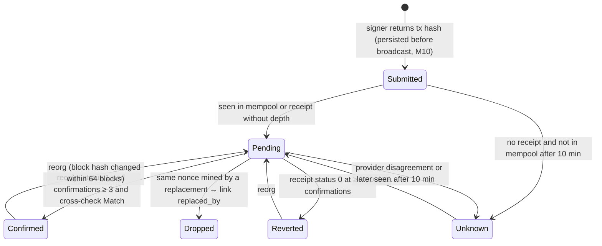

# M06 · Chain Reader & Transaction Tracking (`py-core` adapters + `worker`)

**Status:** Detailed (grilling round M06, 2026-10-11) · **Path:** `docs/modules/chain-reader/` · **Code:** `services/worker/.../chain/` (rpc, snapshot, tracker, indexer) · **Epic:** `[EPIC] M06 · Chain Reader & Tx Tracking`
**ADRs:** ADR-012 (Ethereum Sepolia), ADR-004 (outbox) · **Decisions:** PH-5, PH-6, PH-8, M06-D1 … M06-D10 (§14)

---

## 1. Purpose and boundaries

M06 is the system's **only window onto the chain**. Every other module reads chain facts through it: snapshots for planning and validation, transaction status for execution, events for state sync, and fee history for the fee policy. It never signs or sends anything.

| In scope (M1) | Out of scope |
|---|---|
| RPC client with failover and a secondary for cross-checks | Signing and broadcasting (signer, M10) |
| Block-consistent snapshots (Multicall3, pinned block) | Deciding allow/block (M08) |
| Transaction tracker: Submitted → Pending → Confirmed / Reverted / Unknown, replacements | Recovering Unknown operations (M11) |
| Reorg detection (64-block re-scan) | Reconciliation logic (M11) |
| Event indexer: module, Safe configuration, Safe execution, ERC-20 `Transfer` of treasury wallets | Business reactions to events (M03, M05, M11 handlers subscribe) |
| Unexpected-outflow detection (M06-D2) | Price oracles (Later) |
| Fee history for EXE-012 | |

## 2. Features, requirements and rules

| Feature | FR | BR |
|---|---|---|
| F-050 Chain state reader & snapshots | FR-401, FR-402 | BR-051, BR-018 |
| F-070 Transaction tracking | FR-601, FR-602 | BR-053, BR-060 |
| F-011/F-012 Safe config & coverage (read side) | FR-103, FR-105–107 | BR-018 |
| F-120 Audit/event history (events) | FR-510 | |
| Unexpected outflow | **FR-419 (new)** | **BR-069 (new)** |

## 3. Concepts

| Term | Definition |
|---|---|
| **Head** | Latest block number seen from the primary provider. |
| **Confirmations** | `head − receipt.blockNumber + 1`. Confirmed at ≥ 3 (PH-5, ~36 s on Sepolia). |
| **Snapshot** | All values needed by planning/validation for one treasury, read at **one** block via Multicall3, with block number, hash, timestamp, coverage and missing fields. |
| **Cursor** | Last fully processed block per (treasury, stream) for the indexer. |
| **Reorg window** | 64 blocks (≈ 2 epochs, Sepolia finality); events and confirmations inside it are re-checked by block hash. |
| **Unexpected outflow** | A `Transfer` of the asset **from** T/O1/O2 that does not match any of our operations (M06-D2). |

## 4. Data model (DATA_MODEL §2.5–2.6)

| Table | Columns | Notes |
|---|---|---|
| `snapshots` | id, treasury_id, purpose enum(PLAN, PRE_STEP, DASHBOARD, READBACK), block_number, block_hash, block_timestamp, observed_at, provider, data jsonb, coverage, missing jsonb | immutable; DASHBOARD rows pruned after 7 days |
| `transactions` | id, operation_id, chain_id, tx_hash, nonce, from_address, replaced_by_tx_id, status enum(Submitted, Pending, Confirmed, Reverted, Dropped, Unknown), block_number, block_hash, confirmations, revert_selector, gas_used, effective_gas_price, fee_wei, submitted_at, last_seen_pending_at, confirmed_at, crosscheck enum(NotRun, Match, Mismatch) | unique(chain_id, tx_hash) |
| `observed_events` | id, treasury_id, chain_id, stream enum(MODULE, SAFE_CONFIG, SAFE_EXEC, TOKEN), block_number, block_hash, tx_hash, log_index, address, event_name, payload jsonb, classification null, observed_at, removed bool | unique(chain_id, tx_hash, log_index) |
| `index_cursors` *(new)* | treasury_id, stream, last_block, last_block_hash, updated_at | PK(treasury_id, stream) |
| `token_movements` *(new)* | id, treasury_id, event_id, wallet, direction enum(IN, OUT), counterparty, amount, class enum(AGENT, INTERNAL_REFILL, INFLOW, UNEXPECTED_OUTFLOW), operation_id null, acknowledged_by/at | from TOKEN events |
| `rpc_health` *(new)* | provider, ok bool, latency_ms, head, last_error, at | rolling, 24 h |

## 5. Transaction status machine



There is no `Failed`. `Unknown` blocks the treasury (BR-060) until M11 resolves it from receipts and the module's `requestPaid` / `stepUsed`.

## 6. Interfaces (internal Python API used by worker/api)

| Function | Returns / effect |
|---|---|
| `rpc.call(method, params, critical=False)` | ordered providers with timeout 4 s, 2 retries each, then failover; `RpcUnavailable` if all fail (never a default value) |
| `rpc.crosscheck_receipt(tx_hash)` | reads receipt + block hash from the secondary; `Match` / `Mismatch` / `Unavailable` |
| `snapshot(treasury_id, purpose, block="latest") → Snapshot` | §8.1 |
| `is_fresh(snapshot, now, head) → bool` | ≤ 30 s and ≤ 2 blocks behind head (M08-D6) |
| `track(tx_id)` | Celery task, every 6 s while Submitted/Pending |
| `index(treasury_id)` | Celery beat, every 6 s; §8.3 |
| `fee_history(blocks=20, percentiles=[25, 50, 75])` | for EXE-012 |
| `safe_config(safe) → {owners, threshold, modules, guard, fallbackHandler, nonce}` | for coverage (TRS-007) and governance (MDT-009) |
| Subscribers | `on_event(stream, name, handler)` — handlers in M03 (payees, mandate, pause, exceptions, cancellations, governance txs), M05, M11 |

## 7. Flows

### 7.1 Payment confirmation

```mermaid
sequenceDiagram
  participant T as tracker
  participant P as primary RPC
  participant S as secondary RPC
  participant DB as postgres
  loop every 6 s
    T->>P: getTransactionReceipt, blockNumber
    alt no receipt
      T->>P: getTransactionByHash (mempool?)
    else receipt, confirmations ≥ 3
      T->>S: receipt + block hash (cross-check)
      alt match
        T->>DB: Confirmed (status 1) / Reverted (status 0, selector)
      else mismatch / unavailable
        T->>DB: keep Pending; after 10 min → Unknown + review item
      end
    end
  end
```

### 7.2 Unexpected outflow (M06-D2)

`Transfer(from = O1, to = X, 500)` indexed → no operation matches (same tx hash) → `UNEXPECTED_OUTFLOW` → notify Owner and Finance → if a plan of this treasury is in progress, request an immediate PRE_STEP re-validation (the BUFFER_BREACH of M08 example 10 is caught at once) → circuit-breaker input (RCV-006). The Owner can acknowledge it ("my own withdrawal").

## 8. Algorithms

### 8.1 Snapshot read set (one Multicall3 `aggregate3` at block B)

Per treasury: `asset.balanceOf(T, O1, O2)`; `asset.decimals()` (cached, verified once); module `mandate()`, `status()`, `usedToday(PAY)`, `usedToday(REFILL)`, `bufferOf/targetOf` for T/O1/O2, `isApprover` for known approvers; for the requests in scope: `payeeStatus(payee)`, `requestPaid`, `requestCancelled`, `stepUsed` (their step ids), `fingerprintPaid`, `refilledFor`, `exceptions(requestId)`, `duplicateAllowedFor`; Safe `getModulesPaginated`, `getGuard` (slot read), `getOwners`, `getThreshold`, `nonce` for T/O1/O2. Block B = `head` at call time; the call uses `blockTag = B`; the result stores `block_hash` and `timestamp` of B. Any failed sub-call → field in `missing`, coverage computed by TRS-007 rules; the snapshot is still stored (M08 blocks with `DATA_MISSING`).

### 8.2 Tracker rules

- Poll every 6 s (half a block). Confirmed at 3 confirmations **and** secondary cross-check Match (M06-D1). Unavailable secondary → retry until 10 min, then Unknown.
- Replacement: when another tx with the same `(from, nonce)` is mined, the original becomes `Dropped` and links `replaced_by`; the operation follows the mined one.
- Revert: decode the selector with POL-001 `decode_revert`.
- Day attribution: the UTC day of the **mined block timestamp** (BR-026).

### 8.3 Indexer with reorg handling (PH-6)

```
for stream in [MODULE, SAFE_CONFIG, SAFE_EXEC, TOKEN]:
  from = cursor.last_block − 64 (re-scan window), to = head − 0
  logs = eth_getLogs(addresses, topics, from, to) in chunks of ≤ 2,000 blocks
  for log in logs: upsert by (chain, tx_hash, log_index); store block_hash
  for stored events in [from, to] not returned again or with a different block_hash: removed = true → handlers get a "removed" callback
  cursor = to (with its block hash)
```

TOKEN stream filter: `Transfer` topic on the asset address with topic1 ∈ {T, O1, O2} **or** topic2 ∈ {T, O1, O2} (two queries). Classification: tx hash matches one of our operations → AGENT (or INTERNAL_REFILL for T→O); `to` is a treasury wallet and `from` is not → INFLOW; otherwise OUT → UNEXPECTED_OUTFLOW.

### 8.4 Example

O1 balance 110 after refill (block 100). Block 103: Owner's Safe tx moves 50 from O1. Indexer at ~block 104 sees `Transfer(O1 → owner, 50)`, no matching operation → UNEXPECTED_OUTFLOW; the in-progress plan is re-validated immediately → PAY 100 from 60 breaches buffer 10 → BLOCK, PartiallyCompleted, review item; Owner gets one combined notification.

## 9. Configuration and defaults

| Parameter | Value |
|---|---|
| Chain | Ethereum Sepolia 11155111 (12 s blocks) |
| Providers | Alchemy (primary), public Sepolia RPC e.g. publicnode (secondary) |
| RPC timeout / retries | 4 s / 2 per provider |
| Confirmations | 3 |
| Tracker / indexer interval | 6 s |
| Unknown after | 10 min |
| Reorg window | 64 blocks |
| getLogs chunk | 2,000 blocks |
| Snapshot freshness | ≤ 30 s and ≤ 2 blocks |
| Dashboard snapshot | every 60 s, kept 7 days |
| Multicall3 | `0xcA11bde05977b3631167028862bE2a173976CA11` |

## 10. Security

| Threat | Control | Test |
|---|---|---|
| Lying/lagging RPC marks a payment Paid | secondary cross-check before Confirmed; mismatch → never Paid | CHR-003 mismatch test with a fake provider |
| Stale data used for decisions | pinned block + freshness check; M08 blocks stale | freshness test |
| Reorg leaves a false Paid | 64-block re-scan, demote by block hash | Anvil reorg simulation |
| Funds moved outside the agent | TOKEN stream + UNEXPECTED_OUTFLOW alert + immediate re-validation | §8.4 test |
| Event spoofing from other contracts | logs filtered by exact contract addresses (module clone, Safes, asset) | address-filter test |
| Defaults on RPC failure | `RpcUnavailable` raised; no zero balances | unit test |

## 11. Failure scenarios

| Failure | Behaviour |
|---|---|
| Primary down | failover to secondary; health metric; cross-check marked Unavailable (Confirmed waits) |
| All providers down | snapshots fail → M08 `SNAPSHOT_STALE`/`DATA_MISSING` → no execution; tracker keeps retrying; nothing becomes Failed |
| getLogs range too large | halve the chunk and retry |
| Worker restart | cursors persisted; re-scan window covers the gap |
| Deep reorg > 64 blocks | not handled automatically (Sepolia finality); finalized-block check in M11 reconciliation flags it |

## 12. Test plan

| Level | Content | Ticket |
|---|---|---|
| Unit | failover, no-default behaviour, classification rules, freshness | CHR-001, CHR-006 |
| Integration (Anvil) | snapshot at one block; tracker states incl. replacement and revert decoding; cross-check mismatch; indexer idempotency | CHR-002, CHR-003, CHR-005 |
| Reorg | `anvil_snapshot`/`revert` + re-mine to change block hashes → Confirmed demoted, events removed | CHR-004 |
| E2E | unexpected outflow during a plan (§8.4) | CHR-006 + EXE-008 |

## 13. Tickets (order of work)

CHR-001 RPC client (+ secondary cross-check) → CHR-002 snapshots (Multicall3) → CHR-003 tracker → CHR-005 indexer → CHR-004 reorgs → **CHR-006 token movements and unexpected outflow (new)**.

## 14. Decisions

| ID | Decision |
|---|---|
| M06-D1 | Secondary-provider cross-check only at critical points: before Confirmed/Paid and on mandate read-back; mismatch → Pending/Unknown or Discrepancy. |
| M06-D2 | Index ERC-20 `Transfer` of the asset from/to T/O1/O2; classify AGENT / INTERNAL_REFILL / INFLOW / UNEXPECTED_OUTFLOW; unexpected outflow alerts and triggers immediate re-validation (BR-069). |
| M06-D3 | Snapshots via Multicall3 pinned to one block; failed sub-calls recorded as missing. |
| M06-D4 | Validator "today" = UTC day of the latest block timestamp, never the server clock. |
| M06-D5 | Unknown after 10 min without receipt and not in mempool; never Failed. |
| M06-D6 | Safe configuration events trigger coverage recompute; a drop feeds the circuit breaker. |
| M06-D7 | Plan snapshots immutable; dashboard snapshots every 60 s kept 7 days. |
| M06-D8 | Tracker and indexer poll every 6 s; getLogs chunks ≤ 2,000 blocks. |
| M06-D9 | Logs are filtered by exact addresses (module clone, Safes, asset). |
| M06-D10 | Status changes stream to the UI via SSE (M13). |
| PH-5/6/8 | 3 confirmations; getLogs polling with 64-block re-scan; Alchemy + public RPC. |

## 15. v0.3 changes (ADR-019)

Snapshot read set adds (same Multicall3 block): `aToken.balanceOf(safeT)`, `asset.balanceOf(aToken)` (pool available liquidity), `pool.getReserveData(asset)` (currentLiquidityRate, currentVariableBorrowRate, aToken address check), `pool.getUserAccountData(safeT)` (health factor, debt). Indexer adds module events `Supplied`, `Withdrawn` (and `BorrowExecuted`, `Repaid`). Token movements classify Safe T ↔ aToken transfers as `LENDING` (not unexpected outflow). **Tickets:** CHR-002, CHR-005, CHR-006 revised.
