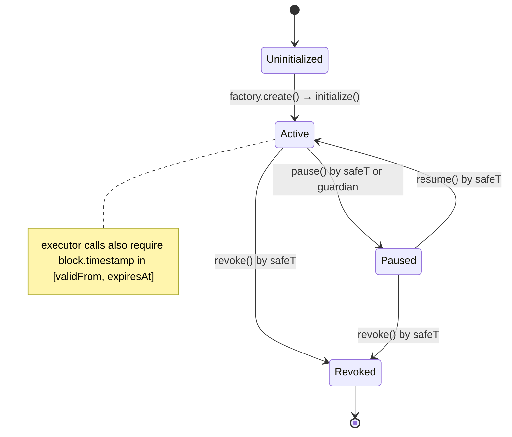
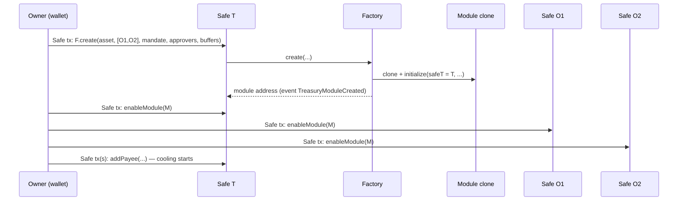
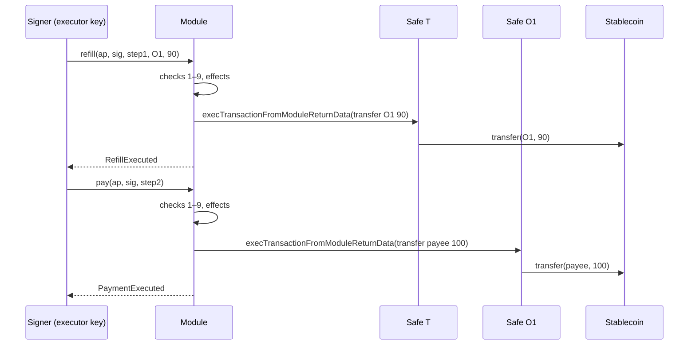

# M04 · Smart Contracts

**Status:** Detailed (grilling round M04, 2026-10-11) · **Path:** `docs/modules/contracts/` · **Code:** `contracts/` · **Epic:** `[EPIC] M04 · Smart Contracts`
**ADRs:** ADR-002 (Safe + module), ADR-003 (EIP-712, revised), ADR-014 (money) · **Decisions:** M04-D1 … M04-D11 (§14)

---

## 1. Purpose and boundaries

The contracts are the **final authority over money** (AP-1). Every rule marked **C** in `BUSINESS_RULES.md` is enforced here, so a compromised backend, signer or AI cannot move funds outside the mandate.

| In scope (M1) | Out of scope (M1) |
|---|---|
| `TreasuryPilotModule` (one clone per treasury) enabled on Safes T, O1, O2 | Generic execution, `delegatecall`, owner/module changes |
| `TreasuryPilotModuleFactory` (EIP-1167 clones) | Upgradeability (replace = disable old + enable new) |
| Stablecoin moves: `refill` T→Ox, `pay` Ox→payee | Native-token (gas) transfers — **none** in M1 (M04-D10) |
| Mandate, approvers, payees (with cooling), limits, buffers, targets, counters, replay protection, exceptions, duplicate overrides, pause/revoke | Reserves/holds on-chain (F-028, Later), n-of-m approvals (F-029, Later), signed quotes (F-065, Later), on-chain plan attestation (SC-L04, Later) |
| `TestUSDC` (labelled TEST) for local/CI | Real DEX integration |
| `TestRouter` + `swapForGas` — **P2, optional** | Bridge |

**Actors as seen by the contract**

| Actor | On-chain identity | Can call |
|---|---|---|
| Owner | **Safe T** itself (Owner signs Safe transactions; Safe threshold applies) | all governance functions |
| Guardian | one EOA/contract address in the mandate | `pause()` only |
| Executor | one EOA (key in `signer` service) | `refill`, `pay`, (`swapForGas`) |
| Approver | addresses in the approver set (EOA or ERC-1271 wallet) | nothing directly — their **signatures** are verified inside `refill`/`pay` |
| Anyone | — | views |

## 2. Features, requirements and rules covered

| Feature | Requirement(s) | Business rules |
|---|---|---|
| F-012 Module enablement & coverage | FR-106 | BR-018 |
| F-021 Mandate activation & lifecycle | FR-204–207 | BR-014, BR-015, BR-016 |
| F-022 Payee registry & cooling | FR-208–210 | BR-013, BR-017 |
| F-023 Limits & UTC counters | FR-212–214 | BR-020–BR-026 |
| F-024 Buffers & targets | FR-215 | BR-030, BR-036 (new) |
| F-025 One-time exception | FR-216–217 (revised) | BR-040–BR-043 (BR-041 revised) |
| F-026 Pause / resume / revoke | FR-219–220 | BR-062, BR-064 |
| F-037 Duplicate fingerprint | FR-315 (revised) | BR-071 (revised) |
| F-038 Approval signature | FR-316–318 | BR-001, BR-003, BR-004 |
| F-062 REFILL | FR-508 (revised) | BR-010, BR-012, BR-023, BR-036 |
| F-063 PAY | FR-509–510 | BR-001, BR-010, BR-019 (new), BR-024 |
| F-064 SWAP (P2) | FR-511–512 | BR-081, BR-082 |
| F-163 Security suites | FR-930, NFR-SEC-01/02/07 | all C-rules |

## 3. Concepts

| Term | Meaning on-chain |
|---|---|
| **Treasury** | One module clone. Its address is the `treasury` id used in signatures and events. |
| **Wallet roles** | `safeT` (source), `operational[]` = {O1, O2}. PAY only from operational wallets (M04-D6). |
| **Mandate** | Struct of rules, versioned; `version` increases on every `configureMandate`. |
| **Request** | An approved invoice payment, identified by `requestId` (bytes32, generated off-chain, unique). |
| **Step** | One executed action (REFILL or PAY), identified by `stepId` (bytes32, deterministic off-chain: `keccak256(requestId, action, seq)`). |
| **Fingerprint** | `keccak256(normalize(vendorId), normalize(invoiceNo), amount, asset)` computed off-chain (ENG-009), carried inside the signed approval. |
| **Day** | `block.timestamp / 86400` (UTC calendar day). |

## 4. Data model (storage)

```solidity
// ── configuration (set at initialize, never changed) ──
address public safeT;                    // Owner = this Safe
address public asset;                    // the only stablecoin of this treasury (M1)
mapping(address => bool) public isOperational;   // O1, O2
address[] public operationalList;
bool    private initialized;

// ── mandate (governance) ──
struct Limits { uint128 perRequest; uint128 daily; }
struct Mandate {
    uint64  version;                 // ++ on each configureMandate
    uint64  validFrom;               // unix seconds
    uint64  expiresAt;               // required (BR-014)
    uint32  payeeCoolingSeconds;     // M04-D5; ≥ 1 (demo 300, prod 86400)
    address executor;
    address guardian;
    Limits  pay;                     // base units of `asset`
    Limits  refill;
    uint32  approvalMaxAge;          // seconds an approval stays usable after signing deadline window, default 14 days
}
Mandate public mandate;
mapping(address => uint256) public bufferOf;   // minimum balance per wallet (incl. safeT)
mapping(address => uint256) public targetOf;   // soft target per operational wallet (used by refill bound, BR-036)
mapping(address => bool)    public isApprover;
uint256 public approverCount;

enum Status { Active, Paused, Revoked }
Status public status;

// ── payees ──
struct Payee { uint64 activeFrom; bool active; }
mapping(address => Payee) public payees;

// ── counters (BR-022: treasury-wide, never reset by version changes) ──
// key = keccak256(abi.encode(action, day)) ; action: 1 = PAY, 2 = REFILL, 3 = SWAP_IN
mapping(bytes32 => uint256) public usedOn;

// ── replay protection ──
mapping(bytes32 => bool) public requestPaid;        // requestId
mapping(bytes32 => bool) public requestCancelled;   // requestId (M05-D4, BR-077)
mapping(bytes32 => bool) public stepUsed;           // stepId
mapping(bytes32 => bool) public fingerprintPaid;    // fingerprint
mapping(bytes32 => mapping(address => bool)) public refilledFor; // requestId => toWallet (BR-036: one refill per request per wallet)

// ── owner grants (M04-D3) ──
struct Exception { uint128 amount; uint64 expiry; uint64 mandateVersion; address payee; bool used; }
mapping(bytes32 => Exception) public exceptions;          // requestId
mapping(bytes32 => bytes32)   public duplicateAllowedFor; // fingerprint => requestId allowed to pay again
```

**Invariants on storage:** `approverCount ≥ 1` while Active · `bufferOf[w] ≤ targetOf[w]` for operational wallets · `mandate.expiresAt > mandate.validFrom` · counters only increase.

## 5. State machine



Payee: `none → Cooling (active=true, now < activeFrom) → Active (now ≥ activeFrom) → Deactivated (active=false)`. Re-adding a deactivated address starts a new cooling period.

## 6. Interfaces

### 6.1 Factory

```solidity
interface ITreasuryPilotModuleFactory {
    /// Must be called BY Safe T (msg.sender becomes safeT). M04-D9.
    function create(address asset, address[] calldata operational, MandateInit calldata m,
                    address[] calldata approvers, BufferInit[] calldata buffers)
        external returns (address module);
    function implementation() external view returns (address);
    event TreasuryModuleCreated(address indexed safeT, address indexed module, address asset);
}
```
The implementation's `initialize` is disabled in its constructor; clones are initialized inside `create` in the same transaction. The Owner then calls `enableModule(module)` on T, O1 and O2 (one MultiSend batch is recommended).

### 6.2 Module — governance (only `msg.sender == safeT`)

| Function | Effect | Reverts with |
|---|---|---|
| `configureMandate(MandateInit m)` | Replaces mandate fields, `version++`. Does **not** touch counters, payees, approvers or buffers. Unused exceptions of older versions become invalid automatically (they store `mandateVersion`). | `NotOwner`, `InvalidMandate(field)` (expiry ≤ validFrom, zero executor, zero cooling, perRequest > daily) |
| `setApprovers(address[] add, address[] remove)` | Updates the set; must stay ≥ 1. | `NotOwner`, `NoApprovers` |
| `setBuffer(address wallet, uint256 buffer, uint256 target)` | Wallet must be safeT or operational; `buffer ≤ target` for operational. | `NotOwner`, `UnknownWallet`, `TargetBelowBuffer` |
| `addPayee(address payee)` | `activeFrom = now + mandate.payeeCoolingSeconds`, `active = true`. Re-adding restarts cooling. Payee must not be a treasury wallet. | `NotOwner`, `InvalidPayee` |
| `deactivatePayee(address payee)` | `active = false`. | `NotOwner`, `UnknownPayee` |
| `grantException(bytes32 requestId, uint128 amount, address payee, uint64 expiry)` | Stores an exception bound to the current `mandate.version`. Overwrites an unused one for the same request. M04-D3. | `NotOwner`, `ExpiryInPast`, `AlreadyPaid` |
| `revokeException(bytes32 requestId)` | Deletes it. | `NotOwner` |
| `allowDuplicate(bytes32 fingerprint, bytes32 requestId)` | Lets exactly this `requestId` pay an already-paid fingerprint once. | `NotOwner` |
| `resume()` | Paused → Active. | `NotOwner`, `NotPaused` |
| `revoke()` | → Revoked, permanently. | `NotOwner`, `AlreadyRevoked` |

### 6.3 Module — emergency

| Function | Caller | Effect |
|---|---|---|
| `pause()` | safeT or `mandate.guardian` | Active → Paused; idempotent if already Paused. Reverts `NotGuardianOrOwner`, `Revoked`. |
| `cancelRequest(bytes32 requestId)` *(added by M05)* | safeT **or any current approver** (`isApprover[msg.sender]`) | Sets `requestCancelled[requestId] = true`, emits `RequestCancelled(requestId, by)`. Idempotent. Works in any status, including Paused. Reverts `NotOwnerOrApprover`, `AlreadyPaid` if `requestPaid`. Cancellation is permanent. |

### 6.4 Module — executor (only `msg.sender == mandate.executor`, status Active, within validity window)

```solidity
struct PaymentApproval {
    bytes32 requestId;
    bytes32 invoiceHash;     // hash of the stored invoice document (off-chain)
    bytes32 fingerprint;
    address treasury;        // must equal address(this)
    address payingWallet;    // must be operational
    address asset;           // must equal `asset`
    address payee;
    uint256 amount;
    uint64  deadline;        // invoice due date — informational on-chain (M04-D11)
    bytes32 termsHash;
    uint64  expiry;          // approval usable until (default deadline + 14 days, ≤ signedAt + approvalMaxAge)
}

function refill(PaymentApproval calldata ap, bytes calldata approverSig,
                bytes32 stepId, address toWallet, uint256 amount) external;
function pay(PaymentApproval calldata ap, bytes calldata approverSig, bytes32 stepId) external;
```

**`refill` — checks in order** (each failure reverts with the named error):

| # | Check | Error | Rule |
|---|---|---|---|
| 1 | caller is executor, status Active, `validFrom ≤ now ≤ expiresAt` | `NotExecutor` / `NotActive` / `MandateExpired` | BR-062 |
| 2 | approval valid: domain, `treasury == this`, `asset == asset`, `now ≤ ap.expiry`, signer is a **current** approver (ECDSA or ERC-1271) | `ApprovalInvalid` / `ApprovalExpired` / `NotApprover` | BR-001/003/004 |
| 3 | `!requestPaid[ap.requestId]`; `!requestCancelled[ap.requestId]` | `RequestAlreadyPaid` / `RequestCancelled` | BR-061, BR-077 |
| 4 | `!stepUsed[stepId]` | `StepAlreadyExecuted` | BR-061 |
| 5 | `toWallet == ap.payingWallet` and `isOperational[toWallet]` | `WrongRefillTarget` | BR-012 |
| 6 | `!refilledFor[requestId][toWallet]` | `AlreadyRefilledForRequest` | BR-036 |
| 7 | `amount ≤ mandate.refill.perRequest` and `usedOn[REFILL,day] + amount ≤ mandate.refill.daily` | `OverRefillPerRequest` / `OverRefillDaily` | BR-023 |
| 8 | `balanceOf(safeT) − amount ≥ bufferOf[safeT]` | `SourceBufferBreach` | BR-030 |
| 9 | `balanceOf(toWallet) + amount ≤ ap.amount + targetOf[toWallet]` | `RefillExceedsNeed` | BR-036 |
| 10 | effects: `stepUsed`, `refilledFor`, `usedOn[REFILL,day] += amount` | — | |
| 11 | interaction: Safe T `execTransactionFromModuleReturnData(asset, 0, transfer(toWallet, amount), Call)`; require success and (returndata empty or `true`) | `TransferFailed` | |
| 12 | post-check: `toWallet` balance increased by exactly `amount` | `BalanceDeltaMismatch` | M04-D8 |
| 13 | emit `RefillExecuted(requestId, stepId, toWallet, amount, day)` | | |

**`pay` — checks in order**

| # | Check | Error | Rule |
|---|---|---|---|
| 1 | caller/status/window as above | as above | |
| 2 | approval valid (as in refill) | as above | BR-001/003/004 |
| 3 | `isOperational[ap.payingWallet]` | `NotOperationalWallet` | BR-019 (M04-D6) |
| 4 | payee: `payees[p].active && now ≥ activeFrom` | `PayeeUnknown` / `PayeeCooling` | BR-013/017 |
| 5 | `!requestPaid`, `!requestCancelled`, `!stepUsed` | `RequestAlreadyPaid` / `RequestCancelled` / `StepAlreadyExecuted` | BR-061, BR-077 |
| 6 | fingerprint: `!fingerprintPaid[fp]` **or** `duplicateAllowedFor[fp] == requestId` (then consume it) | `DuplicateFingerprint` | BR-071 |
| 7 | per-request: `amount ≤ pay.perRequest`, **or** a valid exception: `ex.amount == amount && ex.payee == payee && !ex.used && now ≤ ex.expiry && ex.mandateVersion == mandate.version` (then mark used) | `OverPerRequestLimit` / `ExceptionInvalid` | BR-040/041/042 |
| 8 | daily: `usedOn[PAY,day] + amount ≤ pay.daily` (exceptions included) | `OverDailyLimit` | BR-022/042 |
| 9 | buffer: `balanceOf(payingWallet) − amount ≥ bufferOf[payingWallet]` | `BufferBreach` | BR-030 |
| 10 | effects: `requestPaid`, `stepUsed`, `fingerprintPaid`, `usedOn[PAY,day] += amount` | | |
| 11 | interaction: payingWallet `execTransactionFromModuleReturnData(asset, 0, transfer(payee, amount))` | `TransferFailed` | |
| 12 | post-check payee balance delta == amount | `BalanceDeltaMismatch` | M04-D8 |
| 13 | emit `PaymentExecuted(requestId, stepId, fingerprint, payingWallet, payee, amount, day, usedException)` | | |

All state-changing functions use a reentrancy guard and checks-effects-interactions.

### 6.5 Views

`mandate()`, `status()`, `payees(addr)`, `payeeStatus(addr) → (state, activeFrom)`, `usedToday(action) → uint256`, `remainingToday(action)`, `requestPaid(id)`, `requestCancelled(id)`, `stepUsed(id)`, `fingerprintPaid(fp)`, `exceptions(id)`, `isApprover(addr)`, `bufferOf(w)`, `targetOf(w)`, `operationalList()`, `domainSeparator()`, `hashApproval(PaymentApproval)`.

### 6.6 Events

`MandateConfigured(version, expiresAt)` · `ApproversChanged(added[], removed[])` · `BufferSet(wallet, buffer, target)` · `PayeeAdded(payee, activeFrom)` · `PayeeDeactivated(payee)` · `ExceptionGranted(requestId, amount, payee, expiry, version)` · `ExceptionRevoked(requestId)` · `DuplicateAllowed(fingerprint, requestId)` · `Paused(by)` · `RequestCancelled(requestId, by)` · `Resumed()` · `Revoked()` · `RefillExecuted(...)` · `PaymentExecuted(...)`. Every event used by the backend indexer (CHR-005) carries ids, not free text.

### 6.7 EIP-712

```
domain: { name: "TreasuryPilot", version: "1", chainId, verifyingContract: module }
PaymentApproval(bytes32 requestId,bytes32 invoiceHash,bytes32 fingerprint,address treasury,
                address payingWallet,address asset,address payee,uint256 amount,uint64 deadline,
                bytes32 termsHash,uint64 expiry)
```
Only **one** typed struct remains on-chain in M1 (exceptions and duplicate overrides moved to governance transactions, M04-D3). Golden vectors: `contracts/test/vectors/payment-approval.json` (SC-017), consumed by Python (ENG-010) and TypeScript (WEB-009).

## 7. Main flows

### 7.1 Setup (J1)



### 7.2 Refill then pay (J4)



### 7.3 Over-cap with exception (J5)

1. Validator returns NEEDS_APPROVAL (amount 2,500 > perRequest 2,000).
2. Owner signs a Safe tx `grantException(requestId, 2500, payee, now + 3 days)`.
3. `pay` checks the exception at step 7, consumes it, and still applies the daily cap at step 8.

### 7.4 Failure paths

| Situation | Contract behaviour |
|---|---|
| Same request sent twice (retry/replay) | 2nd call reverts `RequestAlreadyPaid` / `StepAlreadyExecuted`; no state change |
| Paused between refill and pay | `pay` reverts `NotActive`; refill stays done (partial completion handled off-chain, BR-054) |
| Approver removed after signing | `NotApprover` (OQ-08 resolved: current set) |
| Payee deactivated after approval | `PayeeUnknown` |
| Token returns false / fee-on-transfer | `TransferFailed` / `BalanceDeltaMismatch` |
| Owner withdraws from O1 directly between steps | `BufferBreach` or `TransferFailed`; backend re-plans |

## 8. Algorithms and worked examples

Using `TestUSDC` (6 decimals). Amounts below are in whole units for readability; the contract uses base units (×10⁶).

**Mandate (demo defaults, from source YAML):** pay perRequest 2,000 / daily 10,000 · refill perRequest 2,500 / daily 12,000 · buffers T 1,000, O1 10, O2 10 · targets O1 150, O2 150 · cooling 300 s (demo).

| Case | Inputs | Result |
|---|---|---|
| UC-02 | O1 = 20, invoice 100 | refill ≤ `100 + 150 − 20 = 230` (BR-036 bound); planner refills 90 (Shortage) or 230 (Preferred); pay 100; O1 ends ≥ 10 |
| Refill bound abuse | approval for 10, executor tries refill 2,000 to O1 (O1 = 0) | `0 + 2000 > 10 + 150` → `RefillExceedsNeed` |
| Daily cap | used today 8,000, pay 2,500 with exception | `8,000 + 2,500 > 10,000` → `OverDailyLimit` (exception does not lift daily) |
| Buffer | O1 = 105, buffer 10, pay 100 | `105 − 100 = 5 < 10` → `BufferBreach` |
| Midnight | pay at 23:59:59 UTC uses day N; at 00:00:00 uses day N+1 | separate counters |

## 9. Configuration and defaults

| Parameter | Default (demo) | Default (prod) | Where set |
|---|---|---|---|
| `payeeCoolingSeconds` | 300 | 86,400 | mandate |
| approval `expiry` | deadline + 14 days | same | off-chain when building the approval (M04-D11) |
| `approvalMaxAge` | 30 days | 30 days | mandate |
| `pay` / `refill` limits | 2,000/10,000 · 2,500/12,000 | per customer | mandate |
| buffers / targets | T 1,000; O1/O2 10 / 150 | per customer | `setBuffer` |
| Safe version | v1.4.1 (pinned) | same | deployment manifest |
| Solidity | 0.8.24 (pinned), optimizer 200 runs | same | `foundry.toml` |

## 10. Security

| Threat | Control | Proof (test) |
|---|---|---|
| Compromised executor pays attacker | Needs an approver signature over exact payee/amount + payee allowlist + cooling | SC-020 bypass suite; invariant I1, I2 |
| Executor drains T via refills | Refill only to the approval's paying wallet; once per request per wallet; post-balance ≤ amount + target; daily cap | SC-009 tests; invariant I10 |
| Split payments to dodge per-request cap | Full approved amount in one PAY; daily counter treasury-wide | invariant I3 |
| Replay across chains/modules | EIP-712 domain (chainId, verifyingContract) + `treasury` field | SC-005 tests |
| Replay of request/step | `requestPaid`, `stepUsed`, `fingerprintPaid` | invariant I5 |
| Hijacked initialization | Factory callable only by Safe T itself; implementation init disabled | factory tests |
| Guardian abuse | Guardian can only pause; cannot resume or change config | role-matrix test |
| Malicious/odd token | Return-data check + exact balance-delta check | stub-token tests |
| Reentrancy via token hooks | `nonReentrant` + CEI | reentrancy stub test |
| Another module bypasses mandate | Out of contract scope; backend coverage check (TRS-007) blocks execution | AT35-style integration |
| Signature malleability | OpenZeppelin `ECDSA`/`SignatureChecker` (low-s enforced) | unit test |
| Owner mistakes (cooling 0, perRequest > daily) | `configureMandate` validation | unit tests |

**Invariants (SC-014, 10k runs):** I1 no PAY without a current approver signature over exact fields · I2 PAY only to active, non-cooling payee · I3 Σ PAY per day ≤ pay.daily · I4 no agent action leaves a wallet below its buffer · I5 each requestId/stepId/fingerprint executes at most once (except one explicit duplicate allowance) · I6 exception lifts only per-request and is used once · I7 Paused/Revoked ⇒ executor calls revert · I8 version changes never reset counters · I9 only safeT changes governance; guardian only pauses · **I10 refill never makes `balance(toWallet) > approval.amount + target`** (new) · **I11 a cancelled requestId never refills or pays** (added by M05).

## 11. Failure scenarios and recovery

| Failure | Detection | Recovery |
|---|---|---|
| Revert mid-plan | Receipt status 0 + error selector | Backend maps the selector to a reason code (POL-001), creates a review item |
| Tx pending/unknown | Tracker (CHR-003) | Re-query `requestPaid/stepUsed` before any resend (RCV-002) |
| Wrong module deployed / bad config | Coverage check fails (code hash) or `MandateConfigured` mismatch | Owner revokes, disables module, creates a new clone |
| Bug found after deploy (not upgradeable) | Audit/test | Pause → revoke → deploy fixed implementation → new clone → re-enable |
| Executor key lost | Ops | Owner `configureMandate` with a new executor (version++) |

## 12. Test plan

| Level | Content | Ticket |
|---|---|---|
| Unit | every error path in §6.4, governance role matrix, EIP-712 hashing vs vectors | SC-003…SC-012, SC-017, SC-021 |
| Scenario | source AT-01, 02, 05, 06, 07, 08, 10, 11, 12 | SC-013 |
| Fuzz + invariant | I1–I10, 10k runs on main, 1k on PRs | SC-014 |
| Bypass | direct calls with altered fields, non-executor, paused, cooling | SC-020 |
| Static analysis | Slither, triage table in `docs/security/static-analysis.md` | SC-015 |
| Differential | validator vs contract on the same cases | POL-004 |
| Gas report | `forge test --gas-report` stored as evidence | SC-013 |

## 13. Tickets (order of work)

| Order | Ticket | Note |
|---|---|---|
| 1 | SC-001 Foundry setup (Safe v1.4.1, OZ, TestUSDC) | |
| 2 | SC-002 Storage, structs, EIP-712, errors, events | revised: one typed struct |
| 3 | **SC-021 Factory + EIP-1167 clones + initialize** | **new** (M04-D2, D9) |
| 4 | SC-003 Mandate governance & versioning | revised: validation list §6.2 |
| 5 | SC-004 Payees + mandate-level cooling | revised (M04-D5) |
| 6 | SC-005 Approval signature verification (ECDSA + ERC-1271) | |
| 7 | SC-006 `pay()` core | revised: operational wallets only, balance-delta check |
| 8 | SC-007 Limits & UTC counters | |
| 9 | SC-008 Buffers | |
| 10 | SC-009 `refill()` | revised: one per request per wallet + `RefillExceedsNeed` |
| 11 | SC-010 Pause/resume/revoke/guardian | |
| 12 | SC-012 Fingerprint + `allowDuplicate` | revised (governance tx) |
| 13 | SC-011 Exceptions via `grantException` | revised (governance tx) |
| 14 | SC-017 Golden vectors | |
| 15 | SC-013 → SC-014 → SC-020 → SC-015 | test suites |
| 16 | SC-016 Deployment scripts + manifest | factory + implementation |
| 17 | **SC-022 `cancelRequest`** | **new** (M05-D4) |
| P2 | SC-018 TestRouter + swapForGas, SC-019 EAS schema | optional |

## 14. Decisions (grilling M04) and open questions

| ID | Decision |
|---|---|
| M04-D1 | Safe **v1.4.1**, pinned commit; verify official deployment on the chosen chain (ADR-012). |
| M04-D2 | **Factory + EIP-1167 clones**; implementation `initialize` disabled; coverage check = clone points to the known implementation. |
| M04-D3 | Owner grants exceptions and duplicate overrides through **governance transactions** (`grantException`, `allowDuplicate`), not EIP-712 signatures. |
| M04-D4 | Refill bound: post-refill `balance(to) ≤ approval.amount + target(to)`; one refill per request per wallet (BR-036). |
| M04-D5 | Payees are **per treasury**; cooling is one mandate parameter `payeeCoolingSeconds` (≥ 1). |
| M04-D6 | **PAY only from operational wallets**; T only refills (BR-019). |
| M04-D7 | Approvers may be EOAs or **ERC-1271** wallets (OpenZeppelin `SignatureChecker`). |
| M04-D8 | **Exact balance-delta check** after every transfer. |
| M04-D9 | Factory `create` is called **by Safe T itself**; module creation and initialization happen in one transaction. |
| M04-D10 | **No native-token transfers** in M1; executor gas is topped up manually with low-gas alerts. |
| M04-D11 | The contract enforces the approval's **`expiry`** only; the invoice `deadline` is informational (late payment stays possible). |
| M05-D4 *(addendum)* | `cancelRequest(requestId)` callable by Safe T or any current approver permanently blocks refill and pay for that request (BR-077). A compromised approver key can only cancel (denial of service), never pay. |

| Open | Question | Owner |
|---|---|---|
| ADR-012 | Chain and stablecoin (affects decimals, Safe deployment addresses) | anh Phúc |
| M04-Q1 | Single guardian address in M1; multiple guardians later? (default: single) | Project lead |
