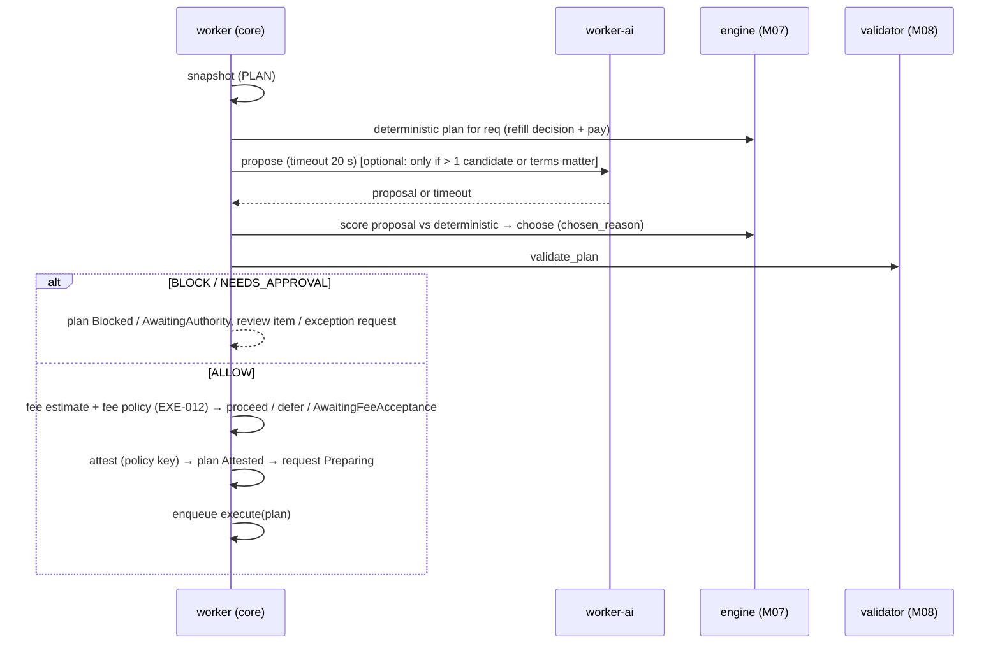

# M10 · Orchestration & Execution (`worker` + `signer`)

**Status:** Detailed and reviewed with the project lead (2026-10-11) · **Path:** `docs/modules/execution/` · **Code:** `services/worker/.../{trigger,planner,executor}`, `services/signer/` · **Epic:** `[EPIC] M10 · Orchestration & Execution`
**ADRs:** ADR-004 (outbox), ADR-006 (signer), ADR-007 (Celery/Redis), ADR-016 (attestation + simulation), ADR-017 (sentinel) · **Decisions:** M10-D1 … M10-D14 (§14)

### EXE-003 trigger integration contract

The worker schedules a 15-minute scheduling sweep, a 60-second safety sweep, and a one-second delayed-payee activation sweep. A durable `ExecutionCycleRequested` outbox event is enqueued after API approval and indexed `Resumed`, `ExceptionGranted`, ERC-20 inflow, or payee activation events. The outbox publisher forwards those events to the core queue; task IDs include the outbox event ID. Every execution and scheduling cycle uses the shared nonblocking `treasury_advisory_xact_lock`, then checks readiness, pause state, active mandate, coverage acknowledgment, Unknown operations, and an already executing operation. Skip reasons are stable structured log fields.

The cycle API exposes `CycleScheduleProvider`, `ScheduleWriter`, and `PlanStarter` protocols so EXE-004 can supply its persisted M07 schedule reader and idempotent plan-claim/enqueue callback. EXE-004 now supplies them in `planner/` (`DbScheduleProvider`, `DbPlanStarter`, task `treasurypilot.planning.plan_request`, AI proposal task on the `ai` queue; migration 0065 adds `plans`). There is no persisted M07 `schedules` table yet: the provider reads Approved requests directly (15-minute replan cooldown), and the scheduling-cycle writer stays unset. The AI is called only when `needs_full_proposal` applies (several eligible requests, or terms/deferrals that matter); otherwise the deterministic plan is used and no model call is made. The validator context comes from `planner/context.py` (shared with the sequencer); `planner/inputs.py` only builds the engine inputs. Each finished plan appends a `plan.finished` record (status, plan hash, reason codes) to the organization's hash-chained `audit_log` in the same transaction; the worker repeats the API's hashing in `worker/audit.py` because services cannot import each other, and a test checks the rows with the API's `verify_chain`. Fees of Attested/Executing plans count against the daily fee budget only for plans updated today (UTC); the sequence task now sets the plan to Executing/Completed/PartiallyCompleted, and re-attestation (`planner/reattest.py`) re-validates the remaining steps, signs a fresh attestation for the same plan and steps and hands the new `PlanRun` to the sequencer. A plan waiting for fee acceptance is expired once the fee policy has been accepted after it was created. Deferred: the EXE-014 liquidity action (`decide_liquidity` SUPPLY/WITHDRAW steps) is not planned yet. Settings: `TP_EXECUTOR_ADDRESS`, `TP_PLANNING_AI_ENABLED`, `TP_PLANNING_AI_TIMEOUT_SECONDS`, `TP_EXECUTION_LEAD_TIME_SECONDS`. Fee-acceptance handlers should call `append_execution_cycle_requested` in the transaction that records acceptance. The ERC-20 hook watches the treasury's configured token; native-coin inflows have no log hook in this indexer and are observed by the 60-second safety cycle. End-to-end “approved request starts executing within 5 seconds” remains unproven until the EXE-004 consumer is integrated.

**Advisory schedules and fee-accepted trigger (#142).** The 15-minute scheduling cycle appends a `schedules` row (migration 0075, `DbScheduleWriter`) with solver `DUE_DATE` (EDF/CP-SAT stay M07's). Items are `{requestId, order, scheduledFor, deadline}`, which differs from the spec's `{requestId, day, value, refill}` (no value/refill yet). Unchanged schedules are not re-written, and an empty schedule is stored only when it replaces a non-empty one; rows older than 30 days are deleted in the same writer call. Fee policy acceptance and held-plan fee acceptance append `ExecutionCycleRequested` in the accepting transaction. `planner/test_pipeline_integration.py` checks the approval-event chain and a budgeted latency estimate for the 5-second start (publisher beat + measured cycle + plan-enqueue countdown + an assumed 1 s pickup); this is an estimate, not a proof, since no live broker is involved. Remaining gap: `DbScheduleProvider` does not consume `schedules` (spec §7.1, “first item of today's schedule whose window is open”), and there is no Approved→Scheduled transition.

---


**Swap for gas (EXE-011, F-064) — a labelled simulation on the test router.** The swap step executes (Safe T pays cash, `TestRouter` pays the ERC-20 `tokenOut` back to Safe T), but `TestRouter.sol` never sends native coin to the executor, so it does **not** cure the shortage: executor gas is still funded manually. Real gas funding needs a production adapter that unwraps to native and pays the executor (EXE-L02 / #88 / #152). The sizing assumes **1 `tokenOut` unit = 1 wei** and the router rate `numerator()/denominator()` is in raw base units (no decimals adjustment). When the executor's native balance is below the plan's estimated fee, the planner prepends one `SWAP` step (module action `SWAP_IN`, Safe T → test router) built by the engine (`engine/gas_swap.py`): `amount_in` is the smallest cash amount whose `minOut` (the router quote less `TP_GAS_SWAP_SLIPPAGE_BPS`, rounded down) covers the shortfall, capped by `TP_GAS_SWAP_MAX_AMOUNT_IN` (the module's per-swap limit, which has no on-chain getter; unset disables swapping; it must be <= the on-chain `configureSwap` `perRequest` limit and the daily limit, or the module reverts; a shortage with swapping disabled logs `gas_swap_disabled_shortage`). The quote comes from the module's configured `swapRouter()` and its fixed `numerator()/denominator()`. A shortage with no quote or an over-cap swap is not attested (INFRA review, `GAS_SHORTAGE_UNCOVERED`). `minOut` and the `TEST_ROUTER` venue are persisted on `plan_steps` (`min_out`, `venue`, migration 0068) and travel in the sign request as `plan.swaps[stepId]`, outside the hashed plan; the signer checks the calldata `swapForGas(stepId, amountIn, minOut)` against them. The executor's `swapForGas` takes no attestation, so `minOut` is bounded by the signer and the module, not by the plan hash. The API and web label the step `TEST ROUTER`. The validator accepts a leading SWAP only (Safe T source, test-router venue, `minOut > 0`) and checks the source buffer; the swap limits are enforced on-chain only. The fee estimate that sizes the swap excludes the swap step's own gas; the later fee-policy check estimates the plan including the swap step.

**Decision (EXE-011-D1, ADR-002 `swapForGas`).** `minOut` and the venue sit outside `plan_hash` and the attestation, so a compromised worker or database could lower `minOut`. Accepted for the TEST ROUTER only (fixed rate; the on-chain perRequest/daily swap caps bound the blast radius). Production swaps need `minOut` in the attestation or an on-chain price floor.

## 1. Purpose and boundaries

M10 is the **engine room**: it decides *when* to act, runs the planning pipeline, and moves each attested step through the outbox, the signer and the chain — one request at a time per treasury — without ever paying twice.

| In scope (M1) | Out of scope |
|---|---|
| Scheduling cycle and execution trigger (time + events) | Computing amounts/schedules (M07) |
| Per-treasury single-flight lock | Allow/block decisions and attestation (M08) |
| Planning pipeline: snapshot → engine → AI proposal → score → validate → fee hold → attest | AI prompting (M09) |
| Outbox executor: operation before signing, tx hash before anything else | Tracking receipts (M06) |
| Step sequencing with PRE_STEP + SIMULATION + post-condition gate | Post-condition rules and reconciliation (M11) |
| Signer service (executor key, attestation check, nonce lane, replacement) and sentinel endpoint | Recovery of Unknown/partial (M12) |
| Gas ledger, low-gas alerts, fee policy enforcement (EXE-012) | Contracts (M04) |
| Run-now; swap step (P2) | KMS, production swaps, bridging, worker partitioning (Later) |

## 2. Features, requirements and rules

| Feature | FR | BR |
|---|---|---|
| F-060 Trigger | FR-501–504 | BR-050, BR-060, BR-063 |
| F-061 Executor & signer | FR-505–507 | BR-061, BR-092 |
| F-062/F-063 REFILL / PAY execution | FR-508–510 | BR-012, BR-019, BR-036, BR-053, BR-054 |
| F-064 Swap for gas (P2) | FR-511, FR-512 | BR-081, BR-082, BR-095 |
| F-066 Gas | FR-514, FR-515, FR-517, FR-518 | BR-025, BR-080, BR-084 |
| F-052–F-056 (pipeline orchestration) | FR-405–413 | BR-052, BR-055–059 |

## 3. Concepts

| Term | Definition |
|---|---|
| **Scheduling cycle** | Runs the M07 scheduler for a treasury and stores the day schedule (advisory). |
| **Execution cycle** | Picks today's next request for a treasury, plans, attests and executes it. |
| **Plan** | One request's execution plan (M08-D1): ≤ 2 steps (REFILL?, PAY), plus SWAP in P2. |
| **Operation** | Outbox row for one step (`step_id` unique). The unit the signer, tracker and recovery talk about. |
| **Nonce lane** | The executor address's transaction nonces, allocated only by the signer. |
| **Lead time** | How early before the due date (or discount date) a request becomes eligible today (OQ-06: 24 h, demo minutes). |

## 4. Data model (DATA_MODEL §2.5–2.6)

| Table | Columns | Notes |
|---|---|---|
| `schedules` | id, treasury_id, computed_at, snapshot_id, solver, status, objective, items jsonb, infeasible jsonb | advisory, append-only |
| `plans` | id, treasury_id, request_id, schedule_id, snapshot_id, planner_source enum(AI, DETERMINISTIC, RULE_BASED), plan_hash, chosen_reason, ai_call_ids uuid[], status enum(Draft, Blocked, AwaitingAuthority, AwaitingFeeAcceptance, Attested, Executing, Completed, PartiallyCompleted, Superseded, Expired), attestation_id, fee_estimate_wei, created_at | one active plan per request |
| `plan_steps` | id, plan_id, seq, step_id, action, from_wallet, to_address, asset, amount, status enum(Pending, Submitted, Confirmed, Verified, Reverted, Skipped) | unique(step_id) across active plans |
| `operations` (outbox) | id, treasury_id, plan_step_id, request_id, step_id, kind, payload jsonb (to, data, value 0), idempotency_key, status enum(NotSubmitted, Submitted, Pending, Confirmed, Reverted, Unknown, Abandoned), attempts, last_error, created_at | unique(step_id) |
| `transactions` | M06 §4 | one operation → 1..n transactions (replacements) |
| `gas_ledger` | id, treasury_id, transaction_id, payer enum(EXECUTOR, SENTINEL, RECEIPT), fee_wei, reverted, day | executor receipts are upserted by the tracker using the mined block's UTC day; a reorg removes the stale ledger row |
| `signer.nonces` *(signer schema)* | address, next_nonce, updated_at | the only nonce allocator |
| `signer.attestation_uses` | M08 §4.2 | |

## 5. State machines

**Plan:** `Draft → (Blocked | AwaitingAuthority | AwaitingFeeAcceptance | Attested)`; `Attested → Executing → (Completed | PartiallyCompleted)`; `Attested/Executing → Expired` (attestation timed out before the next step; a new plan for the remaining steps is created); any open plan → `Superseded` when a new plan replaces it.

**Operation:** `NotSubmitted → Submitted` (signer returned a hash) → `Pending → Confirmed | Reverted`; `→ Unknown` (M06) → resolved by M12 to `Confirmed | Reverted | Abandoned` (never re-sent while Unknown).

**Request (driven here):** `Approved → Scheduled` (in a schedule) → `Planning` (execution cycle picked it) → `Preparing` (attested) → `Paying` (PAY submitted) → `Paid` (PAY Confirmed + Verified); branches to `AwaitingAuthority`, `NeedsReview` per M05 §5.

## 6. Interfaces

### 6.1 Public API

| Method | Endpoint | Perm | Request → Response | Errors |
|---|---|---|---|---|
| POST | `/orgs/{o}/treasuries/{t}/run-now` 🔁 | OPR, OWN | → `202 {jobId}` | 400 `IDEMPOTENCY_KEY_REQUIRED`; 404 `TREASURY_NOT_FOUND`; 409 `TREASURY_PAUSED`, `TREASURY_NOT_READY`, `MANDATE_NOT_ACTIVE`, `COVERAGE_INCOMPLETE`, `UNKNOWN_OPERATION_PENDING`, `EXECUTING_PLAN_EXISTS` |
| GET | `/orgs/{o}/treasuries/{t}/schedule` | ANY | → `{schedule, items[{requestId, day, value, refill}], infeasible[]}` | |
| GET | `/orgs/{o}/plans/{p}` | ANY | → `{plan, steps[], validations[], attestation, aiRationale?, why}` | |
| GET | `/orgs/{o}/operations/{id}` | ANY | → `{operation, transactions[], verification}` | |
| GET | `/orgs/{o}/treasuries/{t}/events` (SSE) | ANY | plan/operation/request status stream | |

### 6.2 Signer (internal network only, shared secret header + allowlisted caller)

| Method | Endpoint | Request → Response | Errors |
|---|---|---|---|
| POST | `/sign-and-send` | `{treasuryId, plan, attestation, signature, stepSeq, payload{to, data}, fees{maxFeePerGas, maxPriorityFeePerGas, feeCapWei}}` → `{txHash, nonce, from}` | `ATTESTATION_INVALID`, `ATTESTATION_EXPIRED`, `NONCE_REUSED`, `PAYLOAD_MISMATCH`, `SIMULATION_REVERTED`, `FEE_CAP_EXCEEDED`, `CHAIN_NOT_ALLOWED`, `SIGNER_KEY_UNAVAILABLE`, `NOT_CONFIGURED` (no keystore mapped for the treasury) |
| POST | `/replace` | `{txHash, fees}` → `{txHash, nonce}` (same nonce, same payload, higher fees) | `NOT_PENDING`, `FEE_CAP_EXCEEDED` |
| POST | `/sentinel/pause` | `{treasuryId}` → `{txHash, alreadyPaused}` (`txHash` null when already paused) | `NOT_CONFIGURED`, `UNAUTHORIZED`, `CHAIN_NOT_ALLOWED`, `SIMULATION_REVERTED`, `SIGNER_KEY_UNAVAILABLE` |
| GET | `/sentinel/address`, `/health` | → addresses and gas balances only | `NOT_CONFIGURED` (address) |

## 7. Flows

### 7.1 Cycles

```
every 15 min and on events (approval, exception granted, resume, inflow, payee Active):
  scheduling_cycle(treasury)  → schedules row (M07 EDF + CP-SAT)

immediately after any of those events or a fee acceptance (M10-D1), and every 60 s as a safety net:
  for treasury in active treasuries:
    with advisory_lock(treasury) (non-blocking; skip if held):
      gates: backend pause, mandate Active, coverage COMPLETE/ack, no Unknown op, no Executing plan
      req = first item of today's schedule whose window is open
      if req: planning_pipeline(req)
```

### 7.2 Planning pipeline (EXE-004)



### 7.3 Step execution (EXE-007/008)

For each step in order:
1. **PRE_STEP** snapshot + `validate_step`; **SIMULATION** `eth_call` (M08). Not ALLOW → stop.
2. Outbox: in one DB transaction set step `Submitted`-intent and insert operation `NotSubmitted` (if not already there for this `step_id`).
3. Call signer `/sign-and-send`. On success persist `txHash` + nonce → operation `Submitted` → hand to tracker. On a typed refusal → stop with that code.
4. Wait (task re-schedules itself) until M06 says `Confirmed` (or `Reverted`/`Unknown`).
5. M11 post-condition check (REC-001) must be **PASSED** before the next step (M10-D6). DISCREPANCY → stop, review item, circuit-breaker signal.
6. After PAY Verified → request `Paid`, plan `Completed`; EAS receipt and reconciliation follow (M11).

**EXE-008 implementation** (`executor/sequencer.py`, `executor/gate.py`, `tasks.sequence_plan_task`): `sequence_plan` is resumable and sends at most one step per call, returning `Waiting` while the previous operation is Submitted/Pending/Unknown. It only runs while the request is Preparing/Paying (checked on entry and again right before a step is sent). Before each step `PlanGate.pre_step` takes a PRE_STEP snapshot, builds a `ValidationContext` (`planner/context.py`), runs `validate_step` then `simulate`, recording both in `validations`; a non-ALLOW or a terminal signer refusal opens one review item and moves the request to `NeedsReview` (only if that transition happened). A step already attempted (operation row with attempts > 0) is replayed without re-validation. PAY submitted → `Paying`; PAY Confirmed → `Paid` (always via `Paying`). The Celery task runs under the treasury advisory lock; the tracker enqueues it when an operation is Confirmed and a 15 s beat sweep backs that up. The REC-001 post-condition gate (`verifier`) and re-attestation (`PlanGate.reattest_fn` = `planner/reattest.py`, wired in `tasks.py`) are in place.

Stop at step k > 0 → plan `PartiallyCompleted`, request `NeedsReview`, completed steps stay (BR-054).

**RCV-003 resume** (`recovery/partial.py`): `resume_partial(pool, request_id)` moves a `PartiallyCompleted` plan back to `Executing` and its request `NeedsReview → Preparing`, resolves the open review items (RETRY, only POLICY_BLOCK/INFRA; otherwise `NotRetryable`, also when a step is Reverted/Abandoned) and sends nothing; the next `sequence_plan` skips Confirmed steps (no second refill) and re-validates the first unfinished one with `pre_step`. It refuses with `InFlight` while an operation is Submitted/Pending/Unknown (M12 resolves those first). Callers (review RETRY, startup scan, unknown resolution) enqueue `sequence_plan_task` afterwards; the sweep also does. The internal tasks `treasurypilot.recovery.resume_partial` / `cancel_partial` call them (resume then enqueues `sequence_plan`); the API review action is RCV-004. `cancel_partial` (same lock and in-flight guard) moves the request to `Cancelled`, the plan to `Superseded`, resolves items with CANCEL and reports the Confirmed steps whose funds stay where they are.

**EXE-008 traceability** (tests in `services/worker/tests/executor/`; Postgres, `TP_TEST_DATABASE_URL`):

| Criterion | Test |
|---|---|
| Owner balance change between refill and pay is detected and handled (AT-10 re-check on the current balance) | `test_gate_integration.py::test_wallet_balance_change_between_refill_and_pay_is_blocked`, `test_sequencer_integration.py::test_owner_balance_change_between_refill_and_pay_stops_with_review` |
| Next step not sent while the previous is Pending | `test_sequencer_integration.py::test_steps_run_in_order_and_pay_confirmation_marks_paid` |
| PRE_STEP then SIMULATION before each step | `test_gate_integration.py::test_wallet_balance_change_between_refill_and_pay_is_blocked` (validations rows) |
| Expired attestation renewed or plan stops | `test_sequencer_integration.py::test_expired_attestation_is_renewed_or_stops` |
| Non-ALLOW stops, PartiallyCompleted, review item with primary code | `test_owner_balance_change_...`, `test_first_step_block_is_blocked_not_partial`, `test_terminal_refusal_and_reverted_step_open_review` |
| Paying then Paid | `test_paid_goes_through_paying_with_both_events` |
| WITHDRAW / SWAP / REFILL steps, leading WITHDRAW | `test_a_request_plan_with_a_leading_withdraw_runs_it_first_and_completes`, `test_a_plan_with_a_swap_for_gas_step_runs_it_first_and_completes` |
| Partial completion resumes without a second refill (AT-07) | `test_resume_sends_only_the_unfinished_pay_after_revalidation` |

SUPPLY has no `ExecutionPlan` wire mapping, so request plans carry no SUPPLY step; liquidity SUPPLY runs under the swap/yield flow.

### 7.4 Gas replacement

Tracker sees a tx Pending longer than the preset's `resend_after` (NORMAL 60 s) → executor calls `/replace` with fees × 1.125, never above the plan's accepted fee cap; after the cap, it waits (no further bumps) and the request may become NeedsReview at the deadline.

## 8. Algorithms

### 8.1 Eligibility (today)

Request is in today's schedule **and** `now ≥ windowStart`, where `windowStart = min(dueDate, discountDate if the schedule chose early payment) − leadTime` (24 h prod; demo profile 2 min). Ties: schedule order (BR-052).

### 8.2 Lock and idempotency

`pg_try_advisory_xact_lock(hash('treasury', id))` around each cycle (skip when held). Celery tasks are `acks_late` + idempotent by `(plan_id, step_seq)`; a redelivered task finds the existing operation by `step_id` and continues from its status — it never calls the signer for an operation that is already `Submitted` (BR-061).

### 8.3 Nonce lane (signer)

`nonce = max(eth_getTransactionCount(executor, "pending"), signer.nonces.next_nonce)`; increment in the signer schema in the same transaction that records the attestation use. Replacements reuse the original nonce. The signer resolves the executor key by `treasury_id` (M10-D7). M1 maps every treasury to one shared executor, so signing for that address is serialized (one in-flight `sign-and-send` per executor address).

### 8.4 Worked example (UC-02)

O1 = 20 tUSDC, buffer 10, target 10 (UC-02 values), invoice 100. Engine: Shortage 90, Preferred 90, Bound 90 → REFILL 90 then PAY 100.
- t0 plan Attested (planHash h, validUntil t0 + 15 min).
- t0+5 s REFILL: PRE_STEP ALLOW, SIMULATION ok, op#1 NotSubmitted → Submitted (0xaa…, nonce 41).
- t0+41 s (3 blocks) Confirmed, cross-check Match; post-condition: O1 = 110, T −90 → PASSED.
- PAY: PRE_STEP ALLOW (110 − 100 = 10 ≥ 10), op#2 → Submitted (nonce 42) → Confirmed → PASSED → request Paid; EAS receipt queued.

### 8.5 Fee estimate and daily usage (EXE-012)

Before attestation, estimate each step with `eth_estimateGas` and sum `gasEstimate × maxFeePerGas` in integer wei. The current UTC day's executor spend is the sum of `gas_ledger.fee_wei` where `payer = EXECUTOR`; the tracker records confirmed and reverted transactions at the mined block's UTC date and removes the row if that inclusion is reorged out. A plan proceeds only if its estimate fits both the Owner-accepted per-plan threshold and the remaining daily budget. See M03 §8.6–8.7 for the proposal, wait, and review rules.

## 9. Configuration and defaults

| Parameter | Default |
|---|---|
| Scheduling cycle | 15 min + events |
| Execution cycle | 60 s |
| Lead time | 24 h (demo 2 min) *(mặc định, OQ-06)* |
| AI proposal timeout | 20 s, then deterministic/rule-based fallback (BR-055) |
| Attestation validity | 15 min (M08) |
| Replacement | per fee preset (NORMAL: after 60 s, +12.5 %, capped by accepted fee) |
| Low-gas thresholds | executor 0.05 ETH, sentinel 0.01 ETH, receipt key 0.01 ETH (Sepolia) |
| Celery | `acks_late`, `reject_on_worker_lost`, visibility timeout 1 h |

The signer accepts `X-Signer-Secret` only on the internal network. Configure
`TP_TRUSTED_POLICY_SIGNERS` and `TP_ALLOWED_CHAIN_IDS` as JSON arrays, and map every treasury UUID
to an encrypted keystore path in `TP_EXECUTOR_KEYSTORE_MAP` (JSON object). The signer reads the
password from `TP_EXECUTOR_KEYSTORE_PASSWORD_FILE`. M1 may map multiple treasury IDs to one
keystore. Missing signer configuration fails closed.

The sentinel uses a separate keystore (`TP_SENTINEL_KEYSTORE_PATH`,
`TP_SENTINEL_KEYSTORE_PASSWORD_FILE`) and `TP_SENTINEL_TARGETS`, a JSON object mapping each
treasury UUID to its `guardianSafe` and `module` (neither may be the zero address, and they must
differ). It can only send `GuardianSafe.execTransaction(module, 0, pause(), CALL, ...)` signed as
a Safe owner (approved-by-sender signature); the request carries no target or calldata. Setting
targets makes both the keystore and `CHAIN_RPC_URL` mandatory at startup; with none set the
endpoint answers `NOT_CONFIGURED`. `/health` reports the sentinel's gas balance, but the
low-gas threshold alert is not implemented yet. The database migration creates the `signer`
schema and `treasurypilot_signer` role; signer connections execute as that role, which has write
access only to the signer nonce and attestation-use tables. The migration grants role membership
to the migration login; if the signer uses a different login, the database administrator must
grant `treasurypilot_signer` to that login before startup.

## 10. Security

| Threat | Control | Test |
|---|---|---|
| Compromised worker-ai signs | worker-ai has no policy key, no signer secret (ADR-005/006) | container secret test |
| Compromised core worker | signer still requires a valid attestation over the exact payload, simulates, and the contract enforces everything | signer forged-attestation tests |
| Double payment by retry/redelivery | unique `step_id`, outbox before signing, contract `stepUsed`/`requestPaid` | RCV-007 crash test |
| Concurrent plans in one treasury | advisory lock + "no Executing plan" gate + contract counters | concurrency test |
| Fee drain | accepted fee cap enforced in the signer (`FEE_CAP_EXCEEDED`) | fee cap test |
| Signer endpoint abuse | internal network, shared secret, caller allowlist, only 5 endpoints | network policy test |
| Key exposure | encrypted keystores, Docker secrets, no key in logs/health | log scan test |

## 11. Failure scenarios

| Failure | Behaviour |
|---|---|
| Worker crash after signer returned but before DB write | Signer persisted the attestation use; tracker finds the tx by (from, nonce) during M12 recovery; operation reconciled by `step_id` |
| Signer down | operation stays NotSubmitted; retried with backoff; plan may expire → re-plan |
| Simulation revert in signer | no broadcast; typed error; plan Blocked/NeedsReview |
| Tx stuck | replacement up to the fee cap; then wait; Unknown after 10 min without data → M12 |
| Reverted step | no counters changed (BR-025); fee recorded; stop; review item; circuit-breaker input |
| Out of gas | `INSUFFICIENT_GAS`, stop before signing, alert |
| AI timeout | fallback (BR-055), plan source RULE_BASED |

## 12. Test plan

| Level | Content | Ticket |
|---|---|---|
| Unit | eligibility, lock, idempotent re-entry, nonce allocation, replacement math | EXE-003, EXE-007, EXE-005 |
| Integration (Anvil) | UC-02 end-to-end; Owner withdrawal between steps (M08 ex. 10); signer refusals; replacement; out of gas | EXE-004…EXE-010 |
| Fault injection | kill worker between signer and DB write; redeliver tasks; signer restart | RCV-007 |
| Security | worker-ai secrets; payload mismatch; fee cap | EXE-005, EXE-002 |

## 13. Tickets (order of work)

EXE-001 schema → EXE-002 Celery → EXE-003 trigger/cycles → EXE-012 fee policy → EXE-004 pipeline → EXE-005 signer → EXE-006 keystore → EXE-013 sentinel → EXE-007 outbox executor → EXE-008 sequencing → EXE-010 gas ledger → EXE-009 run-now → EXE-011 swap (P2). Later: EXE-L01…L04.

## 14. Decisions

| ID | Decision |
|---|---|
| M10-D1 | Two cycles: scheduling (15 min + events) and execution (60 s safety net); **events (approval, exception granted, resume, inflow, payee Active, fee accepted) enqueue an execution cycle immediately**; only today's items execute. (reviewed 2026-10-11) |
| M10-D2 | Per-treasury Postgres advisory lock, non-blocking; plus "no Executing plan" gate. |
| M10-D3 | AI proposal timeout 20 s; deterministic plan always computed first. (reviewed) |
| M10-D4 | Fee policy applied after ALLOW and before attestation (EXE-012). |
| M10-D5 | Outbox: operation row before signing; tx hash persisted before any other step. |
| M10-D6 | The next step requires the previous step's post-condition **PASSED** (M11). (reviewed) |
| M10-D7 | Keys in the signer are stored and looked up **per `treasury_id`** (keystore map, nonce lane per executor address); M1 configures one shared executor for all treasuries, so a per-treasury executor later is a config change only. (reviewed) |
| M10-D8 | Replacements reuse nonce and payload, bump +12.5 %, never above the accepted fee cap. |
| M10-D9 | Lead time 24 h before due/discount date, demo 2 min (OQ-06). (reviewed) |
| M10-D10 | Signer API limited to sign-and-send, replace, sentinel pause, sentinel address, health. |
| M10-D11 | Signer enforces the fee cap carried with the attested plan. |
| M10-D12 | Partial completion → plan PartiallyCompleted, request NeedsReview; resumption creates a new plan for the remaining steps (M12). |
| M10-D13 | Low-gas thresholds per key (executor/sentinel/receipt). (reviewed) |
| M10-D14 | Run-now uses the same gates and enqueues exactly one execution cycle. |
| M10-D15 | RETRY on PartiallyCompleted resumes the same plan; REPLAN remains for plan-shape changes. |

## 15. v0.3 changes (ADR-019)

- Step types: `WITHDRAW`, `REFILL`, `PAY`, `SUPPLY` (`BORROW`/`REPAY` P2, only from an owner-authorized plan).
- Execution cycle order per treasury: (1) request plans due today (with a leading WITHDRAW when needed); (2) when no request plan is executing, at most one liquidity action from `decide_liquidity` (M07 §15).
- Signer payload allowlist adds `module.supply`, `module.withdraw` (and `borrow`/`repay` P2).
- Demo uses one operational wallet (T + O1).
- **Tickets:** EXE-004, EXE-005, EXE-007, EXE-008 revised; EXE-014 liquidity cycle (new).
