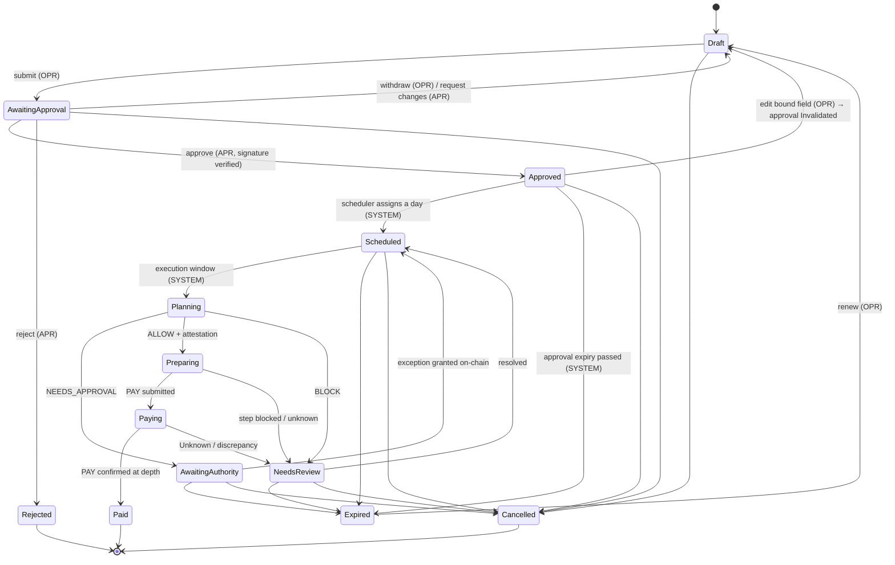
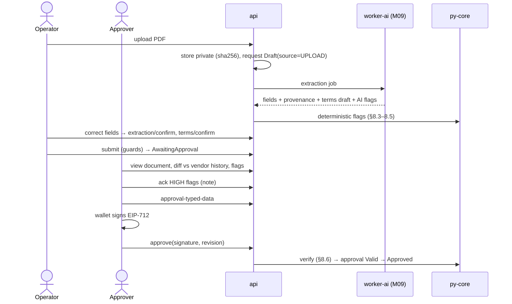

# M05 · Invoices, Payment Requests & Approvals (`api` + `py-core`)

**Status:** Detailed (grilling round M05, 2026-10-11) · **Path:** `docs/modules/invoices/` · **Code:** `services/api/.../requests/`, `packages/py-core/src/treasurypilot_core/{fingerprint,flags,approval}` · **Epic:** `[EPIC] M05 · Invoices & Payment Requests`
**ADRs:** ADR-003 (EIP-712), ADR-014 (money) · **Decisions:** M05-D1 … M05-D14 (§14)

---

## 1. Purpose and boundaries

M05 turns an invoice into a **payment request** that a human approves with a wallet signature over the exact fields the contract will check. It owns intake (manual, upload, CSV), revisions, fingerprints, deterministic risk flags, the approval typed data and its verification, cancellation (off-chain and on-chain), and the request state machine.

| In scope (M1) | Out of scope |
|---|---|
| Manual entry, document upload, CSV import | LLM extraction and instruction-text detection (M09 — we consume its output) |
| Revisions and approval invalidation | Payee registration on-chain, cooling (M03) |
| Fingerprint, exact-duplicate block, near-duplicate flag | Paying, scheduling (M07, M10) |
| Deterministic flags (address, outlier, dates, currency/chain, first payment) | Screening provider (M14) |
| `PaymentApproval` typed data, signature verification, maker-checker | Exceptions (M03 + Owner) |
| Request state machine and status events | Email inbox, inbound API, recurring, fiat (Later: F-033/034/040/041) |
| Cancel, including on-chain `cancelRequest` (M05-D4) | |

**Who decides what:** the Operator enters data; the AI suggests fields (M09); the **Approver decides whether to pay** by signing; the engine and agent decide how and when; the contract enforces.

## 2. Features, requirements and rules

| Feature | FR | BR |
|---|---|---|
| F-030 Manual entry | FR-301, FR-302 | BR-073 |
| F-031 Upload (non-AI part) | FR-303, FR-304, FR-305 | BR-072, BR-074, BR-075 |
| F-032 CSV import | FR-306, FR-307 | |
| F-035 Terms confirmation (model in M07) | FR-310, FR-311 | BR-075 |
| F-036 Deterministic flags | FR-312, FR-313, **FR-323 (new)** | BR-066, BR-072, **BR-076 (new)** |
| F-037 Fingerprint | FR-314, FR-315 | BR-071 |
| F-038 Approval | FR-316, FR-317, FR-318 | BR-001, **BR-007 (new)**, BR-003, BR-004, BR-005, BR-006 |
| F-039 State machine | FR-319, FR-320, **FR-324 (new)** | BR-060, **BR-077 (new)** |

## 3. Concepts

| Term | Definition |
|---|---|
| **Vendor** | A company we pay (name, tax id, normalized reference). Has 1..n payee addresses (M03). History (amounts, addresses) is kept **per vendor** (M05-D2). |
| **Payment request** | One invoice to be paid once, in full, from one paying wallet to one payee (M05-D9). |
| **Bound fields** | The fields signed in `PaymentApproval` (BR-003): requestId, invoiceHash, fingerprint, treasury, payingWallet, asset, payee, amount, deadline, termsHash, expiry. Editing any of their inputs creates a new revision and invalidates approvals. |
| **Free fields** | Internal note, tags, cost center, attachments other than the invoice document. Editable at any time before Paid without invalidation. |
| **requestId (on-chain)** | `keccak256(abi.encode("TP_REQ_V1", orgId, request uuid))`. Stable across revisions so `requestPaid` blocks a second payment of any revision. |
| **invoiceHash** | `keccak256(abi.encode(normVendorRef, normInvoiceNo, amount, asset, issueDate, dueDate, documentSha256 or 0x0))` (M05-D3). |
| **fingerprint** | M07 §8.5: `keccak256(abi.encode(norm(vendorRef), norm(invoiceNo), amount, asset))`. |
| **Flag** | Deterministic (here) or AI (M09) risk signal on a **revision**, severity LOW or HIGH. HIGH needs the Approver's acknowledgment with a note; an ack is valid only for the revision it was made on. |

## 4. Data model (changes to DATA_MODEL §2.3–2.4)

| Table | Columns | Notes |
|---|---|---|
| `vendors` | id, org_id, name, **normalized_ref** (unique per org), **tax_id** null, contact (encrypted), notes, created_by | M05-D2. `normalized_ref = norm(name or supplier code)` set once; renaming keeps it |
| `payees` | + `vendor_id` NOT NULL | a payee always belongs to a vendor |
| `payment_requests` | id, org_id, treasury_id, chain_id (= treasury's chain, ties asset_id), vendor_id (= payee's vendor, same org), payee_id, invoice_no, **issue_date**, due_at, amount numeric(78,0), asset_id, paying_wallet_id, terms jsonb, terms_hash, terms_confirmed_by/at, fingerprint, **invoice_hash**, **onchain_request_id**, **source** enum(MANUAL, UPLOAD, CSV), extraction_confirmed_by/at, status, current_revision, created_by, last_edited_by, note, tags text[], cost_center, **cancel_onchain** enum(NotNeeded, Pending, Confirmed) , cancel_tx_hash, version | unique(treasury_id, fingerprint) where status ∉ (Rejected, Cancelled, Expired) |
| `request_revisions` | id, request_id, revision, snapshot jsonb (all bound inputs), edited_by, at, reason | append-only |
| `documents` | id, request_id, storage_key, sha256, mime, size, pages, uploaded_by | private bucket |
| `flags` | id, request_id, **revision**, code, severity, evidence jsonb, source enum(DETERMINISTIC, AI), status enum(Open, Acknowledged, Superseded), acknowledged_by/at, ack_note | recomputed on every revision; old ones → Superseded |
| `approvals` | id, request_id, revision, approver_user_id, approver_address, typed_data jsonb, signature, **acknowledged_flag_ids** uuid[], **solo_mode** bool, expires_at, status enum(Valid, Invalidated, Expired, Cancelled) | immutable except status, which only moves Valid → Invalidated/Expired/Cancelled |
| `csv_imports` | id, org_id, treasury_id, file_sha256, rows_total, rows_created, errors jsonb, created_by, at | |
| `request_status_events` | id, request_id, from, to, actor_type, actor_id, reason, at | append-only |

## 5. State machine (F-039)



**Guards**

| Transition | Who | Guard (error) |
|---|---|---|
| submit | OPR, ADM | payee exists and not Deactivated (`PAYEE_UNKNOWN`); asset = treasury stablecoin (`ASSET_NOT_PAYMENT_STABLECOIN`); no other active request with the same fingerprint (`DUPLICATE_FINGERPRINT`); extracted fields confirmed if source = UPLOAD (`EXTRACTION_UNCONFIRMED`); extracted terms confirmed or none (`TERMS_UNCONFIRMED`) |
| approve | APR with linked wallet | §8.6 (all errors listed there) |
| edit bound field | OPR, ADM | status ∈ {Draft, AwaitingApproval→withdraw first, Approved} and no operation in flight (`PAYMENT_IN_FLIGHT`); `If-Match` (412) |
| cancel | OPR (own drafts), OWN, ADM | no PAY operation NotSubmitted/Submitted/Pending/Unknown (`PAYMENT_IN_FLIGHT`, BR-060) |
| renew | OPR | creates a new revision with a new due/expiry; needs a new approval |
| SYSTEM transitions | worker | emitted by M07/M08/M10/M11 only |

`Paid`, `Rejected`, `Cancelled` are terminal. There is no generic `Failed` state.

**Cancellation (M05-D4, BR-077):** cancel is immediate off-chain (validator code `REQUEST_CANCELLED`, signer refuses). If the request ever had a `Valid` approval, `cancel_onchain = Pending` and the UI shows **"Cancel on-chain"**: any Approver signs a transaction `module.cancelRequest(requestId)` from their own wallet, or the Owner submits it through Safe T. When `RequestCancelled` is observed, `cancel_onchain = Confirmed`. A Pending on-chain cancel is a visible to-do on the dashboard until confirmed.

## 6. API (changes to API_SPEC §4)

| Method | Endpoint | Perm | Request → Response | Errors |
|---|---|---|---|---|
| GET/POST/PATCH | `/orgs/{o}/vendors[/{vId}]` | ANY / OPR, ADM | `{name, taxId?, contact?}` → `{vendor}` | 409 `VENDOR_REF_EXISTS` |
| POST | `/orgs/{o}/requests` 🔁 | OPR, ADM | `{treasuryId, vendorId, payeeId, invoiceNo, issueDate, dueDate, amount: "1000.00", payingWalletId?, terms?, note?, tags?, costCenter?}` → `201 {request, flags[]}` | 422 `ASSET_NOT_PAYMENT_STABLECOIN`, `PAYEE_UNKNOWN`, `PAYEE_NOT_OF_VENDOR`, `AMOUNT_PRECISION`, `AMOUNT_NOT_POSITIVE`, `DATE_INVALID` |
| POST | `/orgs/{o}/requests/upload` 🔁 | OPR | multipart `file`, `treasuryId` → `202 {requestId, extractionJobId}` | 413, 415, 422 `MULTI_INVOICE_DOCUMENT` |
| POST | `/orgs/{o}/requests/{r}/extraction/confirm` | OPR | `{fields}` (final values) → `{request, flags[]}` | 409 `EXTRACTION_PENDING` |
| POST | `/orgs/{o}/requests/import-csv` 🔁 | OPR | multipart, `?dryRun=true` → `{importId, created[], errors[{row, field, code}]}` | 422 `CSV_HEADER_INVALID`, `CSV_ENCODING` |
| PATCH | `/orgs/{o}/requests/{r}` | OPR | `If-Match` + fields → `{request, revision, approvalInvalidated: bool}` | 409 `NOT_EDITABLE`, `PAYMENT_IN_FLIGHT`, 412 |
| POST | `/…/{r}/terms/confirm` | OPR | `{terms}` → `{request}` | 422 `TERMS_INVALID` |
| POST | `/…/{r}/submit` | OPR | → `{request}` | 409 `DUPLICATE_FINGERPRINT` (+ `existingRequestId`), `TERMS_UNCONFIRMED`, `EXTRACTION_UNCONFIRMED` |
| POST | `/…/{r}/withdraw` | OPR | → Draft | |
| POST | `/…/{r}/request-changes` | APR | `{reason}` → Draft | |
| POST | `/…/{r}/flags/{f}/ack` | APR | `{note}` (≥ 10 chars) → `{flag}` | 409 `FLAG_SUPERSEDED`, `MAKER_CHECKER` |
| GET | `/…/{r}/approval-typed-data` | APR | → `{domain, types, primaryType, message}` | 409 `MAKER_CHECKER`, `HIGH_FLAGS_UNACKED`, `NOT_AWAITING_APPROVAL` |
| POST | `/…/{r}/approve` 🔁 | APR | `{signature, revision}` → `{request: Approved, approval}` | 400 `SIGNATURE_INVALID`, 403 `NOT_IN_APPROVER_SET`, `WALLET_NOT_LINKED`, 409 `MAKER_CHECKER`, `REVISION_CHANGED`, `HIGH_FLAGS_UNACKED` |
| POST | `/…/{r}/reject` | APR | `{reason}` → Rejected | |
| POST | `/…/{r}/cancel` | OPR, OWN, ADM | `{reason}` → `{request: Cancelled, cancelOnchain}` | 409 `PAYMENT_IN_FLIGHT` |
| GET | `/…/{r}/cancel-tx` | APR, OWN | → `{to: module, data: cancelRequest(requestId)}` or `{safeTx}` for the Owner | 409 `CANCEL_NOT_NEEDED` |
| POST | `/…/{r}/renew` | OPR | `{dueDate?}` → Draft (new revision) | 409 `NOT_EXPIRED` |

**`PaymentApproval` typed data (corrected: 11 fields, no `overrideDuplicate`, M04-D3)**

```json
{
  "domain": {"name": "TreasuryPilot", "version": "1", "chainId": 84532, "verifyingContract": "0xModule…"},
  "primaryType": "PaymentApproval",
  "message": {
    "requestId": "0x…32", "invoiceHash": "0x…32", "fingerprint": "0x…32",
    "treasury": "0xModule…", "payingWallet": "0xO1…", "asset": "0xUSDC…",
    "payee": "0xVendorA…", "amount": "1000000000", "deadline": 1761955200,
    "termsHash": "0x…32", "expiry": 1763164800
  }
}
```

## 7. Flows

### 7.1 Upload → approve



### 7.2 CSV import

Template columns: `vendor_ref, payee_address, invoice_no, issue_date, due_date, amount, terms_text?, note?, cost_center?`. Steps: encoding UTF-8 (BOM allowed) → header exact match → per row: vendor by `normalized_ref`, payee address must belong to that vendor (no auto-creation), amount decimal string with ≤ asset decimals, dates ISO → fingerprint vs DB **and** vs earlier rows in the file → flags → Draft. `dryRun=true` returns the same report without writing. Error report CSV escapes cells starting with `= + - @ \t \r` by prefixing `'` (FR-307).

## 8. Algorithms

### 8.1 Normalization

`norm(s) = NFKC(s).strip().casefold()` then remove whitespace and `- _ / . # :`; leading zeros in purely numeric invoice numbers are kept (`0012` ≠ `12` is safer than merging).

### 8.2 Exact duplicate

On create, edit and submit: look up `fingerprint` among the treasury's requests with status ∉ {Rejected, Cancelled, Expired}. Found → `DUPLICATE_FINGERPRINT` with `existingRequestId`, submit blocked (BR-071). A legitimate repeat needs a distinct invoice number, or the Owner's `allowDuplicate` (M03 UI) after which submit is allowed for that one request.

### 8.3 Near-duplicate (M05-D5, BR-076)

Candidates: same vendor, **same amount**, issue dates within **45 days**, status ∉ {Rejected, Cancelled}, different fingerprint.
For each candidate compute Damerau-Levenshtein distance `d` between normalized invoice numbers.

| Condition | Flag |
|---|---|
| `d ≤ 2` | `POSSIBLE_DUPLICATE` **HIGH** (evidence: other request id, both numbers, d) |
| `d > 2` | `POSSIBLE_DUPLICATE` LOW (likely recurring) |

Examples: `INV-2026-0412` vs `INV-2026-0421` → `inv20260412` / `inv20260421`, transposition d = 1 → HIGH. `RENT-SEP` vs `RENT-OCT` (same 3,000) → d = 3 → LOW.

### 8.4 Amount outlier (OQ-10)

History = vendor's Paid requests, last 12 months, n ≥ 5 (else `NO_BASELINE` LOW).
`med = median(h)`, `MAD = median(|h − med|)`, `s = max(1.4826·MAD, 0.02·med)` (2 % floor so identical recurring amounts do not flag every cent), flag `AMOUNT_OUTLIER` HIGH if `|x − med| > 3·s`.

Example: h = [1,000, 1,020, 980, 1,010, 990] → med 1,000; |dev| = [0, 20, 20, 10, 10] → MAD 10; s = max(14.83, 20) = 20; band 940–1,060. x = 1,100 → HIGH; x = 1,050 → none. All in base units; the median of an even count is the lower middle (integer only).

### 8.5 Other deterministic flags

| Code | Severity | Rule |
|---|---|---|
| `ADDRESS_CHANGED` | HIGH | payee address differs from the address used in the vendor's last Paid request (BR-072) |
| `ADDRESS_NOT_REGISTERED` | HIGH | address printed on the document (M09) ∉ the vendor's payee addresses; the request still pays only the selected registered payee (FR-305) |
| `FIRST_PAYMENT_TO_PAYEE` | LOW | no Paid request to this payee yet |
| `NO_BASELINE` | LOW | < 5 history points |
| `CURRENCY_MISMATCH` | HIGH | document currency (M09) ≠ stablecoin symbol |
| `CHAIN_MISMATCH` | HIGH | document names another network |
| `DUE_DATE_PAST` | LOW | due date < today at creation |
| `DUE_DATE_FAR` | LOW | due date > issue date + 120 days |
| `DUE_BEFORE_ISSUE` | HIGH | due date < issue date |
| `POSSIBLE_DUPLICATE` | HIGH/LOW | §8.3 |
| `AI_UNAVAILABLE` | LOW | M09 could not run; deterministic flags only |

AI flags from M09 (e.g. `INSTRUCTION_TEXT`, `EXTRACTION_UNCERTAIN`) use the same table and rules. Flags never change fields or state (F-036).

### 8.6 Approval verification (approve endpoint)

1. Request is `AwaitingApproval` and `revision` in the body equals `current_revision` (`REVISION_CHANGED`).
2. Caller has role Approver and a linked wallet (`WALLET_NOT_LINKED`).
3. Maker-checker: caller ≠ `created_by` and ≠ `last_edited_by`, unless org solo mode is on → approval `solo_mode = true`, audited (BR-005, OQ-07).
4. Every Open HIGH flag on this revision is Acknowledged (`HIGH_FLAGS_UNACKED`).
5. Rebuild the typed data server-side from the current revision (never trust the client message); `expiry = min(deadline + 14 days, now + mandate.approvalMaxAge)`.
6. Recover the signer (ECDSA) or call `isValidSignature` (ERC-1271) on the caller's linked contract wallet (`SIGNATURE_INVALID`).
7. Signer address ∈ the **on-chain** approver set read from the module (`NOT_IN_APPROVER_SET`).
8. Store the approval (`acknowledged_flag_ids` = ids of acknowledged flags on this revision), transition to Approved, audit event, notification.

`services/api/src/treasurypilot_api/invoices/approval.py` is the server-side typed-data builder for INV-010. It accepts the current normalized request view and on-chain module context, derives expiry from the due deadline and mandate `approvalMaxAge`, and delegates the exact 13-field EIP-712/domain encoding to `treasurypilot_core.eip712`. The INV-010 API routes must call it after loading the latest request revision; route, persistence, linked-wallet authorization, and signature submission wiring remain part of the invoice approval endpoint implementation.

M1 needs **one** valid Approver signature (M05-D1, BR-007).

### 8.7 Invalidation and expiry

- Bound edit → new revision → all `Valid` approvals → `Invalidated`, flags → Superseded and recomputed, status → Draft.
- Periodic task (every 5 min): approvals with `expires_at < now` → `Expired`; requests not Paid whose last approval expired → `Expired`.
- Residual risk (documented in known-risks): after a bound edit, the old signature stays valid on-chain until expiry for the *old* fields. It can be used at most once (`requestPaid` is per request), only within limits, and only by the executor through an attested plan. Owners who want certainty use cancel-on-chain and create a new request.

## 9. Configuration and defaults

| Parameter | Default |
|---|---|
| Upload types / size | PDF, PNG, JPG ≤ 10 MB; ≤ 20 pages |
| CSV max rows | 1,000 per file |
| Near-duplicate window / distance | 45 days / ≤ 2 |
| Outlier k / min history / floor | 3 / 5 points / 2 % of median |
| Due-date far threshold | 120 days |
| Approval expiry | deadline + 14 days, capped by `approvalMaxAge` |
| Flag ack note min length | 10 characters |
| Expiry sweep | every 5 minutes |

## 10. Security

| Threat | Control | Test |
|---|---|---|
| Tampering after approval | bound fields in the signature; edit → Invalidated; contract verifies | edit-after-approve test; tampered PAY reverts (SC) |
| BEC: new address on an old vendor | `ADDRESS_CHANGED` / `ADDRESS_NOT_REGISTERED` HIGH + ack; payees only via Owner + cooling | AT-09 |
| Duplicate / near-duplicate invoice | fingerprint block (DB + contract), near-duplicate HIGH flag | §8.3 examples |
| Client sends a forged typed-data message | server rebuilds typed data; signature verified against it | test with a modified message |
| Cancelled request paid by a compromised backend | `cancelRequest` on-chain (BR-077) | SC-022 tests |
| CSV formula injection | neutralize on input and output | INV-005 |
| Malicious files | type sniffing (magic bytes), size/page limits, no server-side rendering except text extraction in `worker-ai` sandbox | upload tests |
| Untrusted invoice text | data only (BR-070); never changes a payee | AD-01 |
| Self-approval | maker-checker; solo mode flagged | MAKER_CHECKER test |

## 11. Failure scenarios

| Failure | Behaviour |
|---|---|
| Extraction timeout or error | Draft stays, document shown, manual entry (FR-304); `AI_UNAVAILABLE` LOW |
| Concurrent edits | `If-Match` → 412 |
| Approver set changed between typed-data fetch and approve | step 7 fails `NOT_IN_APPROVER_SET` |
| RPC down at approve | 503 `RPC_UNAVAILABLE`; nothing stored |
| On-chain cancel never sent | dashboard to-do; validator/signer still refuse the request (off-chain cancel) |
| Cancel requested while PAY Unknown | refused `PAYMENT_IN_FLIGHT` until recovery resolves (M11) |

## 12. Test plan

| Level | Content | Ticket |
|---|---|---|
| Unit | transition matrix (every legal + illegal pair); normalization; near-duplicate and outlier examples; flag rules | INV-002, INV-007, INV-012 |
| Integration | create/edit/submit/approve/reject/cancel/renew; signature verification EOA + ERC-1271 mock; maker-checker; revision race | INV-003…INV-011 |
| Contract | `cancelRequest` by approver, by Safe T, by stranger (revert); pay/refill after cancel revert | SC-022 |
| Performance | 500-row CSV < 10 s | INV-005 |
| E2E | upload → confirm → approve → paid (WEB-023) | |

## 13. Tickets (order of work)

INV-001 schema → INV-002 state machine → INV-003 manual entry → INV-004 upload → INV-006 fingerprint → INV-007 flags → **INV-012 near-duplicate (new)** → INV-008 terms → INV-009 submit & ack → INV-010 approval → INV-011 reject/cancel/expiry (+ on-chain cancel) → INV-005 CSV. Related: MDT-004 (vendors), **SC-022 `cancelRequest` (new)**, POL-002 (`REQUEST_CANCELLED`), WEB-007/WEB-009.

## 14. Decisions

| ID | Decision |
|---|---|
| M05-D1 | One Approver signature per request in M1 (contract checks one). Multi-approver tiers: Later. |
| M05-D2 | Separate `vendors` with 1..n payee addresses; history per vendor. |
| M05-D3 | `invoiceHash` = keccak of the canonical invoice record including the document sha256. |
| M05-D4 | Cancel is off-chain immediately; if an approval was ever Valid, an on-chain `cancelRequest(requestId)` by any Approver or Safe T is offered and tracked. |
| M05-D5 | Near-duplicate flag: same vendor + same amount within 45 days; HIGH if invoice numbers differ by ≤ 2 edits, else LOW. |
| M05-D6 | Bound vs free fields; only bound edits invalidate. |
| M05-D7 | `requestId` on-chain is stable across revisions. |
| M05-D8 | Operator chooses the paying wallet; default = treasury default operational wallet. |
| M05-D9 | One request = one full payment; no partial payments. |
| M05-D10 | Extraction confirmed once per form; terms confirmed separately. Multi-invoice PDFs rejected. |
| M05-D11 | "Request changes" → Draft; "Reject" is terminal. |
| M05-D12 | Approval expiry = min(deadline + 14 d, now + approvalMaxAge); expired requests need renew + re-approval. |
| M05-D13 | Outlier: median ± 3·max(1.4826·MAD, 2 % median), n ≥ 5. |
| M05-D14 | M1 UI signs with EOAs and instantly-signing smart wallets; Safe-as-approver message flow: Later (contract and backend already accept ERC-1271). |

## 15. v0.3 changes (ADR-019)

- When confirmed terms contain an early-payment discount, the approval typed data includes `earlyAmount = amount − floor(amount × discount_bps / 10000)` and `earlyPayBy = discount deadline (23:59:59 UTC)`; otherwise `earlyAmount = 0`. The Approver sees both options and signs once (13-field `PaymentApproval`).
- The approval inbox shows "Early: 930.00 by 05/11 · Standard: 950.00 by 15/11".
- **Tickets:** INV-008, INV-010, WEB-009 revised.
