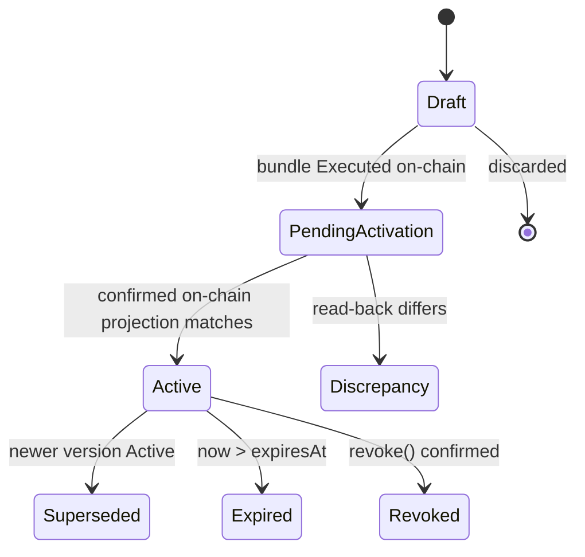
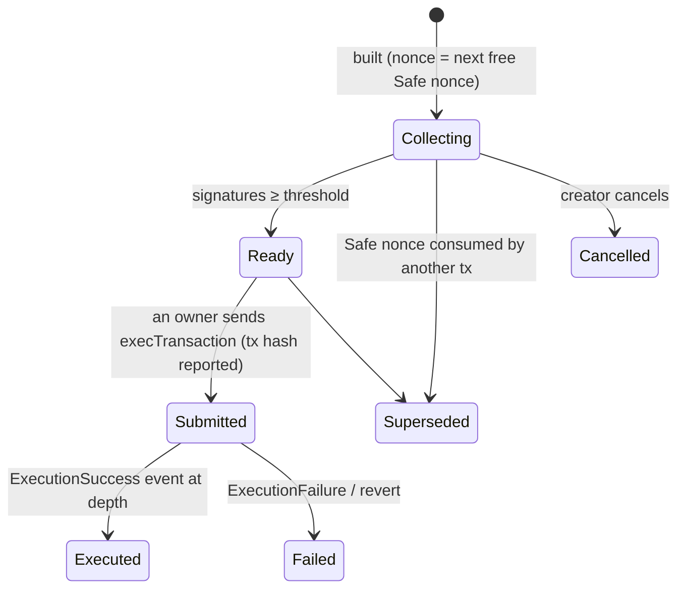
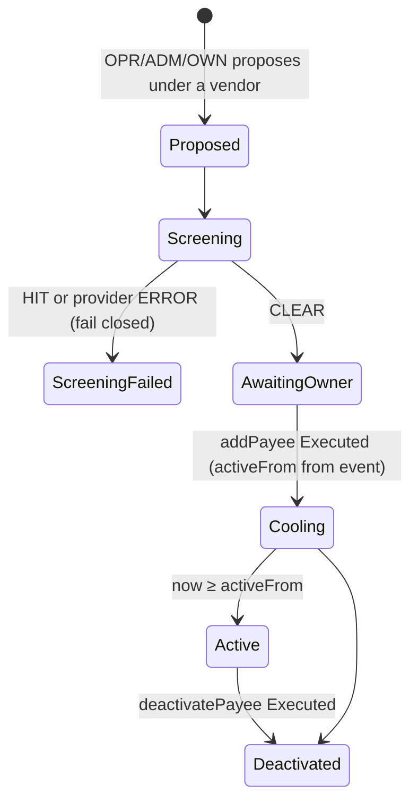
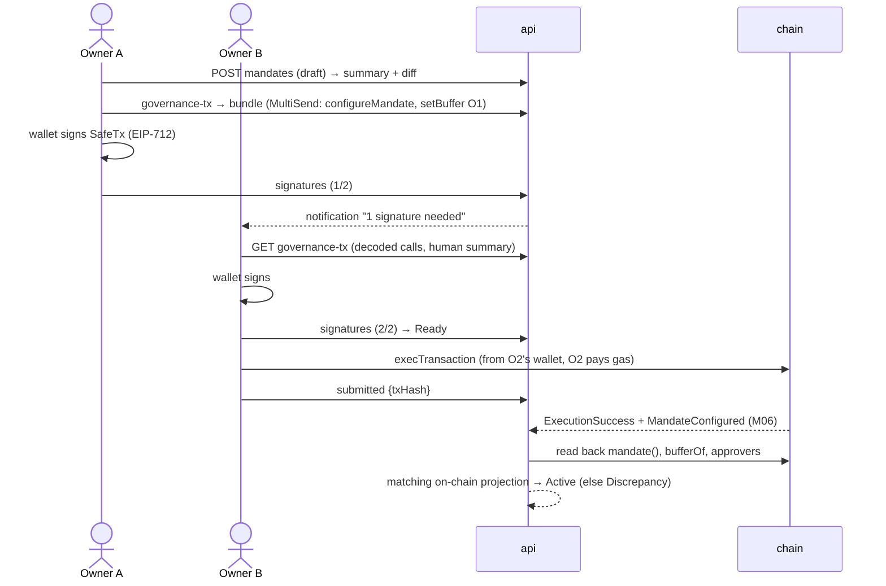

# M03 · Mandate, Payees, Exceptions, Pause & Governance Transactions (`api` + `worker` + `signer`)

**Status:** Detailed (grilling round M03 + chain round with anh Phúc, 2026-10-11) · **Path:** `docs/modules/mandate/` · **Code:** `services/api/.../mandate/`, `services/api/.../governance/`, `services/worker/.../sentinel/`, `services/signer/.../sentinel/` · **Epic:** `[EPIC] M03 · Mandate, Payees & Exceptions`
**ADRs:** ADR-002 (Safe + module), ADR-012 (chain: **Ethereum Sepolia**, accepted), **ADR-017 (governance signing in-app + guardian sentinel, new)** · **Decisions:** M03-D1 … M03-D16, PH-1 … PH-11, FEE-1 … FEE-3 (§14)

---

## 1. Purpose and boundaries

M03 is the **Owner's control room**. It turns what the Owner wants (limits, buffers, payees, exceptions, pause) into **Safe transactions on Safe T**, collects the owners' signatures inside the app, tracks them on-chain, and keeps the backend's view equal to the contract's state. It also owns the **guardian sentinel** (automatic on-chain pause) and the per-treasury **fee policy** (how much gas the agent may spend without asking).

| In scope (M1) | Out of scope |
|---|---|
| Mandate drafts, validation, summary, diff, activation, version history, expiry | Contract logic (M04) |
| Governance bundle builder (MultiSend) + in-app Safe signature collection + execution by an owner | Reading chain state generally (M06 — we consume events) |
| Vendors (M05-D2) and payee registry: proposal → screening → Owner registration → cooling → Active → deactivation | Screening provider (M14) |
| One-time exception requests and `grantException` / `revokeException` transactions | AI exception text (M09) |
| Duplicate override `allowDuplicate` transactions | Exact-duplicate detection (M05) |
| Pause (backend + on-chain via sentinel or a human), resume, revoke | Circuit-breaker rules themselves (M11, RCV-006 — they call our sentinel) |
| Guardian Safe (1-of-N) with sentinel key | Executor key (M10) |
| Treasury fee policy (per-plan threshold, daily fee budget, fee acceptance) | Fee estimation and transaction submission (M10 uses our policy) |

## 2. Features, requirements and rules

| Feature | FR | BR |
|---|---|---|
| F-020 Mandate configuration | FR-201–203 | BR-014, BR-020–024, BR-030 |
| F-021 Activation & versions | FR-204–207 | BR-015, BR-016, BR-022 |
| F-022 Payee registry | FR-208–211 | BR-013, BR-017, BR-072, BR-085 |
| F-023/F-024 Limits, buffers (config side) | FR-212–215 | BR-020–026, BR-030, BR-036 |
| F-025 One-time exception | FR-216, FR-217 | BR-040–043 |
| F-026 Pause, resume, revoke | FR-218–221 | BR-062–064, **BR-068 (new)** |
| F-027 Circuit breaker (on-chain part) | FR-222 | BR-065 |
| F-066 Gas (policy part) | **FR-517, FR-518 (new)** | BR-080, **BR-084 (new)** |
| Governance signing | **FR-225 (new)** | BR-015, **BR-008 (new)** |

## 3. Concepts

| Term | Definition |
|---|---|
| **Governance state** | Everything only Safe T can change: mandate fields, approvers, buffers/targets, payees, exceptions, duplicate allowances, status (pause/resume/revoke). |
| **Mandate version (off-chain)** | An immutable snapshot of the *whole* governance configuration (mandate fields + approvers + buffers/targets) with `config_hash`. Its `onchain_version` is the contract's `mandate.version` after activation. |
| **Governance bundle** | One Safe transaction on Safe T (MultiSend when > 1 call) that applies a change: e.g. `configureMandate` + `setBuffer(O1)` + `setApprovers`. `configureMandate` is included **only if mandate fields changed**, so a buffer-only change does not bump the version or invalidate exceptions (M03-D3). |
| **SafeTx** | Safe's EIP-712 struct `{to, value, data, operation, safeTxGas, baseGas, gasPrice, gasToken, refundReceiver, nonce}`. Owners sign its hash; any owner executes `execTransaction` once the threshold is met. |
| **Guardian Safe** | A Safe with threshold **1** whose owners are the human Guardian(s) and the **sentinel** address. `mandate.guardian` = this Safe. It can only call `module.pause()` (M04). |
| **Sentinel** | A dedicated key held by the `signer` service that can only produce Guardian-Safe transactions calling `pause()` on this treasury's module. |
| **Fee policy** | Per-treasury off-chain settings: speed preset, **per-plan fee threshold** and **daily fee budget**, both proposed by the system and accepted by the Owner (FEE-1). |

## 4. Data model (changes to DATA_MODEL §2.3)

| Table | Columns | Notes |
|---|---|---|
| `mandate_versions` | id, treasury_id, version (off-chain seq), onchain_version null, status enum(Draft, PendingActivation, Active, Superseded, Expired, Revoked, Discrepancy), config jsonb, config_hash, governance_tx_id, valid_from, expires_at, created_by, activated_at | immutable rows except status/onchain_version/activated_at; unique(treasury_id, version) |
| `mandate_status_events` | id, mandate_version_id, from, to, tx_hash, at, by | append-only |
| `governance_txs` *(new)* | id, treasury_id, safe_address, purpose enum(MODULE_SETUP, MANDATE, PAYEE_ADD, PAYEE_DEACTIVATE, EXCEPTION_GRANT, EXCEPTION_REVOKE, ALLOW_DUPLICATE, CANCEL_REQUEST, PAUSE, RESUME, REVOKE, GUARDIAN_SETUP), entity_type, entity_id, calls jsonb (decoded list), to, value, data, operation, safe_nonce, safe_tx_hash, threshold, owners_snapshot address[], status enum(Collecting, Ready, Submitted, Executed, Failed, Superseded, Cancelled), exec_tx_hash, created_by, created_at | unique(safe_address, safe_nonce) where status ∈ (Collecting, Ready, Submitted) |
| `governance_signatures` *(new)* | id, governance_tx_id, owner_address, signature, signed_by_user, at | unique(governance_tx_id, owner_address) |
| `payees` | id, treasury_id, vendor_id, label, address, status enum(Proposed, Screening, ScreeningFailed, AwaitingOwner, Cooling, Active, Deactivated), active_from, oob_verified_by/at, oob_method enum(PHONE, IN_PERSON, SIGNED_LETTER, OTHER), oob_note, registration_tx_id, deactivated_at, proposed_by | unique(treasury_id, address) where status ≠ Deactivated |
| `screenings` | id, payee_id or address, provider, result enum(CLEAR, HIT, ERROR), source_ref, checked_at, ttl_until | |
| `exceptions` | id, request_id, mandate_onchain_version, amount, payee, expiry, status enum(Requested, Proposed, Granted, Consumed, Expired, Invalidated, Rejected, Revoked), governance_tx_id, draft_ai_call_id, reason | unique(request_id) where status ∈ (Proposed, Granted) |
| `guardian_setups` *(new)* | id, treasury_id, guardian_safe, human_owners address[], sentinel_address, threshold (=1), created_tx_id, status | |
| `treasury_fee_policies` *(new)* | id, treasury_id, preset enum(ECONOMY, NORMAL, FAST), max_fee_multiplier_bps, tip_percentile, resend_after_s, bump_bps, per_plan_threshold_wei, daily_budget_wei, reference_eth_price (asset base units per 1 ETH, for value comparison only), proposed_at, accepted_by, accepted_at, version | one active row per treasury; history kept |
| `fee_acceptances` *(new)* | id, plan_id, estimated_fee_wei, accepted_cap_wei, accepted_by, at, reason | |
| `backend_pause` | treasury_id, paused bool, reason, by, at, onchain_status enum(NotRequested, Requested, Effective) | one row per treasury |

## 5. State machines

### 5.1 Mandate version

Paused is a **treasury status**, not a version status (pause does not change the version). While a newer version is PendingActivation, the old one stays Active (BR-015).

### 5.2 Governance transaction

Only one governance tx per Safe nonce is open; a second change queues with nonce + 1 and shows "waiting for #n".

### 5.3 Payee

The Owner can build `addPayee` only after recording the **out-of-band verification** (method + note) (M03-D7).

### 5.4 Exception

`Requested` (NEEDS_APPROVAL from M08, numbers from M07) → `Proposed` (grant bundle built) → `Granted` (`ExceptionGranted` observed) → `Consumed` (PaymentExecuted with `usedException`) · branches: `Rejected` (Owner), `Revoked` (`revokeException`), `Expired`, `Invalidated` (mandate version changed).

## 6. Interfaces (API_SPEC §3, revised)

### 6.1 Mandate

| Method | Endpoint | Perm | Request → Response | Errors |
|---|---|---|---|---|
| GET | `/…/treasuries/{t}/mandates` | ANY | → `{items}` | |
| POST | `/…/treasuries/{t}/mandates` | OWN | `MandateConfig` → `201 {draft, summary, diff, bundlePreview}` | 422 `MANDATE_INCOMPLETE{fields}`, `TARGET_BELOW_BUFFER`, `PER_REQUEST_ABOVE_DAILY`, `EXPIRY_BEFORE_START`, `MANDATE_ALREADY_EXPIRED`, `COOLING_OUT_OF_RANGE`, `UNKNOWN_WALLET`, `NO_APPROVERS`, `AMOUNT_PRECISION` |
| POST | `/…/mandates/{v}/clone` | OWN | → `201 {draft}` | |
| POST | `/…/mandates/{v}/governance-tx` | OWN + step-up | → governance transaction fields plus `{mandate, bundlePreview}` (§6.3) | 409 `MANDATE_NOT_DRAFT`, `MODULE_NOT_READY`, `NO_CHANGES`, `AAVE_POOL_REQUIRED`; 422 `MANDATE_CALL_INVALID` |
| DELETE | `/…/mandates/{v}` | OWN | discard a Draft | 409 `NOT_DRAFT` |

### 6.2 Payees, exceptions, duplicates, pause

| Method | Endpoint | Perm | Request → Response | Errors |
|---|---|---|---|---|
| POST | `/…/treasuries/{t}/payees` | OPR, ADM, OWN | `{vendorId, label, address}` → `201 {payee: Screening}` | 409 `PAYEE_EXISTS`, 422 `ADDRESS_INVALID`, `ADDRESS_IS_TREASURY_WALLET`, `SCREENING_HIT`; a provider ERROR fails closed with 503 `DATA_MISSING` (payee `ScreeningFailed`, registration stays blocked) |
| POST | `/…/payees/{id}/verify-oob` | OWN | `{method, note}` → `{payee}` | 409 `NOT_AWAITING_OWNER`, `OOB_ALREADY_VERIFIED` (evidence is recorded once) |
| POST | `/…/payees/{id}/registration-tx` | OWN | → `{governanceTx}` | 409 `SCREENING_NOT_CLEAR`, `OOB_NOT_VERIFIED`, `SCREENING_EXPIRED` |
| POST | `/…/payees/{id}/deactivation-tx` | OWN | `{reason}` → `{governanceTx}` | |
| POST | `/…/payees/{id}/replace-address` | OWN | `{address, reason}` → `{payee, deactivationGovernanceTx}` | 409 `PAYEE_NOT_REGISTERED`, `ADDRESS_UNCHANGED`, `PAYEE_EXISTS`; 422 `ADDRESS_INVALID`, `SCREENING_HIT`; 503 `DATA_MISSING` |
| GET | `/orgs/{o}/requests/{r}/exception` | OWN, OPR, FIN | → `{exception, numbers{amount, cap, dailyUsed, dailyRemainingAfter, valueIfGranted}, aiDraft?}` | 404 |
| POST | `/orgs/{o}/requests/{r}/exception/grant-tx` | OWN | `{expiryHours?: 72}` → `{governanceTx}` | 409 `NOT_OVER_CAP`, `DAILY_LIMIT_WOULD_EXCEED`, `PAYEE_NOT_ACTIVE` |
| POST | `/orgs/{o}/requests/{r}/exception/reject` | OWN | `{reason}` → `{exception: Rejected}` | |
| POST | `/orgs/{o}/requests/{r}/exception/revoke-tx` | OWN | → `{governanceTx}` | 409 `NOT_GRANTED` |
| POST | `/orgs/{o}/requests/{r}/allow-duplicate-tx` | OWN | `{reason}` → `{governanceTx}` | 409 `NOT_DUPLICATE` |
| POST | `/…/treasuries/{t}/pause` 🔁 | OWN, GRD | `{reason}` → `{backendPaused: true, onchain: "Requested", sentinelTxHash?, guardianSafeTx?}` | |
| POST | `/…/treasuries/{t}/resume-tx` | OWN | → `{governanceTx}` | 403 for GRD, 409 `NOT_PAUSED` |
| POST | `/…/treasuries/{t}/revoke-tx` | OWN | `{confirmName}` → `{governanceTx}` | 422 `CONFIRMATION_MISMATCH` |

### 6.3 Governance transactions (in-app signature collection, M03-D1)

| Method | Endpoint | Perm | Request → Response | Errors |
|---|---|---|---|---|
| GET | `/…/governance-txs?status=` | ANY | → `{items}` | |
| POST | `/orgs/{o}/treasuries/{t}/governance-txs` 🔁 | OWN | `{purpose, calls[]}` → `{governanceTx, decodedCalls[], humanSummary, typedData}` | 503 `MULTISEND_UNAVAILABLE` when a bundle has no configured Safe MultiSendCallOnly v1.4.1 deployment |
| GET | `/…/governance-txs/{g}` | ANY | → `{governanceTx, decodedCalls[], humanSummary, typedData (SafeTx EIP-712), signatures[], threshold, owners[]}` | |
| POST | `/…/governance-txs/{g}/signatures` 🔁 | OWN (an owner of that Safe) | `{signature}` → `{signatures[], status}` | 400 `SIGNATURE_INVALID`, 403 `NOT_SAFE_OWNER`, 409 `ALREADY_SIGNED`, `SUPERSEDED` |
| GET | `/…/governance-txs/{g}/exec-call` | OWN | → `{to: safe, data: execTransaction(..., packedSignatures)}` for the owner's wallet | 409 `NOT_READY` |
| POST | `/…/governance-txs/{g}/submitted` | OWN | `{transactionHash}` → `{status: Submitted}` | |
| POST | `/…/governance-txs/{g}/cancel` | creator, OWN | → `{status: Cancelled}` | 409 `ALREADY_SUBMITTED` |
| GET | `/…/governance-txs/{g}/safe-wallet-link` | OWN | → `{url}` (optional: propose to Safe Transaction Service, open in Safe{Wallet}) | 503 if the service is unavailable |

Borrow and repay calldata builders encode the module's `authorizeBorrow` and
`authorizeRepay` calls from integer arguments. Amounts, expiry, minimum health
factor and maximum rate are carried without display-unit conversion or rounding.
The proposal read model currently has no API-backed `planId`, expiry, minimum
health-factor authorization, or max-rate authorization fields, so proposal-backed
creation and the WEB-027 owner action are not wired yet. Until that integration
exists, the general governance endpoint persists and tracks calls supplied by an
Owner but does not independently prove they match a validated borrow proposal.

### 6.4 Fee policy (FEE-1 … FEE-3)

| Method | Endpoint | Perm | Request → Response |
|---|---|---|---|
| GET | `/…/treasuries/{t}/fee-policy` | ANY | → `{active, proposal{preset, perPlanThresholdWei, dailyBudgetWei, basis{avgPlanFee7d, p90PlanFee7d, plansPerDay7d}}}` |
| POST | `/…/treasuries/{t}/fee-policy/accept` | OWN | `{proposalId, preset?}` → `{active}` (values are the system's; the Owner accepts or picks another preset — no free typing in M1) |
| POST | `/orgs/{o}/plans/{p}/fee/accept` | OWN, FIN, OPR | `{reason}` → `{acceptedCapWei}` (for a plan held by FEE-1/FEE-2) |
| POST | `/orgs/{o}/plans/{p}/fee/defer` | OWN, FIN, OPR | → plan waits for a cheaper window |

## 7. Flows

### 7.1 Mandate change (in-app collection, 2-of-3 Safe T)

### 7.2 Emergency pause

1. Owner/Guardian clicks **Pause** (or RCV-006 fires). Backend sets `backend_pause.paused = true` immediately: trigger and executor stop (BR-063).
2. If a sentinel is configured, the worker asks the signer `POST /sentinel/pause {treasuryId}`; the signer builds `GuardianSafe.execTransaction(module, 0, pause(), …, sig_sentinel)` and broadcasts it from the sentinel address (threshold 1). `onchain_status = Requested`.
3. `Paused(by)` observed → `Effective`. Without a sentinel, the UI offers the human Guardian a one-click Guardian-Safe transaction from their wallet.
4. Resume: only Safe T (`resume()` bundle, 2-of-3). After `Resumed`, every queued request is re-planned and re-validated.

### 7.3 Payee onboarding

Propose (vendor, label, address) → screening (CLEAR within 24 h) → Owner calls/meets the vendor and records `verify-oob` → registration bundle → owners sign → executed → `PayeeAdded(activeFrom)` → Cooling (demo 5 min, prod 24 h) → Active at `activeFrom`. The API stores `activeFrom` from the indexed event and projects Cooling as Active once that timestamp passes.

An address replacement creates a separate payee record for the same vendor and starts the full screening and out-of-band verification flow again. The Owner receives a deactivation governance transaction for the old address; once that transaction is executed, `PayeeDeactivated` marks only the old record Deactivated. Registering the new address starts a fresh cooling period from its own `PayeeAdded(activeFrom)` event; the old payee address is never overwritten in place.

### 7.4 Exception (UC-06)

M08 NEEDS_APPROVAL → exception `Requested` with numbers → AI draft (M09) → Owner opens it, chooses expiry (default 72 h) → `grantException` bundle → signatures → executed → `ExceptionGranted` → `Granted` → trigger re-plans → PAY consumes it → `Consumed`.

## 8. Algorithms

### 8.1 Mandate validation (BR-014)

Required: actions ⊆ {REFILL, PAY, SUPPLY} (SWAP only if P2 enabled with router, pairs, slippage, quote age); executor ≠ 0; guardian set; ≥ 1 approver; `validFrom < expiresAt`; `expiresAt − validFrom ≤ 365 d`; cooling within 1 h–7 d (demo profile: 60 s–1 h); for each PAY/REFILL/SUPPLY action `0 ≤ perRequest ≤ daily`; SUPPLY uses the separate `supplyLimits` field; for each operational wallet `0 ≤ buffer ≤ target`; Safe T buffer set; `approvalMaxAge` 1–60 days; all amounts are integer base-unit strings. `minSupply` is required in production and defaults to 500 whole asset units in demo; when SUPPLY is enabled it must be positive and fit both SUPPLY limits. `reserveHorizonDays` defaults to 30. Limits of 0 are allowed with a warning "action disabled".

### 8.2 Summary and diff

Human summary template (one line per rule, display units and base units), e.g. *"The agent may pay vendors up to **2,000.00 tUSDC** per invoice and **10,000.00 tUSDC** per UTC day (2000000000 / 10000000000 base units)."* Diff = field-by-field old → new with risk markers: ▲ looser (higher limit, lower buffer, shorter cooling, earlier start, longer expiry, added action/approver) / ▼ stricter. Looser changes show a red marker and require a confirm checkbox.

### 8.3 Bundle building

Compute the on-chain diff: mandate fields changed → `configureMandate`; approvers added/removed → `setApprovers(add, remove)`; each changed wallet → `setBuffer`. Each secondary asset policy → `setAssetBuffer(asset, wallet, buffer, target)` per wallet, then `setAssetPolicy`; because `configureMandate` clears secondary policies on-chain, they are all re-sent whenever it is included. One call → direct call; several → `MultiSendCallOnly` v1.4.1 (the Safe uses delegatecall, operation = 1; each bundled operation is CALL). Its address must be configured in the chain deployment manifest as `SAFE_MULTISEND_CALL_ONLY`. `safe_nonce` = max(on-chain nonce, highest open governance nonce + 1).

### 8.4 Read-back

After Executed + the chain's configured confirmations: read `mandate()`, `isApprover` for current and removed addresses, primary and secondary asset buffers/targets and allowlists, and the secondary PAY/REFILL caps from `AssetPolicySet` logs in the confirmed execution receipt. Also verify `aavePool()`/`aToken()` and the reserve's underlying/pool identity. Compare a canonical hash of the on-chain projection; off-chain-only settings remain covered by the immutable full `config_hash`. Equal projection → Active and the previous version becomes Superseded. A mismatch → Discrepancy plus an Owner/Finance review item; the previous version remains Active and execution is blocked by M08 `DATA_MISSING` until resolved. SUPPLY limits require a module initialized with an Aave pool; activation rejects a draft that enables SUPPLY when the module has none.

### 8.5 Exception pre-check

`amount > pay.perRequest` (else `NOT_OVER_CAP`) · payee Active · `usedOn[PAY,today] + amount ≤ pay.daily` (else `DAILY_LIMIT_WOULD_EXCEED`) · expiry ≤ approval expiry · current on-chain version recorded.

### 8.6 Fee policy proposal (FEE-1)

From the last 7 days on this chain (or defaults on a new treasury):
`avgPlanFee` = mean gas used per plan × mean effective gas price; `p90PlanFee` likewise at p90.
**Per-plan threshold** = `3 × avgPlanFee` (min `p90PlanFee`). **Daily budget** = `max(3 × plansPerDay × avgPlanFee, 2 × threshold)`. Presets set `maxFee = k × baseFee + tip` with k = 1.5 / 2 / 3 and tip = p25 / p50 / p75 of `eth_feeHistory(20)`; resend after 90 / 60 / 30 s with +12.5 % (NORMAL is default). All values are proposed by the system; the Owner **accepts** (or picks another preset) — no manual numbers in M1.

### 8.7 Fee hold and smart wait (FEE-1, FEE-2)

Before attesting a plan (M10): `est = estimateGas × maxFee` for all steps.
- `est ≤ threshold` and `spentToday + est ≤ dailyBudget` → proceed.
- Otherwise, if the request can still be paid by its due day with margin (`lastSafeDay > today`, using the execution lead time) → **defer** (re-check every cycle), reason `FEE_ABOVE_THRESHOLD` / `FEE_BUDGET_EXHAUSTED`, no human needed.
- If today is the last safe day → plan `AwaitingFeeAcceptance`; review item `FEE_APPROVAL` routed to Finance/Operator/Owner (FEE-3) with "Pay now at X" / "Defer".
- Discount check (FEE-2, with M07): early payment for a discount is scheduled only if `discount − feeInAsset > 0`, where `feeInAsset = est × reference_eth_price / 1e18` (reference price is a labelled setting in M1; an oracle is Later).

Example (NORMAL): avgPlanFee 0.0004 ETH → threshold 0.0012 ETH, 10 plans/day → budget max(0.012, 0.0024) = 0.012 ETH. A spike makes a plan cost 0.002 ETH: due in 5 days → deferred; due today → Finance sees "Pay now 0.002 ETH (≈ 6 tUSDC at reference 3,000) or defer".

### 8.8 Guardian Safe setup (PH-4)

During treasury setup (after the module exists): deploy a Safe with owners `[humanGuardian…, sentinel]`, threshold 1, via SafeProxyFactory (from any owner's wallet); then the mandate's `guardian` = that Safe. The sentinel address comes from `signer GET /sentinel/address`. Sentinel needs a small ETH balance (low-gas alert like the executor).

## 9. Configuration and defaults

| Parameter | Demo | Production |
|---|---|---|
| Chain | Ethereum Sepolia (PH-1) | same in M1 |
| Asset | `tUSDC` (6 dec, label TEST) for the main demo; one run with Circle USDC Sepolia, limits ÷ 100 (PH-2) | |
| PAY limits | 2,000 / 10,000 tUSDC (Circle run: 20 / 100) | Owner-defined |
| REFILL limits | 2,500 / 12,000 tUSDC (Circle run: 25 / 120) | |
| Buffers / targets | T 1,000; O1/O2 10 / 150 tUSDC | |
| Cooling | 300 s | 86,400 s (1 h–7 d) |
| Approval max age | 14 d | 14 d |
| Exception expiry | 72 h | 72 h |
| Mandate expiry warnings | 7 d, 48 h, 1 h | same |
| Safe owners | T, O1, O2: same 3 owners, threshold 2 (PH-9) | |
| Guardian Safe | 1-of-2: human guardian + sentinel | |
| Fee preset | NORMAL | |
| Screening TTL | 24 h | 24 h |

## 10. Security

| Threat | Control | Test |
|---|---|---|
| Non-Owner changes governance | Only Safe T can call governance functions (contract); API requires OWN; signatures verified against the Safe's on-chain owners | role matrix test; NOT_SAFE_OWNER test |
| Owner signs something different from what the UI shows | UI shows decoded calls + human summary built from the same calldata; typed data recomputed server-side and by the wallet | decode-vs-build round-trip test |
| Draft ≠ chain | read-back hash (§8.4) | Discrepancy test |
| BEC on payee onboarding | screening + mandatory out-of-band verification + cooling + Owner multisig | OOB_NOT_VERIFIED test |
| Sentinel key leak | can only pause (DoS); Owner resumes and removes it from the Guardian Safe | sentinel can't call anything but pause (signer whitelist test) |
| Signer abused to sign governance | signer's sentinel endpoint builds only `pause()` on the configured module through the configured Guardian Safe; no free-form calls | unit test with other calldata refused |
| Stale backend pause | backend flag checked by trigger and executor before every action; on-chain pause is the real stop | AT-08 |
| Nonce collisions on Safe T | one open governance tx per nonce; Superseded detection | race test |
| Fee griefing (spikes) | threshold + budget + defer + human acceptance only on the last safe day | FEE tests |

## 11. Failure scenarios

| Failure | Behaviour |
|---|---|
| Owners never reach threshold | governance tx stays Collecting; reminder notifications at 24 h; old state governs |
| Execution reverts | Failed; decoded revert shown (e.g. `InvalidMandate(field)`); draft stays editable |
| Someone executes another tx with the same Safe nonce (e.g. in Safe{Wallet}) | ours → Superseded; rebuild with the next nonce |
| Sentinel out of gas or signer down | backend pause still applies; UI prompts the human Guardian to pause from their wallet |
| Screening provider down | registration blocked (fail closed, BR-085) |
| Read-back mismatch | Discrepancy, execution blocked, review item |
| Fee estimation RPC error | plan deferred (no fee guess); retry next cycle |

## 12. Test plan

| Level | Content | Ticket |
|---|---|---|
| Unit | mandate validation matrix; summary/diff with looser/stricter markers; bundle diff (configureMandate only when needed); fee proposal and hold rules (§8.6–8.7 examples) | MDT-002, MDT-009, EXE-012 |
| Integration (Anvil, real Safe v1.4.1) | 2-of-3 signature collection + execTransaction; MultiSend bundle; Superseded nonce; read-back Active/Discrepancy; payee lifecycle with time travel; exception grant → consumed; revoke | MDT-003…MDT-009 |
| Integration | sentinel pause through Guardian Safe in < 2 blocks; sentinel refuses any other call | MDT-010, EXE-013 |
| E2E | AT-08 pause/resume; AT-11 exception | WEB-005/006/013/019, WEB-024/025 |

## 13. Tickets (order of work)

MDT-001 schema → **MDT-009 governance tx builder + signature collection (new)** → MDT-002 drafts/summary/diff → MDT-003 activation/read-back → MDT-004 vendors/payees/screening (+ OOB) → MDT-005 payee txs/sync → MDT-006 exceptions → MDT-007 pause/resume/revoke → **MDT-010 Guardian Safe + sentinel setup (new)** → **EXE-013 sentinel signer endpoint (new)** → MDT-008 expiry → **EXE-012 fee policy, holds and acceptance (new)**. UI: WEB-005, WEB-006, WEB-013, WEB-019, **WEB-024 fee policy & acceptance (new)**, **WEB-025 governance signing inbox (new)**. Chain round: DOM-001/002 revised, SC-019 + REC-005 promoted (EAS receipts, ADR-018).

## 14. Decisions

| ID | Decision |
|---|---|
| M03-D1 | Governance transactions are signed **in the app** (each owner signs the SafeTx hash with their wallet) and executed by the last owner from their wallet; "open in Safe{Wallet}" is optional (ADR-017). |
| M03-D2 | Guardian = Safe 1-of-N {human guardian(s), sentinel}; sentinel key in `signer`, can only pause (ADR-017). Pause in the UI triggers the sentinel immediately. Resolves M04-Q1. |
| M03-D3 | One governance change = one bundle (MultiSend); `configureMandate` only when mandate fields change, so buffer/approver-only changes keep exceptions valid. |
| M03-D4 | Off-chain mandate version = snapshot of the whole governance configuration; Active only after read-back hash matches. |
| M03-D5 | One open governance tx per Safe nonce; others queue; Superseded on external nonce use. |
| M03-D6 | Exception default expiry 72 h (≤ approval expiry); pre-check daily headroom before building the tx. |
| M03-D7 | Payee registration requires the Owner's out-of-band verification record (method + note), audited. |
| M03-D8 | Changing cooling affects only payees added afterwards (contract computes `activeFrom` at add time). |
| M03-D9 | Mandate expiry warnings at 7 d, 48 h, 1 h; renewal = new version. |
| M03-D10 | Resume re-plans and re-validates all queued requests. Revoke requires typing the treasury name; a revoked module needs a new module via the factory. |
| M03-D11 | Diff marks looser changes; looser changes require an explicit confirm. |
| M03-D12 | Validation ranges per §8.1 (cooling 1 h–7 d prod, approvalMaxAge 1–60 d, mandate ≤ 365 d). |
| M03-D13 | Screening result valid 24 h; registration needs a CLEAR within TTL. |
| M03-D14 | Owner/Guardian pause always sets the backend flag first; on-chain pause follows (sentinel or human). |
| M03-D15 | Fee policy is per treasury, proposed by the system, accepted by the Owner (no free-form numbers in M1). |
| M03-D16 | Sentinel and executor are separate keys with separate gas balances and low-gas alerts. |
| **PH-1** | Chain M1 = **Ethereum Sepolia** (ADR-012 accepted). |
| **PH-2** | Asset: `tUSDC` for the main demo and automated runs; one evidence run with **Circle USDC on Sepolia** with limits ÷ 100. |
| **PH-3** | PH-3 records the team's public-testnet interpretation, not an organizer reply. Published item 06 requires real on-chain transaction hashes without specifying the network; DOM-003 clarification is optional (source review 2026-10-14). |
| **PH-4** | Guardian Safe 1-of-N with sentinel (= M03-D2). |
| **PH-5** | Payment "Paid" after **3 confirmations** on `latest` (~36 s on Sepolia), configurable; reconciliation can additionally wait for `finalized` (M10/M11). |
| **PH-6** | Event indexing by polling `eth_getLogs` (every 6 s) with stored block hashes and a 64-block reorg re-scan (M06). |
| **PH-7** | Gas: EIP-1559 presets (§8.6), resend with +12.5 %, one nonce lane per executor; values proposed by the system, accepted by the user. |
| **PH-8** | RPC: Alchemy primary + a public Sepolia RPC (e.g. publicnode) fallback. |
| **PH-9** | T, O1, O2 share the same owners and threshold (demo 2-of-3). |
| **PH-10** | Implementation and factory deployed with CREATE2 (fixed salt), verified on Etherscan, code hashes in the manifest. |
| **PH-11** | EAS payment receipts promoted to **P1 / Tier A** (ADR-018). |
| **FEE-1** | Auto-execute within a per-plan fee threshold **and** a daily fee budget, both system-proposed and Owner-accepted; otherwise hold. |
| **FEE-2** | Smart wait: defer while the deadline allows; ask only on the last safe day. The scheduler counts gas as a cost and does not pay early for a discount smaller than the fee. |
| **FEE-3** | Owner sets threshold and budget; Finance, Operator or Owner may accept the fee of an individual held plan. |

M08 snapshot freshness becomes **≤ 30 s and ≤ 2 blocks** on Sepolia (12 s blocks).

## 15. v0.3 changes (ADR-019)

- Mandate gains **supply limits** (per tx, per day). The **Safe floor** is `bufferOf[safeT]` (OperatingBuffer). Treasury setting **min_supply** (off-chain; demo 500) and **reserve horizon** (30 days).
- Aave Pool and aToken are fixed when the module is created (registry); the factory `create` takes `aavePool`.
- P2: governance functions `authorizeBorrow` / `authorizeRepay` for owner-authorized borrowing (MDT-011, P2).
- Demo config: pay 2,000/10,000; refill 2,500/12,000; supply 5,000/20,000; Safe floor 1,000; min_supply 500; one operational wallet O1 (buffer 10, target 150).
- **Tickets:** MDT-002, MDT-003 revised; MDT-011 (P2) new.
