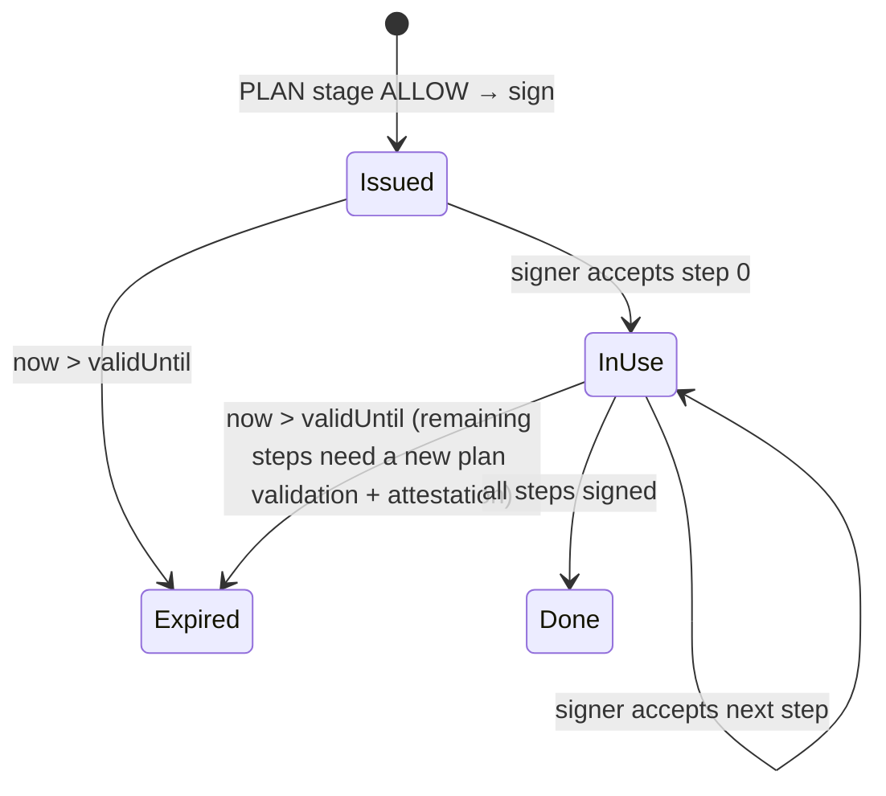

# M08 · Policy Engine & Attestation (`py-core` + `worker`)

**Status:** Detailed (grilling round M08, 2026-10-11) · **Path:** `docs/modules/policy-engine/` · **Code:** `packages/py-core/src/treasurypilot_core/policy/` (validator, codes, plan hashing) + `services/worker/.../attest/` (attestation signing) · **Epic:** `[EPIC] M08 · Policy Engine & Attestation`
**ADRs:** ADR-003 (EIP-712), ADR-006 (keys), **ADR-016 (policy attestation and pre-submit simulation, new)** · **Decisions:** M08-D1 … M08-D12 (§14)

---

## 1. Purpose and boundaries

The policy engine answers one question before every on-chain action: **may this exact step run now?** It returns `ALLOW`, `NEEDS_APPROVAL` or `BLOCK` with reason codes, and for an allowed plan it signs a **PlanAttestation** that the signer service requires before it will sign a transaction (BR-059, FR-507).

It is the second of three checking layers:

| Layer | Where | What it is for |
|---|---|---|
| 1. Validator (this module) | `py-core`, called by the worker | Explain *why* (reason codes for UI, review items, audit); stop early; check off-chain rules the contract cannot see |
| 2. Pre-submit simulation (this module) | worker → RPC `eth_call` from the executor address | Catch any drift between the validator and the contract (M08-D5) |
| 3. Contract (M04) | chain | The final authority. Backend "ALLOW" is never sufficient (BR-004, AD-04) |

| In scope (M1) | Out of scope |
|---|---|
| Reason-code catalogue and decision model | Computing amounts and schedules (M07) |
| Plan-level and step-level validation (contract mirror + off-chain gates) | Reading chain state (M06 builds the snapshot) |
| Canonical plan encoding, `planHash`, deterministic `stepId` | Signing transactions (signer, M10) |
| PlanAttestation (EIP-712) signing and the verification helper used by the signer | Raising flags (M05/M09 compute them; the validator only checks acknowledgment) |
| Pre-submit `eth_call` simulation and revert decoding | Creating review items (M11 recovery uses our decision) |
| Differential tests validator ↔ contract | On-chain attestation verification (SC-L04, Later) |

## 2. Features, requirements and rules

| Feature | FR | BR |
|---|---|---|
| F-055 Policy validation | FR-410, FR-411, FR-313 (flag acknowledgment), FR-505 (simulation) | BR-001–005, BR-010–019, BR-022–024, BR-030, BR-036, BR-040–042, BR-050–051, BR-057–058, BR-060–063, BR-071–072, BR-085, **BR-066 (new)**, **BR-067 (new)** |
| F-056 Plan attestation | FR-412, FR-413, FR-507 | BR-059 (revised) |
| F-163 Security tests (differential part) | — | NFR-SEC-01 |

## 3. Concepts

| Term | Definition |
|---|---|
| **Execution plan** | The ordered steps for **one** request: optional `REFILL(T → payingWallet)` then `PAY(payingWallet → payee)`. At most 2 steps in M1 (3 with the P2 swap). The day schedule from M07 is advisory; only execution plans are validated and attested (M08-D1). |
| **Stage** | When validation runs: `PLAN` (before attesting), `PRE_STEP` (fresh snapshot before each step), `SIMULATION` (eth_call right before signing). |
| **Hard failure** | Any code whose default decision is BLOCK. |
| **Soft failure** | `OVER_PER_REQUEST_LIMIT` only. It produces NEEDS_APPROVAL when it is the *only* failure and no matching exception exists. |
| **Warning** | Recorded and notified, never changes the decision (`DEADLINE_MISSED`, `DISCOUNT_MISSED`, `TARGET_NOT_REACHED`). |
| **Policy version** | `keccak256(abi.encode(mandateVersion, validatorVersion, offchainConfigHash))`. Recorded on every validation and in every attestation. |
| **Flag** | A deterministic risk signal on a request (address change, amount outlier k·MAD, instruction-like text, …) with severity LOW/HIGH. HIGH flags need explicit approver acknowledgment (FR-313). |

## 4. Data model

### 4.1 Python (frozen Pydantic)

```python
class Action(StrEnum): REFILL = "REFILL"; PAY = "PAY"; SWAP = "SWAP"; WITHDRAW = "WITHDRAW"   # SWAP is P2

class PlanStep(BaseModel):
    seq: int                      # 0, 1, …
    step_id: bytes32              # deterministic, §8.4
    action: Action
    from_wallet: Address
    to: Address                   # payingWallet for REFILL, payee for PAY, Safe T for WITHDRAW
    asset: Address
    amount: BaseUnits

class ExecutionPlan(BaseModel):
    request_id: bytes32
    treasury: Address             # module address
    chain_id: int
    steps: list[PlanStep]
    planner_source: Literal["AI", "DETERMINISTIC", "RULE_BASED"]
    evidence_ids: list[str]       # snapshot id, schedule id, ai_call ids

class ApprovalView(BaseModel):    # from M05
    typed: PaymentApproval        # the 11 signed fields (M04 §6.1)
    signature: bytes
    signer: Address
    approved_at: datetime         # flags raised at or after it need re-approval (M08-D4)
    created_by: UUID; last_edited_by: UUID; approved_by_user: UUID
    acknowledged_flag_ids: list[UUID]
    solo_mode: bool

class FlagView(BaseModel):        id: UUID; code: str; severity: Literal["LOW", "HIGH"]; raised_at: datetime
class ExceptionView(BaseModel):   amount: BaseUnits; payee: Address; expiry: int; mandate_version: int; used: bool

class ValidationContext(BaseModel):   # built by the worker from M06/M03/M05/M10 data
    now: int; head_block: int
    executor: Address              # the worker's executor key; must equal mandate.executor
    snapshot: ChainSnapshot        # block number, block timestamp, read_at, balances, buffers/targets,
                                   # mandate (status, version, window, limits, executor), approver set,
                                   # payee statuses, usedOn counters, requestPaid/stepUsed/fingerprintPaid,
                                   # refilledFor, exception for this request, duplicateAllowedFor
    request: RequestView           # status, amount, earlyAmount, earlyPayBy, deadline, payee, payingWallet, fingerprint, invoiceHash, termsHash
    approval: ApprovalView | None
    flags: list[FlagView]
    coverage: Literal["COMPLETE", "PARTIAL_ACK", "PARTIAL", "NONE"]
    unknown_operations: int        # count for this treasury
    pause_requested: bool          # BR-063 backend pause
    circuit_open: bool             # BR-065
    screening_hit: bool            # BR-085; latest screening returned HIT
    screening_clear: bool          # false by default; true only after a valid CLEAR (a HIT reports SCREENING_HIT only)
    policy_state: PolicyState      # balances, buffers, limits, daily counters and exception view (POL-003)
    config: PolicyConfig           # §9

class Check(BaseModel):    name: str; passed: bool; code: PolicyReasonCode | None; expected: str | None; observed: str | None
                           skipped: bool = False   # not run: a gate failed, or no approval for an approval check
class Decision(BaseModel):
    decision: Literal["ALLOW", "NEEDS_APPROVAL", "BLOCK"]
    primary: PolicyReasonCode | None     # first failing code by precedence (§8.2)
    codes: list[PolicyReasonCode]        # every failing code
    warnings: list[PolicyReasonCode]
    checks: list[Check]            # every check that ran, passed or not
    stage: Literal["PLAN", "PRE_STEP", "SIMULATION"]
    step_seq: int | None
    policy_version: bytes32
    snapshot_block: int
```

PolicyState is the immutable, block-consistent input to POL-003: pay/refill/supply limits; wallet balances, buffers and targets; daily usage; request/step/fingerprint replay flags; matching exception; and liquidity reserve/Aave balances. Missing policy state is DATA_MISSING, never an implicit zero. PLAN checks project balance and daily usage after earlier steps before validating the next step. validate_plan and validate_step return a Decision; the decision policy version hashes the mandate version, validator version and canonical policy configuration.

### 4.2 Database (changes to DATA_MODEL §2.5)

| Table | Columns | Notes |
|---|---|---|
| `validations` | id, plan_id, step_seq null, stage enum(PLAN, PRE_STEP, SIMULATION), decision, primary_code, reason_codes text[], warnings text[], checks jsonb, policy_version bytea, snapshot_block, created_at | append-only |
| `attestations` | id, plan_id, request_id, plan_hash, step_ids bytea[], policy_version, executor, nonce numeric(78,0), valid_until, evidence_digest, typed_data jsonb, signature, policy_signer address, created_at | unique(nonce); append-only |
| `signer.attestation_uses` *(signer-owned schema)* | nonce, plan_hash, step_id, first_signed_at | unique(nonce, step_id); a nonce bound to one plan_hash only. Only the signer DB role can write (M08-D9). |

## 5. State

Validator: stateless. Attestation lifecycle (derived, not stored as a column):



A re-plan after partial completion (RCV-003) produces a **new** plan containing only the unfinished steps (same `stepId`s), validated and attested again.

## 6. Interfaces

### 6.1 Package API (`py-core`, pure)

| Function | Returns |
|---|---|
| `validate_plan(plan, ctx) → Decision` | stage PLAN: every step checked against the projected state after the previous steps |
| `validate_step(plan, seq, ctx) → Decision` | stage PRE_STEP: one step against a fresh snapshot |
| `decide(checks) → Decision` | aggregation (§8.2) |
| `plan_hash(plan) → bytes32` | §8.3 |
| `ExecutionPlan.message() → dict` | the §8.3 Plan mapping (hex strings, module action codes): `attestation_typed_data` takes it as is; `plan_hash` takes its four fields |
| `step_id(request_id, action, wallet) → bytes32` | §8.4 |
| `policy_version(mandate_version, cfg) → bytes32` | §3 |
| `attestation_typed_data(plan, decision, nonce, valid_until, evidence_digest) → dict` | EIP-712 message |
| `verify_attestation(typed_data, sig, trusted_signers, now) → AttestationCheck` | used by the signer |
| `decode_revert(data) → tuple[PolicyReasonCode, ...]` | `SIMULATION_REVERTED`, plus the code a known module custom-error selector maps to (§6.4) |
| `REASON_CODES` | the catalogue (§6.4) |

### 6.2 Worker API

| Function | Notes |
|---|---|
| `attest(plan, decision) → Attestation` | Only for `decision == ALLOW` at stage PLAN. Loads the policy key (§10). Persists the row before returning. |
| `simulate(step, attestation_ctx) → Decision` | stage SIMULATION: `eth_call` of `module.refill/pay` with `from = executor`, at block `latest`, same calldata the signer will send. Revert → decoded code, BLOCK. RPC error → `SIMULATION_UNAVAILABLE`, BLOCK. |

### 6.3 PlanAttestation (EIP-712, M08-D3)

```
domain: { name: "TreasuryPilot Policy", version: "1", chainId, verifyingContract: <module clone> }
Step(uint32 seq,bytes32 stepId,uint8 action,address from,address to,address asset,uint256 amount)
PlanAttestation(bytes32 planHash,bytes32 requestId,bytes32[] stepIds,bytes32 policyVersion,
                address executor,uint64 validUntil,uint256 nonce,bytes32 evidenceDigest)
```

- `validUntil = now + 15 min` (M08-D2). `nonce` = random 128-bit integer, unique in `attestations`.
- `evidenceDigest = keccak256(snapshot_id ‖ schedule_id ‖ sorted ai_call ids ‖ validation id)`: links the attestation to the evidence bundle.
- The domain uses a different `name` from the approval domain ("TreasuryPilot"), so an approval signature can never be replayed as an attestation and vice versa.

**Signer verification (EXE-005), in order:** recover signer ∈ `trusted_policy_signers` → `now ≤ validUntil` → `chainId` allowed and `verifyingContract` = the module the payload targets → recompute `planHash` from the attested plan the worker sends with the step and compare → the payload's function and arguments equal step `seq` exactly (action, from/to, asset, amount, stepId, approval fields) → `(nonce, stepId)` not already used for a *different* payload, and `nonce` never used with another `planHash` → simulate → sign. Re-signing the **same** step payload (gas bump/replacement) is allowed.

### 6.4 Reason-code catalogue

Decision: **B** = BLOCK, **NA** = NEEDS_APPROVAL, **W** = warning. "Contract error" names the M04 custom errors that decode to the code (the catalogue test fails if a module executor error is missing). Errors are full Solidity signatures (the selector hashes them). Every revert decodes to `SIMULATION_REVERTED`, plus the first code listing the error when it is known. Table order = precedence for `primary`.

The table is generated from `treasurypilot_core.policy.REASON_CODES` (POL-001); regenerate it with `uv run python -m treasurypilot_core.policy.reason_codes`, never edit it by hand.

<!-- reason-codes:start -->
| # | Group | Code | Dec. | Contract error | Rule | Note |
|---|---|---|---|---|---|---|
| 1 | Safety gate | `PAUSE_REQUESTED` | B | — | BR-063 |  |
| 1 | Safety gate | `CIRCUIT_OPEN` | B | — | BR-065 |  |
| 1 | Safety gate | `UNKNOWN_OPERATION_PENDING` | B | — | BR-060 |  |
| 1 | Safety gate | `COVERAGE_INCOMPLETE` | B | — | BR-018 |  |
| 1 | Safety gate | `SNAPSHOT_STALE` | B | — | BR-051, M08-D6 |  |
| 1 | Safety gate | `DATA_MISSING` | B | — | FR-411 |  |
| 1 | Safety gate | `CHAIN_MISMATCH` | B | — | BR-014 |  |
| 1 | Safety gate | `ASSET_MISMATCH` | B | — | BR-014 | the contract reverts `ApprovalInvalid` |
| 2 | Lifecycle | `MANDATE_NOT_ACTIVE` | B | `NotActive()` | BR-015, BR-062 |  |
| 2 | Lifecycle | `MANDATE_PAUSED` | B | `NotActive()` | BR-015, BR-062 |  |
| 2 | Lifecycle | `MANDATE_REVOKED` | B | `NotActive()` | BR-015, BR-062 |  |
| 2 | Lifecycle | `MANDATE_EXPIRED` | B | `MandateExpired()` | BR-015 |  |
| 2 | Lifecycle | `EXECUTOR_MISMATCH` | B | `NotExecutor()` | BR-092 |  |
| 3 | Approval | `NOT_APPROVED` | B | — | BR-001 |  |
| 3 | Approval | `APPROVAL_INVALID` | B | `ApprovalInvalid()` | BR-004 |  |
| 3 | Approval | `APPROVAL_EXPIRED` | B | `ApprovalExpired()` | BR-003 |  |
| 3 | Approval | `NOT_IN_APPROVER_SET` | B | `NotApprover()` | BR-001, OQ-08 |  |
| 3 | Approval | `APPROVAL_STALE` | B | — | BR-002 | invoiceHash/termsHash/amount/earlyAmount/earlyPayBy/deadline/payee differ from the current request |
| 3 | Approval | `MAKER_CHECKER` | B | — | BR-005 |  |
| 3 | Approval | `FLAG_UNACKNOWLEDGED` | B | — | BR-066, FR-313 |  |
| 3 | Approval | `SCREENING_HIT` | B | — | BR-085 |  |
| 3 | Approval | `WRONG_PAYMENT_OPTION` | B | `WrongPaymentOption()` | ADR-019 |  |
| 4 | Wallet path | `NOT_OPERATIONAL_WALLET` | B | `NotOperationalWallet()` | BR-019 |  |
| 4 | Wallet path | `WRONG_REFILL_TARGET` | B | `WrongRefillTarget()` | BR-012 |  |
| 5 | Replay | `REQUEST_ALREADY_PAID` | B | `RequestAlreadyPaid()` | BR-061 |  |
| 5 | Replay | `STEP_ALREADY_EXECUTED` | B | `StepAlreadyExecuted()` | BR-061 |  |
| 5 | Replay | `REQUEST_CANCELLED` | B | `RequestCancelled()` | BR-077 | off-chain status Cancelled or on-chain `requestCancelled` |
| 5 | Replay | `ALREADY_REFILLED_FOR_REQUEST` | B | `AlreadyRefilledForRequest()` | BR-036 |  |
| 5 | Replay | `DUPLICATE_FINGERPRINT` | B | `DuplicateFingerprint()` | BR-071 |  |
| 6 | Payee | `PAYEE_UNKNOWN` | B | `PayeeUnknown()` | BR-013 |  |
| 6 | Payee | `PAYEE_COOLING` | B | `PayeeCooling()` | BR-017 |  |
| 7 | Limits | `OVER_DAILY_LIMIT` | B | `OverDailyLimit()` | BR-022 |  |
| 7 | Limits | `OVER_REFILL_PER_REQUEST` | B | `OverRefillPerRequest()` | BR-023 |  |
| 7 | Limits | `OVER_REFILL_DAILY` | B | `OverRefillDaily()` | BR-023 |  |
| 7 | Limits | `EXCEPTION_INVALID` | B | `ExceptionInvalid()` | BR-041 |  |
| 7 | Limits | `OVER_SUPPLY_PER_TX` | B | `OverSupplyPerTx()` | ADR-019 |  |
| 7 | Limits | `OVER_SUPPLY_DAILY` | B | `OverSupplyDaily()` | ADR-019 |  |
| 7 | Limits | `OVER_PER_REQUEST_LIMIT` | **NA** | `OverPerRequestLimit()` | BR-040 |  |
| 8 | Liquidity | `BUFFER_BREACH` | B | `BufferBreach()` | BR-030 |  |
| 8 | Liquidity | `SOURCE_BUFFER_BREACH` | B | `SourceBufferBreach()` | BR-030 |  |
| 8 | Liquidity | `SOURCE_INSUFFICIENT` | B | — | BR-033 |  |
| 8 | Liquidity | `REFILL_EXCEEDS_NEED` | B | `RefillExceedsNeed()` | BR-036 |  |
| 8 | Liquidity | `REFILL_BOUND` | B | `RefillExceedsNeed()` | BR-036 |  |
| 8 | Liquidity | `SUPPLY_FLOOR_BREACH` | B | `SupplyFloorBreach()` | ADR-019 |  |
| 8 | Liquidity | `RESERVE_BREACH` | B | — | ADR-019 | off-chain PaymentReserve |
| 8 | Liquidity | `INSUFFICIENT_POOL_LIQUIDITY` | B | — | ADR-019 |  |
| 8 | Liquidity | `INSUFFICIENT_A_TOKEN` | B | `InsufficientAToken()` | ADR-019 |  |
| 8 | Liquidity | `BORROW_NOT_AUTHORIZED` | B | `BorrowNotAuthorized()`, `AuthorizationExpired()` | ADR-019 | P2 |
| 8 | Liquidity | `HEALTH_FACTOR_TOO_LOW` | B | `HealthFactorTooLow()` | ADR-019 | P2 |
| 9 | Plan | `PLAN_MALFORMED` | B | — | BR-056 | wrong step order, >1 PAY, amount ≠ approval option, refill/withdraw not for this request |
| 9 | Plan | `AI_PLAN_REJECTED` | B | — | BR-056 |  |
| 9 | Plan | `AI_UNAVAILABLE` | B | — | BR-055 |  |
| 10 | Simulation | `SIMULATION_REVERTED` | B | — | BR-067 | every revert; known errors also add their own code |
| 10 | Simulation | `SIMULATION_UNAVAILABLE` | B | — | BR-067 |  |
| 11 | Signer | `ATTESTATION_INVALID` | B | — | BR-059 |  |
| 11 | Signer | `ATTESTATION_EXPIRED` | B | — | BR-059 |  |
| 11 | Signer | `NONCE_REUSED` | B | — | BR-059 |  |
| 11 | Signer | `PAYLOAD_MISMATCH` | B | — | BR-059 |  |
| 12 | Post execution | `TRANSFER_FAILED` | B | `TransferFailed()` | M04-D8 | receipts; fail-closed if a simulation decodes it |
| 12 | Post execution | `BALANCE_DELTA_MISMATCH` | B | `BalanceDeltaMismatch()` | M04-D8 | receipts; fail-closed if a simulation decodes it |
| 12 | Post execution | `ALLOWANCE_NOT_CLEARED` | B | `AllowanceNotCleared()` | ADR-019 | receipts; fail-closed if a simulation decodes it |
| — | Warning | `DEADLINE_MISSED` | W | — | M08-D7 |  |
| — | Warning | `DISCOUNT_MISSED` | W | — | M08-D7 |  |
| — | Warning | `TARGET_NOT_REACHED` | W | — | BR-032 |  |
| — | Warning | `BELOW_MIN_SUPPLY` | W | — | ADR-019 | the SUPPLY step is dropped |
<!-- reason-codes:end -->

Governance-only errors (`NotOwner`, `InvalidMandate`, …) are not validator codes; M03 maps them for the Owner UI.

## 7. Flows

### 7.1 Plan → attest → steps

```mermaid
sequenceDiagram
  participant W as worker (core)
  participant V as validator (py-core)
  participant C as chain (RPC)
  participant S as signer
  W->>C: snapshot (M06)
  W->>V: validate_plan(plan, ctx)
  alt BLOCK / NEEDS_APPROVAL
    V-->>W: decision → review item / exception draft (M11, M09)
  else ALLOW
    W->>W: attest (policy key) → attestations row
    loop each step seq
      W->>C: fresh snapshot (BR-051)
      W->>V: validate_step(plan, seq, ctx)   [PRE_STEP]
      W->>C: eth_call module.pay/refill from executor   [SIMULATION]
      alt not ALLOW
        W-->>W: stop; plan PartiallyCompleted if seq > 0; review item
      else ALLOW
        W->>S: step payload + attested plan + attestation
        S->>S: verify (§6.3), simulate, sign, broadcast
        W->>C: wait for confirmation (M10) before next seq
      end
    end
  end
```

### 7.2 NEEDS_APPROVAL → exception → re-validate

1. PLAN stage: `OVER_PER_REQUEST_LIMIT` only → NEEDS_APPROVAL; request → `AwaitingAuthority`; M09 drafts the exception text with engine numbers (FR-414).
2. Owner submits `grantException(...)` through Safe T (M03). M06 sees `ExceptionGranted`.
3. Trigger re-plans; validator now sees a matching, unused, unexpired, current-version exception → the limit check passes (it records `usedException = true`); every other check still applies (BR-040).

## 8. Algorithms

### 8.1 Check order per step

**Gates (every stage, before any step check):** pause requested → circuit open → unknown operations = 0 → coverage COMPLETE or PARTIAL_ACK → snapshot fresh (§9) → all required fields present → chain id and asset match the treasury.

**Request/approval (PLAN and PRE_STEP):** request status `Approved`/`Scheduled`/`Paying` → approval present → typed fields equal the current request (`APPROVAL_STALE`) → signature recovers / ERC-1271 → signer is in the **current** approver set (OQ-08) → `now ≤ expiry` → maker-checker (creator and last editor ≠ approving user, unless solo mode) → every HIGH flag raised **before** the approval is in `acknowledged_flag_ids`, and no HIGH flag was raised **after** it (M08-D4; a new HIGH flag needs re-approval) → screening.

**Plan shape (PLAN):** steps sorted by `seq`; actions are `[PAY]`, `[REFILL, PAY]` or `[WITHDRAW, REFILL, PAY]` (financial-engine §15); `PAY.amount == approval.earlyAmount` when `earlyAmount > 0` and `now ≤ earlyPayBy`, else `approval.amount` (ADR-019, as the module's `pay`); `PAY.from == approval.payingWallet`, `PAY.to == approval.payee`; `REFILL.to == approval.payingWallet`, `REFILL.from == safeT`; `WITHDRAW.to == safeT`; each `stepId` equals §8.4. At PRE_STEP a `seq` not in the plan is `PLAN_MALFORMED`.

**REFILL** mirrors M04 §6.4 refill checks 1–9; **PAY** mirrors pay checks 1–9. At stage PLAN the PAY step is checked against the state *projected* after the REFILL (balance + refill amount, counters + refill).

**Deadline warning:** confirmation expected after the due day → `DEADLINE_MISSED`; after the discount day → `DISCOUNT_MISSED`. Decision unchanged (M08-D7).

All checks run (no short-circuit after the gates), so the review item lists every problem at once. Exception: if a gate fails, step checks are skipped and marked `skipped` (their inputs may be untrustworthy). Without an approval, only `NOT_APPROVED` is reported and the approval checks are marked `skipped`. A check whose input cannot be parsed (naive datetime, non-numeric amount, missing field) fails with `DATA_MISSING`.

### 8.2 Aggregation

```
hard = [c for c in failing if default(c) == BLOCK]
soft = [c for c in failing if c == OVER_PER_REQUEST_LIMIT]
decision = BLOCK if hard else NEEDS_APPROVAL if soft else ALLOW
primary  = min(failing, key=precedence)       # group order in §6.4, then table order
```

A valid exception removes `OVER_PER_REQUEST_LIMIT` from `failing` before aggregation; it never removes anything else. A mismatched exception adds `EXCEPTION_INVALID` (BLOCK).

### 8.3 planHash

`planHash = keccak256(abi.encode(PLAN_TYPEHASH, requestId, treasury, chainId, keccak256(abi.encodePacked(stepHash_0, stepHash_1, …))))` with `stepHash_i = hashStruct(Step_i)` (EIP-712 struct hash, §6.3). `PLAN_TYPEHASH = keccak256("Plan(bytes32 requestId,address treasury,uint256 chainId,Step[] steps)Step(…)")`, so planHash is the EIP-712 `hashStruct(Plan)`. `treasury` is the module clone, the same address as the approval `treasury` and the attestation `verifyingContract` (not Safe T). Field order is fixed; JSON is never hashed (POL-005). Python and TypeScript share golden vectors.

### 8.4 stepId

`stepId = keccak256(abi.encode("TP_STEP_V1", requestId, uint8(action), wallet))`, where `action` uses the module codes (PAY 1, REFILL 2, SWAP_IN 3, SUPPLY 4, WITHDRAW 5) and `wallet` = `toWallet` for REFILL, `payingWallet` for PAY and Safe T for SUPPLY/WITHDRAW. A liquidity plan has `requestId = 0x0` in its planHash, so its stepId uses the liquidity cycle id in place of requestId; otherwise every SUPPLY would get the same id and `stepUsed` would block the second one. `cycleId = keccak256(abi.encode("TP_LIQ_CYCLE_V1", treasury, uint64(utcDay), uint32(seq)))`, where `treasury` is the module clone, `utcDay = unix_seconds / 86400` (the module's day) and `seq` counts the treasury's liquidity plans already completed that day. A retry of an unfinished cycle rebuilds the same id, so `stepUsed` still blocks a duplicate (BR-061). Retries and re-plans reuse the same id (BR-061); the contract's `stepUsed` makes a second execution impossible.

### 8.5 Worked examples

Mandate: pay 2,000/10,000; refill 2,500/12,000; O1 buffer 10, target 150; payee active; approval valid; snapshot fresh.

| # | Situation | Codes | Decision |
|---|---|---|---|
| 1 | PAY 1,500 from O1 (balance 1,600), used today 3,000 | — | ALLOW |
| 2 | PAY 3,000, no exception, used today 2,000 | OVER_PER_REQUEST_LIMIT | **NEEDS_APPROVAL** |
| 3 | PAY 3,000, used today 8,000 | OVER_DAILY_LIMIT, OVER_PER_REQUEST_LIMIT | BLOCK, primary OVER_DAILY_LIMIT |
| 4 | PAY 3,000 with exception {3,000, same payee, current version} | — | ALLOW (usedException) |
| 5 | PAY 3,000 with exception amount 2,900 | EXCEPTION_INVALID | BLOCK |
| 6 | PAY 3,000, no exception, payee cooling | PAYEE_COOLING, OVER_PER_REQUEST_LIMIT | BLOCK (exception never masks a hard failure) |
| 7 | Snapshot read 45 s ago | SNAPSHOT_STALE | BLOCK, step checks skipped |
| 8 | Another operation Unknown | UNKNOWN_OPERATION_PENDING | BLOCK |
| 9 | Due yesterday, all checks pass | warning DEADLINE_MISSED | ALLOW |
| 10 | Plan REFILL 90 + PAY 100 (O1 = 20 → 110 after refill). Owner then moves 50 out of O1 (→ 60). PRE_STEP for PAY: 60 − 100 < buffer 10 | BUFFER_BREACH | BLOCK at seq 1 → PartiallyCompleted, review item; refill is not undone (BR-054) |
| 11 | HIGH flag "address differs from history" not acknowledged | FLAG_UNACKNOWLEDGED | BLOCK |
| 12 | Validator ALLOW, but `eth_call` reverts `NotApprover` (approver removed 1 block ago) | SIMULATION_REVERTED + NOT_IN_APPROVER_SET | BLOCK |

## 9. Configuration and defaults

| Parameter | Default | Notes |
|---|---|---|
| Snapshot max age | 30 s and ≤ 2 blocks behind head (Ethereum Sepolia, 12 s blocks), read at `latest` | M08-D6, PH-1 |
| Attestation validity | 15 min | M08-D2 |
| Attestation nonce | random 128-bit | |
| Trusted policy signers (signer config) | current + previous address | rotation window (§10) |
| Simulation block tag | `latest` | |
| Flag severity needing acknowledgment | HIGH | FR-313 |
| `validatorVersion` | package semver | part of policy version |

`offchainConfigHash` = keccak of the canonical JSON of this table (sorted keys) — the only place JSON is hashed, because it is never signed by a user.

## 10. Security

| Threat | Control | Proof |
|---|---|---|
| Compromised `worker-ai` makes the signer sign | `worker-ai` has no policy key and no signer credentials; signer requires a policy attestation | container secret audit test (DEV), signer test with forged attestation |
| Validator/contract drift | Differential suite (POL-004) + pre-submit simulation (BR-067) | POL-004 report; example 12 |
| Attested plan modified before signing | planHash recomputed by the signer; payload equality per step | PAYLOAD_MISMATCH test |
| Attestation replay to another plan/treasury/chain | nonce bound to one planHash; domain includes chainId and module | NONCE_REUSED test, domain test |
| Approval signature reused as attestation | different EIP-712 domain name | cross-domain test |
| Policy key theft | encrypted keystore, Docker secret password, loaded only in `worker` (core); key never logged; rotation: add new address to signer's trusted list, switch worker, remove old after 15 min | log-scan test, rotation runbook |
| LLM text decides permissions | validator never reads AI text or confidence (BR-057/058); AI plan is just steps | AD-01, AGT-009 |
| Missing data looks like "no problem" | DATA_MISSING gate; every check has explicit inputs | property test: dropping any input never yields ALLOW |

Even if the policy key leaks, the contract still enforces approvals, limits, payees and buffers (attestation is a backend control in M1).

## 11. Failure scenarios

| Failure | Behaviour |
|---|---|
| RPC down during snapshot or simulation | `SNAPSHOT_STALE` / `SIMULATION_UNAVAILABLE` → BLOCK; trigger retries next cycle (no review item for transient infra unless > 3 cycles → INFRA review item) |
| Policy key cannot load | worker refuses to start the attest task; health check red; no execution |
| Attestation expires between steps | next step needs a new PLAN validation + attestation for the remaining steps |
| Decision ALLOW but contract reverts on-chain | recorded as reverted operation; selector decoded; circuit-breaker counter (BR-065); POL-004 case added |
| Catalogue missing a contract error | CI test fails (POL-001) |

## 12. Test plan

| Level | Content | Ticket |
|---|---|---|
| Unit | one test per reason code; aggregation matrix (§8.5 rows 1–9, 11); gate skip behaviour | POL-002, POL-003 |
| Property | removing/staling any input never yields ALLOW; exception removes only the per-request code | POL-003 |
| Vectors | planHash, stepId, PlanAttestation digest (Python = TS = Solidity helper) | POL-005, POL-006 |
| Signer | forged, expired, reused-nonce, modified-payload attestations refused; same-payload re-sign allowed | POL-006, EXE-005 |
| Differential | validator vs contract on Anvil for all AT-05 variants, boundaries, cooling, pause, expiry, refill bound | POL-004 |
| Simulation | revert decoding for every module error; RPC failure → BLOCK | POL-007 |
| E2E | example 10 (partial completion), example 12 (simulation catches drift) | EXE-008 |

## 13. Tickets (order of work)

POL-001 catalogue → POL-005 planHash/stepId → POL-002 approval & request checks (incl. flags, maker-checker) → POL-003 limits, liquidity, gates, aggregation → POL-006 attestation sign/verify → **POL-007 pre-submit simulation (new)** → POL-004 differential suite. Consumers: EXE-005 (signer verification), EXE-008 (PRE_STEP + SIMULATION loop), RCV-004 (review routing from `primary`).

## 14. Decisions and open questions

| ID | Decision |
|---|---|
| M08-D1 | Unit of validation and attestation = one request's execution plan (≤ 2 steps in M1). The day schedule is advisory. |
| M08-D2 | One attestation per plan, valid 15 min; every step is re-validated on a fresh snapshot (PRE_STEP); failure stops the chain, keeps completed steps, opens a review item. |
| M08-D3 | PlanAttestation is EIP-712 signed by a dedicated secp256k1 policy key held only by the core worker (ADR-016). |
| M08-D4 | HIGH flags must be acknowledged in the approval; unacknowledged or post-approval HIGH flags → BLOCK `FLAG_UNACKNOWLEDGED` (BR-066). |
| M08-D5 | Pre-submit `eth_call` simulation from the executor address is a validation stage; revert → decoded code, BLOCK (BR-067). The signer also simulates before broadcasting. |
| M08-D6 | Snapshot freshness: read at `latest`, ≤ 30 s old and ≤ 2 blocks behind head (Sepolia, PH-1). Payment finality is still M10's confirmation depth. |
| M08-D7 | Late payment is ALLOW with warning `DEADLINE_MISSED` (and `DISCOUNT_MISSED`); the fee is recorded and Finance notified. |
| M08-D8 | All checks run after the gates; decision = most restrictive; `primary` by fixed group precedence. |
| M08-D9 | The signer owns a separate `signer` schema for attestation uses; no other service can write it. |
| M08-D10 | `stepId = keccak("TP_STEP_V1", requestId, action, wallet)`; retries and re-plans reuse it. |
| M08-D11 | Policy version = keccak(mandateVersion, validatorVersion, offchainConfigHash). |
| M08-D12 | Exceptions are read from chain state (`exceptions(requestId)`), never from the backend DB alone. |

| Open | Question | Owner |
|---|---|---|
| M08-Q1 | Verify attestations on-chain (SC-L04) — Later. | Tech lead, Later |

## 15. v0.3 changes (ADR-019)

- **Plan kinds:** besides a request plan (WITHDRAW? → REFILL? → PAY), a **liquidity plan** with one SUPPLY or one WITHDRAW step and `requestId = 0x0`, attested the same way (M08-D1 extended).
- **New checks:** SUPPLY — Safe floor, supply caps, `AvailableForSupply ≥ amount`, `amount ≥ min_supply` (policy), PaymentReserve intact after the step; WITHDRAW — `amount ≤ min(aUSDC, pool_available)`; PAY — amount equals the approval's early or standard option for the expected execution time.
- **New reason codes:** `SUPPLY_FLOOR_BREACH` (SupplyFloorBreach), `OVER_SUPPLY_PER_TX`, `OVER_SUPPLY_DAILY`, `RESERVE_BREACH` (off-chain PaymentReserve), `BELOW_MIN_SUPPLY` (warning, step dropped), `INSUFFICIENT_POOL_LIQUIDITY`, `INSUFFICIENT_A_TOKEN` (InsufficientAToken), `ALLOWANCE_NOT_CLEARED`, `WRONG_PAYMENT_OPTION`, `BORROW_NOT_AUTHORIZED`, `HEALTH_FACTOR_TOO_LOW` (P2).
- **AI fallback (BR-055):** templates may run `WITHDRAW → REFILL → PAY` only; never SUPPLY, BORROW or REPAY.
- **Tickets:** POL-001/002/003/005 revised.
