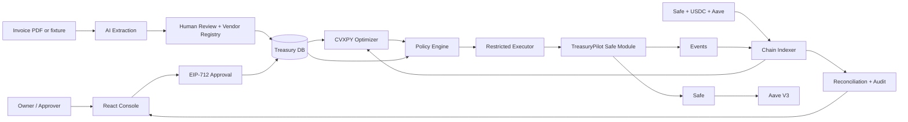

# TreasuryPilot: Autonomous On-chain Treasury Manager

**Loại:** Product, architecture và delivery specification  
**Phiên bản:** 0.3 - MVP mở rộng, scope đã xác nhận  
**Dùng cho:** Product, Finance, Smart Contract, Backend, AI, Frontend, QA

## 1. Quyết định sản phẩm

TreasuryPilot là một autonomous on-chain treasury manager cho doanh nghiệp đã vận hành bằng stablecoin. Hệ thống tự thực thi thao tác on-chain trong quyền được cấp; doanh nghiệp vẫn nắm quyền quyết định nghĩa vụ chi và rủi ro.

### MVP cần chứng minh

1. Đọc vị thế USDC ở Safe và USDC supplied vào Aave.
2. Tự `REFILL`, `PAY`, `SUPPLY`, `WITHDRAW` khi payment request đã được người có thẩm quyền duyệt và policy đạt.
3. Giữ tiền cho nghĩa vụ đã duyệt, chỉ supply USDC thực sự dư, và withdraw khi reserve mới tăng.
4. Phân tích `BORROW`/`REPAY`, nhưng chỉ gọi hai action này sau approval riêng của owner cho đúng plan.

### Scope đã chốt

| Hạng mục | Quyết định |
|---|---|
| ICP | Web3/stablecoin-native business ngoài Trung Quốc đại lục |
| Network | Một EVM testnet; khuyến nghị Ethereum Sepolia khi Aave test market/token đã xác minh tại thời điểm deploy |
| Asset | Một USDC test token; limit tính theo token base units, không lấy giá USD từ oracle |
| Wallet | Safe smart account có TreasuryPilot module |
| Lending | Aave V3 testnet hoặc fork với block đã pin |
| Invoice | Synthetic fixture và upload PDF để demo AI extraction |
| Stack | Solidity/Foundry, TypeScript/Node/Viem, React, SQLite/Postgres, Python/CVXPY |

### Ngoài phạm vi MVP

- Mainnet, fiat, custody, KYC/AML hay tuyên bố tuân thủ pháp lý.
- Trung Quốc đại lục, multi-chain, bridge, DEX, swap, nhiều stablecoin, token biến động giá.
- Tự thêm payee, tự sửa mandate, tự tăng limit, tự tạo nghĩa vụ chi.
- Tự mở khoản vay, tự repay, yield farming, leverage, dự báo/đầu tư danh mục rủi ro.
- LLM ký giao dịch hoặc có private key.

> Với một stablecoin, đây là bài toán **tối ưu thanh khoản ngắn hạn dưới nghĩa vụ đã duyệt**, không phải “AI đầu tư”. Agent làm on-chain execution; policy và smart contract giới hạn quyền đó.

### Quan hệ với tài liệu v0.2

Đây là nguồn quyết định scope v0.3. Nó thay thế phần “chỉ REFILL/PAY” và “không lending” ở các tài liệu trước. Định nghĩa mandate, payee allowlist, one-time exception, fallback và policy engine vẫn được giữ nếu tài liệu này không ghi khác.

---

## 2. ICP, vấn đề và giá trị

### ICP

Web3 SaaS nhận revenue bằng USDC, có Safe treasury và ví vận hành cùng chain, trả API/vendor/service fee bằng USDC. Họ có hóa đơn có hạn thanh toán, early-payment discount và late fee.

MVP mô phỏng một Treasury Safe và một Operational wallet. Đây là tối giản kỹ thuật của tình huống doanh nghiệp có nhiều ví vận hành.

### Pain statement

`Fragmented liquidity -> manual treasury operations -> unsafe delegation to AI.`

Operator kiểm tra số dư, nạp ví, chờ duyệt, trả invoice và đối soát bằng tay. Giữ toàn bộ USDC nhàn rỗi làm mất yield; supply quá nhiều làm rủi ro thiếu tiền lúc đến hạn. Giao quyền rộng cho AI là không chấp nhận được.

### Giá trị

- Giữ đủ USDC cho khoản chi đã duyệt và buffer.
- Supply phần dư có thể chứng minh; withdraw khi xuất hiện nghĩa vụ mới.
- Thực thi on-chain có hạn mức, payee allowlist, expiry và proof.
- Ghi đủ authorization, plan, policy decision, transaction hash, reconciliation.

---

## 3. Phân vai: AI không phải policy engine

| Thành phần | Được làm | Bị cấm |
|---|---|---|
| AI | Extract invoice, nhận diện term, giải thích plan, phát hiện anomaly để review | Ký, gọi contract, thêm payee, phê duyệt chi, đổi limit |
| Optimizer | Tính schedule thanh khoản từ dữ liệu đã xác thực | Bỏ qua mandate hay gửi tx |
| Policy engine | Validate off-chain: data freshness, cap, route, reserve, state | Là lớp bảo mật cuối cùng |
| Safe module | Enforce on-chain: token, payee, amount, nonce, expiry, pause, route | Generic target/calldata, delegatecall, tin prompt |
| Owner/Approver | Duyệt payment, borrow/repay, cấu hình/revoke/pause | Để agent tự thay quyền của nó |
| Executor | Broadcast step đã validate | Sửa payload, retry tx unknown, admin mandate |

Raw PDF/prompt không bao giờ đi vào contract. AI confidence chỉ quyết định có phải review, không tạo quyền thanh toán.

---

## 4. Domain model và công thức

| Khái niệm | Nghĩa |
|---|---|
| Treasury Safe | Safe giữ USDC/aUSDC; nguồn quỹ chính |
| Operational wallet | Ví được refill để trả vendor allowlist |
| PaymentReserve | Tổng max amount của request đã duyệt, chưa trả, trong reserve horizon |
| OperatingBuffer | USDC tối thiểu phải còn trong Treasury Safe |
| DebtServiceReserve | Tiền giữ cho debt/interest; bằng 0 nếu không có debt |
| ExecutionHold | Số tiền khóa tạm khi tx pending/unknown |
| AvailableForSupply | Phần USDC có thể supply sau mọi reserve |
| AccessibleLiquidity | Safe USDC cộng underlying USDC có thể withdraw từ Aave ngay lúc check |
| Mandate | Quyền machine-enforceable, versioned và có expiry |

```text
RequiredSafeReserve
  = PaymentReserve + OperatingBuffer + DebtServiceReserve + ExecutionHolds

AvailableForSupply
  = max(0, SafeUSDC - RequiredSafeReserve)

AccessibleLiquidity
  = SafeUSDC + min(AaveUnderlyingUSDC, AavePoolAvailableUSDC)

RequiredLiquidity
  = PaymentReserve + OperatingBuffer + DebtServiceReserve
```

**Quy tắc MVP:** PaymentReserve không được supply. Chỉ `AvailableForSupply` được supply. Khi request mới tăng reserve, agent withdraw từ Aave để khôi phục `RequiredSafeReserve`. Quy tắc này làm bảo vệ reserve có thể enforce và dễ audit.

```text
OperationalShortfall
  = max(0, authorizedPayment + estimatedGas - operationalUSDC)

RefillAmount
  = min(OperationalShortfall + operationalBuffer,
        maxRefillPerTransaction,
        remainingDailyRefillLimit)
```

Refill chỉ được chạy vì một payment request hợp lệ. Nếu refill làm Treasury Safe dưới reserve, agent withdraw; nếu không đủ thanh khoản thì block và escalates to owner.

---

## 5. Invoice, approval và authorization

### AI extraction schema

```json
{
  "vendorName": "Acme Cloud",
  "invoiceNumber": "ACME-2026-042",
  "amount": "950.000000",
  "asset": "USDC",
  "dueAt": "2026-11-15T00:00:00Z",
  "earlyTerms": {"amount": "930.000000", "payBy": "2026-11-05T00:00:00Z"},
  "lateFee": "1% monthly",
  "payeeCandidate": "0x...",
  "confidence": {"amount": 0.99, "dueAt": 0.94, "payee": 0.61}
}
```

Finance user kiểm tra evidence và match Vendor Registry. Vendor address mới/changing address vào cooling period và cần owner review.

### PaymentAuthorization

Approver ký EIP-712. MVP có hai option đã duyệt trước: early-payment hoặc standard payment.

| Field | Ý nghĩa |
|---|---|
| `requestId`, `nonce` | ID duy nhất, chống replay |
| `vendorId`, `payee` | Vendor và address allowlist |
| `asset`, `chainId` | Chỉ USDC và network cấu hình |
| `standardAmount`, `dueAt` | Amount/hạn thông thường |
| `earlyAmount`, `earlyPayBy` | Option discount, có thể rỗng |
| `expiry`, `mandateVersion` | Authorization hết hiệu lực khi timeout hoặc mandate đổi |

Contract chỉ chọn `earlyAmount` trước `earlyPayBy`; còn lại chỉ `standardAmount` trước `dueAt`. Một request chỉ consumed một lần.

### BorrowAuthorization / RepayAuthorization

Owner ký một approval một lần, gắn với `planId`, state snapshot hash, token, amount, Aave pool, expiry, max cost, minimum health factor và repayment plan. Bất kỳ thay đổi snapshot/parameter nào đều buộc ký lại. Borrow và repay đều cần approval riêng trong MVP.

---

## 6. Mandate và policy

```text
Autonomous: REFILL, PAY, SUPPLY, WITHDRAW
Owner-approved only: BORROW, REPAY
Asset: configured USDC only
Chain: one configured EVM chain
Payees: Vendor Registry allowlist
Payment cap: 2,000 USDC/tx (demo config)
Autonomous aggregate cap: 10,000 USDC/day (demo config)
Refill and supply caps: configured in token units
Safe floor: PaymentReserve + OperatingBuffer + DebtServiceReserve
Unknown payee/asset, stale state, expiry, cap breach: BLOCK
```

Các số là cấu hình demo, không hard-code. Gas cap được cấu hình riêng; không dùng oracle để biến token limit thành USD.

### Evaluation order

1. Safe/module active, mandate đúng version/chưa expiry/chưa pause.
2. Payment/borrow authorization hợp lệ, chưa consumed, đúng signer.
3. Snapshot balances/Aave/counters/nonce còn fresh.
4. Token, chain, payee, route, amount, deadline và daily/per-tx caps hợp lệ.
5. Action-specific reserve rule hoặc borrow authorization đạt.
6. Generate immutable `planHash`; executor chỉ nộp exact plan step.
7. Module kiểm lại toàn bộ rule enforceable ngay trước call.

| Action | Tự động | Hard conditions |
|---|---:|---|
| `PAY` | Có | Signed payment option, allowlist, cap, unconsumed |
| `REFILL` | Có | Phục vụ request hợp lệ, không phá Safe floor |
| `SUPPLY` | Có | Safe còn >= required reserve sau supply; pool/token registry đúng |
| `WITHDRAW` | Có | Pool/token registry đúng; phục vụ reserve hoặc request đã duyệt |
| `BORROW` | Không | Exact owner authorization, HF and cost threshold |
| `REPAY` | Không | Exact owner authorization |

### AI fallback

Khi AI unavailable, template rule-based chỉ được thực hiện `WITHDRAW -> REFILL -> PAY` cho payment request đã review/approved, route cố định và snapshot fresh. Không fallback `SUPPLY`, `BORROW`, `REPAY`. Pending/unknown transaction, security alert và vendor mismatch phải dừng.

---

## 7. Optimizer: liquidity management, không phải investment bot

### Input

- Payment request/options/due date đã duyệt.
- Safe USDC, aUSDC, Aave pool liquidity và debt state.
- Supply APY, borrow APR, gas estimate.
- Buffer, reserve, caps, pending execution.

### Objective

```text
Minimize:
  lateFees + lostEarlyDiscount + borrowInterest + estimatedGas
  - expectedSupplyInterest

Subject to:
  each approved payment funded before selected deadline
  SafeUSDC[t] >= PaymentReserve[t] + OperatingBuffer + DebtServiceReserve
  supply[t] <= AvailableForSupply[t]
  withdraw[t] <= protocol withdrawable liquidity
  autonomous actions <= mandate caps
  borrow/repay only when owner approval exists
```

Thứ tự ưu tiên: nghĩa vụ đã duyệt, mandate, tránh fee/mất discount, rồi mới đến yield.

### Borrow logic

Với USDC-only MVP, withdraw thường tốt hơn borrow. Optimizer chỉ tạo **proposal** khi withdraw bị giới hạn hoặc owner có lý do chứng minh cần giữ position. Proposal phải nêu amount/deadline, borrow cost đến repayment, withdraw cost, health factor trước/sau, policy threshold và lý do. Không có owner authorization thì borrow bị loại khỏi executable plan.

### Library

Dùng CVXPY trực tiếp cho linear/quadratic constrained optimization. PyPortfolioOpt phù hợp khi có nhiều asset rủi ro và return data, nên không là core dependency của MVP. Output CVXPY phải qua TypeScript policy engine; không serialize optimization expression vào contract.

---

## 8. Architecture và contract boundaries



### Trust boundary

- AI, UI, DB, optimizer và executor là untrusted-by-design.
- Owner keys, Safe, minimal Safe module và verified Aave Pool là trust anchors.
- Executor không có generic transaction, admin mandate hoặc quyền sửa payload.
- Module chỉ gọi fixed USDC/Aave methods. Không có `execute(target,calldata)` generic và không delegatecall.

### Contracts

| Contract | Trách nhiệm |
|---|---|
| `TreasuryPilotModule` | Safe module, authorization, caps, nonce, reserve floor, pause, fixed routes |
| `MandateRegistry` | mandate version/hash, guardian, payees, limits |
| `PaymentAuthorizationRegistry` | signature validation, consumed request/nonce |
| `AaveAdapter` | fixed `supply`, `withdraw`, `borrow`, `repay` calls |

Demo có thể gộp registry vào module nhưng giữ interfaces tách. Required checks:

- Caller là executor/owner đúng action; pause và expiry được kiểm.
- Request nonce chưa used; signature/approver/mandate version hợp lệ.
- USDC/payee/chain/Aave pool khớp registry; no arbitrary target.
- Amount khớp approved option và caps/counters.
- `SUPPLY` xong Safe vẫn >= stored required reserve.
- `BORROW`/`REPAY` có owner authorization; borrow check Aave account data/HF ngay trước call.
- Reentrancy, zero amount, duplicate execution và replay bị chặn.

Contract không biết invoice “có thật” hay dự đoán liquidity/price tương lai. Đây là input có review và monitoring, không phải guarantee.

---

## 9. End-to-end product flow

### Payment + liquidity flow

1. User upload PDF hoặc chọn fixture.
2. AI extract schema/evidence. Confidence thấp hoặc address change -> `NEEDS_REVIEW`.
3. Finance review, match vendor, chọn payment option.
4. Owner signs `PaymentAuthorization`; DB lưu immutable digest, PaymentReserve tăng.
5. Scheduler/event listener lấy chain snapshot mới rồi chạy optimizer.
6. Optimizer tạo plan, ví dụ `WITHDRAW 500 -> REFILL 900 -> PAY 930`; hoặc `SUPPLY 2,000` khi surplus.
7. Policy validates full plan và tạo `planHash`.
8. Executor nộp từng step theo thứ tự đến module.
9. Module validate lần cuối, Safe gọi fixed route, event emit requestId/planHash/action/amount.
10. Indexer chờ confirmation, cập nhật step state, giảm reserve sau payment thành công, reconciliation.

### Borrow/repay flow

1. Optimizer tạo cost/HF comparison proposal.
2. UI hiển thị withdraw vs borrow, repayment plan và risk.
3. Owner từ chối/đổi nguồn tiền hoặc ký one-time authorization.
4. Policy revalidates snapshot. Khác snapshot, expiry hoặc parameter -> ký lại.
5. Executor calls `BORROW`/`REPAY` đúng authorization.

### State machine

```text
INGESTED -> EXTRACTION_REVIEW -> VENDOR_VERIFICATION
-> AWAITING_PAYMENT_APPROVAL -> APPROVED_RESERVED
-> PLANNED -> VALIDATED -> EXECUTING -> PAID -> RECONCILED

Any state -> NEEDS_REVIEW | BLOCKED
PLANNED -> AWAITING_BORROW_APPROVAL
EXECUTING -> PARTIALLY_EXECUTED | UNKNOWN
```

`UNKNOWN` là tx broadcast nhưng chưa biết final result. Không retry/payment-step tiếp theo cho tới khi indexer resolve receipt/reorg.

---

## 10. Data, API, events

| Table | Core fields |
|---|---|
| `vendors` | identity, allowlisted addresses, cooling status |
| `invoice_extractions` | file hash, schema, confidence, evidence, reviewer |
| `payment_requests` | approved options, auth hash, reserve state, lifecycle |
| `mandates` | version/config/expiry |
| `positions` | Safe USDC, aUSDC, debt, pool liquidity, block |
| `plans`, `plan_steps` | objective, snapshot hash, payload, tx state |
| `authorizations` | digest, signer, nonce, expiry, consumed |
| `executions`, `audit_events` | broadcast/receipt/events/reconciliation/actor |

```text
POST /invoices/ingest
POST /invoices/:id/review
POST /payment-requests/:id/approve
GET  /treasury/:safe/position
POST /plans/generate
POST /plans/:id/validate
POST /plans/:id/execute
POST /borrow-authorizations
POST /repay-authorizations
POST /mandates/:id/pause
GET  /audit?requestId=&planId=
```

Mutations require authenticated actor and audit event. Browser không bao giờ gửi arbitrary target/calldata; executor chỉ nhận server-side plan ID.

```solidity
event PaymentExecuted(bytes32 indexed requestId, bytes32 indexed planHash,
                      address indexed payee, uint256 amount);
event RefillExecuted(bytes32 indexed requestId, bytes32 indexed planHash,
                    address recipient, uint256 amount);
event Supplied(bytes32 indexed planHash, uint256 amount);
event Withdrawn(bytes32 indexed planHash, uint256 amount);
event BorrowExecuted(bytes32 indexed authorizationId, uint256 amount);
event Repaid(bytes32 indexed authorizationId, uint256 amount);
event MandatePaused(address indexed safe, address indexed actor);
```

---

## 11. Security, failure and recovery

| Threat | Control |
|---|---|
| Prompt injection | AI output untrusted; schema/evidence/review/allowlist; text never controls call |
| Wrong extraction | Exact signed authorization and contract cap |
| Executor compromise | Fixed routes; no generic execution; amount/expiry constrained |
| Vendor address changed | Registry, cooling period, owner review |
| Duplicate/replay | requestId + nonce + consumed mapping + idempotency |
| Stale RPC/reorg | block snapshot, confirmations, `UNKNOWN`, no blind retry |
| Aave risk | testnet/fork only, pool registry, pre-check; no future liquidity guarantee |
| Liquidation | no autonomous borrow; owner approval, HF threshold, monitoring |
| Module bug | minimal surface, pause, Foundry fuzz/invariants, independent review before real deployment |

Emergency: guardian/owner pause on-chain; pause blocks executor but Safe owners recover via native Safe. Owner can revoke executor/module. Backend circuit-breaks on stale state, reconciliation failure, abnormal event or repeated simulation failure.

---

## 12. Test strategy và demo acceptance

### Smart contract

- Unit: EIP-712, option selection, caps, expiry, pause, nonces/counters/reserve floor.
- Aave fork/integration: supply, withdraw, account data, borrow/repay on pinned state.
- Invariants:
  - request không trả hai lần;
  - payment không vượt signed option;
  - unknown payee/asset không chuyển tiền;
  - supply không phá Safe reserve;
  - borrow/repay không có owner authorization thì fail;
  - pause blocks executor;
  - không arbitrary target/delegatecall.

### Services

- Invoice fixtures: clean, wrong amount, changed address, discount, missing due date, injection text.
- Optimizer: feasible plan không bỏ deadline; reproducible từ snapshot.
- Policy: stale snapshot, cap breach, expired approval, insufficient liquidity, pending tx.
- E2E: invoice -> approval -> plan -> on-chain step -> index -> reconciliation.

### Judge demo

| ID | Case | Must show |
|---|---|---|
| D1 | Wallet thiếu tiền | autonomous refill rồi pay, full proof |
| D2 | USDC dư | supply đúng surplus, reserve còn nguyên |
| D3 | New approved invoice | withdraw để restore reserve |
| D4 | Unknown payee | blocked trước execution |
| D5 | Cap breach | blocked; one-time exception only |
| D6 | Borrow proposal | cost/HF; no signature, no tx |
| D7 | Signed borrow | exact one-time params; repay still approval-only |
| D8 | AI outage | only safe fallback route |
| D9 | Tx unknown | no retry until resolved |
| D10 | Guardian pause | executor reverts; Safe recovery remains |

### Benchmark

| Baseline | Purpose |
|---|---|
| B0: manual/EDF, cash idle | Workflow baseline |
| B1: validated data + deterministic optimizer | Optimizer benefit |
| B2: AI extraction + human validation + B1 | AI workflow benefit |

Measure: on-time rate, reserve breach, mandate violation, estimated net benefit, invoice processing time, reviewed extraction accuracy and manual interventions. Demo must label data/APY/gas as synthetic or snapshot assumptions.

---

## 13. Backlog và phân công

### A. Smart contract

1. Freeze EIP-712 types, roles, nonces, interfaces.
2. Mandate/payment authorization/consumed logic.
3. Fixed USDC PAY/REFILL and reserve floor.
4. Aave SUPPLY/WITHDRAW adapter.
5. Owner-approved BORROW/REPAY.
6. Pause, guardian, event/error design.
7. Unit/fuzz/invariant/fork tests.

**Done:** D1-D7 test pass; no generic target; address config verified.

### B. Backend/indexer/policy

1. Schema/migrations/audit events.
2. Chain reader/indexer and confirmation/reorg handling.
3. Mandate evaluator, plan hash.
4. Idempotent executor and UNKNOWN resolver.
5. Reconciliation, alerts, circuit breaker.
6. APIs and seeded fixtures.

**Done:** Every execution links authorization, policy outcome, tx hash and reconciliation result.

### C. Optimizer

1. Input/output contract and feasibility rules.
2. CVXPY liquidity model with deterministic tie break.
3. Borrow comparison; exclude it without authorization.
4. Fixture tests and B0/B1 runner.

**Done:** Reproducible output; no hard-constraint violation.

### D. AI workflow

1. Ingestion/extraction JSON/evidence references.
2. Review contract and vendor anomaly.
3. Injection suite and error handling.
4. Labelled synthetic invoices/evaluation.

**Done:** No output bypasses human review, allowlist or signature.

### E. Frontend/demo

1. Treasury position dashboard.
2. Invoice review and EIP-712 approval.
3. Plan, constraints and explanation view.
4. Borrow approval risk view.
5. Audit timeline, pause/recovery.
6. D1-D10 recording/script.

**Done:** A judge can understand why a tx was allowed without terminal access.

### F. QA/security

1. Threat model and deployment checklist.
2. Test evidence/coverage/adversarial fixtures.
3. Dry-run all scenarios.
4. Secret/sensitive-data scan.

**Dependencies**

```text
Domain + EIP-712 schema
  -> contract interfaces + DB schema
  -> policy engine + optimizer I/O
  -> executor/indexer
  -> UI
  -> E2E demo, benchmark, pitch
```

AI/UI can start against mocked APIs. Executor integration waits until EIP-712/action schema freezes.

---

## 14. Configuration gate before deploy

Store a non-secret, version-controlled manifest:

```text
CHAIN_ID, RPC_URL, SAFE_ADDRESS
USDC_ADDRESS and decimals
AAVE_POOL_ADDRESS, ATOKEN_ADDRESS, POOL_ADDRESSES_PROVIDER
OWNER, APPROVER, GUARDIAN, EXECUTOR addresses
caps, reserves, expiry, health-factor threshold
confirmation count, snapshot freshness threshold
```

Addresses must come from verified official deployment data, not prompt/tutorial text. CI must fail if chain ID, token decimals or Aave mapping differ from the manifest.

## 15. Evidence package

1. This spec and one-page architecture.
2. Verified contracts plus unit/fuzz/invariant report.
3. Testnet links for D1-D10.
4. Short recording: review -> sign -> autonomous execution -> reserve -> pause.
5. Benchmark notebook/result and assumptions.
6. Disclosure: testnet/synthetic data; no legal approval, production audit or guaranteed yield claim.

## 16. Vì sao đây là MVP nên làm

Nó chứng minh autonomy ngay trên chain qua Safe module (`withdraw`, `refill`, `pay`, `supply`), chứ không chỉ là dashboard/ERP. Đồng thời:

- AI xử lý tài liệu và giải thích; optimizer xử lý số; policy/contract xử lý quyền.
- Reserve là hard constraint; yield là mục tiêu phụ.
- Borrow được mô tả thành exception có owner approval, không phải “tối ưu” giả tạo.
- Mỗi quyết định dẫn đến authorization, policy result, contract event, tx hash và reconciliation.

## 17. References

- Aave V3 testing: https://aave.com/docs/developers/smart-contracts/testing-and-debugging
- Aave V3 overview: https://aave.com/docs/developers/smart-contracts/overview
- Safe modules: https://docs.safe.global/advanced/smart-account-modules
- Foundry invariant testing: https://getfoundry.sh/forge/advanced-testing/invariant-testing
- CVXPY: https://www.cvxpy.org/examples/basic/quadratic_program.html
