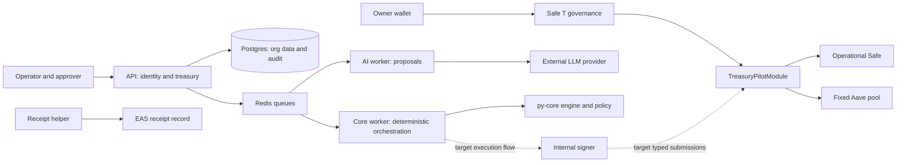
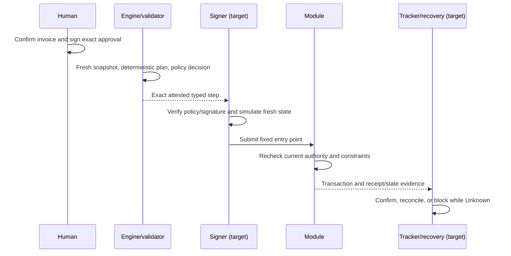

# TreasuryPilot technical documentation

DOM-012 / #236. Implementation baseline: main
`0c79d0731ad730e7c2f9f6644e90c36453b02d7e`, reviewed for this draft on
2026-10-15. Status: **submission draft; feature-freeze and developer review pending**.
Scope: synthetic testnet treasury evaluation. Target workflows still under
implementation are marked below. The committed Sepolia manifest
(`deployments/11155111.json`) remains `configured_only`, with no deployed module
or Safe addresses. A closed deployment-related issue is not mined-state evidence.

## 1. Problem and scope

Treasury operations combine invoice authenticity, human payment authorization,
wallet liquidity, daily budgets, deadlines and payment evidence. TreasuryPilot
delegates bounded actions from owner-controlled Safes through a custom module.
AI proposes document fields and plans; deterministic code computes money and
validates feasibility; humans approve obligations and govern the mandate.

M1 targets one treasury stablecoin, Safe T plus one operational wallet in the
Sepolia demo, Aave supply/withdraw and borrowing proposals. Owner-authorized
borrow/repay execution and a labelled test router are P2 contract paths. The
local fixture can use two operational wallets to exercise shared counters.
Mainnet, speculative trading and unrestricted execution are outside this demo.

The module also has versioned per-asset PAY/REFILL policies and buffers. That code
capability does not imply that additional assets are configured in the demo.

## 2. Architecture and trust boundaries



Dashed edges identify target integrations absent at this baseline. The signer
service currently exposes health only. The core worker now has extraction,
Safe configuration refresh, chain tracking/indexing/snapshots, audit anchoring,
domain-event publishing and external notification tasks, plus policy-attestation
helpers. These components do not establish the diagram's full payment loop. The AI process has an
explicit environment allowlist without policy/executor keys. This is a deployed
configuration boundary, not proof against compromise of the common host.

| Component | Implemented baseline                                                                                                                                                                                                                        | Remaining target integration                                                                               |
| --------- | ------------------------------------------------------------------------------------------------------------------------------------------------------------------------------------------------------------------------------------------- | ---------------------------------------------------------------------------------------------------------- |
| Contracts | Clone/factory, per-asset PAY/REFILL policies, governance, budgets/floors/replay, fixed Aave supply/withdraw, owner borrow/repay grants, optional executor wrapper and audit-root anchor                                                                                                                  | Public deployment/verification, independent authorization review and application integration                                                 |
| py-core   | Strict integer money/domain models, refill formulas, EDF scheduler, CP-SAT scheduler with EDF fallback, test-only exhaustive oracle, plan scoring, payment-option/value functions, forecast, reserve/liquidity decision and borrow proposal | Integration of the CP-SAT scheduler (ADR-015) and plan scoring into API/worker flows                       |
| API       | In-house session/auth (ADR-009) and org RBAC, identity/treasury repositories/routes, invoice intake/approval lifecycle, maker-checker/solo mode, HIGH acknowledgments, payee screening, audit primitives                                                                 | Complete policy/execution/reconciliation flow and release evidence              |
| Worker/AI | Queue/environment separation, RPC health/pool primitives, logging/metrics/locks, model adapter/failover/budgets, input sanitization/detector, policy-attestation helpers, extraction, read-only tool primitives, tracker/indexer/snapshots, audit anchoring, notification delivery                                      | Full planner/tool evaluation, trigger/executor integration and operational recovery |
| Signer    | Internal health service                                                                                                                                                                                                                     | Attestation verification, fresh simulation and typed signing endpoint                                      |
| Evidence  | Verified mined-state publisher, schema/receipt helpers, local journals, static/test reports                                                                                                                                                 | Public Sepolia/EASScan evidence and production reconciliation/uniqueness                                   |

See [system architecture](../SYSTEM_ARCHITECTURE.md),
[AI design](../AI_AGENT_ARCHITECTURE.md) and the [security self-assessment](security-self-assessment.md)
for the target design and its present implementation qualifications.

## 3. Money and payment authorization

Money is an integer count of asset base units. For a six-decimal test token,
`"25000000"` represents 25 tokens, not a fiat valuation. Dataset/API serialization
uses decimal strings; the engine uses strict `BaseUnits`, Solidity uses integer
amounts. Asset identity is chain/address; decimals are reviewed against chain state.

PaymentApproval has 13 fields, including exact standard/early options, request,
fingerprint, treasury/wallet, asset/payee, confirmed-term hashes and expiry. EIP-712
binds the chain and module. The contract checks a current approver through EOA
or ERC-1271 verification. While an early option is active, PAY consumes that exact
early amount; otherwise the standard amount. A successful request is consumed
once. A backend approved flag and an AI confidence score do not substitute for
the signature.

Governance requires Safe T as caller; its human threshold is enforced by Safe.
An exact one-time exception can lift the per-request cap, while daily budgets,
floors, allowlist/cooling and expiry remain. Pause/revoke prevent subsequent
module execution after mining and cannot reverse completed transfers. Direct
owner transactions remain a separate Safe authority path.

## 4. Deterministic financial algorithms

### 4.1 Request-bound refill

For destination balance B, hard floor F, soft target H, current demand D and
other protected funds R, the engine computes:

```text
Shortage  = max(0, R + D + F - B)
Preferred = max(0, R + D + H - B)
Bound     = max(0, D + H - B)
Capacity  = max(0, SourceBalance - SourceProtected - SourceFloor)
Cap       = min(Capacity, RemainingRefillDaily, PerRefillLimit)
```

If Shortage is zero, no refill occurs solely to reach H. If Shortage exceeds
Bound, stop. Otherwise use bounded Preferred when it fits Cap, or Shortage when
that fits; if neither fits, stop without partial payment. PAY and REFILL have
separate daily counters. The module additionally binds destination and refill
count to the approved request and checks exact source/destination balance deltas.

### 4.2 Scheduler, payment value and forecast

The implemented `schedule_edf` sorts by due UTC day, approval sequence and request
ID. It iterates 30 days, resets simulated counters at UTC day boundaries, carries
wallet/source cash forward, rechecks cooling and caps, and applies request-bound
refill decisions. A request blocked today can remain eligible on later days.
It returns scheduled items, remaining blockers and an objective tuple:
`(0, missed_deadlines, -total_value, transaction_count)`.

EDF returns a feasible heuristic result, not a global optimum certificate.
The older source calls it B1; ADR-019 benchmark naming is B0 manual/EDF with idle
cash, B1 deterministic optimizer, B2 AI plus optimizer. Reports must use the
ADR-019 labels with explicit algorithm identities and must not relabel EDF as
the CP-SAT scheduler. `schedule_cpsat` (ADR-015) is on main with a 5 s limit and EDF
fallback; state the actual algorithm, solver status and fallback mode explicitly. No measured B0/B1/B2 comparison is reported here.

For a confirmed early option, value is exact standard-minus-early saving less
estimated execution fee and simple supply interest forgone until due date;
accrued late fees reduce value. Percentage fees use integer basis points and
ceiling period count, then floor monetary division and apply any configured cap.
Late-fee valuation does not authorize a PAY larger than the signed options.
EDF currently supplies rate to valuation but no per-request fee parameter;
benchmark inputs must disclose the resulting zero-fee assumption.

Forecast replays EDF payment/refill order with conserved balances. It reports
due-but-unpaid obligations and their modeled late fees, buffer-hit and shortfall
days. A forecast is conditional on approved inputs and fixed assumptions, not
guaranteed future liquidity.

### 4.3 Idle cash and debt proposal

```text
RequiredSafeReserve = PaymentReserve + SafeFloor + DebtServiceReserve + ExecutionHolds
AvailableForSupply  = max(0, SafeUSDC - RequiredSafeReserve)
AccessibleLiquidity = SafeUSDC + min(aUSDC, PoolAvailableUSDC)
Deficit             = max(0, RequiredSafeReserve - SafeUSDC)
WithdrawTarget      = ceil(Deficit * 105 / 100)
```

PaymentReserve includes approved unpaid obligations due or scheduled within the
configured inclusive reserve horizon; the chosen early amount is used when known,
otherwise standard amount. Supply requires minSupply and respects per-call/daily
caps. A prior withdrawal suppresses supply that day. Withdrawal is bounded by
aToken balance and available pool cash; any remaining deficit yields
INSUFFICIENT_LIQUIDITY rather than an automatic borrow transaction.

The module enforces static floor and supply caps; dynamic reserve calculation is
an off-chain responsibility. Simple-interest borrow proposals use current rate,
amount and repayment interval. Estimated post-borrow HF is unknown without an
existing debt position; current/future rate and liquidation behavior require
review. P2 execution needs an unused, unexpired owner grant and instantaneous
rate/HF checks, not merely an AI recommendation or proposal.

## 5. Validation and proposed execution lifecycle



This sequence describes required end-to-end integration, not a measured runtime
flow in this baseline. Sequential execution, fresh re-reads before each step,
outbox writes, post-conditions and Unknown recovery remain necessary. Completed
steps in a non-atomic sequence must be recorded and not repeated.

## 6. Security and evidence

The [self-assessment](security-self-assessment.md) gives all five permission tiers
and [known risks](../security/known-risks.md) records 25 architectural residuals.
The register retains its stated historical baseline. Independent audit, full backend integration and public execution evidence remain open.

Contract files at this baseline match revision `02e4d674d1a76aa60cf2ac1c242f2aed20a6fb5c`:
[Contracts CI](https://github.com/Nostidus4/TreasuryPilot/actions/runs/38583286706)
records 110 tests passing, zero failures, across 16 suites including aggregate
invariant execution. [Security CI](https://github.com/Nostidus4/TreasuryPilot/actions/runs/38583286728)
has successful invariant and Slither jobs. These bounded checks do not establish
complete authorization coverage, backend integration or public readiness.
The historical 86-test campaign, seven Aave fork cases and local receipt evidence
remain documented in [test-evidence](../security/test-evidence.md) at their own
revisions. Independent policy authorization review remains a release gate.

Receipt helpers require successful canonical PAY and finalized Sepolia state,
expected schema and configured trusted attester. Invoice/approval/plan/policy
hashes remain backend assertions. Persistent local journals reduce duplicate
sends; production reconciliation still needs database uniqueness.

## 7. Evaluation status and reporting protocol

No extraction accuracy, AI planner uplift, customer-validation count or full
red-team pass rate is established by this document. A dataset authoring artifact
is not a measured benchmark result. Publish measured results only with:

- Dataset and code revision, asset scale, UTC horizon and split/exposure history.
- Actual B0/B1/B2 implementations, fees/rates and failure/fallback behavior.
- Feasibility violations, deadline misses, net modeled value, transaction count,
  latency/cost and sample denominators; include cases where EDF is optimal.
- Independent ground-truth review and protected held-out evaluation. Synthetic
  examples in the public repo are accessible and must not be called unseen.
- Explicit limits: simplified static scenario assumptions, external provider
  availability, no mainnet performance or guaranteed yield extrapolation.

## 8. Deployment and feature-freeze handoff

Follow [DEPLOYMENT](../../contracts/docs/DEPLOYMENT.md). Keep predictions separate
from the published mined-state manifest. Verify canonical Safe infrastructure,
chain/asset/decimals, actual operational list, owner/threshold, module enablement,
pool/aToken and dedicated attester. Demo topology is T/O1; Anvil T/O1/O2 is a
test fixture. Public deployment/receipt acceptance remains separate from local forks and GitHub issue closure.
Recheck Aave USDC headroom and current EVM gas behavior before public broadcast.

At feature freeze, update the baseline and implementation/evidence tables, attach
actual benchmark results and public evidence when available, obtain developer
review and export the reviewed Markdown if a PDF is required. This draft exposes
the present gaps so they can be reviewed rather than filled with invented results.
