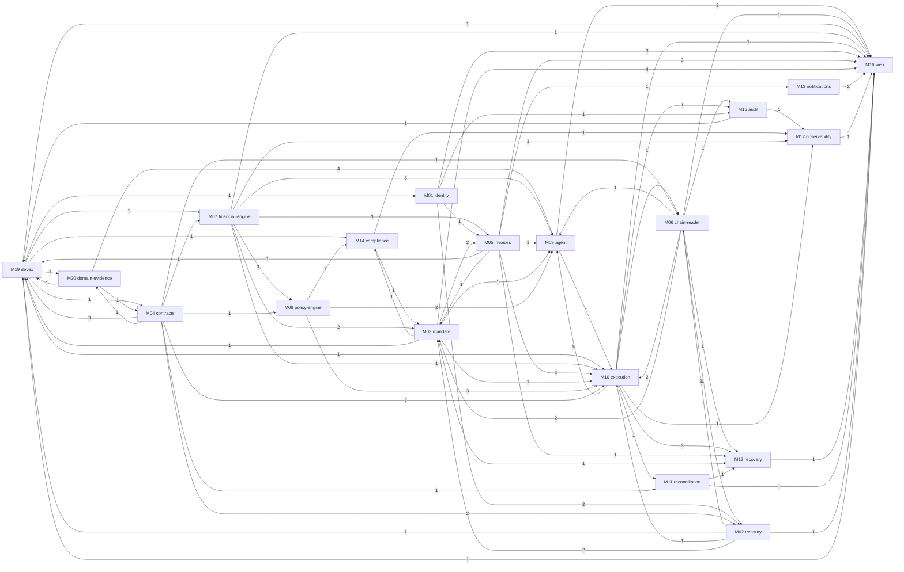

# Dependency Map

Generated by `planning/tools/gen_issues.py`.

## 1. Module-level blocking dependencies (M1)

An arrow A → B means at least one ticket in B is blocked by a ticket in A. The number is how many such links exist.

## 2. Dependency types

| Type | Meaning | Examples |
|---|---|---|
| **Blocking** | B cannot start until A is merged (listed in each ticket's *Dependencies*). | SC-005 → SC-006; ENG-010 → INV-010; POL-006 → EXE-005 |
| **Soft** | B can start against a stub or recorded data and integrate later. | WEB-* pages against the OpenAPI schema before endpoints are finished; AGT-004 with recorded model responses; AGT-013/014 scaffolding before DOM datasets are complete |
| **Parallel** | No dependency in either direction. | Contracts (SC) ‖ py-core engine (ENG) ‖ identity (IDN) ‖ web shell (WEB-001) ‖ all DOM tickets |

## 3. Execution waves (M1)

Tickets in the same wave have no blocking dependency on each other, so they **can run in parallel**. A ticket appears in the earliest wave in which all of its blockers are done.

### Wave 1 (12 tickets)

| ID | Title | Prio | Size | Blocked by |
|---|---|---|---|---|
| DEV-001 | Initialize monorepo skeleton | P0 | M | — |
| DOM-001 | Decide the M1 chain (owner: Phúc) | P0 | S | — |
| DOM-003 | Ask the organizers whether testnet evidence is accepted | P0 | S | — |
| DOM-004 | Author the labelled invoice dataset (30) | P0 | M | — |
| DOM-005 | Author planner scenarios with ground truth (≥30) | P0 | L | — |
| DOM-006 | Author the red-team invoice set (20) | P0 | M | — |
| DOM-008 | Review business rules and demo limits from a finance view | P0 | S | — |
| DOM-009 | Review the threat model and write the known-risk list | P0 | M | — |
| DOM-010 | Run customer interviews (2–3) | P1 | M | — |
| DOM-015 | Write the compliance positioning note and license inventory | P1 | S | — |
| DOM-017 | Choose the repository license | P1 | S | — |
| DOM-016 | Update the FigJam board from the repo diagrams | P2 | S | — |

### Wave 2 (11 tickets)

| ID | Title | Prio | Size | Blocked by |
|---|---|---|---|---|
| CMP-003 | Implement data classification, encryption helpers and log redaction | P0 | M | DEV-001 |
| DEV-002 | Create Docker Compose stack (local profile) | P0 | M | DEV-001 |
| DOM-002 | Decide the M1 stablecoin (owner: Phúc) | P0 | S | DOM-001 |
| DOM-013 | Create the 10-minute presentation deck | P0 | M | DOM-008 |
| ENG-001 | Create py-core money types and domain models | P0 | M | DEV-001 |
| SC-001 | Set up the Foundry project with pinned dependencies | P0 | S | DEV-001 |
| WEB-001 | Create the web app shell | P0 | M | DEV-001 |
| DEV-003 | Add CI workflow for Python | P1 | S | DEV-001 |
| DEV-011 | Enforce module boundaries with import-linter | P1 | S | DEV-001 |
| DOM-007 | Author Copilot question cases (20) | P1 | S | DOM-005 |
| SC-019 | Register the attestation schema and add an attest helper | P2 | S | DOM-001 |

### Wave 3 (10 tickets)

| ID | Title | Prio | Size | Blocked by |
|---|---|---|---|---|
| ENG-002 | Implement the liquidity calculator | P0 | M | ENG-001 |
| ENG-005 | Model payment terms and their value function | P0 | S | ENG-001 |
| ENG-009 | Implement invoice fingerprint normalization and hashing | P0 | S | ENG-001 |
| EXE-002 | Set up Celery with core and ai queues | P0 | M | DEV-002 |
| IDN-001 | Create identity database schema and migrations | P0 | S | DEV-002 |
| POL-001 | Define the reason-code catalogue and decision model | P0 | S | ENG-001 |
| SC-002 | Define module storage, structs, EIP-712 domain, errors and events | P0 | M | SC-001 |
| DEV-004 | Add CI workflow for contracts | P1 | S | SC-001 |
| DEV-005 | Add CI workflow for web and OpenAPI client drift | P1 | S | WEB-001 |
| OBS-001 | Configure structured logging with correlation ids | P1 | S | CMP-003 |

### Wave 4 (9 tickets)

| ID | Title | Prio | Size | Blocked by |
|---|---|---|---|---|
| AGT-001 | Build the LLM adapter with routing and timeouts | P0 | M | EXE-002 |
| AUD-001 | Implement the hash-chained audit log | P0 | M | IDN-001 |
| ENG-003 | Implement the refill decision table | P0 | S | ENG-002 |
| IDN-002 | Implement magic-link login, sessions and CSRF | P0 | M | IDN-001 |
| SC-005 | Implement approval signature verification | P0 | M | SC-002 |
| SC-021 | Implement the module factory with EIP-1167 clones | P0 | M | SC-002 |
| TRS-001 | Create treasury and chain schema | P0 | S | IDN-001 |
| OBS-002 | Add OpenTelemetry tracing | P1 | M | OBS-001 |
| OBS-003 | Add Sentry and Prometheus metrics | P1 | S | OBS-001 |

### Wave 5 (14 tickets)

| ID | Title | Prio | Size | Blocked by |
|---|---|---|---|---|
| AGT-002 | Log every AI call and fail closed | P0 | S | AGT-001 |
| AGT-003 | Implement untrusted-content wrapping and sanitization | P0 | S | AGT-001 |
| AUD-002 | Add audit read and chain verification | P0 | S | AUD-001 |
| ENG-004 | Add property tests for buffer and limit safety | P0 | S | ENG-003 |
| ENG-006 | Implement the baseline scheduler B1 (earliest deadline first) | P0 | S | ENG-003, ENG-005 |
| IDN-003 | Rate-limit authentication endpoints | P0 | S | IDN-002 |
| IDN-004 | Implement SIWE wallet linking | P0 | M | IDN-002 |
| IDN-005 | Implement organization creation and onboarding checklist | P0 | S | IDN-002 |
| MDT-001 | Create mandate, payee and exception schema | P0 | S | TRS-001 |
| SC-003 | Implement mandate governance and versioning | P0 | M | SC-021 |
| SC-017 | Publish EIP-712 golden vectors | P0 | S | SC-005 |
| TRS-002 | Load and validate platform chain configuration | P0 | S | TRS-001 |
| AGT-017 | Add a secondary LLM provider fallback | P1 | M | AGT-001 |
| ENG-011 | Implement the 7-day liquidity forecast | P2 | S | ENG-003 |

### Wave 6 (10 tickets)

| ID | Title | Prio | Size | Blocked by |
|---|---|---|---|---|
| CHR-001 | Build the RPC client with failover | P0 | M | TRS-002 |
| ENG-007 | Implement the terms-aware scheduler | P0 | L | ENG-006 |
| ENG-010 | Build EIP-712 typed data for approvals, exceptions and attestations | P0 | M | SC-017, ENG-001 |
| IDN-006 | Implement RBAC dependencies and tenant isolation | P0 | M | IDN-005 |
| INV-001 | Create invoice and request schema | P0 | S | MDT-001 |
| MDT-002 | Validate mandate drafts and generate summary and diff | P0 | M | MDT-001, ENG-001 |
| SC-004 | Implement the payee registry with cooling period | P0 | S | SC-003 |
| SC-010 | Implement pause, resume, revoke and guardian | P0 | S | SC-003 |
| WEB-002 | Build login, org selection and onboarding checklist | P0 | M | WEB-001, IDN-005 |
| CMP-001 | Build the screening adapter and fixture provider | P1 | S | MDT-001 |

### Wave 7 (12 tickets)

| ID | Title | Prio | Size | Blocked by |
|---|---|---|---|---|
| ENG-008 | Expose plan scoring and binding-constraint reporting | P0 | S | ENG-007 |
| EXE-001 | Create operations (outbox), transactions and gas ledger schema | P0 | S | INV-001 |
| IDN-008 | Implement the maker-checker service and solo mode | P0 | S | IDN-006 |
| INV-002 | Implement the request state machine | P0 | M | INV-001 |
| MDT-004 | Implement vendor and payee proposals with screening | P0 | M | MDT-001, CMP-001 |
| POL-002 | Validate approval, mandate and payee conditions | P0 | M | POL-001, ENG-010 |
| SC-006 | Implement pay() core flow | P0 | M | SC-004, SC-005 |
| SC-016 | Write deployment scripts and the deployments manifest | P0 | M | SC-010, SC-021 |
| TRS-003 | Implement the asset registry with on-chain decimals check | P0 | S | TRS-002, CHR-001 |
| WEB-003 | Add wallet connection and SIWE linking | P0 | S | WEB-002, IDN-004 |
| IDN-007 | Implement invites and membership management | P1 | M | IDN-006 |
| POL-005 | Define canonical plan encoding and planHash | P1 | S | ENG-010 |

### Wave 8 (13 tickets)

| ID | Title | Prio | Size | Blocked by |
|---|---|---|---|---|
| CHR-003 | Implement the transaction tracker | P0 | M | CHR-001, EXE-001 |
| INV-003 | Implement manual request creation and editing | P0 | M | INV-002, MDT-004 |
| POL-003 | Validate limits, buffers, deadlines, coverage and unknown operations | P0 | M | POL-002 |
| RCV-004 | Implement the review queue and routing | P0 | M | INV-002 |
| SC-007 | Implement per-request limits and UTC daily counters | P0 | M | SC-006 |
| SC-008 | Enforce minimum buffers on pay and refill | P0 | S | SC-006 |
| SC-012 | Add the duplicate-invoice fingerprint registry and owner override | P0 | S | SC-006 |
| TRS-004 | Implement treasury creation with Safe verification | P0 | M | TRS-003, IDN-006 |
| CHR-005 | Index module and Safe events | P1 | M | CHR-001, SC-016 |
| DEV-010 | Add testnet profile and VM deployment | P1 | M | DEV-002, DOM-001, SC-016 |
| NTF-001 | Create the domain event bus and notification routing | P1 | M | INV-002 |
| POL-006 | Sign and verify plan attestations | P1 | S | POL-005 |
| WEB-017 | Build members and roles administration | P1 | M | WEB-002, IDN-007 |

### Wave 9 (18 tickets)

| ID | Title | Prio | Size | Blocked by |
|---|---|---|---|---|
| AGT-010 | Implement rule-based fallback templates | P0 | S | ENG-007, POL-003 |
| CHR-002 | Implement block-consistent snapshots | P0 | M | CHR-001, TRS-004 |
| EXE-005 | Build the signer service | P0 | L | POL-006, SC-016 |
| INV-004 | Implement document upload to private storage | P0 | S | INV-003 |
| INV-006 | Compute fingerprints at intake and block duplicates | P0 | S | INV-003, ENG-009 |
| INV-008 | Implement payment-terms confirmation | P0 | S | INV-003, ENG-005 |
| MDT-005 | Build payee registration and deactivation transactions and sync status | P0 | M | MDT-004, CHR-005 |
| SC-009 | Implement refill() bound to an approved request | P0 | M | SC-005, SC-007, SC-008 |
| TRS-005 | Read and snapshot Safe configuration | P0 | S | TRS-004 |
| TRS-006 | Build the module deploy-and-enable Safe transaction | P0 | M | TRS-004, SC-016, SC-021 |
| WEB-007 | Build the request list and manual entry form | P0 | M | WEB-002, INV-003 |
| CHR-004 | Detect reorgs and re-evaluate status | P1 | S | CHR-003 |
| CMP-002 | Screen payees before each PAY | P1 | S | CMP-001, POL-003 |
| INV-005 | Implement CSV bulk import | P1 | M | INV-003 |
| NTF-002 | Expose in-app notifications and the SSE stream | P1 | M | NTF-001 |
| SC-011 | Implement one-time exceptions via owner governance | P1 | M | SC-007 |
| NTF-003 | Add Telegram linking and delivery | P2 | M | NTF-001 |
| TRS-008 | Build a Safe deployment transaction from the UI | P2 | S | TRS-004 |

### Wave 10 (12 tickets)

| ID | Title | Prio | Size | Blocked by |
|---|---|---|---|---|
| AGT-004 | Implement invoice extraction | P0 | M | AGT-003, AGT-002, INV-004 |
| AGT-007 | Implement the read-only tool layer | P0 | M | CHR-002, ENG-008, POL-003 |
| EXE-006 | Load the executor key from an encrypted keystore | P0 | S | EXE-005 |
| EXE-007 | Implement the executor with outbox semantics | P0 | M | EXE-005, EXE-001 |
| INV-007 | Implement deterministic anomaly checks | P0 | M | INV-006 |
| MDT-003 | Implement mandate activation and read-back | P0 | M | MDT-002, TRS-006, CHR-003 |
| SC-013 | Write the contract acceptance test suite (AT cases) | P0 | M | SC-009, SC-010, SC-012 |
| TRS-007 | Compute coverage and handle acknowledgment | P0 | M | TRS-005, TRS-006 |
| AUD-004 | Propagate coverage labels through the API | P1 | S | CHR-002 |
| WEB-015 | Build the notifications center | P1 | S | WEB-001, NTF-002 |
| WEB-020 | Build the CSV import UI | P1 | S | WEB-007, INV-005 |
| SC-018 | Add the test router and swapForGas | P2 | M | SC-009 |

### Wave 11 (17 tickets)

| ID | Title | Prio | Size | Blocked by |
|---|---|---|---|---|
| AGT-005 | Extract and validate payment terms | P0 | S | AGT-004, ENG-005 |
| AGT-006 | Detect instruction-like text in documents | P0 | S | AGT-004 |
| AGT-008 | Implement the plan proposer | P0 | M | AGT-007 |
| EXE-008 | Sequence steps with re-read and re-validation | P0 | M | EXE-007, CHR-003, POL-003 |
| INV-009 | Implement submit-for-approval and flag acknowledgment | P0 | S | INV-007, INV-008 |
| MDT-007 | Implement pause and resume (backend and transactions) | P0 | M | MDT-003 |
| POL-004 | Add differential tests between validator and contract | P0 | M | POL-003, SC-013 |
| RCV-001 | Scan in-flight operations at startup | P0 | S | EXE-007 |
| RCV-005 | Implement retry policy and error classification | P0 | S | EXE-007 |
| SC-014 | Write the invariant and fuzz suite | P0 | M | SC-013 |
| SC-015 | Run static analysis and write the findings report | P0 | S | SC-013 |
| SC-020 | Write direct-call bypass tests | P0 | S | SC-013 |
| WEB-004 | Build the treasury setup wizard | P0 | M | WEB-003, TRS-007 |
| AGT-012 | Build the Copilot backend | P1 | L | AGT-007 |
| DEV-006 | Write seed script for the local environment | P1 | M | SC-016, TRS-004, MDT-003, INV-003 |
| EXE-010 | Track gas fees and alert on low executor gas | P1 | S | EXE-007 |
| MDT-008 | Sync mandate expiry and status | P1 | S | MDT-003 |

### Wave 12 (16 tickets)

| ID | Title | Prio | Size | Blocked by |
|---|---|---|---|---|
| AGT-009 | Score AI proposals and select the plan | P0 | S | AGT-008, ENG-008 |
| AGT-013 | Build the extraction accuracy eval | P0 | S | AGT-005, DOM-004 |
| AGT-015 | Build the red-team suite runner | P0 | S | AGT-006, DOM-006 |
| AUD-003 | Define the evidence bundle schema and exporter | P0 | M | AUD-001, EXE-008 |
| DOM-011 | Write the security self-assessment report | P0 | M | DOM-009, SC-015 |
| INV-010 | Implement approval typed data and signature verification | P0 | M | INV-009, ENG-010, IDN-008 |
| RCV-002 | Resolve unknown operations from chain evidence | P0 | M | RCV-001, CHR-003 |
| RCV-003 | Handle partial completion and resume | P0 | S | EXE-008 |
| REC-001 | Verify post-conditions after each confirmed step | P0 | M | EXE-008 |
| WEB-005 | Build the mandate editor with summary, diff and activation | P0 | L | WEB-004, MDT-003 |
| WEB-006 | Build the payee registry UI | P0 | M | WEB-004, MDT-005 |
| WEB-008 | Build upload and extraction review | P0 | L | WEB-007, AGT-005 |
| WEB-010 | Build the treasury dashboard | P0 | M | WEB-004, CHR-002 |
| AGT-016 | Build the Copilot numeric-fidelity suite | P1 | S | AGT-012, DOM-007 |
| OBS-004 | Compute operational metrics | P1 | M | AUD-001, EXE-008 |
| EXE-011 | Execute the swap-for-gas step on the test router | P2 | S | EXE-008, SC-018 |

### Wave 13 (14 tickets)

| ID | Title | Prio | Size | Blocked by |
|---|---|---|---|---|
| AGT-014 | Build the planner benchmark (B1 vs B2) | P0 | M | AGT-009, ENG-006, DOM-005 |
| DOM-012 | Assemble the technical documentation for submission | P0 | M | DOM-011 |
| EXE-003 | Implement the deadline trigger | P0 | M | EXE-002, INV-010, MDT-007, TRS-007 |
| INV-011 | Implement reject, cancel, invalidation and expiry | P0 | S | INV-010 |
| RCV-007 | Automate the crash-recovery test | P0 | S | RCV-002 |
| REC-002 | Build reconciliation records with classification | P0 | M | REC-001 |
| WEB-009 | Build the approval inbox and EIP-712 signing | P0 | L | WEB-008, INV-010 |
| WEB-019 | Add pause and resume controls and status banners | P0 | S | WEB-010, MDT-007 |
| DEV-007 | Build scenario runner CLI | P1 | M | DEV-006, AUD-003 |
| MDT-006 | Implement one-time exception requests and owner grant transactions | P1 | M | MDT-003, ENG-010, INV-010 |
| OBS-005 | Compute the savings report | P1 | M | OBS-004, ENG-006 |
| WEB-016 | Build the Copilot chat UI | P1 | M | WEB-010, AGT-012 |
| RCV-006 | Implement circuit-breaker rules and auto-pause | P2 | M | REC-001, MDT-007 |
| WEB-021 | Build the runway forecast chart | P2 | S | WEB-010, ENG-011 |

### Wave 14 (7 tickets)

| ID | Title | Prio | Size | Blocked by |
|---|---|---|---|---|
| EXE-004 | Implement the planning pipeline task | P0 | L | EXE-003, CHR-002, ENG-008, POL-006, AGT-009 |
| REC-003 | Implement match, discrepancy and auto-match | P0 | S | REC-002 |
| AGT-011 | Draft exception requests with a numeric post-check | P1 | S | AGT-001, MDT-006 |
| DEV-008 | Write the demo runbook | P1 | S | DEV-007 |
| DEV-009 | Build the reliability run harness | P1 | S | DEV-007 |
| EXE-009 | Add the operator run-now endpoint | P1 | S | EXE-003 |
| WEB-018 | Build metrics and savings pages | P1 | M | WEB-010, OBS-005 |

### Wave 15 (4 tickets)

| ID | Title | Prio | Size | Blocked by |
|---|---|---|---|---|
| DOM-014 | Script and record the 5-minute demo video | P0 | M | DEV-008 |
| WEB-011 | Build plan cards and the Why panel | P0 | M | WEB-010, EXE-004 |
| REC-004 | Export reconciliation CSV and journal lines | P1 | M | REC-003 |
| REC-005 | Publish on-chain payment attestations | P2 | S | REC-003, SC-019 |

### Wave 16 (3 tickets)

| ID | Title | Prio | Size | Blocked by |
|---|---|---|---|---|
| WEB-012 | Build the live execution timeline | P0 | M | WEB-011, NTF-002 |
| WEB-013 | Build the exception and review console | P0 | L | WEB-011, RCV-004, MDT-006 |
| WEB-014 | Build the reconciliation view and export | P0 | M | WEB-010, REC-004 |

### Wave 17 (2 tickets)

| ID | Title | Prio | Size | Blocked by |
|---|---|---|---|---|
| WEB-022 | Run the accessibility and responsive pass | P1 | S | WEB-014 |
| WEB-023 | Write the Playwright end-to-end happy path | P1 | M | WEB-012 |

## 4. Longest blocking chain

The longest chain of blocking dependencies. Anything on it that slips delays the end of M1.

DEV-001 → SC-001 → SC-002 → SC-005 → SC-017 → ENG-010 → POL-005 → POL-006 → EXE-005 → EXE-007 → EXE-008 → REC-001 → REC-002 → REC-003 → REC-004 → WEB-014 → WEB-022

